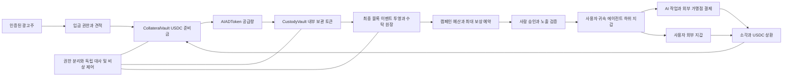

# AI AD Coin 블록체인과 광고 결제 기술 설계 v5

설계 ID `ai-ad-coin-architecture-v5` · 2026-11-06 · 상태는 구현 전 설계

> 상위 사업 범위는 2026-11-07 [플랫폼 정책 v6.1](AD_COIN_PLATFORM_POLICY.md)와 [실행 기획](AD_COIN_PLATFORM_ROADMAP.md)으로 확장했다. 본 문서의 자산·원장·담보 불변식은 그대로 적용한다. 추가한 [플랫폼 개발 설계](AD_COIN_PLATFORM_ARCHITECTURE.md)와 [데이터·API 계약](AD_COIN_PLATFORM_DATA_API.md)은 광고 전략·매체 제안·귀속·시장 분석의 개발 경계·논리 스키마를 구체화하며, 첫 P1 외 개별 OpenAPI·실행용 migration은 후속 구현에서 완성한다.

## 1 설계 범위와 기준안

정책의 근거는 [발행·유통·광고 정책](AD_COIN_POLICY.md)이다. 현재 소스는 [v4 구현 현황](../reports/AI-AD-Coin-implementation-v4-2026-11-06.md)이며, 이 문서에 정의한 계약·API·테이블이 이미 존재한다는 뜻이 아니다. 실제 자산의 발행·입금·출고·상환이나 배포는 수행하지 않는다.

구현 기준안은 EVM/ERC-20, 단일 체인, 공식 네이티브 USDC 담보, 6자리 소수점, 1 AI AD Coin당 1 USDC 상환이다. 초기 공급량은 0이다. 메인넷은 아직 확정하지 않는다. Ethereum L1과 지원 EVM 체인의 최종성·USDC 지원·수탁·비용·가용성·법적 적합성을 검증해 활성화 명세에 고정한다. 토큰 심볼도 미확정이며 코드에서는 자산 ID로 구분한다.

온체인은 발행·총공급·수탁 자산·외부 이전·소각·USDC 상환을 담당한다. 오프체인은 사용자·위임·광고·노출 증거·가맹점 주문·작업 결과·세부 소유권 원장을 담당한다. 순수 내부 결제는 매번 체인 거래를 만들지 않지만, 외부 출고 가능한 잔액은 실제 토큰 수탁으로 충당한다.

## 2 구성과 신뢰 경계

광고주·브라우저·에이전트·가맹점·RPC·웹훅·체인 이벤트는 각각 별도 입력 경계다. 어떤 하나가 인증되었다고 다른 행위까지 신뢰하지 않는다. 내부 관리자와 수탁 서명자도 서로 독립된 권한이다. 상대 시스템의 웹훅을 받았다는 사실은 결제 확정이나 작업 성공의 증거가 아니다.

## 3 온체인 구성

### 3.1 AIADToken

최소 ERC-20 전송·잔액·총공급 인터페이스를 제공하고 리베이스·전송세·보유 이자·프록시 업그레이드를 넣지 않는 참조안이다. 일반 이전은 표준 동작을 유지한다. 추가 동결 등 준법 기능이 법적으로 필요하다면 권한·남용 위험·거래소 호환성까지 포함해 별도 검토한 뒤 계약 배포 전에 확정한다.

발행은 고정된 CollateralVault 경로만 가능하고 임의 관리자 민터는 없다. 소각은 대응 상환 경로만 사용한다. 일반 보유자 임의 소각을 담보 지급으로 오인하지 않으며, 준비금이 남는 실수를 줄이기 위해 별도 무상 소각 인터페이스를 초기에는 제공하지 않는다. 배포 시 주소 결속을 원자적으로 완료하고 공개 initializer나 사후 민터 교체 통로를 남기지 않는다. 활성화 전 모든 주소·역할·초기 공급 0을 검증한다.

### 3.2 CollateralVault

공식 USDC 계약 주소를 불변으로 고정한다. `depositAndMint(amount, depositAuthorization)`는 승인 광고주·자산·체인·목적 수탁 주소·금액·만료·단회 nonce를 확인하고 USDC를 수취한다. 전후 실제 잔액 증가가 정확히 amount일 때 같은 최소 단위만 발행한다. 담보 수취와 발행은 같은 트랜잭션에서 원자적이어야 한다. 실패하면 둘 다 되돌아간다.

`redeem(amount, usdcRecipient, redemptionAuthorization)`는 토큰 소유권·상환 자격·수취인·금액·nonce를 검사하고, 해당 토큰 소각과 USDC 지급을 같은 트랜잭션에서 수행한다. USDC가 동결·정지되거나 지급에 실패하면 소각도 되돌린다. 운영비·가스비를 준비금에서 빼는 함수, 대출·재담보·승인 무제한 부여, 관리자 임의 USDC 인출은 초기 계약에 없다. 잘못 들어온 다른 자산의 구조 함수가 USDC나 AI AD Coin에 적용되지 않도록 제한한다.

허가된 발행 요청 서명자는 입금 자격을 승인할 수 있을 뿐 담보 없이 mint할 수 없다. USD 은행 입금은 외부 파트너가 실제 USDC로 전환해 이 경로로 납입한 경우에만 토큰화한다. 수표·입금 예정·알림만으로 발행하는 오프체인 임의 민팅 경로를 두지 않는다.

### 3.3 CustodyVault와 서명

내부 사용자·에이전트·캠페인·가맹점의 토큰을 보관한다. USDC 준비금과 별개 계약이다. 내부 원장 소유자는 토큰 수탁 주소를 공유할 수 있으나 권리·위임·감사를 분리한다.

출고·상환은 요청별 결속된 실행 승인과 독립 위험 검사를 모두 거친다. 참조안은 별도 환경·키의 ExecutionPolicySigner와 RiskSigner를 요구하고, 고액·새 수취인에는 사람의 재인증을 추가한다. 2개의 키가 같은 서버에 들어 있으면 독립 통제로 인정하지 않는다. 서명에는 계약·체인·작업 종류·수취인·자산·금액·기한·단회 nonce·불투명 요청 ID가 들어간다. 명세에 정한 일별 한도도 계약 수준에서 집행한다.

가스 릴레이어는 서명된 요청을 제출할 뿐 수취인·금액을 바꾸지 못한다. 거래 시간 초과나 대체 거래는 같은 논리 요청과 nonce로 추적한다. EIP-712 자체는 재전송 방지를 제공하지 않으므로 별도 nonce와 만료가 필수다. 계약 지갑의 서명은 ERC-1271로 검증한다. [EIP-712](https://eips.ethereum.org/EIPS/eip-712), [ERC-1271](https://eips.ethereum.org/EIPS/eip-1271)

### 3.4 관리자와 비상 제어

거버넌스 참조값은 분리된 보안 키의 3-of-5 다중 승인과 일반 관리 변경 48시간 지연이다. 비상 Guardian은 관련 기능을 중지할 수 있으나 준비금을 인출하거나 무담보 발행할 수 없다. 재개·한도 확대·서명자 교체는 다중 승인과 영향 검토를 거친다. 서명자·지연·한도는 활성화 명세에 확정하며 검토 전 실제 자산으로 적용하지 않는다.

발행·출고·상환·토큰 이전 중지를 분리한다. 담보만 이상이면 새 발행을 중지하되 정상 상환 가능성을 따로 평가한다. 키 침해·수탁 불일치이면 관련 외부 이동을 차단한다. 전면 이전 중지는 제한적 최후 수단으로 이유·범위·재개 근거를 공개한다. 관리 권한과 지연에도 남용·가용성 위험이 있음을 심사한다. [OpenZeppelin 권한·지연 설명](https://docs.openzeppelin.com/contracts/5.x/access-control)

일반적인 일괄 pause 확장이 이전·발행·소각을 모두 막을 수 있으므로 그대로 상속했다는 이유만으로 중지 분리가 완료됐다고 보지 않는다. 각 플래그에서 예치·발행·사용자 이전·수탁 출고·소각·상환이 어떻게 동작하는지를 행렬로 검수한다. 새 발행만 중지한 경우 정상 상환이 가능한지 별도 확인한다.

## 4 자산 식별과 회계 불변식

자산 키는 `(environment, chain_id, token_contract)`이며 decimals는 검증 후 고정하는 자산 속성이다. policy_version은 업무 객체에 따로 붙이며 정책 변경으로 같은 토큰을 새 자산처럼 중복 인식하지 않는다. 같은 이름·주소 문자열만으로 다른 체인의 자산을 합치지 않는다. 금액은 6자리 최소 단위 정수 문자열로 API에 보내고 내부 정수 범위를 검사한다. float·암묵적 환율·기존 원화 단위는 금지한다. 가스는 별도 자산·운영 계정으로 처리한다.

같은 확정 블록에서 다음을 검증한다.

- `R`: 준비금 Vault가 보유하고 실제 지급 가능한 공식 USDC 최소 단위.
- `S`: 공식 AIADToken의 `totalSupply`. 발행자·플랫폼·수탁·자기보관·거래소 보유분을 모두 포함한다.
- `C`: 등록된 수탁 주소가 보유한 AI AD Coin의 확정 잔액 합계.
- `B`: 내부 원장의 고객·광고주·제공자·운영자·플랫폼 권리 합계. 가용·광고 예약·작업 잠금·출고 잠금 등 모든 살아 있는 수탁 청구권을 한 번씩 포함한다.

**INV-01:** 정상 상태에서 `R >= S`. 별도 보강 준비금은 초과분이며 새 공급이 아니다. 동결로 실제 지급 가능성이 사라지면 원시 잔액이 커도 정상으로 표시하지 않는다.

**INV-02:** 동기화한 동일 확정 블록에서 `C >= B`. 고객 하위 계정은 `S`에 다시 더하지 않는다. 출고 대기분은 확정 전까지 B에 잠금으로 포함하고 가용액에서 뺀다. 확정 이벤트를 적용할 때 C 투영과 B 감소를 한 DB 트랜잭션으로 반영한다.

**INV-03:** 내부 광고 보상·지갑 이전·작업 결제는 B 내부 권리만 옮기며 R·S·C를 바꾸지 않는다. 소유자별 가용·잠금 잔액은 음수가 될 수 없고 분개 합계는 0이다.

**INV-04:** 담보 입금·발행은 `R,S,C,B`에 같은 순액을 더한다. 외부 토큰 출고는 `C,B`만 줄인다. 토큰 재입금은 `C,B`만 늘린다. 수탁 토큰 상환은 `R,S,C,B`를 같은 양 줄인다. 자기보관 토큰 상환은 `R,S`만 줄인다. 각 동작은 사건별 1회 반영한다.

**INV-05:** 이벤트 투영이 뒤처졌다면 서로 다른 시점의 C·B로 정상 대사를 주장하지 않는다. 새 가용 잔액 생성과 관련 출고를 잠시 중단하고 동일 체크포인트까지 재생한다. 실제 체인 담보가 없는 DB 수치로 대사를 맞추지 않는다.

**INV-06:** 광고주의 미집행 예산은 B에 이미 포함된 청구권이다. 발행 토큰에 더해 독립 환급 채무를 중복 만들지 않는다. 플랫폼 수익·환불·작업 지급을 같은 준비금에서 두 번 집행할 수 없다. 소각 후 비동기 미지급 채무를 만들 경로는 초기 범위에서 제외한다.

예시: 1,000 USDC 입금은 R=S=C=B=1,000이다. 100코인 광고비를 사용자 50·운영자 10·직접비 15·플랫폼 25로 배분해도 총량은 같다. 사용자가 제공자에게 20을 지급해도 총량은 같다. 제공자가 20을 수탁 상환하면 네 값은 980이다. 이후 사용자가 10을 외부 출고하면 R=S=980, C=B=970이다. 그 10을 외부에서 상환하면 R=S=970이고 C=B=970이다. 모든 수치는 설명용이며 실제 발행 기록이 아니다.

## 5 입금과 체인 이벤트 처리

체인별 활성화 프로필에는 chain ID·공식 USDC·토큰·Vault·최종성 기준·RPC 소스·최대 지연·중지 조건·입금 및 출고 한도를 필수로 둔다. 빈 값이면 실제 가치 모드를 거부한다. 메인넷을 확정하지 않은 상태에서 임의의 블록 수를 보편적 확정값으로 쓰지 않는다.

입금은 `authorized → submitted → observed → finalized → credited`다. 실패는 `reverted`, 잘못된 자산은 `unsupported`, 확정 전 체인 재구성은 `orphaned`다. `observed`에서는 사용 가능한 내부 잔액을 만들지 않는다. 발행 계약 이벤트와 실제 담보 증가·공급 증가·수탁 수취를 같은 트랜잭션에서 확인한 뒤 `credited`를 원자적으로 기록한다.

주문·소유권과 결속되지 않은 수탁 주소 직접 송금은 미지정 입금으로 격리한다. 준비금이나 플랫폼 매출로 자동 분류하거나 임의 고객에게 붙이지 않는다. 거래소 공용 송금 주소를 개인의 소유 증거로 가정하지 않으며, 지정 입금 경로·거래 근거·수취 권리 검증과 수동 구제 절차를 둔다.

이벤트 유일 키는 `(chain_id, block_hash, tx_hash, log_index, contract)`이고 논리 요청 nonce와도 연결한다. 반복 수신·중복 RPC·과거 재생은 금전 효과가 한 번이다. 확정 전 orphan 이벤트는 되돌려 읽을 수 있어야 한다. 서로 독립된 RPC의 체인·블록 해시·최종성 결과가 불일치하면 신규 크레딧·외부 이동을 정지한다.

이미 확정으로 처리한 블록의 번복·이상은 단순 자동 잔액 수정으로 덮지 않는다. 사고 모드에서 관련 작업을 중지하고 영향·원장·준비금을 대사한다. 블록체인 최종성도 모든 공격에 대한 절대 불변 보장은 아니다. [Ethereum 최종성 번복 설명](https://ethereum.org/developers/docs/consensus-mechanisms/pos/attack-and-defense)

## 6 광고와 사람 승인 및 보상

견적은 `campaign_id, creative_digest, selection_digest, policy_version, split_version, asset_id, base_reward, bonus_stages, maximum_reserved, active_ms, destination_owner, agent_ref, expires_at, nonce`를 결속한다. 설명은 일반 답변과 분리해 추가 활용의 근거·필요 코인·광고로 확보할 양을 제시한다. 소유자·토큰·개인 식별값을 공개 Chat 본문에 노출하지 않는다.

기본 흐름은 `offered → reserved → human_authorized → presenting → exposure_verified → base_awarded`다. 승인 전 거절·만료는 `declined/expired`로 최대 보상 잠금을 해제한다. `base_awarded`는 P1 노출만으로 완료되며 확인 답·클릭·구매는 필수 조건이 아니다. 추가 단계는 별도 `pending → verified → awarded/expired` 상태와 `(exposure_id, stage_id)` 유일 키를 갖는다.

서버는 사람의 인증 주체·fresh assertion·세션·Origin·CSRF·견적 해시·목적·단회 nonce·만료를 검증한다. 에이전트 키는 제안 조회·설명 자료 수신을 할 수 있지만 이 사람 승인 증명을 발행하지 못한다. 광고 승인과 지출 승인은 각각 별도 증명이다. 제한적 사전 승인도 사람이 만든 구체적 정책 객체를 통해서만 해석한다.

노출은 서버 시간의 시작·종료, 도전 nonce, 이벤트 순서·유효 구간·재생 중복·포그라운드·상호작용 등 복수 신호로 평가한다. `displayed_ms/foreground` 값을 보내는 것만으로 확정 지급하지 않는다. 패스키는 권한 검증에 도움을 주지만 시청·주의를 증명하지는 않는다. 고위험·외부 게시자는 검증 가능한 전달 경로·서명·기기 위험 평가·한도를 별도로 요구하고 근거가 부족하면 확정 전에 보류한다.

노출별 최대 보상을 사전 예약하고 단계별 분개를 append-only로 기록한다. 분개와 보상 상태·멱등 키·감사·이벤트 outbox를 같은 트랜잭션에서 저장한다. 확정 보상 후 광고주의 환불·부정적 의견 때문에 사용자 코인을 회수하지 않는다. 사기 손실과 유효 사용자 보상 보호는 운영 자본·분쟁 재원으로 처리한다.

가격·배분은 최소 단위로 계산한다. 총 광고 대가 Q와 사용자율 u_bps이면 사용자 몫은 `floor(Q × u_bps / 10000)`이다. 운영자·직접비 몫도 정수 내림하고 남는 최소 단위는 공개된 플랫폼 몫에 포함한다. 사용자 보상이 0이면 제안을 거부한다. S1이 작업 가격 T를 전액 후원하려면 `Q >= ceil(T × 10000 / u_bps)`이고 실제 사용자 몫이 T 이상인지 다시 검사한다. 기본 사용자율 50%에서는 Q가 최소 2T다. 기존 `/0.6` 원화 시험 최저가를 재사용하지 않는다.

S1도 기본은 사용자 지갑 코인 보상이며, 특정 작업 자동 실행은 별도의 사람 지출 승인 또는 유효 위임이 있을 때만 한다. 가격 예약이나 실행권은 사용자의 토큰 권리를 숨겨서 대체하지 않는다. 기본 노출·추가 단계별 대가와 배분은 승인 견적에서 고정한다.

## 7 지갑과 위임 및 출고

초기 에이전트 지갑은 사용자 소유 관리형 하위 계정이다. 사람 주체는 `human_session`, 에이전트는 `agent_key`, 가맹점은 `merchant_service`, 운영은 목적별 관리자 역할로 판별한다. 서비스 핸들러가 본문으로 actor를 정하지 않는다.

사람만 광고·마케팅 동의, 위임 신규·확대, 지갑 소유 결속, 고위험 재인증을 할 수 있다. 에이전트는 허용된 제안 조회와 위임 범위의 작업·이전만 한다. 위임은 소유자·키·목적·수취인·제공자·자산·체인·금액·누적 한도·시간·nonce·철회 버전을 갖는다. 한 요청의 인가와 누적 한도 소비·자금 잠금을 같은 트랜잭션으로 처리한다.

외부 출고는 `requested → authorized → funds_locked → submitted → observed → finalized → completed`다. 동일 요청 ID 재시도는 같은 상태를 반환한다. `submitted`에서 응답을 잃었으면 `unknown`으로 조회·대사하고 새 요청으로 재지급하지 않는다. 기한이 지났다는 이유만으로 원거래가 실패했다고 가정해 잠금을 풀지 않는다. 대체·취소 거래의 확정 또는 미제출 증거가 있어야 `failed_released`로 돌린다.

외부 주소는 서명으로 소유·지정 의도를 검증하고 오입금 위험을 안내한다. 계약 지갑도 지원하되 서명 시점·체인상의 현재 검증 결과를 확인한다. 자기보관 주소의 키는 사용자나 선택 수탁자가 관리하며 플랫폼의 14일 자동 회수 대상이 아니다.

## 8 외부 가맹점과 AI 작업 결제

가맹점은 계약·수취 지갑·고객확인·정산 자산·환불 재원·서명 키를 등록한다. `/payment-intents`로 주문·작업 정의 해시·토큰·금액·유효기간·정산 방식을 결속한다. 내부 사용자는 잔액을 잠그고 권한을 확인하며, 외부 지갑 사용자는 지정 계약의 의도와 결속된 결제 함수 또는 검증 가능한 입금 경로로 지급한다. 금액·주소만 같은 미지정 송금을 임의 주문에 붙이지 않는다.

결제 상태는 `created → authorized → funds_locked → paid → fulfilled/partially_fulfilled → settled`다. 외부 지급은 필요한 체인 최종성이 확인되어야 `paid`다. 내부 수탁 결제는 이미 확정 보관된 자산의 권리 이전이므로 DB 정합성 확인 뒤 paid로 진행할 수 있다. 작업 실행 성공과 금전 정산 성공은 다른 상태다.

현재 `run_results.py`는 재사용 후보지만 결제 시 고정된 워크플로 정의·버전·실행 권한·제공자·호출 횟수·execution ID를 실제 run에 결속하도록 보강한다. 임의의 같은 워크플로 성공 기록이나 클라이언트가 제출한 성공 비율만으로 지급하지 않는다. 분기·미실행·실패한 호출은 성공으로 세지 않는다.

작업 전 미사용 잠금은 원래 소유자에게 환불한다. 제공자 지급을 확정한 뒤의 분쟁 환불은 제공자 계약·가맹점 환불 재원 또는 플랫폼 운영 자본으로 충당하며 준비금 인출로 부족을 숨기지 않는다. 상환·환불은 원래 지급 자산과 근거를 연결하고 새로운 광고 보상으로 발행하지 않는다.

가맹점은 AI AD Coin 보유 또는 적격 USDC 상환을 선택한다. USDC 정산은 관련 토큰 소각·USDC 지급을 원자적으로 수행한다. 콜백은 event ID·버전·타임스탬프·서명·재전송 방지·중복 처리를 제공하고, 순서가 바뀌면 조회 API로 최종 상태를 확인한다.

## 9 API와 데이터 설계

신규 인터페이스는 `/api/ad-coin/v2/`로 분리한다. 기존 v1의 원화 시험 코인을 v2 자산으로 재해석하지 않는다. 아래는 **계획된 인터페이스**다.

- `GET /asset`, `/capabilities`: 환경·지원 체인·공식 주소·정책 버전·단위·상환 조건. 비밀·실시간 내부 진단 제외.
- `POST /funding-intents`: 광고주 전용 입금 승인·발행 견적. 클라이언트 입금 통보로 mint/credit 불가.
- `GET /funding-intents/{id}`: 소유 광고주 상태만 조회.
- `POST /offers`, `/human-consents`, `/exposure-sessions`, `/exposures/{id}/complete`: 제안·사람 승인·전달 증거·완료. 사람 승인 경로는 agent key 거부.
- `POST /mandates`, `/mandates/{id}/revoke`: 사람 전용 위임 변경. 에이전트는 자기 위임 범위 조회만 가능.
- `POST /transfers`, `/withdrawals`, `/redemptions`: 인증 주체별 권한·새 수취인·한도·자산별 증명을 검사.
- `POST /payment-intents`, `/payment-intents/{id}/authorize`, `/capture`, `/refunds`: 가맹점 요청과 사용자 지출·정산을 분리.
- `GET /operations/{id}`: 재시도·상태 불명 해소. 타인 객체 비공개.
- 내부 체인 이벤트·작업 결과 수신은 공개 사용자가 호출하는 완료 API와 분리한다.

모든 금전 쓰기는 `Idempotency-Key`와 정규화 본문 해시를 결속한다. 같은 키·같은 본문은 동일 결과, 같은 키·다른 본문은 409다. 권한 검사는 재시도에도 수행한다. API의 ‘요청 수락’은 체인 확정이 아니므로 operation 상태를 함께 반환한다. 숫자는 최소 단위 정수 문자열이며 bool·float·음수·오버플로를 거부한다.

스키마 후보는 `assets`, `policy_versions`, `funding_intents`, `chain_events`, `chain_checkpoints`, `custody_accounts`, `postings`, `operations`, `signing_requests`, `human_consents`, `exposure_sessions`, `reward_stages`, `mandates`, `payment_intents`, `execution_bindings`, `refund_cases`, `outbox`, `reconciliation_reports`다. 금액은 asset_id와 분리하지 않고 저장한다. 사건·nonce·멱등·주문·보상 단계·실행 기록에는 유일 제약을 둔다.

기존 SQL 허용 목록과 명시적 마이그레이션을 유지한다. 새 스키마는 기존 표·과거 원화 잔액을 덮어쓰지 않는다. v6.2 신규 개발은 로컬 시험·통합·운영 모두 PostgreSQL 전용이다. SQLite 저장소나 fallback을 추가하지 않는다. 기존 v1 역사 기록은 새 개발의 선택지가 아니다. 운영 DSN·키·주소를 설계 파일에 넣지 않는다.

## 10 일관성과 장애 처리

DB의 상태·분개·잠금·outbox를 한 트랜잭션으로 커밋하고, 체인 서명·방송은 그 뒤 수행한다. DB와 블록체인의 분산 원자 커밋을 가정하지 않는다. 서명 전 승인, 방송 후 거래 추적, 확정 이벤트의 단회 투영으로 상태를 조정한다. 애매한 결과는 `unknown/reconciling`으로 보존하며 사람이 재지급 버튼을 눌러 이중 지급하게 하지 않는다.

잔액 잠금 순서는 소유자 → 업무 객체 → 자산 계정의 정렬된 순서로 고정한다. 재시도는 범위를 정하고 트랜잭션 전체를 되돌린 뒤 수행한다. 이벤트/웹훅 전달은 적어도 한 번이며 유일 제약·멱등 투영으로 경제적 효과가 한 번이 되도록 한다. ‘네트워크 메시지가 정확히 한 번 전달된다’고 약속하지 않는다.

백업 복구 때 운영 체크포인트·체인 이벤트·외부 지급·서명 nonce와 대사할 때까지 새 지급을 막는다. 오래된 잔액·미사용 nonce·노출 완료를 되살리지 않는다. 읽기 전용 잔액과 복구 상태는 제공하되 민감한 내부 정보는 노출하지 않는다.

## 11 전환과 기능 격리

기존 v1은 `legacy_test_krw` 자산 프로필로 유지하고 정식 자산과 API·DB·UI를 구분한다. 자동 1:1 승계·원화 환율 고정·기존 영수증을 온체인 지급 증거로 사용하는 것은 금지한다. 필요하면 소유자·원본 잔액·전환율·새 자산·실제 담보·단회 claim을 담은 전환 명세를 따로 심사한다. 실제 준비금 없는 시험 잔액은 정식 발행량에 들어가지 않는다.

전환하지 않는다는 이유로 기존 서비스 이용 권리나 잔액 기록을 몰래 삭제하지 않는다. 기존 약정과 시험 자산 표시는 보존하고, 새로운 상환 가능한 자산의 권리와 구분해 설명한다.

환경은 `model`, `local_chain`, `testnet`, `mainnet`으로 구분하고 mainnet은 기본 금지다. 플래그 하나로 v1과 v2의 권리를 바꾸지 않는다. 배포·마이그레이션·기능 공개·실자산 활성화는 서로 다른 단계다. 테스트넷도 별도 명시적 작업으로 수행하며 이번 설계 작업에서 키나 거래를 생성하지 않는다.

## 12 성능과 품질 검수

내부 승인·원장 경로는 기존 읽기 p99 20ms, 금전 쓰기 50ms, 정산 200ms 목표를 기준으로 삼는다. 실제 실행·부정 검사·DB 대기·부하·거부율을 포함해 측정하며 보호 기능을 끈 결과를 쓰지 않는다. 원장 처리량 200건/초 관문·1,000건/초 도전 목표는 측정 전후 분개 차이로 검증한다.

체인 확정·은행 입금·가맹점 작업은 별도 완료 시간으로 보고한다. 내부 50ms를 온체인 상환 완료 약속으로 표시하지 않는다. 다지역 왕복 p95/p99·지갑 서명·LCP·실제 결제 완료율·장애 복구·표본 수와 오류를 함께 제시해야 글로벌 우위를 판단할 수 있다.

출시 검수에는 POL-01~24와 INV-01~06, 아래 구현 계획의 보안·경제·실행·복구 항목을 전부 포함한다. 기존 89개 시험과 219개 보안 시나리오는 v4의 증거이며 v5 계약·체인·상환을 검증하지 않았다. 이번 설계의 회계 모형 검증도 실제 스마트 계약 감사가 아니다.

## 13 확정해야 할 활성화 항목

메인넷·공식 USDC와 계약 주소·최종성 프로필·발행 및 수탁 주체·고객 관할·상환 자격·환불 책임·수수료·초기 위험 한도·서명자 구성·복구 승인·법적 동결 요구·감사기관·가맹점 계약을 실제 가치 활성화 전에 확정한다. 이 항목이 미정이어도 로컬 모형·계약 구현·격리 시험은 진행할 수 있다. 채워지지 않은 필드를 임의 기본값으로 실제 운영에 적용하지 않는다.

## 14 공식 기술 근거

[ERC-20 표준](https://eips.ethereum.org/EIPS/eip-20), [EIP-712](https://eips.ethereum.org/EIPS/eip-712), [ERC-1271](https://eips.ethereum.org/EIPS/eip-1271), [OpenZeppelin 접근 제어](https://docs.openzeppelin.com/contracts/5.x/access-control), [OWASP 스마트 계약 접근 제어](https://scs.owasp.org/SCSVS/controls/SCSVS-AUTH-1/), [Circle 지원 체인·자산](https://developers.circle.com/circle-mint/supported-chains-and-currencies), [USDC 담보 토큰의 상환 선례](https://help.circle.com/support/en/xreserve-faq?id=kb_article_view&sysparm_article=KB0010617)를 참조했다. 표준·사업자 문서의 존재가 본 설계의 보안·법적 적격성·제휴를 승인하는 것은 아니다.
