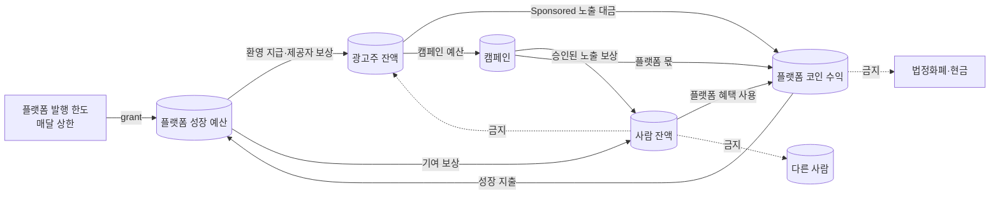

# AI AD Coin 코인 경제 설계안 (수익·지출은 코인으로만)

- **작성:** 2026-11-10, AI AD Coin 팀. 11-10 총괄 PM 승인. 7절 순서대로 구현 중이다.
- **바탕이 된 결정:** 11-10 사용자 결정(CLAUDE.md·헌장, 커밋 22418e7d)
  - 달러·원화 거래는 하지 않는다. 수익과 지출은 코인으로만 한다.
  - 코인으로 생긴 플랫폼 수익은 성장에 언제든 쓸 수 있다(승인 불필요).
  - 코인을 돈 받고 팔거나, 현금화하거나, 법정화폐와 교환하는 경로는 만들지 않는다. 지갑 USDC 송금은 이 결정에 들어가지 않는다.
- **지금 규칙과의 관계:** 무상 활동 포인트 모드(`docs/AD_COIN_POINTS_MODE.md`)를 그대로 쓰고 넓힌다. 화면에서 사람에게 보이는 이름은 "points"로 유지한다(코인이라는 말이 가상자산으로 오해되지 않게).

## 1. 원칙: 코인은 닫힌 고리 안에서만 돈다

- **허용:** 플랫폼과 사용자(사람·광고주) 사이에서만 코인이 오간다.
- **금지 1:** 사람에서 사람으로의 이동(이미 원장이 막는다).
- **금지 2:** 사람에서 광고주로의 이동. 사람이 모은 포인트를 광고주에게 넘기면, 바깥에서 현금으로 사고파는 시장이 생길 수 있기 때문이다.
- **금지 3:** 코인 판매, 현금화, 법정화폐 교환. 이 경로는 코드에 없고, 실가치 스위치도 꺼져 있다.

## 2. 수익: Sponsored 노출을 코인으로 결제

**광고주가 코인을 얻는 경로**(돈이 오가지 않는 것만):

| 경로 | 설명 | 상한(초안) |
|---|---|---|
| 환영 지급 | 광고주 계정을 열고 심사를 통과하면 한 번 지급 | 계정당 1회 |
| 제공자 보상 | 우리 카탈로그에 올라간 에이전트·MCP 제공자가 검증(헬스체크·평가)을 통과하면 매달 지급. 제공자가 곧 광고주가 되는 구조 | 제공자당 월 상한 |
| 활동 적립 | 광고주가 품질 개선 피드백을 반영하는 등 플랫폼에 기여하면 지급 | 건별 상한 |

**결제 방식**
- Sponsored 영역(`/api/ad-coin/v2/sponsored`)에 하루 노출을 예약한다. 일 단위 정액으로 시작하고, 나중에 노출 수 기반을 검토한다.
- 예약 대금은 광고주 잔액 → 플랫폼 코인 수익으로 옮긴다.
- 노출하지 못한 날은 돌려준다(같은 원장 기록을 되돌리는 환불).
- 기존 동의 노출(P1) 흐름도 그대로 쓴다. 캠페인 예산 가운데 플랫폼 몫이 수익이 된다.

## 3. 지출: 플랫폼 코인 수익을 성장에 사용

| 지출 | 받는 사람 | 기록 |
|---|---|---|
| 피드백·검증 기여 보상 | 에이전트 평가 피드백, 결함 신고를 한 사람 | 성장 예산 → 사람 잔액(`growth_reward`) |
| 신규 에이전트 등록 보상 | 새 에이전트를 등록해 검증을 통과한 제공자 | 성장 예산 → 광고주(제공자) 잔액 |
| 노출 지원 | 새 제공자에게 Sponsored 하루 노출을 무상으로 지원 | 성장 예산 → 플랫폼 수익(자기 거래로 기록) |

- 모든 지출은 원장에 기록하고 사유 코드를 붙인다. 같은 사유는 한 번만 지급한다(멱등 키).
- 지출은 성장 예산 잔액을 넘지 못한다. 원장이 음수 잔액을 막는다.
- 운영자 권한(`platform.operate`)이 있는 사람만 수동 지급을 할 수 있다. 자동 지급은 작업자가 규칙대로 한다.

## 4. 원장 설계 (기존 표로 충분, 새 표는 1개)

**계정**: 기존 용도(`purpose`)를 그대로 쓴다.

| 계정 | 용도(purpose) | 소유자 |
|---|---|---|
| 플랫폼 발행 | `external_clearing` | 플랫폼 |
| 플랫폼 성장 예산 | `platform_revenue` | 플랫폼(성장용 고정 id) |
| 플랫폼 코인 수익 | `platform_revenue` | 플랫폼(수익용 고정 id) |
| 광고주 잔액 | `advertiser_available` | 광고주 |
| 사람 잔액 | `user_available` | 사람 |

**새 원장 종류(kind):** `issuance`(발행), `grant`(지급), `sponsored_purchase`(노출 대금), `growth_reward`(성장 지출)

**원장 규칙 추가**
1. 사람 계정(`user_available`, `user_locked`)과 광고주 계정(`advertiser_available`)이 한 기록에 함께 있으면 거부한다.
2. `issuance`는 발행 계정 → 성장 예산만 허용한다. 달마다 상한을 두고, 넘으면 거부한다.

**새 표:** `adc2_sponsored_bookings`(광고주, 캠페인, 날짜, 분류·지역, 대금, 상태). 운영 DB 승인안(A1)에 더한다.

**발행 상한**
- 처음에는 매달 성장 예산으로 정해진 양만 발행한다.
- 코인 총량, 발행량, 수익, 지출은 운영 화면(`/ad-coin/admin`, 한국어)에서 매일 대사한다.
- **보유량 조회(11-10):** `GET /api/ad-coin/v2/admin/overview`의 `coins`(운영자 권한, 읽기 전용).
  - `platform_holdings_atoms`: 성장 예산과 코인 수익의 합
  - `issued_atoms`: 누적 발행량
  - 단위: 1코인 = 1,000,000 atoms
  - 화면: `/ad-coin/v2/admin`(한국어, 운영자 전용, 읽기 전용). 보유량, x402 시험 조건(남은 양·한도), 원장 대사를 버튼을 누르면 병렬로 불러온다. v1 `/ad-coin/admin`은 동결이라 v2 쪽에 따로 두었다.
  - x402 실제 결제 시험은 이 보유량이 10만 코인 이상일 때만 한다(사용자 결정 11-10). 쓰는 양은 보유량의 1/1000을 한도로 하고, 실제 USDC 지출은 따로 사용자 승인을 받는다.

## 5. 플랫폼 혜택 (지출 0 원칙)

사람의 포인트를 쓸 수 있는 곳은 **바깥 비용이 들지 않는 것**으로 한정한다.

| 혜택 | 내용 | 비용 |
|---|---|---|
| 워크스페이스 기능 | 저장 과업 수 늘리기, 기록 보존 기간 늘리기 등 기존 한도 완화 | 0(우리 서버 자원만) |
| 자체 에이전트 실행 | 플랫폼이 직접 운영하는 에이전트(외부 유료 API를 쓰지 않는 것)의 추가 실행 | 0. 에이전트별로 확인이 필요하다 |
| Sponsored 노출 | 광고주 잔액으로만 산다(사람은 아님) | 0 |

- 기존 혜택 목록의 "무료 실행 크레딧"은 **외부 유료 제공자 실행이 아니다.** 바깥 비용이 0인 자체 에이전트로 한정한다.
- 어떤 워크스페이스 한도를 풀지는 워크스페이스 담당과 정한다(공용 코드).

## 6. 하지 않는 것

- 코인 판매, 충전, 현금화, 법정화폐 교환, 거래소 상장, 체인 발행. 실가치 스위치는 계속 꺼 둔다.
- 사람 사이 이동, 사람에서 광고주로의 이동
- 광고를 추천처럼 보이게 하기. Chat 답변 본문에 광고나 가격을 넣기
- "투자", "수익 보장", "가치 상승" 같은 표현

## 7. 구현 순서 (PM 확인 뒤)

1. ~~원장 규칙 2개(사람↔광고주 이동 금지, 발행 상한)와 새 종류 4개, 그리고 시험~~ → **11-10 완료.** `points.py`, `ledger.py`, 스키마 10(`adc2_sponsored_bookings`), 시험 `tests/test_ad_coin_v2_coin_economy.py`. 상한은 코드 상수다: 발행 월 100,000코인, 제공자 보상 월 1,000코인
2. ~~성장 예산 계정, 환영 지급, 제공자 보상 작업(작업자), 운영자 수동 지급 API~~ → **11-10 완료.**
   - `economy.py`
     - 월 발행: 달마다 1회, 상한은 원장이 검사
     - 환영 지급: 100코인, 1회, 활성 광고주만
     - 제공자 보상: 달마다 1회, 1,000코인 상한
     - 운영자 수동 지급: `platform.operate`, 1회 최대 1,000코인. 대상은 사람·광고주 잔액만. 사유를 감사 로그에 남긴다.
   - 운영자 API `/api/ad-coin/v2/admin/coins/*`, `/admin/advertisers/{id}/welcome-grant|provider-reward`: 운영자 권한과 CSRF가 필요하다.
   - 시험: `tests/test_ad_coin_v2_economy_grants.py`
   - 제공자 보상을 카탈로그 검증 결과로 자동 지급하는 작업자는 v2 운영 연결 뒤에 만든다.
3. ~~Sponsored 하루 예약과 결제·환불~~ → **11-10 시험 모드 구현.**
   - PM 결정(11-10)
     - 가격: (분류, 지역) 하루 1칸 50코인, (분류, 지역)마다 하루 2칸
     - 예약한 캠페인만 노출한다.
     - 환불: 플랫폼 사정이면 전액, 하루 전 취소도 전액, 광고주가 스스로 멈추면 환불 없음
     - 첫 예약 지원: 광고주당 1번, 그달 지원 합계가 성장 예산의 10% 안일 때 성장 예산으로 낸다.
   - `sponsored_booking.py`: 예약, 취소, 운영자 반환, 정산
     - 작업자 데몬이 하루가 끝나고 10분 뒤에 정산한다.
     - 반려·정지된 캠페인과 정지된 광고주의 예약은 환불한다.
     - 지원받은 예약을 환불하면 코인은 성장 예산으로 돌아간다.
   - `sponsored_booking_http.py`: 예약·취소는 캠페인 활성화와 같은 권한에 CSRF와 Idempotency-Key가 필요하다. 운영자 반환은 `platform.operate` 권한이 필요하다.
   - `sponsored.py` 스냅샷은 그날 예약된 캠페인만 담는다.
   - 새 DB 구조 변경은 없다. 표는 스키마 10에 이미 있고, SQL은 등록 목록에 557개로 더했다.
   - 시험: `tests/test_ad_coin_v2_sponsored_booking.py` 8개, `test_ad_coin_v2_sponsored.py`
   - 공개는 광고주 약관 조항(`reports/AI-AD-Coin-Sponsored-광고주약관-조항초안-2026-11-10.md`)의 사용자 승인과 v2 재가동 뒤에 한다.
4. 운영 화면(`/ad-coin/admin`)의 발행·수익·지출 대사
5. 혜택 목록 확정(워크스페이스 담당과 협의)과 사용 연결
