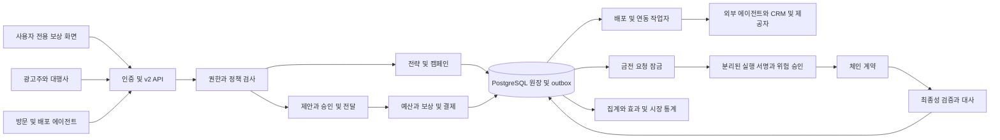

# AI AD Coin 플랫폼 개발 설계 v6.2

> 최신 조사에 따른 [v6.2 보강 설계](AD_COIN_PLATFORM_DESIGN_UPGRADE.md)의 DEC-08~13·DES-01~10을 함께 적용한다. 최상위 사업 정책은 v6.1을 유지하며 이전 기계 계약은 역사본으로 보존한다.

설계 ID `ai-ad-coin-platform-design-v6.2` · 2026-11-07 · 구현 전 개발 기준안

2026-11-08 [상세 설계서](AD_COIN_V6_2_DETAILED_DESIGN.md)를 추가했다. 기존 정책/계약은 유지하고 인가·DB 제약·원자 경계·29개 handler·worker·복구·화면을 개발 절차로 구체화한다.
## 1 범위와 기준 문서

최상위 요구는 [최종 정책 PLAT-01~38](AD_COIN_PLATFORM_POLICY.md)이다. 자산·준비금·상환은 [정책 POL-01~24](AD_COIN_POLICY.md)와 [블록체인 설계 INV-01~06](AD_COIN_ARCHITECTURE.md)을 유지한다. 이 문서는 광고주 플랫폼을 개발할 서비스 경계·권한·업무 흐름·상태·운영을 구체화한다. [데이터·API 설계](AD_COIN_PLATFORM_DATA_API.md), [개발 작업·검수](AD_COIN_PLATFORM_IMPLEMENTATION_PLAN.md), [기계 판독 명세](ad_coin_platform_v6_2_spec.json), [첫 개발 범위 OpenAPI](ad_coin_platform_p1_v6_2.openapi.json)를 함께 적용한다.

완료 범위는 개발 설계와 정합성 검증이다. 제품 코드·서버·운영 DB·플래그·릴리스·실제 재원·키·체인 거래는 변경하지 않는다. 기획의 ‘모든 에이전트’는 참여 확대 목표이며 초기 버전에서 모든 외부 프로토콜을 지원한다는 뜻이 아니다.

## 2 주요 설계 결정

**DEC-01 · 모듈 단위 구현.** 기존 FastAPI와 PostgreSQL을 활용하는 모듈형 구조로 시작한다. 권한·캠페인·광고 전달·보상·결제는 같은 DB의 명시적 트랜잭션으로 조정한다. 초기부터 모든 업무를 마이크로서비스나 별도 메시지 브로커로 나누지 않는다. 서명·위험 승인·체인 추적은 독립 실행 경계이며 분석·소재 처리·외부 연동은 작업자로 실행한다.

**DEC-02 · v2 별도 자산 경계.** 새 HTTP 경로는 `/api/ad-coin/v2`, 새 업무 표는 `adc2_` 접두사를 쓴다. 기존 `ad_coin_*`의 원화 금액·시험 영수증·방문 토큰을 새 자산으로 재해석하지 않는다. 배포는 후속 명시적 마이그레이션이며 이번 설계에 포함하지 않는다.

**DEC-03 · 최초 사람 광고 매체 제한.** 첫 P1은 플랫폼이 직접 렌더링하는 전용 보상 화면만 지원한다. 외부 에이전트는 제안 요약과 사용자 소유 세션으로 결속된 진입 경로를 전달한다. 외부 매체가 자체 보고한 시청 시간으로 사람 보상을 확정하는 경로는 첫 버전에 없다. 외부 렌더러는 별도의 적합성·표시·증거·사기 검증을 통과한 뒤 추가한다.

**DEC-04 · 권한의 기준은 서버 주체.** 인증된 주체 종류·권리자·조직·에이전트·scope·철회 버전을 서버가 만든다. 요청의 `actor`, `owner_id`, `agent_ref`로 권한을 결정하지 않는다. 사람 세션과 기계 자격이 동시에 제출되어 주체가 모호하면 거부한다. 운영 관리자는 사용자로 가장해 동의하거나 보상을 만드는 우회 권한이 없다.

**DEC-05 · 모델과 자금 실행 분리.** 모델 출력은 소재 초안·계획·최적화 권고다. 심사·한도·집행·송금 결정은 타입이 고정된 명령과 결정적 정책 검사로 수행한다. 광고 문구를 시스템 지시로 실행하지 않으며 모델에 원장 쓰기·수탁 서명 키를 제공하지 않는다.

**DEC-06 · 상태와 외부 효과의 분리.** DB 상태·분개·예산·멱등 기록·outbox를 원자적으로 반영한다. 체인·HTTP 전송은 커밋 뒤 수행하고 결과를 별도 inbox로 받아 중복 제거한다. 네트워크 전달은 반복될 수 있으나 동일 경제 사건은 한 번만 반영한다.

**DEC-07 · 자산 설계와 활성화 분리.** 로컬·가상 시험은 진행할 수 있다. 메인넷, 지원 관할, 허용 발행·수탁 주체, 담보 자격·상환·감사·한도·공식 주소가 확정되지 않으면 실제 가치 모드를 시작하지 않는다. 기술적 USDC 담보가 법적 적격성의 대체물이 아니다.

## 3 구성과 책임

기능 모듈은 다음과 같다. 이름은 새로 만들 후보이며 현재 구현된 패키지 이름이 아니다.

- **M01 identity:** 사람 세션, 조직·광고주 역할, 에이전트 등록·키, 서비스 자격, 목적별 scope, fresh action·step-up, 철회. 요청마다 객체 소유권을 검사한다.
- **M02 commercial:** 광고주·대행사, 브랜드·매체 판매 권한, 전략·상품 정보 팩·소재 심사·캠페인 버전, 예약·제안 비교, 예산 계약. 일반 검색에 쓰기 권한이 없다.
- **M03 delivery:** 매체·프로토콜 기능, 선택한 맥락, 제안·승인·노출 세션·중계 경로·브랜드 대화. 승인 전에는 비광고성 동의 요약만 제공하고 소재 URL을 노출하지 않는다.
- **M04 economy:** 자산·복식 원장·예산·단계별 보상·명세·내부 지갑. 원장 쓰기는 지정 명령으로만 가능하고 보고서는 원장을 수정하지 않는다.
- **M05 fulfillment:** 위임·payment intent·작업 정의 결속·실제 실행·부분 정산·환불·분쟁·가맹점. 결제 완료와 서비스 성공을 분리한다.
- **M06 treasury:** v5 계약 어댑터, funding intent, 체인 이벤트·출고·상환·동일 체크포인트 대사. 웹훅만으로 잔액을 생성하지 않는다.
- **M07 measurement:** 사실 사건·무효 판정·전환·귀속·실험·코호트. 보상 자격과 광고주의 장기 성과를 별도 투영한다.
- **M08 intelligence:** 권한·집계 기준을 통과한 시장 통계·보고 API. 개인 원문·지갑·경쟁사의 미공개 입찰을 반환하지 않는다.
- **M09 operations:** 심사·분쟁·지원·사고·감사·활성화 프로필·동작별 중지. 재개는 필요한 승인과 대사를 거친다.

배포 어댑터는 M03, CRM·측정 어댑터는 M07, AI 실행 어댑터는 M05, 체인 어댑터는 M06이 소유한다. 인증·전송 라이브러리는 공용으로 쓸 수 있지만 어댑터의 인증 성공이 다른 업무 권한을 만들지 않는다.

## 4 권한 모델

사람은 `human_session`, 사용자 측 에이전트는 `agent_key`, 광고 구매 자동화는 `buyer_service`, 배포자는 `publisher_service`, 가맹점은 `merchant_service`, 측정은 `measurement_service`, 운영은 목적별 `ops_service`로 구분한다. API 명세의 security scheme는 인증 수단이며 최종 허용은 객체·역할·scope·위임·활성화 상태를 함께 검사한다.

사람만 수신 참여·맥락 공유·건별 노출 동의·지갑 소유 결속·위임 신규/확대·고위험 재인증을 수행한다. 사람 로그인은 사용자 존재의 증거일 뿐 실제 시청을 증명하지 않는다. 새 동의는 서버 challenge와 사용자 세션·행동·객체·견적 버전·기한을 결속한다. 새 수취인·고액 등 위험 행위는 별도 fresh authentication을 요구한다. agent key는 어떤 challenge 응답을 제출해도 사람으로 승격되지 않는다.

광고주 조직 역할은 viewer·planner·campaign_editor·budget_approver·finance·owner로 분리한다. 대행사 위임은 각 광고주 객체별로 고정하며 agency owner라도 모든 고객의 돈을 쓸 수 없다. 초기 캠페인의 편집과 집행 승인은 다른 capability이며 고위험 변경은 분리된 승인자를 요구한다. 예산 증액·새 지역·새 공유 목적은 기존 승인으로 덮지 않는다.

관리자 심사·사기 검토·고객 지원·대사·금전 서명 권한은 분리한다. 지원 담당자는 일반 지갑 이전이나 임의 mint를 할 수 없다. 서비스 자격은 audience·scope·기한·키 회전·폐기 상태를 검사하고 장기 공용 관리자 토큰을 외부 파트너에 제공하지 않는다.

## 5 광고주 계획부터 집행까지

전략은 `draft → proposed → approved`다. 승인은 목표·기간·분모·단가 상한·일/총 예산·매체·지역·소재·성과 정의·위임 범위를 고정한 immutable plan revision을 대상으로 한다. 승인 이후 변경은 새 revision이다. 예측 값은 추정이며 집행 가능한 예산이 아니다.

캠페인은 `draft → in_review → eligible → active → paused/completed/archived`다. `rejected/suspended`에서는 새 제안을 만들 수 없다. active 전에는 소재·매체 권한·상품 팩·지역·계약·실재원·전체 최대 보상·집행 승인을 모두 확인한다. 전환 과금이어도 P1 약정이 있으면 그 재원을 별도 확보한다. 정지 시 새 노출은 막고 이미 노출을 시작한 계약·확정 보상은 약정과 사고 상태에 따라 처리한다.

M02는 일반 검색 결과의 읽기 전용 snapshot과 해시를 참조할 수 있다. 일반 검색은 광고 입찰·잔액·광고주 등급을 읽어 순위를 정하지 않는다. 광고 슬롯은 관련성·적격성 관문 뒤 자체 배분 규칙으로 거래하고 추천 결과와 분리해서 표시한다.

## 6 최초 개발할 P1 흐름

1. 광고주가 캠페인 revision·P1 단계·전체 최대 대가·배분·노출 기준·적격 매체를 승인한다. 테스트 재원과 실제 재원은 서로 다른 환경·자산이다.
2. 사용자가 수신 참여와 필요한 맥락 공유를 별도로 허용한 범위에서 에이전트가 제안을 요청한다. 서버는 사용자와 에이전트 결속·거절·빈도·지역·관련성을 검사한다.
3. 제안 발급 트랜잭션에서 전체 단계의 최대 대가를 캠페인 가용 예산에서 offer hold로 옮기고 총액·일 상한·동시 제안 수를 검사한다. 한도가 부족하면 보상량을 몰래 줄이지 않고 no_offer를 반환한다.
4. 승인 전 요약은 광고주 식별, 정확한 보상·시간·보관 지갑·활용 가능한 AI 작업·만료·거절 조건만 담는다. 소재 본문·추적 픽셀·외부 자동 요청은 포함하지 않는다. 전달 링크는 잔액 사용 권한이 아니며 로그인한 해당 권리자만 열 수 있다.
5. 플랫폼 화면에서 사람이 고정된 제안에 건별 승인한다. 세션·CSRF·Origin·일회 challenge·위임자·보상 snapshot을 검사하고 그 동의에 묶인 노출 세션을 연다.
6. 승인 뒤 짧은 기한의 인증된 소재 조회를 제공한다. 세션·nonce·순번·서버 시간 구간·포그라운드/가시성 신호를 수집하고 제한된 전용 검증기가 판단한다. 클라이언트 시각·`displayed_ms` 하나로 완료하지 않는다. 이 신호들도 실제 사람의 집중을 완전히 증명하지 못한다.
7. 완료 요청은 원시 증거를 제출하는 API다. 동기 검증 또는 검증 작업자가 `accepted/rejected/review_pending`을 만들며 외부 사용자가 판정을 직접 쓸 수 없다. review_pending은 재원을 유지하고 견적에 고정한 검토 기한·이의 제기 경로를 제공한다.
8. accepted의 P1 사건에 대해 같은 DB 트랜잭션에서 단계 유일 키·동의 사용·예산 소비·정수 배분·사용자 소유 지갑 크레딧·서명할 영수증 outbox를 기록한다. 답변·클릭·구매를 요구하지 않는다. 동시 재시도도 한 번만 지급한다.
9. 사용자는 별도 지출 허락이나 유효 위임으로 AI 작업을 구매하거나 이전·상환을 요청한다. 광고 수락은 이 후속 행동의 승인이 아니다. 클릭·완료·구매 보상은 각각 별도 단계와 기한을 가진다.

제안은 `reserved → consented → exposing → evidence_pending → awarded`다. 노출 전 종료는 `declined/expired/cancelled`; 검증 실패는 `rejected`; 의심은 `review_pending`이다. 단계를 이미 확정한 뒤에는 later event의 실패나 광고주 불만으로 해당 단계 보상을 되돌리지 않는다.

제안 만료는 **새 승인 가능 기한**이다. 이미 시작한 세션에는 별도 `evidence_deadline`과 약정한 수집 지연 범위를 적용한다. 만료 정리 작업이 검증 중·검토 중 사건의 담보를 해제하지 못한다. 캠페인 중지·동의 철회와 완료가 경쟁하면 같은 offer/consent version을 잠가 최초 확정된 허용 상태에 따라 처리한다. 아직 미달인 노출은 중단할 수 있지만 이미 충족·확정된 권리를 몰수하지 않는다.

## 7 추가 광고 상품과 중계

단계별 상품은 P1 노출, click, playback_interval, playback_complete, neutral_feedback, trial, qualified_signup, subscription, purchase로 식별하고 `prerequisites`, `incremental_reward`, `max_occurrences`, `qualification_deadline`, `review_deadline`를 고정한다. 합산 보상과 최종 총액을 혼동하지 않게 API가 단계 합계를 제공한다. B1은 operator receipt이며 human impression 계열에 합치지 않는다.

전달 envelope는 원본 offer ID·hash·발급자·audience·재전달 허용·만료·소재/계약 revision·후원 표시·보상·중계 대가를 포함한다. 원본 서명과 중계 endorsement를 분리한다. 수신자는 각 홉의 판매·재전달 권한과 누적 hop 상한을 검사한다. 루프·자기 중계·다른 사용자로의 재결속을 거부한다. 운영 대가는 승인된 operator pool 안에서 배분하며 홉 추가가 대가 총액을 늘리지 않는다. 서명은 계약 보존의 증거이며 사람 노출·내용 진실의 증명은 아니다.

브랜드 대화는 사용자가 별도 선택한 후 `created → active → ended/blocked/expired`로 운영한다. 공유할 질문·필드·동의와 별도 비용 상한을 결속하고 원래 대화 전체를 복사하지 않는다. 대화 모델은 심사된 상품 팩만 사실 근거로 쓰고 상담량이 과금·성과 사건을 자동 생성하지 않는다. 구매·구독은 다른 API와 별도 권한을 따른다.

## 8 측정·시장 정보·최적화

사실 사건은 광고 전달→사람 승인→유효 노출→클릭→검증 전환→AI 실제 완료를 다른 type으로 기록한다. CRM 어댑터는 tenant·연동 자격·원본 주문 사건·서명/전송 증거·시점·환불을 보존하고 같은 주문을 여러 callback ID로 보내도 중복 제거한다. 외부 서명은 송신자 확인이지 사실의 진위 판정이 아니다.

귀속은 수정 가능한 별도 투영이다. 사건 원본은 불변으로 두고 attribution rule version·관찰 기간·보상 여부·실험 배정을 고정한다. 지연·환불은 adjustment 사건으로 반영한다. 귀속 변경은 이미 확정한 기본 보상을 되돌리는 원장 명령이 아니다. 광고주·독립 측정과 일치하지 않는 수치는 dispute 상태와 출처를 표시한다.

대조 실험은 배정 단위와 결과 분모·중단 조건을 집행 전에 등록한다. 대조군에는 사전에 약속한 광고 보상을 박탈하지 않으며, 아직 제안을 받지 않은 적격 집단 또는 별도로 동의한 설계를 사용한다. 보상형·비보상형 성과를 구분한다. 작은 표본으로 수익 보장을 만들지 않는다.

최적화는 `suggested → checked → approved → applied`다. 새 계획은 revision·예산·지역·소재·대가 범위를 검사하며 자동 적용도 유효한 mandate를 소비한다. 모델 배포 후 역할·언어·더 저렴한 대안·후원 유무 비교 검수를 통과해야 한다. 안전 중지·철회는 계획 적용 직전에 다시 확인한다.

시장 정보는 승인된 집계 뷰만 읽는다. 최초 공개 기본안은 **서로 다른 적격 사용자 50명, 광고주 5곳 이상**의 셀만 공개하며 이는 개인정보 안전 인증이 아닌 보수적 설계 선택값이다. 기준 미달·민감 분야·지배적 단일 주체·차분 질의는 억제한다. 질의 정규화·반복 예산·캐시·상위 집계 병합을 적용하고 정확한 원시 집계와 외부 공개 수치를 분리한다. 차등 개인정보 보호를 채택한다면 별도 epsilon·기여 상한·누적 질의 설계가 필요하며 단순 k 기준을 DP라고 부르지 않는다.

## 9 운영·보안·성능

브라우저는 전용 보상·광고주 화면에서 CSP·출력 escaping·입력 마스킹·접근성·영어 공개 문구를 유지한다. 소재 업로드는 크기·형식·악성 파일 검사를 거치며 광고 HTML을 같은 origin에서 실행하지 않는다. 외부 URL·CRM·에이전트 콜백은 등록된 목적지·HTTPS·DNS/IP 재검증·redirect 제한으로 SSRF를 막고 자격 헤더를 다른 호스트로 전달하지 않는다.

민감한 증거와 개인 맥락은 별도 암호화 저장·목적별 접근·삭제 일정으로 관리한다. 원장에는 필요한 업무 참조와 보존 근거만 남긴다. 해시도 개인과 연결되면 개인정보로 관리한다. 분개·계약·동의·집행 감사의 보존과 원문 삭제를 분리하며 법적 보존은 관할별 활성화 명세로 확정한다.

작업자는 outbox lease·중복 키·재시도 상한·dead letter·수동 복구 권한을 갖는다. 동일 webhook의 늦은 응답을 위해 이전 키를 제한된 검증 기한 동안 보존하되 폐기된 실행 권한은 되살리지 않는다. HTTP Message Signatures 등 외부 인증 규격은 어댑터별 버전을 고정하고 nonce·created/expires·method·대상·본문 digest를 검증한다. 서명 replay 방지는 업무 사건 멱등과 별개다.

중지 플래그는 new_campaign, new_offer, new_exposure, reward_verification, internal_spend, external_withdrawal, mint, redeem, statistics_publish로 분리한다. 사고가 사용자 확정 보상·채무를 없애지 않는다. 복구 시 체인 체크포인트·원장·미확정 지급·nonce·outbox를 대사한 뒤 관련 자금 쓰기를 재개한다. 보안 감사·원장·최신 철회 상태가 불확실하면 금전 쓰기는 닫는다.

내부 읽기 p99 20ms, 금전 쓰기 50ms, 정산 200ms는 v5 목표를 유지한다. 추가 외부 심사·체인·CRM·모델 대기는 완료 시간에서 분리해 표시하되 사용자 체감 전체 시간도 함께 측정한다. 노출 세션의 heartbeat는 원장 쓰기와 분리하고 한도·TTL·표본 수를 제한한다. 중요한 원장 커밋은 비동기 배치로 지연시키지 않는다. 초기에는 한 쓰기 영역을 사용하며 전역 다중 쓰기를 도입하기 전 중복 지출·한도·철회 일관성을 별도 설계한다. ‘세계 최고’는 독립 비교와 다지역 실측 전 달성으로 표현하지 않는다.

## 10 현재 코드와의 연결

읽기 기준 2026-11-07. `api.py`의 `person()`은 agent key와 사람을 같은 경로로 반환하고 `/spends`는 본문 mandate 존재로 actor를 정한다. `transfers`는 step_up=False를 전달한다. 첫 작업은 이 경계를 수정하는 것이며 새 설계가 이미 적용된 것처럼 표기하지 않는다.

`ledger.py`의 복식 분개·조건부 잔액·savepoint 패턴, `advertisers.py`의 조직·심사·명세, `db.py`의 PG 풀·스키마 이전, `sql_registry.py`의 SQL 허용 목록은 재사용 후보다. 원화 계산, 계정 문자열 접두사로 권리를 판단하는 방식, 범용 admin 우회, 클라이언트 노출 값은 그대로 v2에 복사하지 않는다. `run_results.py`는 실제 실행 결속을 강화한 뒤 활용한다.

추천 연결은 `upgrade.py`와 카탈로그의 읽기 전용 adapter로 두고 `front.py`의 라우터 등록만 공용 진입점으로 사용한다. 공개 Chat의 가격·지갑·토큰 숨김과 HTML 동기화 경계는 기존 정책을 따른다. 본 설계로 공개 화면이 자동 개정되지 않는다.

## 11 개발 기준과 미정 항목

확정한 개발 선택은 모듈형 FastAPI·PostgreSQL, v2·adc2 격리, 플랫폼 렌더러 우선 P1, 원장 정수, 불변 계약 revision, outbox/inbox, 사람·에이전트 주체 분리다. TTL·질의 집단 기준·자동화 상한은 명세의 reference profile 값이며 실제 위험·법률·성능 검증 후 버전 고정한다.

실가치 활성화 전 미정은 체인·공식 주소·발행/수탁 주체·관할·담보 법적 적격성·고객확인·고액 한도·수수료·외부 매체 계약·심사 책임·보존·독립 감사다. 빈 항목을 임의 기본값으로 채워 mainnet을 시작하지 않는다. 로컬 구현의 막힘으로 취급하지 않고 활성화 체크리스트의 차단 항목으로 관리한다.

기술 근거: [OpenAPI 3.1.1](https://spec.openapis.org/oas/v3.1.1.html)을 계약 작성 버전으로 선택했다. 최신 버전이라는 주장은 아니다. [PostgreSQL 행 보안](https://www.postgresql.org/docs/current/ddl-rowsecurity.html)은 보조 격리이며 owner/BYPASSRLS 권한과 서비스의 명시적 인가를 함께 검토한다. [RFC 9421](https://www.rfc-editor.org/rfc/rfc9421.html)은 서명 프레임워크이며 파트너별 인증 프로필과 별도 nonce·업무 중복 제거가 필요하다.
