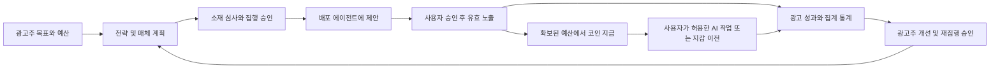

# AI AD Coin 광고주 플랫폼 실행 기획 v6.1

2026-11-07 재검토 · 기준 정책: [글로벌 에이전트 광고 플랫폼 정책 v6.1](AD_COIN_PLATFORM_POLICY.md)

> 개발 설계는 [플랫폼 아키텍처](AD_COIN_PLATFORM_ARCHITECTURE.md), [데이터·API](AD_COIN_PLATFORM_DATA_API.md), [작업 WP-01~12와 인수 기준](AD_COIN_PLATFORM_IMPLEMENTATION_PLAN.md)을 따른다. 첫 P1 모형 계약과 후속 실가치·열린 광고 시장의 출시 단위를 분리했다. 이 사업 기획의 GROW 검수는 그대로 유지한다.

> 최신 조사로 개발 설계를 v6.2로 보강했다. [DEC-08~13·DES-01~10](AD_COIN_PLATFORM_DESIGN_UPGRADE.md)의 프로토콜 고정·근거 검증·전역 한도·비용·보고·철회/작업자·영수증 계약을 추가하며 사업 정책 v6.1은 유지한다.

## 1 범위와 완료 기준

이번 개정의 산출물은 정책과 사업 실행 기획이다. 아래 상품·지표·자동화·검수는 **개발할 요구사항**이며 출시 완료 목록이 아니다. 자산 기반은 [정책 v5](AD_COIN_POLICY.md)·[기술 설계](AD_COIN_ARCHITECTURE.md)·[기존 43개 검수 계획](AD_COIN_V5_IMPLEMENTATION_PLAN.md)을 따른다. 기존 89개 시험·219개 HTTP 시나리오는 v6의 광고주 효과·귀속·통계·자동 집행을 검증하지 않는다.

이번 정책 개정의 완료 기준은 광고주 전체 업무 흐름, 코인·사용자 효용과의 연결, 수익 구조, 지표 정의, 기존 기능의 개정 범위, 단계별 검수와 보안 차단 조건을 문서로 연결하는 것이다. 실제 가치 출시는 이 기획과 별개로 제품·법적·운영 검증을 모두 통과해야 한다.

## 2 광고주 여정과 플랫폼 구성

광고주 업무는 ‘목표·상품 등록 → 전략·예산 계획 → 에이전트 매체 제안 비교 → 소재 승인 → 재원 확보·집행 승인 → 배포·사용자 승인 → 유효 사건과 보상 → AI 서비스 이용 → 성과·손익 분석 → 다음 집행 승인’으로 연결한다.

필요한 제품 묶음은 다음과 같다. 명칭은 기획상의 구분이며 상표·현재 화면 메뉴가 아니다.

- **광고주 업무 공간:** 사업·브랜드·대행사 권한, 전략 제안, 상품·소재 관리, 예산·계약·청구·이의 제기.
- **에이전트 광고 시장:** 매체 검색, 검증·기능·광고 지면, 제안 요청과 비교, 예약·거래·배포, 파트너 수익.
- **사용자 보상과 AI 사용:** 건별 승인, P1 보상과 추가 단계, 사용자 소유 지갑, 위임된 작업 결제·이전·상환.
- **성과와 시장 분석:** 사건 검증, 귀속·실험, 전환 품질, AI 작업 효용, 분야별 집계, 광고주 개선·재집행 보고.
- **신뢰·정산 기반:** 광고 심사, 사기·분쟁, 원장·담보 대사, 권한·보안·감사, API·SDK·지원 지역 관리.

v6.1의 우선 사업 개선은 세 가지다. 광고주가 보유한 CRM·주문 자료를 연결해 실제 적격 성과를 확인하고, 사용자가 선택하는 브랜드 상담·체험 상품을 추가하며, 집계 시장 정보를 외부 에이전트도 활용하도록 한다. 각각 PLAT-34·33·36을 충족한 출시 범위만 판매한다. 정밀 설계 전 단계에서는 채널·보상·측정 계약과 이용자 권리를 먼저 확정한다.

전략·제작·구매·배포·진단 에이전트는 각 역할의 권한 안에서 협업한다. 소재·상품 설명을 읽는 작업과 광고비를 집행하는 권한을 분리하고, 외부 광고 문구가 실행 지시나 권한 확대가 되지 않게 한다.

## 3 기존 정책과 기능을 바꿀 범위

- **단순 후원에서 광고주 전체 업무로:** 기존 `advertisers.py`·`advertiser_page.py`의 캠페인·소재·예산·심사·명세를 기반으로 전략 목표, 매체 계획, 소재 실험, 대행사 권한, 성과·재집행 업무를 확장한다. 새 메뉴가 이미 구현됐다고 표기하지 않는다.
- **마케팅 허락만 저장하던 단계에서 실제 배포로:** 목적별 수신 참여, 검증된 전달 경로, 철회·빈도·지역 제한, 사람의 건별 노출 승인, 전달 증거를 먼저 구현한다. 작업 알림 동의를 이전하지 않으며 현재의 배포 비활성 상태는 관문 통과 후 별도 활성화한다.
- **P2 중심에서 P1 필수 상품으로:** `service.py`·`api.py`·`people.py`의 사람 권한 경계를 고친 뒤 답변 없는 노출 보상을 추가한다. 기존 P2·S1·B1은 다른 보상 사건으로 유지하고 전환·추가 보상은 별도 검증을 붙인다.
- **내부 시험 지갑에서 외부 사용 가능한 재원으로:** `ledger.py`·`config.py`·영수증·정산을 v5 자산 ID·정수·준비금·수탁·상환 설계로 확장한다. 기존 원화 시험 잔액은 실자산으로 자동 전환하지 않는다.
- **시험 경매에서 매체 상품별 거래로:** `exchange.py`의 원화·작업 후원 중심 규칙과 별개로 광고 지면·과금 사건·입찰/예약·최대 보상·정산 기준을 정의한다. 거래 변경이 일반 검색 순위를 바꾸지 않게 회귀 검증한다.
- **집계 보고에서 효과·통계 상품으로:** 기존 보고 기능에 사건 정의·중복 제거·귀속 버전·환불·무효 트래픽·통계 범위·공개 집단 기준을 추가한다. 개인별 원문이나 지갑 명단을 광고주에게 전달하지 않는다.
- **제한된 안내에서 관련성 있는 설득으로:** `upgrade.py`와 별도 광고 화면·제안 패킷에 작업별 검증 근거·정확한 보상·충당 가능한 작업을 담는다. 공용 Chat의 숨김 필드나 일반 추천을 바꾸는 작업은 별도 화면 정책·보안·회귀 검증을 먼저 수행한다. 제품 공개 문구는 영어로 작성한다.

추가로 광고 정보의 유효기간·근거와 재전달 권한, 경로 전체의 광고 표시, 브랜드 대화 진입·종료, CRM 대사, 자율 수준과 사용자 역할을 설계해야 한다. 현재 영수증 서명이 이 전체 경로를 보장한다고 표현하지 않는다. 거래·주소·코인·서명자의 구체 구현은 이 기획의 사업 요구를 확정한 뒤 별도 상세 설계한다.

기존 권한 결함 중 사람 승인에 에이전트 키가 접근하는 문제, `/spends` 행위자를 요청 본문에서 추정하는 문제, 클라이언트 노출 값 신뢰, 고액 이전 재인증 미완료는 후속 사업 기능보다 먼저 해결해야 한다. 문서 변경으로 해결 처리하지 않는다.

## 4 성장 지표의 정의

모든 지표는 환경, 기간, 사건 버전, 분모, 중복 제거 범위, 보상 참여 여부를 함께 표시한다. 시험·자체 프로모션·관계사·실제 외부 광고주를 분리한다. 현재 실측 기준선이 없으므로 아래에 매출·시장 점유율·성장률의 실적 수치를 만들지 않는다. 첫 시험 집행 전 기준선과 목표를 등록한다.

- **실집행 광고주:** 기간 내 실제 재원이 확보되고 유효한 유료 광고 사건이 발생한 고유 광고주. 등록·충전만 하고 미집행인 계정은 별도다.
- **30일 재집행률:** 첫 집행 후 30일 관찰이 완료된 고유 광고주 중 그 안에 추가 집행한 비율. 신규 유입으로 분모를 섞거나 아직 관찰 중인 광고주를 실패로 단정하지 않는다. 자동 갱신과 광고주 새 승인도 구분한다.
- **제안 수락률:** 유효한 제안을 전달받은 적격 사용자 중 건별 승인을 한 비율. 동일 제안 재전송을 새로운 기회로 부풀리지 않는다. 기계 ACK는 이 지표에서 제외한다.
- **유효 노출·순도달:** 계약한 노출 기준과 검증을 통과한 사건 수, 식별 가능한 범위에서 중복 제거한 사용자 수를 각각 표시한다. 식별 불가능한 사람 수는 추정과 한계를 표시한다.
- **클릭률·적격 전환율:** 각각 유효 노출 대비 검증 클릭, 계약에 정한 분모 대비 검증 전환으로 산출한다. 비율마다 분모와 귀속 기간을 표시하고 원시·무효 제거 후 결과를 함께 보관한다.
- **광고주 CPA·ROAS:** 계약된 적격 전환당 총 광고 관련 비용, 귀속된 검증 매출/동일 범위의 총 광고 관련 비용으로 산출한다. 광고 대가·선택 서비스료·보상 부담의 포함 범위를 공개한다. 환불·취소·중복 매출을 반영하고, 0건 전환이나 0비용의 비율은 미정의로 표시한다. 매출 기반 ROAS를 이익률이라고 부르지 않는다.
- **증분 효과:** 대조군 대비 추가 전환·매출을 실험으로 추정하며 배정 단위·표본·기간·신뢰구간·교차 노출을 보고한다. 단순 귀속 ROAS와 별도로 표시한다. 유의한 개선이 없으면 그 결과도 보고한다.
- **사용자 AI 효용:** 보상으로 결제한 작업의 고유 실제 완료 건수, 지급 후 정한 관찰 기간 안의 이용률, 작업 성공·만족·환불률. 내부 지갑 이전이나 결제 요청만으로 완료를 세지 않는다. 미사용·외부 이전도 별도로 표시하되 사용자의 권리를 제한하지 않는다.
- **에이전트 수익:** 운영자에게 확정된 배포 대가와 AI 제공자의 실현된 서비스 대가에서 각자의 직접 부담을 구분한다. 사용자 보관 잔액을 운영자 매출에 넣지 않는다.
- **플랫폼 공헌이익·유치비 회수:** PLAT-24의 실제 부담과 환불을 반영해 캠페인·광고주 코호트별로 계산한다. 준비금과 고객 잔액을 제외한다. 광고 결제액과 AI 결제액의 합계를 순수익으로 부르지 않는다.
- **품질·안전·시장 건전성:** 미충당 부채·예산 초과·권한 위반은 허용 목표 0, 필수 검수 범위 통과 목표 100%다. 무효 트래픽·불만·철회·작업 실패·광고주/매체 편중은 함께 추적하고 집행 전 중단 기준을 확정한다. 수익이 좋아도 필수 관문 실패를 상쇄하지 못한다.

브랜드 대화의 적격 성과는 대화 횟수·길이 대신 사용자가 요청한 상품 답변·체험 완료·확인된 문의·견적 등 계약한 사건으로 측정한다. CRM과 연결한 유지·재구매 지표는 관찰이 완료된 코호트로 계산하고 사용자 기본 보상과 별도로 다룬다. 각 상품의 노출·상담·도구 실행 비용과 플랫폼 실제 부담을 사전 추정한 뒤 실측으로 갱신하며, 동일 직접비를 배분 계정과 플랫폼 비용에서 이중 차감하지 않는다.

## 5 검증하며 확장할 단계

**단계 0 · 권리와 재원 기반.** v5 단계 A~C의 사람·에이전트 권한, 자산 경계, 발행·담보·수탁·상환·대사를 먼저 구현·검증한다. 가상 시험 프로필에서 상위 광고주 업무 개발은 병행할 수 있으나 실재원 집행은 열지 않는다.

**단계 1 · 하나의 광고주 업무 완결.** 제한된 작업 분야에서 광고주 목표→소재→P1→지급→실제 AI 작업→명세·효과 보고를 끝까지 연결한다. 기획 예시 분야는 개발·업무 생산성·정보 조사이며 실제 수요·제공자 품질을 확인해 선택한다. 이 단계의 성공 기준은 광고주 유치 건수가 아니라 정확한 집행·보상·작업·보고와 재집행 의사다.

광고주 시험 제안은 분야·매체 묶음·제공할 AI 작업·유효기간·정액 상한·적격 사건·추가 보상·보고·중단 조건을 하나의 계약으로 정한다. 집행 전 광고주에게 수용 가능한 CPA 또는 효용 기준과 측정 가능 자료를 확인하고, 집행 후 재집행·수정·중단 판단을 함께 제공한다. 충분한 적격 광고·작업 공급이 없으면 지원 범위를 줄이며 미제공 광고량이나 AI 품질을 보장하지 않는다.

**단계 2 · 열린 배포와 매체 거래.** 외부 에이전트·대행사·AI 제공자의 검증, 기능 협상, 제안·예약, 승인 전달, 수익 영수증을 제공한다. 광고 연결이 없더라도 일반 발견·추천은 이용할 수 있게 한다. 광고 표준은 지원 버전별 어댑터와 격리 시험을 통과시킨다.

**단계 3 · 마케팅 효과와 운영 최적화.** 적격 전환·취소·환불 귀속, 소재 실험, 대조군, 광고주별 손익·재집행 보고를 제공한다. 충분한 관측 자료로 제안의 유효성을 검증한 뒤 제한된 자동 예산 조정을 허용한다. 보상형 전환의 사업 효과를 별도 비교한다.

브랜드 상담은 원래 대화와 구분된 선택형 상품부터 시작한다. CRM·주문 연결과 독립 측정은 지원 사건별로 시험하고 집행 권한 없는 분석 전용 연동도 제공한다. 민감한 원문 공유나 영구적인 전면 계정 권한을 성과 보고의 전제로 요구하지 않는다.

**단계 4 · 분석 상품과 글로벌 사업.** 개인정보 보호 기준을 통과한 분야별 집계·보고 API, 대행사 관리·전략 서비스, 현지화·지원 지역을 확장한다. 시장 보고는 플랫폼의 관측 범위를 명확히 밝힌다. 국가별 활성화 명세와 법적·결제·상환·지원 검증을 완료한다.

단계는 일정 약속이 아니라 의존 관계다. 단계별 목표·실험 기간·표본·중단 기준·책임자를 집행 전에 등록한다. 수익이 사용자 효용·성과·유지비를 충당하지 못하면 보상률 하한이나 준비금을 훼손하는 대신 분야·소재·거래 방식·선택 서비스·직접비를 조정한다.

## 6 추가 제품 검수 관문

아래 **GROW-01~28은 계획된 제품 검수이며 현재 통과 증거는 없다.** 기존 v5 검수 43개를 대체하지 않는다. 각 항목은 출시할 범위에 맞는 통합·부정·경쟁·복구·권한 시험으로 증명한다. 완벽 보안 목표를 문서 정합성 검사 통과로 입증하지 않는다.

- **GROW-01** 전략의 목표·기간·분모·예산·제외 범위·예측 가정이 누락되면 집행하지 않는다. 근거: PLAT-06·07.
- **GROW-02** 에이전트의 신원·매체 권한·버전·지원 기능을 확인하고 미지원 형식을 거부한다. 근거: PLAT-03·04·05·20.
- **GROW-03** 일반 검색의 유료 광고 온·오프 비교에서 적격 결과·순서가 유지되며 광고 영역과 자사 이해관계가 식별된다. 근거: PLAT-09·10·28.
- **GROW-04** 건별 사람 승인 이전 소재 노출과 에이전트 키의 승인 위조를 차단하고 거절·철회를 전달한다. 근거: PLAT-11·18.
- **GROW-05** 클릭·답변·구매 없이 P1을 지급하고 추가 전환 실패가 확정 기본 보상을 취소하지 않는다. 근거: PLAT-12·21.
- **GROW-06** 동시 캠페인·예약·추가 보상·재시도에도 총액·일 한도와 사전 확보 예산을 초과하지 않는다. 근거: PLAT-15·21·23.
- **GROW-07** 대행사·광고주·매체·사용자 간 예산·조회·집행·분석 권한을 분리한다. 근거: PLAT-03·15·20.
- **GROW-08** 기계 ACK·재전송·자가 클릭·반복 전환·조작된 노출 시간 신호를 사람 도달이나 적격 성과로 잘못 청구하지 않는다. 근거: PLAT-05·07·13·17.
- **GROW-09** 지연·중복·순서 뒤집힌 전환, 여러 캠페인의 귀속, 취소·환불이 고정한 귀속 규칙대로 한 번만 반영된다. 근거: PLAT-13·29.
- **GROW-10** 원문 대화·개인 지갑·작은 집단·반복 집계 질의를 통해 다른 고객이나 사용자를 추적할 수 없게 한다. 공개 집단 기준·질의 제한·보존을 별도 확정한다. 근거: PLAT-18·19.
- **GROW-11** 소재 번역·자동 생성·브랜드 에이전트가 승인 사실·보상·약관을 왜곡하지 않고 광고 문구의 실행 지시를 따르지 않는다. 근거: PLAT-05·08·11.
- **GROW-12** 자동 조정이 허용 범위를 벗어나면 새 승인을 요구하며 중지·철회 후 신규 집행을 막는다. 근거: PLAT-14·15·26.
- **GROW-13** 보상·서비스 지급·제공자 정산·외부 이전과 실제 작업 완료를 결속하고 사용자 권리·실패 환불을 보존한다. 근거: PLAT-16·22·23.
- **GROW-14** 수수료 분모·배분·환불·준비금·공헌이익을 대사하고 동일 코인의 유통을 신규 발행·중복 수익으로 합산하지 않는다. 근거: PLAT-01·22·23·24.
- **GROW-15** 보고서가 관측·추정·실험을 구분하고 표본·기간·분모·0분모·미관찰 기간을 정확히 처리한다. 근거: PLAT-13·14·19·28.
- **GROW-16** 자체 프로모션·소개 보상은 확보된 운영 재원으로 처리하고 재집행은 새 승인 또는 유효한 위임에만 따른다. 근거: PLAT-25·26.
- **GROW-17** 미지원 지역·계약·자산·상환 경로를 차단하고 장애·담보·권한 사고의 중단·복구·고객 청구 보존을 검증한다. 근거: PLAT-02·23·27·29.
- **GROW-18** 정책 변경에도 기존 견적·보상·위임을 보존하고 영어 공개 화면, API·브라우저 보안, 기존 클라이언트, 고정 부하의 p99·실패율을 검증한다. 실험 중인 표준은 지원 범위를 표시한다. 근거: PLAT-02·04·20·30.
- **GROW-19** 구조화된 광고 정보의 근거·가격·보상·유효기간을 확인하고 만료·변경된 제안을 거부하거나 새 승인으로 연결한다. 근거: PLAT-08·31.
- **GROW-20** 여러 에이전트를 거친 요약·번역·재전송에서 광고 표시·권리·보상이 보존되고 중계 수수료·청구가 복제되지 않는다. 필수 표시를 보존할 수 없는 매체에는 배포하지 않는다. 근거: PLAT-22·32.
- **GROW-21** 브랜드 대화는 별도 선택과 표시를 유지하며 원래 대화의 무단 이전, 자동 구매·구독, 무제한 상담 비용을 차단한다. 근거: PLAT-11·12·33.
- **GROW-22** CRM·주문·측정 파트너 연동의 권한과 사건 출처, 중복·지연·취소·유지 기간을 대사하고 최종 효과 부진이 기본 보상을 취소하지 않는다. 근거: PLAT-13·17·34.
- **GROW-23** 역할·모델·언어·후원 여부와 불리한 대안을 바꾼 평가에서 후원·가격 은폐, 독립 답변 조종, 사용자 이익에 반하는 추천을 탐지·차단한다. 근거: PLAT-10·32·37.
- **GROW-24** 민감 정보·미성년자·지갑 잔액의 추론으로 광고를 타기팅하거나 설득을 강화하지 않고, 목적·맥락 공유 권한과 노출 승인을 분리한다. 근거: PLAT-18·35.
- **GROW-25** 외부 통계 질의에서도 집계 권한·사용권·기간·표본·기밀 경계를 보존하며 다른 광고주의 비공개 입찰·예산을 추출할 수 없게 한다. 근거: PLAT-19·20·36.
- **GROW-26** 권고·승인 실행·제한 자율 운영의 권한과 수혜자를 구분하고, 알려진 동일 권리자의 여러 에이전트에서 동의된 빈도·시간·예산을 함께 지킨다. 근거: PLAT-15·37.
- **GROW-27** 발행 주체·관할·담보 적격성·수탁·상환·보고의 검증 문서가 없으면 실자산을 열지 않으며 발행 모델 변경 시 기존 권리·상위 설계를 함께 개정한다. 근거: PLAT-23·27·38.
- **GROW-28** 시험 판매 약속과 실제 공급·측정·비용을 대사한다. 광고주 재집행 판단과 사용자 AI 효용·공헌이익을 함께 보고, 코인 유통·긴 대화·클릭만으로 상품 성공을 판정하지 않는다. 근거: PLAT-16·24·26·28·33·34.

## 7 현재 상태와 다음 개발 작업

v6.1의 최신 조사와 정책 보완·요구사항 연결은 완료했다. 광고주 전체 업무·열린 매체 거래·P1·통계·자동화와 신규 브랜드 상담·CRM·외부 통계 질의는 추가 구현 대상이다. 다음 구현은 v5 단계 A의 사람 전용 승인·서버 인증 주체·자산 단위 경계를 먼저 해결하고, 격리 시험 환경에서 P1과 광고주 업무를 연결하는 순서다. 제품 코드·서버·배포·운영 DB·기능 플래그·실제 자금·체인 거래는 이번 정책 개정에서 변경하지 않았다.

이번 근거와 문서 정합성은 [v6.1 재검토 기록](../reports/ad-coin-policy-review-v6.1-2026-11-07/README.md), 이전 기록은 [v6 개정 기록](../reports/ad-coin-platform-v6-2026-11-07/README.md)에 보관한다. v4·v5·v6 증거는 각각 당시의 범위와 파일 해시에 대한 역사 기록이다. 이후 문서가 개정되어도 과거 시험 날짜·결과를 새 플랫폼의 검증으로 다시 표기하지 않는다.
