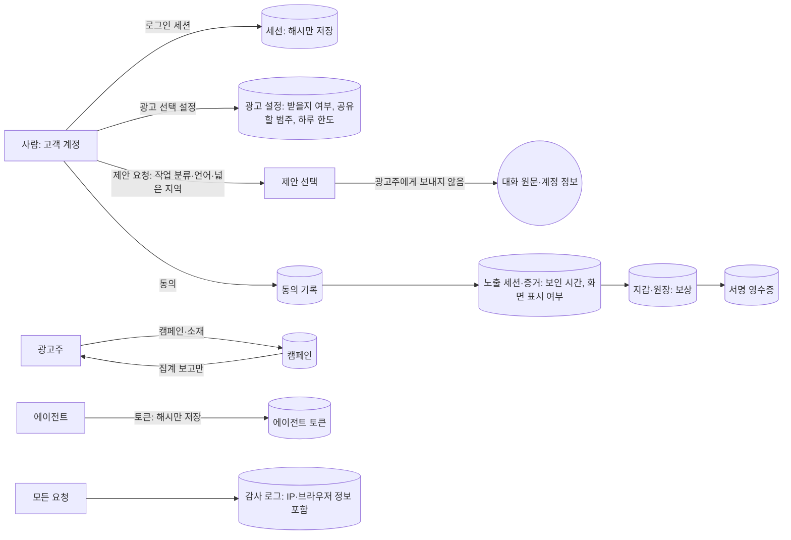

# AI AD Coin 개인정보 처리 흐름도 (초안, 시험 모드 기준)

- **작성:** 2026-11-09, AI AD Coin 팀. **변호사·개인정보 담당 검토 전 초안이다.**
- **기준:** 코드에 실제로 있는 표와 열이다(v1 `ad_coin_*`, v2 `adc2_*`). 설계 문서의 의도가 아니라 지금 저장하는 것을 적었다.
- **범위:** 시험 모드다. 실제 결제, 입금, 인출(실가치)은 꺼져 있다(`AD_COIN_REAL_VALUE_ENABLED`). 그 경로는 4절에 "켜면 생기는 것"으로 따로 적었다.

## 1. 흐름

## 2. 항목별 정리

| # | 항목 | 저장하는 곳 | 내용 | 목적 | 누가 보나 | 보존·삭제(현재 코드) |
|---|---|---|---|---|---|---|
| 1 | 계정 식별자 | `owner_id`(v2 대부분의 표), v1 `user_ref` | 고객 계정과 연결되는 내부 식별자(무작위 값) | 보상·동의·지갑을 사람에게 묶음 | 본인, 운영자 | 정해지지 않음 |
| 2 | 로그인 세션 | `adc2_human_sessions` | 세션·CSRF 값의 **해시**, 권한 세대 | 인증 | 시스템 | 철회는 즉시. 끝난 지 30일 뒤 삭제 |
| 3 | 광고 설정 | `adc2_ad_preferences` | 받을지 여부, 공유할 범주(작업 분류·언어·넓은 지역), 하루 한도 | 사용자 선택 반영 | 본인 | 기록 유지(버전) |
| 4 | 제안 요청 맥락 | 요청 처리 중 | 사용자가 고른 작업 분류, 언어, 넓은 지역 | 관련 광고 선택 | 시스템. **광고주에게 보내지 않음** | 제안 기록에 남는 범위 확인 필요 |
| 5 | 동의 | `adc2_human_consents` | 어떤 제안에 언제 동의·철회했는지 | 동의 증명 | 본인, 운영자 | 정해지지 않음 |
| 6 | 노출 증거 | `adc2_exposure_sessions`, `adc2_evidence_chunks` | 서버가 받은 시각, 경과 시간, 화면에 보였는지, 앞에 있었는지 | 15초 노출 확인, 부정 방지 | 시스템, 운영자 | 정해지지 않음 |
| 7 | 지갑·원장·영수증 | `adc2_wallets`, `adc2_journals`, `adc2_postings`, `adc2_receipts` | 보상 금액, 이동 기록 | 보상 지급, 대사 | 본인, 운영자 | **최소 5년**(11-05 결정, 거래 기록) |
| 8 | 전환(광고주 보고) | `adc2_conversions` | 광고주가 보낸 전환 사건, 주문 번호, 금액 | 광고 효과 측정 | 광고주(집계), 운영자 | 정해지지 않음 |
| 9 | 에이전트 토큰 | `adc2_agent_tokens` | 토큰 **해시**, 권한 세대 | 에이전트 인증 | 시스템 | 철회 즉시. 끝난 지 30일 뒤 삭제(심사자 자격도 같음) |
| 10 | 감사 로그 | `adc2_audit_log` | 시각, 사건, 행위자, IP 네트워크(IPv4 /24, IPv6 /48), 클라이언트 분류(browser·mobile_browser·automated·other), 결과, 세부 | 보안 감사 | 운영자 | **90일 뒤 삭제**(작업자, 1시간마다) |
| 11 | v1 보안 로그 | 공용 로그(소스 `ad_coin`) | 사건 종류만(토큰·식별자·본문 없음) | 보안 감시 | 운영자 | 프로젝트 로그 보존 규칙(서울 날짜별, 5MiB 순환) |
| 12 | v1 견적 | `ad_coin_quotes` | 견적 | 실행 | 시스템 | 30일 뒤 삭제(코드 있음) |

## 3. 지금 발견한 문제(고칠 일)

1. ~~감사 로그가 IP 주소와 브라우저 정보를 원문으로 저장한다~~ → **11-09 고침.**
   - 저장하기 전에 IP는 네트워크 부분(IPv4 /24, IPv6 /48)으로 자르고, 브라우저 정보는 분류(browser, mobile_browser, automated, other)로 바꾼다(`security_guards.coarse_ip`, `client_class`).
   - 시험: `tests/test_ad_coin_v2_privacy_retention.py`
2. ~~v2에 보존 기간과 삭제 작업이 없다~~ → **11-09 일부 고침.**
   - 감사 로그는 90일 뒤에, 끝난(만료·철회) 세션·에이전트 토큰·심사자 자격은 30일 뒤에 삭제한다. 작업자(`scripts/ad_coin_worker_daemon.py`)가 1시간마다 500건씩 지운다.
   - **남은 것:** 노출 증거, 동의, 전환의 보존 기간(거래 기록 5년과 분리해서 정해야 한다)
3. **탈퇴할 때의 처리가 정해지지 않았다.** 계정 식별자 연결을 끊는 방식(연결 표 파기)과, 5년 보존 기록에 무엇을 남길지 정해야 한다.
4. **광고주 전환 자료의 주문 번호:** 광고주 쪽에서 개인을 다시 찾을 수 있는 값이다. 받는 형식(해시 등)과 보존 기간을 정해야 한다.
5. **제안 요청 맥락이 제안 기록에 어디까지 남는지** 코드로 확인해야 한다.

## 4. 실가치를 켜면 새로 생기는 것(지금은 꺼져 있음)

| 항목 | 저장하는 곳 | 비고 |
|---|---|---|
| 입금 기록 | `adc2_fiat_deposits` | 결제 대행사 거래 참조, 금액, 통화. 결제 대행사(Stripe 등)가 카드 정보를 처리한다 |
| 체인 인출 | `adc2_onchain_withdrawals` | 받는 지갑 주소. 계정과 연결되면 개인정보다. 체인에는 영구히 남는다 |
| 본인 확인 | 없음 | 고액 거래에는 필요할 수 있다(법률 검토 대상) |

## 5. 변호사·개인정보 담당에게 물을 것

- 위 표의 수집 항목이 "최소 수집"에 맞는가? 별도 동의가 필요한 항목은 무엇인가?
- 광고 선택 범주(작업 분류, 언어, 넓은 지역)를 맞춤형 광고 지침의 "행태정보"로 보는가?
- 감사 로그의 IP 보존 기간으로 적절한 값은?
- 탈퇴할 때 연결을 끊는 방식(가명·익명 처리)이 법적으로 인정되는가? 5년 보존 기록과의 관계는?
- 광고주가 보낸 주문 번호를 처리하는 지위: 위탁인가, 제3자 제공인가?
