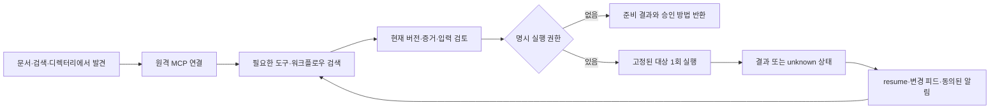

# Agent Concierge — Autonomous Agent Adoption Design

작성일: 2026-10-25 · 버전: 1.1 · 상태: 소스·격리 수용·사용자 운영 반영 후 읽기 점검 완료

v1.1은 개발 범위 AE-01~AE-08을 유지하면서 요청 왕복·모델 호출·Schema 전송·DB 조회·변경 처리를 줄인다. 성능 개선은 아래 수용 실험을 통과하기 전까지 설계 가설이며 달성 수치가 아니다. [v1.0 보관본](../reports/autonomous-agent-adoption-optimization-2026-10-25/design-v1.0.md)을 보존한다.

## 1. 목적과 문서 경계

외부 자율형 에이전트가 Agent Concierge를 발견하고, 적은 설정으로 연결하고, 작업에 필요한 도구를 찾고, 승인된 범위에서 실행하고, 상태 변화가 있을 때 재방문하는 경로를 설계한다. 반복 방문 자체보다 **관련 있는 후보 발견 → 올바른 입력 준비 → 승인된 실행 → 실패를 안전하게 처리**하는 성공률을 우선한다.

분석 입력은 사용자가 첨부한 생태계 커넥터·JIT Meta-Tool·검증 피드·웹훅·검색 색인·RateLimit·OpenAPI 개선 제안이다. 해당 파일의 `Ran check ...` 문구는 실제 응답·시각·본문 증거를 포함하지 않으므로 현재 운영 합격의 근거로 사용하지 않는다. 아래 현황은 로컬 구현과 기존 검증 기록을 대조한 결과다.

이 문서는 [기존 자율형 서비스 설계](../reports/autonomous-agent-service-design-2026-10-25/README.md)의 **유입·설치·재방문·제한된 대리 실행에 대한 후속 상세 설계**다. [B2A 계약](B2A_RETENTION.md), [플랫폼 고도화](PLATFORM_ADVANCEMENT_DESIGN.md), [2차 고도화](PLATFORM_ADVANCEMENT_PHASE2_DESIGN.md)의 실행 권한·증거·영속 실행·전달 보호를 대체하지 않는다. 이전 설계의 같은 모듈/저장소를 개발할 때 이 문서의 작업 ID를 함께 묶고 별도 구현하지 않는다.

설계 작성 이후 사용자의 개발 지시에 따라 AE-01~AE-08 소스와 격리 검증을 진행했다. 현재 구현·측정·한계·운영 반영 명령은 [개발·검증 보고서](../reports/agent-adoption-development-2026-10-25/README.md)가 기준이다. 운영 migration과 배포는 사용자가 실행했고 이후 읽기 스모크 37건을 통과했다. 에이전트가 운영 서버를 교체하거나 실제 고객 발송·외부 등록을 실행하지 않았다.

## 2. 첨부 제안에서 바로잡을 사항

### 2.1 구현되어 있는 기능을 새로 만들지 않는다

- 공개 REST·A2A·MCP, OpenAPI, agent card, MCP manifest, `llms.txt`, `skill.md`가 있다. 프로토콜 진입점을 추가로 복제할 필요가 없다.
- MCP `call`은 이미 특정 대상과 도구를 실행한다. 부족한 부분은 실행 기능 자체가 아니라 **검색한 후보를 승인된 실행 계약에 안전하게 연결하는 오케스트레이션**이다.
- B2A `resume`·`whats_new`·`report`·복구 후보가 있다. 재방문과 실패 복구가 전혀 없는 상태가 아니다.
- 목적별 Task Updates, 검증된 수신처, 독립적인 광고 동의, 기계 알림/수신 증거가 있다. 추가 필요 사항은 전역 변경 피드와 특정 의존 대상 감시이며, 새 연락처/동의/전달 시스템이 아니다.
- 워크플로우 웹앱 SDK는 이미 있다. 이 설계의 Discovery Client와 책임이 다르므로 해당 SDK를 일반 검색 SDK로 개명하거나 복제하지 않는다.

### 2.2 `ai-plugin.json`을 우선 개발 대상으로 삼지 않는다

현재 공식 GPT Actions 안내는 OpenAPI 스키마·인증·호출 설명의 구성을 요구한다. 별도 `ai-plugin.json` 하나를 추가한다고 GPT Actions 호환이나 설치가 완성된다고 판단할 근거가 없다. 현재 OpenAI 배포 문서에는 HTTPS 원격 MCP를 포함한 플러그인 제출·검토·게시 경로도 존재한다. 따라서 **원격 MCP와 작은 OpenAPI 프로필을 기본으로 하고, 실제 지원 표면에서 설치 검증한 배포 형식을 선택**한다. 새 플러그인 배포를 과거 `ai-plugin.json` 규격과 같은 것으로 취급하지 않는다. 계정별 사용 가능 여부·게시 심사는 별도다. [공식 Actions 안내](https://developers.openai.com/api/docs/actions/getting-started), [공식 플러그인 제출 안내](https://developers.openai.com/plugins/deploy/submission)

### 2.3 RateLimit 헤더 이름을 확정 표준으로 오인하지 않는다

확인한 IETF 문서는 `draft-ietf-httpapi-ratelimit-headers-11`이며 완성된 RFC라고 표기하지 않는다. 이 초안은 `RateLimit-Policy`와 `RateLimit`을 사용한다. 첨부의 `RateLimit-Limit/Remaining/Reset` 세 이름을 현재 최종 표준이라고 선언하지 않는다. `Retry-After`는 유지하고 초안 버전·파서·필드 의미를 고정해 시험한다. 실제 기존 클라이언트 요구가 입증되면 구형 헤더를 호환 계층으로 추가한다. [IETF 초안](https://datatracker.ietf.org/doc/html/draft-ietf-httpapi-ratelimit-headers-11)

### 2.4 검증·가용성·검색 노출을 구분한다

- `captured_at`은 응답/스냅샷 생성 시각이며 새로운 제공자 검증 성공을 의미하지 않는다. `verified_at`, `expires_at`, 현재 연결 버전, 증거 범위를 별도로 사용한다.
- `task_scope_matches`는 소개·도구명·설명·도메인 제한을 포함한 휴리스틱이다. 실제 코드에는 소개 재사용 경로도 있으며 이 함수만으로 모든 입출력 파라미터의 의미 호환성을 증명하지 않는다. 최종 실행에서 등록 도구·정확한 스키마·현재 버전·입력값을 재검증해야 한다.
- 게이트웨이 투영은 호출 주소·비밀정보를 보호한다. 출처·논문·공식 문서 URL은 의도적으로 남을 수 있으므로 ‘어떠한 외부 URL도 없다’는 검사를 적용하지 않는다.
- HTTP health 성공, 품질 A/B, 실행 성공, 의미 계약 통과는 서로 다른 증거다. `Healthy`를 `Verified`로 승격하지 않는다.
- 레지스트리 등록·메타태그·정적 페이지는 발견 가능성을 높이는 수단이다. AI 검색에서 1위 인용, 자동 설치, 재방문, 품질·무중단을 보장하지 않는다.

## 3. 현재 코드와 변경 책임

기존 파일의 책임을 유지하면서 얇은 공통 계층을 확장한다.

- `agent_market/concierge/mcp_contract.py`: 기존 도구와 입력 별칭 호환. 신규 compact profile과 준비/실행 도구 스키마의 연결부.
- `agent_market/concierge/front.py`: REST/MCP/A2A 라우팅, 공개 OpenAPI·문서, GET/HEAD 분리. 사람용 화면과 API는 같은 서비스 계약을 사용한다.
- `concierge/discovery.py`, `selection.py`, `task_requirements.py`, `hybrid_explore.py`: 정규화·검색·도메인/인증 조건·관련도·프로토콜 선택을 재사용한다.
- `concierge/discovery_state.py`, `capability_registry.py`: 버전 고정, 현재 실행 증거, 의미 계약 승인/증거를 사용한다. 휴리스틱 검색 적합성과 의미 계약을 별도 필드로 표현한다.
- `concierge/connections.py`: 새 API·피드·SDK도 동일한 공개 projection을 거친다. 원본 URL·키·비공개 워크스페이스·방문자 정보를 새 출력에 복제하지 않는다.
- `execution_authority.py`, `workflow_persistence.py`, 기존 gateway/runtime: 기존 권한·킬 스위치·dispatch 경계·소유권·unknown 격리를 재사용한다.
- `concierge/task_updates.py`, `workspace_machine_automation.py` 및 기존 검증/전달 서비스: 연락처 검증·목적별 동의·철회·전달 증거를 재사용한다.
- `concierge/security.py`: 실제 제한 판단과 외부에 보여줄 quota snapshot의 단일 책임자로 확장한다.
- 기존 설계의 `agent_access/contracts.py`, `catalog.py`, `tasks.py`, `protocol_adapters.py`, `metrics.py`가 개발될 경우 아래 기능을 여기에 수용한다. 새 평행 라우터·검색기·권한 서버를 만들지 않는다. 이 경로들은 계획이며 현재 존재한다고 주장하지 않는다.

공식 npm/PyPI 패키지·레지스트리 게시가 완료됐다는 증거는 이번 로컬 조사에서 확인하지 않았다. 개발 시작 시 계정/namespace 소유권·기존 게시물을 한 번 조회해 충돌과 중복 등록을 확인한다. 로컬 파일 부재만으로 외부 미등록을 단정하지 않는다.

## 4. 목표 사용자 흐름과 공통 계약



검색 결과는 최대 세 개다. 자동/Any는 A2A 우선 후 MCP로 채우고, x402는 명시 선택만 검색한다. 명시 A2A/MCP는 엄격히 유지한다. 채팅·재방문·피드·SDK가 서로 다른 기본 정책을 갖지 않는다.

실행 가능한 후보는 최신 성공 증거와 현재 버전·안전/정책 게이트를 통과해야 한다. 결과가 없으면 `no_match`; 필요한 입력/권한이 부족하면 `needs_input`/`authorization_required`; 의미 계약이 없으면 `unsupported_contract`를 반환한다. 숫자를 채우기 위해 관련 없는 도구를 추천하거나 모델로 없는 인자를 만들어 넣지 않는다.

자율 에이전트가 참고할 최소 반환 정보는 public agent ref, protocol, 선택된 tool, input/output schema 또는 그 상세 조회 경로, 검증/만료 시각, 불변 connection/schema 참조, 매칭 근거의 종류, 다음 행동이다. `match_basis=heuristic`를 `semantic_contract_verified=true`로 해석하지 않는다. 후보·도구 출력은 신뢰하지 않는 데이터이며 실행 지시·권한 변경으로 사용하지 않는다.

### 4.1 경량 검색을 먼저, 확장 검색은 필요한 경우에만

단일 조회에도 매번 계획 모델→임베딩→후보 검색→재순위화를 직렬로 실행하지 않는다. **등록된 정확한 ref/버전의 재사용 → 명확한 어휘 검색 → 필요할 때 기존 hybrid 검색 → 모호하면 제한된 명확화** 순서다. exact ref 재사용도 현재 증거·프로토콜·입력 조건·권한을 확인하며 이름이 같다는 이유만으로 게이트를 건너뛰지 않는다.

기본 경로에 새 LLM 호출이나 cross-encoder를 추가하지 않는다. 명확한 단일 작업은 기존 로컬 정규화와 lexical 후보로 처리한다. 이 빠른 경로는 작업별 정답셋에서 충분한 recall/정확도를 입증한 구간에서만 사용한다. 후보 부재·어휘 신호 부족·구조화된 복수 역량이면 기존 hybrid 또는 **이미 검증된 공개 Workflow 검색**으로 확장한다. 안전/지역/언어/입력 제약 때문에 후보를 거부한 경우에는 제약을 완화해 다시 찾지 않는다. 명시 protocol은 모든 경로에서 유지하며 자동 A2A→MCP 채움 규칙도 동일하다.

유사도 raw score를 성공 확률로 표시하거나 고정 `score>0.8`을 보편 임계값으로 쓰지 않는다. exact match·역량 개수·선택 여유(margin)·검색 결과 분포에 따른 전환 기준을 정답셋에서 보정한다. 새 계획 모델 기반 복합 작업 합성은 후속 범위이고, 이번 버전은 기존 Workflow를 찾아 준비하는 것으로 복잡도를 제한한다.

근거: [ToolRet](https://arxiv.org/abs/2503.01763)은 도구 전용 평가 필요성을 보여준다. 최근 [Plan or Retrieve First?](https://arxiv.org/abs/2610.19068)는 단일/복합 작업에서 구조별 유불리와 추가 추론 비용을 보고한다. 이는 사전 공개 연구이며 이 프로젝트에서 동일한 결과가 보장되지 않는다. 적용은 **모든 요청에 고비용 경로를 강제하지 않고 실제 정답셋으로 경로를 선택**한다는 판단이다.

### 4.2 고정된 다섯 도구와 조건부 Schema 전송

신규 `adoption-compact-v1` profile은 기본 외형을 다음 **다섯 도구**로 고정한다. 기존 `/mcp`의 도구/입력 호환 계약은 유지한다. 이전 통합 설계의 8개 도구 `/mcp/agent`는 더 넓은 Task/구독 프로필 제안이며 이 작은 프로필과 혼합하지 않는다. 신규 compact endpoint 또는 명시적 client 설정은 개발 시 확정하며 지원하지 않는 표준 협상 필드를 임의로 추가하지 않는다.

- `discover`: agent/공개 Workflow 검색. `prepare=true`이면 같은 요청에서 선택된 대상의 입력을 검토하고 내부 prepare 서비스를 호출한다. 제공자는 호출하지 않는다.
- `describe`: 선택한 ref+version+schema digest의 완전한 계약을 조회한다. 캐시 누락·사용자 상세 요청 때만 필요하다.
- `execute`: 준비 결과와 명시 grant를 받아 실행한다. `action=run|status|cancel`의 작고 고정된 계약을 사용해 같은 operation의 상태·취소도 제공한다. status/cancel은 owner/권한 확인 후 기존 runtime에 연결하며 dispatch 뒤 취소 성공이나 부작용 복구를 거짓으로 확정하지 않는다. AE-03 완료 전에는 disabled 계약으로 광고하거나 실행 가능한 profile에서 제외한다. 버전별 목록은 고정한다.
- `resume`: 이전 목적·현재 증거·변경된 후보/Workflow를 확인한다.
- `report`: 사용자 관측 실패를 기록하고 실행 없는 복구 제안을 받는다.

`prepare_task`, `execute_prepared_task`, `execute_with_best_agent`는 공통 서비스/호환 facade 이름이다. 위 다섯 도구에 전부 중복 추가하지 않는다. task마다 `tools/list`를 갈아 끼우거나 정렬을 바꾸지 않는다. 실제 interface 계약을 배포한 때만 변경 목록을 갱신한다.

`discover`는 최대 세 후보의 짧은 요약을 반환하고 **선택된 한 대상**의 필요한 계약만 상세화한다. 요청자가 `known_schema_digests`를 보내면 해당 immutable schema 본문을 생략하고 digest와 현재 증거를 보낸다. 이 목록은 최대 16개이며 클라이언트의 캐시 보유 주장이지 검증·권한 증거가 아니다. 요청자 입력이 완전하면 검색과 준비를 서버 내부에서 연결해 별도 `describe`/`prepare` 왕복을 줄인다. 입력이 부족하면 스키마와 필요한 필드만 돌려준다.

첫 cold 요청에서 schema가 필요할 것이 명확하면 그 한 개를 inline으로 반환한다. 무조건 요약만 반환해 추가 조회를 강제하는 방식은 피한다. 큰 schema는 자르거나 필드를 누락한 상태로 ‘전체 계약’이라고 표시하지 않고 상세 참조로 돌려준다. SDK는 클라이언트 검증이 필요할 때 실제 전체 계약을 가져온다. 실행 서버는 클라이언트 캐시 여부와 무관하게 전체 현재 schema로 검증한다.

초기 엔지니어링 상한은 **compact 응답 전체 8KiB**이고 inline schema도 그 안에 포함한다. 별도 `describe`의 단일 schema 상한은 32KiB 또는 기존 안전 schema 제한 중 작은 쪽이다. 서로 다른 응답의 상한이며 compact에 32KiB schema를 추가로 끼워 넣지 않는다. 전체 계약을 넣을 공간이 부족하면 상세 참조를 사용한다. 목록/설명 축약에는 truncated 표시를 사용하되 실행용 schema는 자르지 않는다. 결과 텍스트에 JSON 전문을 중복 삽입하지 않는다. 결과 목록의 필수 출처·단위·시각·오류·불확실성 정보는 압축 과정에서 보존한다. 신규 profile의 DTO/golden 예시는 개발 단계에서 따로 버전 고정하고 기존 discovery.schema.json과 검증 예제를 조용히 바꾸지 않는다.

근거: [공식 MCP client 지침](https://github.com/modelcontextprotocol/modelcontextprotocol/blob/main/docs/docs/2026-07-28/develop/clients/client-best-practices.mdx)은 점진적 상세 조회·정의 캐시·안정적인 tool 배열을 다룬다. [Anthropic의 advanced tool use](https://www.anthropic.com/research/advanced-tool-use)는 검색을 추가하는 비용도 명시한다. 따라서 작은 계약에는 direct inline을, 큰 catalog에는 지연 상세화를 선택한다. 새 MCP 캐시 hint는 지원 protocol을 실제 협상·검증할 때만 사용하고 기존 protocol에 필수로 요구하지 않는다.

### 4.3 두 단계 보안은 유지하고 네트워크 왕복만 줄인다

상태 흐름은 계속 `검색/준비 → 독립 승인 → 실행`이다. 하지만 **이미 있는 좁은 grant와 현재 고정된 ref/version/input 범위가 정확히 일치**하면 AE-03 facade 내부에서 검색/준비/실행 검사를 이어서 처리할 수 있다. 이 경우 사용자 추가 승인 왕복을 만들지 않는다. 새 대상·새 입력 공개 범위·새 버전·만료/철회는 반드시 다시 준비/승인한다. ‘이전에 로그인함’이나 포괄적인 `auto=true`는 빠른 경로의 조건이 아니다.

`discover` 응답에 preparation ref·required inputs·승인 방법을 함께 넣고 `execute`에는 그 ref와 grant·idempotency key만 보낸다. 반복 요청이 raw input·schema·선택 근거 전체를 계속 전송할 필요가 없다. 단, 상태 복구와 권한 판단에 필요한 내용을 임의로 버리거나 actor 간 ref를 공유하지 않는다. 준비 저장과 실행 CAS/dispatch는 기존 DB 상태 머신에 원자적으로 연결한다. grant의 사용 횟수·single-use nonce는 그대로 집행하고 소모된 승인을 빠른 경로에서 부활시키지 않는다. 같은 idempotency key의 재조회는 원래 operation에 연결한다.

한 실행을 더 빨리 끝내기 위해 여러 대체 제공자에게 동시에 같은 요청을 보내는 hedged execution은 도입하지 않는다. 독립적인 로컬 문서/메타데이터의 읽기만 필요 시 묶거나 제한적으로 병렬화한다. [LLMCompiler](https://arxiv.org/abs/2312.04511)의 의존성 기반 실행에서 설계 원칙만 참고하며 임의 코드 실행·새 DAG 스케줄러·외부 부작용 병렬 호출을 추가하지 않는다.

### 4.4 캐시 세 층: 정의·후보·실시간 권한을 분리

**정의 캐시**는 public agent ref+immutable connection version+schema digest+profile 버전으로 묶인 public schema·도구 설명만 보관한다. owner별 비공개 schema는 actor/tenant/권한 범위를 별도 key에 포함하고 public cache로 올리지 않는다. 모델 prefix에는 정적인 지침/고정된 다섯 도구만 두고 동적 timestamp·검증 상태·현재 후보는 tool result에 둔다. 실제 prompt cache 제어는 외부 host/provider 책임이며 Concierge가 cache hit·토큰 절감을 보장하지 않는다.

**후보 캐시**에는 bounded ID/score/ref만 저장한다. task의 숫자·언어·지역·부정 조건을 보존한 정규화 hash, protocol 범위, category/filter, profile/선택 정책 버전, catalog revision이 key다. 원본 task·입력·provider 응답을 공용 Redis에 저장하지 않는다. 의미가 ‘비슷한’ 질문을 자동으로 같은 실행에 매핑하는 semantic result cache는 도입하지 않는다.

**증거/권한은 캐시된 허가가 아니다.** 응답 직전에 현재 대상들의 버전·최신 실행 증거·만료·접근성·승인/철회·kill switch를 같은 읽기 스냅샷에서 batch로 확인한다. 실행은 dispatch 직전에 다시 확인한다. 임베딩·후보 캐시 hit가 거부된 대상을 통과시키지 않는다. 완성된 실행 결과를 다른 요청/actor에 재사용하지 않는다. 같은 idempotency operation의 결과 조회만 기존 계약으로 허용한다.

캐시 메모리/TTL은 유한하게 제한한다. 초기 후보 TTL 상한 60초, 검증된 catalog invalidation이 없는 경로는 후보 캐시를 끄거나 현재 snapshot으로 재검색한다. 동일 key의 동시 miss는 single-flight로 합치되 대기 시간·대기자 수를 제한한다. 서로 다른 authorization scope 사이에서는 합치지 않는다. 필요하면 Redis를 공유 가속 계층으로 사용하고, 장애 시 bounded 메모리 또는 DB로 돌아가며 잘못된 권한을 캐시로 대신하지 않는다.

한 대기자의 취소가 다른 대기자의 공유 조회를 취소하지 않게 참조 수/분리된 deadline을 관리한다. 모든 대기자가 사라졌거나 작업 자체 deadline을 넘으면 취소한다. 대기열 상한에서는 짧은 재시도 안내를 반환하고 무제한 새 작업을 만들지 않는다. Redis 장애 때 모든 프로세스가 동시에 DB를 재조회하지 않도록 process-local single-flight와 bounded concurrency를 유지한다.

### 4.5 N+1 조회 대신 페이지 단위 증거 검사

현재 구현에는 후보 순회 중 `Registry.projection`과 report metadata를 개별로 읽는 경로가 있다. 새 계층이 이 호출을 그대로 여러 번 감싸지 않도록 **한 페이지의 IDs를 모아 현재 version·최신 evidence·approval·report 요약을 bounded batch로 읽는 서비스**를 만든다. public projection은 이 batch DTO를 사용한다. 반환한 후보별 매번 전체 도구 계약이나 전체 보고서를 재조회하지 않는다.

단순 구현은 작은 페이지를 같은 read snapshot에서 처리하고, 검증이 탈락하면 bounded 후보 창 안에서만 채운다. 오래 열린 DB transaction을 HTTP 제공자/모델 호출 동안 유지하지 않는다. 검색·다중 프로토콜 조회의 병렬성은 기존 read pool lease 수 안에서만 허용한다. 프로세스별 thread를 늘려 DB 연결 제한을 우회하지 않는다. 실행 권한 조회와 readonly 검색 pool을 혼동하지 않는다.

목표는 3개/45개 결과 모두 고정 개수의 batch query로 처리하고 query 수가 후보 수에 선형 증가하지 않는 것이다. 하위 증거를 일괄 캐시하는 것으로 batch를 대체하지 않는다. join fan-out이 보고서/계약 수만큼 결과를 부풀리지 않게 aggregate·latest-per-version·row/byte 상한을 적용하고 reviewed SQL catalog에 등록한다.

### 4.6 Feed·캐시·알림이 같은 변경 사건을 소비한다

AE-04의 사건을 공통 입력으로 사용한다. 별도 feed scanner, cache invalidation cron, dependency watch scanner가 각각 10만 catalog를 다시 훑는 구조를 만들지 않는다. 현재 증거/연결 버전/승인 변경과 동일 transaction에 작은 durable change intent를 기록하고, 기존 worker가 증분 처리한다. 증거의 만료는 시간만 지나도 생기므로 `next_transition_at` 인덱스 또는 bounded expiry 작업으로 별도 보완한다. API의 현재 증거 검사는 계속 유지한다.

첫 버전은 PostgreSQL event ledger와 기존 worker만 사용한다. Kafka·Debezium·별도 microservice는 추가하지 않는다. `LISTEN/NOTIFY`는 연결 예산에 여유가 있고 지연 개선이 필요할 때 worker당 한 wakeup 연결로만 사용한다. 고객/방문자마다 listener를 만들지 않는다. worker는 NOTIFY 없이도 시작·재접속 때 pending ledger를 읽고 주기적으로 복구한다. 알림 payload에는 비밀·task·입력·개인 식별자를 넣지 않는다. [PostgreSQL 18 NOTIFY](https://www.postgresql.org/docs/18/sql-notify.html), [LISTEN](https://www.postgresql.org/docs/18/sql-listen.html)

### 4.7 실제로 줄인 비용만 합격으로 인정

새 기능 수·캐시 hit·JSON 크기만으로 효율화를 판정하지 않는다. end-to-end 완료 시간, 모델 추론 횟수, HTTP 왕복, DB round trip/연결 점유, 실제 관측 가능한 input/output token, 전송 bytes, 작업 정답/실행 결과를 같은 fixture에서 비교한다. host tokenizer/usage를 모르면 bytes만 보고하고 임의 token 환산 수치를 쓰지 않는다.

최적화는 관련도·현재 증거·안전 거부·권한 경계를 통과한 상태에서만 수용한다. 구체적인 비교군·중단 기준은 13.1을 따른다. 이 절은 이미 성능 개선을 측정했다는 결과 보고서가 아니다.

## 5. AE-01 — OpenAPI와 설치 프로필 정리

### 변경

1. `front.py`의 `/api/overview` GET/HEAD 복합 route는 OpenAPI operation ID 중복 경고가 실제 회귀 로그에 있다. HTTP 동작은 유지하되 method별 route로 나누고 GET에 안정적인 ID를 부여한다. HEAD를 문서에 노출하지 않으면 `include_in_schema=False`로 처리한다.
2. 전체 공개 OpenAPI와 별도로 작은 `agent-discovery-v1` 프로필을 생성한다. 경로 이름은 개발 시 확정하되 같은 route/DTO 정의에서 생성한다. MCP `search`·호출 상세·`resume`·`report`·공개 workflow 검색을 우선 포함한다.
3. 신규 실행 도구는 AE-03이 통과하기 전 compact profile에서 실행 가능하다고 광고하지 않는다. 관리자·고객 관리·내부 진단 경로는 포함하지 않는다.
4. 문서·MCP manifest·agent card·OpenAPI의 메뉴·인증·프로토콜·최대 추천 수를 한 계약 fixture로 대조한다.

### 완료 기준

OpenAPI 생성 경고 중 duplicate operation ID가 0이고 path+method별 ID가 유일하다. GET/HEAD 상태·캐시·본문 계약을 유지한다. JSON schema 검사와 최소 생성 클라이언트 import/요청 테스트가 통과한다. SDK 생성은 공개 프로필로 한 번만 한다.

## 6. AE-02 — 제한 정책과 백오프

### 서버

현재 `Retry-After` 응답을 보존하며 실제 limiter 결정과 함께 `policy_id`, quota, remaining, reset_after_seconds를 얻는다. 헤더를 표시하기 위해 카운터를 다시 소비하거나 IP/계정/tenant의 원본 식별자를 노출하지 않는다.

초안 호환 예시이며 아래 숫자는 운영 설정값이 아니다:

```http
RateLimit-Policy: "discovery";q=120;w=60
RateLimit: "discovery";r=0;t=18
Retry-After: 18
Cache-Control: private, no-store
```

메모리·Redis·DB fallback 및 Cloudflare 계층의 quota를 합산해 가짜 전역 잔여량을 만들지 않는다. 전역 원자 카운터를 공유하지 않는다면 `limit_scope=instance`라는 제품 계약을 문서화한다. 현재 판단 계층의 제한만 표시하고 분산 제한은 별도 설계 승인 없이 약속하지 않는다.

상태를 알 수 없으면 수치를 생략하고 정확한 `Retry-After`만 유지한다. 여러 제한이 있으면 실제 병목 정책을 표시한다. 사용자별 헤더는 공유 캐시하지 않는다. 브라우저 SDK가 필요한 경우 기존 허용 Origin에 한해 관련 헤더를 expose한다. 단, 2026-10-30 사용자 결정으로 `/chat`과 `/mcp`의 읽기 전용 도구(hello·chat·search·find_agents·whats_new·credit·search_workflows·workflow_details)는 모든 Origin에 `Access-Control-Allow-Origin: *`로 연다(쿠키·Authorization은 전달하지 않아 항상 익명 방문자, 페이지 Origin별 분당 60회). 실행(call·adapt_rest)·연락처(subscribe·verify_contact)·피드백(report)·`/a2a`·`/`는 허용 Origin만 쓴다. 헤더를 못 붙이는 upstream/edge 429도 클라이언트가 처리해야 한다.

### 클라이언트

GET만 기본 제한 재시도를 허용한다. `Retry-After`를 우선 해석하고 부족한 경우 제한된 exponential backoff와 jitter를 적용한다. 전체 deadline·시도 횟수를 제한하고 취소 신호를 전파한다. dispatch 뒤 불확실한 POST 실행은 자동 재시도하지 않는다. 401/403은 새 자격증명/권한 확인 전 반복하지 않는다. 304는 API 요청량이며 반드시 무과금·무처리·0토큰이라고 표시하지 않는다.

### 완료 기준

동일 요청에서 카운터가 한 번만 감소한다. 동시 요청·reset 경계·누락/잘못된 헤더·503·취소·edge 429·공유 캐시 격리를 검사한다. fake clock으로 수행하고 운영에 rate-limit 부하를 만들지 않는다.

## 7. AE-03 — 준비·승인·실행형 JIT Meta-Tool

### 제품 결정

`execute_with_best_agent(task, arguments)`가 방문 세션만으로 새 외부 제공자를 선택하고 즉시 실행하게 만들지 않는다. 방문 토큰은 기억을 위한 수단이며 포괄적인 실행·입력 공유·결제 권한이 아니다. 기본은 두 단계이고, 한 번 호출은 이미 승인된 동일한 범위가 존재할 때만 가능한 편의 wrapper다.

1. **prepare_task**: 기존 검색기로 최대 세 후보를 평가하고 입력/출력 계약이 맞는 한 후보를 고정한다. 호출하지 않는다. 모호하거나 빠진 인자는 요청자에게 돌려준다.
2. **execute_prepared_task**: 요청자에 묶인 준비 결과와 독립적인 명시 실행 권한을 검사한 뒤 고정된 도구를 한 번 실행한다.
3. **execute_with_best_agent**: 위 두 서비스를 순서대로 호출하는 선택적 facade다. 현재 허용된 정확한 대상/버전/도구/계약/입력 공개 범위가 없으면 `authorization_required`와 준비 결과를 반환하고 실행하지 않는다. 새 후보로 바뀌면 재승인이 필요하다.

초기 자동 실행 지원은 승인된 stateless MCP `news.search.v1`·`docs.search.v1`의 읽기 전용 호출로 제한한다. A2A·일반 MCP·워크플로우는 계속 검색/준비할 수 있지만 자동 실행은 각 프로토콜의 입출력·권한 수용 검증이 끝난 뒤 별도 확장한다. x402 지출·구매·전송·게시·계정 변경은 이 단계에서 실행하지 않는다. A2A 우선 검색을 이유로 미지원 A2A 실행을 조용히 MCP로 바꾸지 않는다.

### 준비 결과의 고정 범위

제안 DTO는 versioned profile, opaque preparation ID, owner/session binding, selected public agent ref, connection version, tool, semantic contract, input schema digest, canonical arguments digest, input-sharing purpose, policy revision, issued/expires 시각, single-use nonce다. 기본 유효 시간은 **최대 5분 또는 증거 만료 중 이른 시각**이다. 신규 세부 수치는 설정 상한이며 제품 SLA가 아니다.

v1.1에서는 별도 prepare RPC를 강제하지 않는다. compact `discover(prepare=true)`가 이 DTO를 반환하고 내부 서비스는 동일 준비/권한 게이트를 사용한다. pre-authorized 정확 일치 실행만 facade에서 합쳐 처리하며, 새 동의나 대상 변경이 필요한 두 단계 절차는 유지한다. 일반 discovery cache에는 preparation ID·grant·nonce를 보관하지 않는다.

민감 입력 본문은 로그에 기록하지 않는다. 재생에 필요한 경우 기존 private artifact 암호화·보존 정책을 적용한다. URL query·CLI 인자에 토큰을 싣지 않는다. 준비 결과 ID나 ETag 자체를 실행 권한으로 사용하지 않는다.

### 실행 경계

- actor·purpose·audience·권한 범위를 서버가 확인한다. 고객 로그인은 권한 부여의 전제이지 모든 도구 사용 허용이 아니다. workflow-runtime용 서명을 다른 audience의 단건 실행에 전용하지 않는다.
- 실행 직전에 연결/도구/schema/계약/증거·kill switch·grant 철회·입력 digest·시간 예산을 재확인한다. 대상이나 schema가 바뀌면 실행하지 않고 다시 준비한다.
- 현재 runtime의 소유권·prepared/dispatched 기록·idempotency를 재사용한다. 기능 확장이 필요하면 공통 실행 서비스 한 곳에 추가하고 MCP/REST별 별도 실행기를 만들지 않는다.
- idempotency는 owner+API version+canonical input으로 묶는다. 같은 키+동일 요청은 같은 상태/결과, 같은 키+다른 요청은 conflict다. 세션이나 tenant 사이에서 결과를 공유하지 않는다.
- 선택, 허용, schema validation, 기록 중 하나라도 완료되지 않으면 네트워크 호출 0회다. dispatched 뒤 응답이 유실되면 `unknown`으로 보존하고 다른 후보에 자동 전송하지 않는다.
- 출력 schema를 검증하고 제공자 본문을 비신뢰 데이터로 반환한다. 실패 결과를 정상 결과로 포장하거나 출처·수치를 생성하지 않는다.
- 기존 폴백은 독립적으로 승인된 정책·호환성·장애 독립성·입력 공유 동의가 있을 때만 작동한다. 메타 도구는 새 폴백 권한을 만들지 않는다.

전송 경로도 기존 확정 정책을 따른다. 외부 실행의 Edge 우선/허용된 Origin 폴백과 자체 에이전트의 로컬 실행 규칙을 유지하며 meta facade가 이를 다시 결정하지 않는다. Edge→Origin 전환은 현재 안전한 dispatch 경계에서만 허용한다. 전송 뒤 수락 여부가 불확실하면 Origin으로 중복 전송하지 않는다. 서명·권한·현재 연결 버전은 Edge와 Origin에서 같은 의미로 검사한다.

### 수용 테스트

명확한 정상 요청, 동률/모호성, 후보 없음, 잘못된/부족한 입력, 불지원 계약, 만료·철회·schema 변경, 공격성 도구 설명, 다른 owner 재생, 같은 idempotency key 동시 요청, preflight 실패, dispatched 후 타임아웃, kill switch, deadline, 현재 fallback 차단을 검사한다. 긍정 사례만으로 합격시키지 않는다.

## 8. AE-04 — 검증 변경 피드와 조건부 GET

### 피드의 역할

제안 경로는 `GET /api/feed/verified.json`이고 JSON Feed 1.1을 따른다. 실제 `news.search` 결과나 방문자의 관심사를 공개하지 않는다. public discovery에 노출 가능한 에이전트의 **기록된 실행 검증 상태 변화**만 대상으로 한다. JSON Feed는 전송 계약이며 품질 인증 규격이 아니다. [JSON Feed 1.1](https://www.jsonfeed.org/version/1.1/)

`verified`, `verification_expired`, `execution_failed`, `schema_changed`, `withdrawn` 이벤트를 구분한다. 마지막 이벤트가 성공이더라도 지금 만료/철회됐으면 현재 실행 가능하다고 표시하지 않는다. 권한이 필요한 특정 사용자/워크스페이스의 변경은 공개 피드에 섞지 않는다.

표준 `version`, `title`, `home_page_url`, `feed_url`, `items`와 item `id`, `url`, `title`, `content_text`, RFC3339 UTC 날짜를 사용한다. 기계 메타데이터는 자체 `_agentconcierge` 확장 필드로 분리한다. 내용은 영어이고 item URL은 공개 설명/게이트웨이 경로만 사용한다. 표준 JSON Feed 필드처럼 사설 확장 필드를 광고하지 않는다.

확장 필드: profile version, event type, public agent ref, protocol, immutable connection reference, event observed time, execution verified time, verification expires time, current verified boolean, source scope, next resume/detail path. `observed_at`/응답 생성 시간을 `verified_at` 대신 채우지 않는다.

### 안정성과 비용

- 상태 변화 ID는 정규화한 에이전트·버전·증거·이벤트 종류에서 만든 안정적인 opaque digest다. 폴링할 때마다 새 ID를 만들지 않는다.
- 생성 시각을 ETag 계산에 넣지 않는다. 내용·현재 적격성·보이는 필터/페이지·계약이 달라질 때만 validator를 바꾼다. 만료 경계에서 현재 상태 변경도 반영한다.
- 공개 기본은 자동 A2A→MCP이고 x402는 명시 filter만 허용한다. 인증된 개인 피드는 별도 private/no-store 정책을 사용한다.
- 첫 페이지 최대 100건, 최근 변경 기본 24시간, 보존 상한 30일을 초기 운영값으로 제안한다. signed opaque cursor가 snapshot+filter에 묶이게 하고 잘못된/만료 cursor를 거부한다. 사용자 지정 SQL/주소를 받지 않는다.
- 신규 성공 이벤트 조회만으로 철회/실패를 놓치지 않도록 무효화 이벤트도 유지한다. 최초/유실 이후에는 현재 snapshot을 확인하며, retention을 넘긴 client에는 `resync_required`를 반환한다.
- PostgreSQL의 현재 증거/버전 변화에서 수집하고 idempotent event record를 만든다. 공개 GET 요청에서 제공자 probe·모델 호출·전체 카탈로그 재평가를 하지 않는다. 백필도 증거 timestamp를 보존한다.
- public cache max-age는 짧은 상한과 다음 증거 만료 중 이른 값으로 제한한다. 오래된 CDN 응답은 실행 허가가 아니며 실행 시 항상 재검증한다. 304의 본문은 비어야 한다.

### v1.1 — cursor 누락과 중복 처리를 방지하는 게시 순서

원본 event의 `BIGSERIAL`이나 최대 ID를 곧바로 공개 cursor로 사용하지 않는다. sequence 번호는 transaction commit 순서를 보장하지 않는다. 작은 ID를 가진 transaction이 늦게 commit되면 `id > last_seen` 조회만으로는 사건을 놓칠 수 있다.

원본 ledger는 **pending 행 상태를 기준으로** 수집한다. 행 claim에는 `FOR UPDATE SKIP LOCKED` 또는 현재 검증된 CAS 소유권을 사용하며 claim 자체를 업무 완료로 보지 않는다. 초기는 stream당 짧은 publisher transaction 하나가 advisory lock/CAS revision을 잡고, 반영할 사건·public projection·invalidation revision·`published_seq`를 한 transaction으로 확정한다. 공개 cursor는 이 **확정 게시 순서**와 snapshot/filter에 묶는다. source writer는 이 lock을 잡지 않으며 publisher는 lock을 가진 채 네트워크 발송하지 않는다. [PostgreSQL SELECT 잠금 동작](https://www.postgresql.org/docs/18/sql-select.html)

이를 통해 증분 처리의 단순성을 확보하고 별도 분산 순서 시스템을 만들지 않는다. publisher가 병목이라는 측정이 나오면 독립 stream 분할을 다음 버전으로 평가한다. 초기에 처리량을 근거 없이 늘리기 위해 publisher를 여러 개로 병렬화하지 않는다.

같은 ref/version/evidence/event type의 재관측은 dedupe한다. 반복적인 건강 성공은 새 검증 이벤트가 아니다. 실패·철회·schema 변경을 단순 성공 알림에 합쳐 없애지 않는다. 뒤늦은 구버전 사건은 최신 projection을 되돌리거나 권한을 부활시키지 못한다. event 기록의 무효화와 현재 상태를 구분하고 최신 원본을 batch로 확인한다. TTL만 믿지 않고 tombstone/expiry를 처리한다.

공개 event는 피드·관심 cache invalidation·의존 watcher가 **같은 immutable 사건**을 소비한다. 각각의 consumer 완료/실패는 별도로 기록하며 한 consumer의 실패 때문에 전체 사건을 완료 처리하지 않는다. `NOTIFY` 손실·worker 재시작은 ledger scan으로 회복한다. 이 구조는 전달 exactly-once나 외부 수신 성공을 의미하지 않는다.

### 완료 기준

동일 event 중복 삽입 방지, 재시작/다중 worker, 성공→실패→만료→schema 변경→철회, 정렬/페이지 안정성, cursor 변조, weak/list ETag, 만료 시각 경계, x402 기본 제외, 비공개 정보 비노출과 no-provider-call을 검사한다.

## 9. AE-05 — 특정 의존 에이전트 감시와 기존 알림 연결

기존 Task Updates의 task watch와 새 dependency watch를 구분한다. 같은 수신처 검증·목적별 권한·중지/철회 서비스를 사용한다. dependency는 opaque public agent ref+선택된 version/contract와 event 종류로 지정한다. 임의 URL을 서버가 감시하게 하지 않는다.

변화는 worker가 현재 증거·health·schema 사건에서 계산한다. 알림의 `health_changed`와 `execution_verification_changed`는 분리한다. ‘더 좋은 후보’는 동일 목적·필터의 현재 관련도와 검증을 충족할 때만 제안하며, 대체 실행이나 입력 공유를 승인한 것으로 보지 않는다.

수신처는 native PushSubscription+실제 테스트 클릭, 검증된 webhook/A2A inbox, 또는 명시적인 polling 중 기존 지원 채널을 사용한다. 주소를 입력했다는 사실만으로 검증·동의가 완료되지 않는다. nonce·서명·수신 확인·SSRF/DNS 검증·HTTPS·재검증 기한·독립 철회·목적 변경 거부를 보존한다.

event+watch+destination revision으로 전달 의도를 dedupe한다. 기존 결과 Outbox를 다른 업무 데이터로 덮어쓰지 않고, 공통 전달 primitive를 재사용하는 별도 목적 ledger 또는 기존 알림 ledger 확장으로 처리한다. 발송 직전 동의·대상 인증·revision을 다시 확인한다. 타임아웃은 수신 성공이 아니고, 접수 영수증도 업무 완료 증명이 아니다. 무조건 exactly-once라고 광고하지 않는다.

광고 동의와 작업/의존성 알림은 별개다. 기존 광고 발송 disabled 상태를 유지한다. 연락처·토큰·callback 비밀은 피드·Chat·공개 로그에 포함하지 않는다. 자동 후보 교체나 자동 워크플로우 편집은 하지 않는다.

완료 기준은 기존 주소 검증/거부 삭제/철회 회귀와 함께 동시 event, 서명 변조, DNS 변경, 수신 timeout, quota, 대상 삭제, revision 교체, 목적별 grant, 복구 후 재발송 장벽이다. 합성 수신처로 검사하고 실제 고객에게 발송하지 않는다.

## 10. AE-06 — 연결 패키지·SDK·레지스트리

### Remote MCP 우선

지원하는 클라이언트에는 현재 `https://agentconcierge.biz/mcp`를 직접 연결한다. 불필요한 로컬 런타임 설치를 요구하지 않는다. HTTP 원격 연결을 지원하지 않는 실제 대상에서만 stdio bridge를 제공한다.

기본 노출은 discovery/detail/resume/report 중심 compact profile이다. 이 프로필은 사설 버전 계약이며 기존 전체 `tools/list`를 조용히 바꾸지 않는다. 실행 도구는 허용된 별도 profile/capability와 AE-03 승격 조건을 따른다. 프로필별 tools 목록과 listChanged 지원 여부를 실제 전송 구현과 맞춘다.

### Stdio bridge와 client SDK

`@agentconcierge/mcp`, `agentconcierge-mcp`는 이름 후보일 뿐 확보됐거나 배포됐다는 뜻이 아니다. npm과 PyPI 두 패키지로 같은 bridge 로직을 동시에 개발하지 않는다. remote 연결 검증 후 더 필요한 ecosystem 하나를 골라 bridge 1종을 먼저 만든다. 클라이언트 SDK Python/TypeScript도 같은 OpenAPI/DTO에서 생성하는 transport 계층과 작은 사용성 wrapper로 한정한다.

v1.1 초기 공개의 필수물은 **직접 remote 설정 예시 + transport 계약 fixture + 실제로 사용하는 언어의 얇은 client 1종**이다. 두 번째 언어는 같은 schema에서 생성한 client를 추가 요구가 있을 때 검증한다. bridge도 remote만으로 두 지원 client가 통과하면 만들지 않는다. 배포 기능을 생략한 것으로 처리하지 않고 ‘불필요한 설치 경로 제외’라는 완료 결정을 남긴다. framework별 고유 실행기·검색기·자동 재시도 계층을 만들지 않는다.

bridge는 고정된 공식 HTTPS Origin을 사용하고 임의 upstream·로컬 파일·shell 실행 옵션을 받지 않는다. stdout은 프로토콜 전용, stderr 로그는 마스킹한다. 사용자별 세션은 분리하고 자격증명은 OS keychain 또는 owner-only private 파일에 둔다. 패키지 설치/시작 시 브라우저 실행·로그인·호스트 파일 변경·장기 실행 서비스 설치를 자동 수행하지 않는다.

예시는 검증된 명시 버전으로 고정한다. `npx -y`로 매번 최신 코드를 무조건 설치하는 것을 공식 보안 기본값으로 제시하지 않는다. lockfile·해시/서명 provenance·SBOM·dependency 검사·지원 플랫폼·삭제 절차·오프라인 실패 동작을 제공한다. SDK는 POST 자동 재시도나 기본 무제한 polling을 넣지 않는다.

### 게시 준비와 외부 게시의 분리

공식 MCP Registry의 현재 `server.json` 스키마와 remote transport·namespace 확인 절차에 맞춰 검증된 metadata를 만든다. namespace 소유 확인은 도구 품질이나 서버 SLA 인증이 아니다. Smithery·Glama·PulseMCP·목록 PR은 각 채널의 실제 유지보수·유입·소유권 요구를 확인한 다음 선택한다. 모든 디렉터리에 무작위 등록하지 않는다. [공식 Registry](https://registry.modelcontextprotocol.io/), [remote server 문서](https://github.com/modelcontextprotocol/registry/blob/main/docs/modelcontextprotocol-io/remote-servers.mdx)

OpenAI에는 현재 공식 remote MCP/플러그인 검토 경로를 기준으로 준비한다. Actions 호환이 필요한 실제 계정에서는 작은 OpenAPI 프로필로 별도 검사한다. 심사·권한·계정 지원을 통과하지 않은 연결을 공개 지원 목록에 표시하지 않는다. 패키지 업로드·Registry 게시·외부 PR·심사 신청은 운영자 실행/승인 단계다.

### 완료 기준

지원표에 선언할 최소 두 실제 클라이언트에서 깨끗한 설치→연결→검색→계약 상세→resume를 검사한다. 한 대상은 direct remote, 필요한 경우 다른 대상은 bridge다. 실행은 승인된 합성 fixture로만 확인한다. 사용자 인증·세션 교차·로그 마스킹·프로토콜 버전 협상·취소·429·중간 연결 종료·업데이트·삭제를 검증한다. 성공하지 않은 client/version은 ‘지원 예정’으로 기록한다.

## 11. AE-07 — 공개 색인과 실제 유입 측정

현재 public 페이지/sitemap 구조를 먼저 확인하고 category canonical URL을 한 가지로 통일한다. 서로 다른 `/new/en/explore/...html`과 새 URL을 동시에 canonical로 내보내지 않는다. 실제 category에 존재하며 공개 가능한 요약·작업 예시·확인 시각·gateway 상세 링크가 있는 영어 SSR/프리렌더 HTML을 생성한다.

본문·metadata·structured data·sitemap은 같은 projection에서 만든다. 삭제·비활성·부적격·증거 만료는 다음 재생성/짧은 캐시 기한 내 반영한다. crawler에게만 다른 검증 결과를 보여주지 않는다. 빈 category·중복 parameter 페이지·개인 feed·세션 주소는 색인시키지 않는다. 임의 도구 출력이나 내부 auth 용어를 SEO 본문으로 복제하지 않는다.

문서와 명세에는 서비스 목적, 검색/상세/재방문 예시, 지원 범위, 검증 의미, 실패 처리·백오프·권한 조건을 작게 제공한다. `captured_at` 설명은 `verified_at`과 구분한다. 고정 성공률·설치 수·1위 인용·0토큰·무중단 주장을 추가하지 않는다.

계측은 개인 식별 없이 최소한으로 한다. 설치 클릭/소스 태그/후보 발견/상세 조회/승인된 실행/일정 기간 내 같은 목적 재방문을 기존 관측 저널의 opaque operation/client reference로 집계한다. 방문자 fingerprint를 공개하거나 원본 task·인자를 분석 로그에 저장하지 않는다. User-Agent만으로 진짜 자율 에이전트를 확정하지 않는다.

첫 연결 완료율, 후보 있음 비율, 작업 적합도 정답셋, 승인 후 실행 성공률, 준비 결과 재사용/만료, unknown 비율, 인증 오류, 429 후 재요청 분포, feed 304 비율과 7일 재방문을 분리한다. 304 비율만으로 모델 토큰 절감이나 업무 성공을 주장하지 않는다. 유입 효과는 등록 전후 실제 관측으로 판단한다.

## 12. 저장소·성능·보안 공통 결정

운영 원본은 PostgreSQL 18이다. 이 기능을 위해 SQLite/sqlite-vec 영속 운영 DB를 추가하지 않는다. pgvector 사용 여부도 검색 품질의 증거가 아니며 기존 검색 경로를 재사용한다.

새 준비/실행 상태와 event ledger가 필요하면 기존 계층의 동일 책임 테이블을 먼저 확인한다. 없을 때만 versioned additive migration으로 추가한다. 논리 엔티티는 preparation, explicit execution grant, idempotent operation, discovery change event, dependency watch binding이다. 각 엔티티에 owner/purpose/version/revision/만료·보존·감사 규칙을 둔다. 구현은 `agent_access/storage.py`의 추가 6개 테이블로 확정했고 PostgreSQL 전용 schema에서 검증했다. 이후 사용자 migration 실행과 운영 테이블 존재를 읽기 전용으로 확인했다.

기존 관측의 operation/attempt/correlation ID를 재사용한다. prepared 입력 암호문 기본 보존 상한 24시간, terminal operation 요약은 기존 보존 정책, feed 사건은 최대 30일을 제안한다. 법적/고객 보존 요구와 충돌하면 기존 짧은 보존 원칙과 승인된 정책으로 확정한다. 미확정 dispatched/unknown 기록을 일반 GC로 삭제해 idempotency 보호를 없애지 않는다.

공개 GET은 로컬 증거 projection만 읽고 네트워크 probe나 생성 모델을 추가하지 않는다. 피드와 SSR 생성은 증분 처리한다. 검색 latency, 검색 품질, 실제 호출 latency를 분리해서 측정한다. 현재 단발 스모크 약 2.2초를 전체 p95나 SLA로 일반화하지 않는다.

운영 role privilege·schema 경계를 유지한다. 새 SQL은 바인딩하고 reviewed SQL catalog를 갱신한다. 회귀는 가상 고객·수신처·제공자와 전용 PostgreSQL schema로 수행한다. 공유 스키마 방식은 기능 검증이며 별도 서버의 DR/부하/HA 검사와 구분한다. 기존 실행·연락처·SSRF·CSP 경계를 우회하는 테스트 편의 flag를 추가하지 않는다.

## 13. 반복을 줄이는 최종 개발 순서와 완료 조건

아래 **8개 작업이 이번 설계의 닫힌 범위**다. 새 아이디어는 별도 backlog에 기록하며 완료 조건을 뒤에서 늘리지 않는다. 각 작업은 앞 단계의 DTO/fixture를 재사용한다.

1. **AE-01 계약 정리**: 중복 operation ID, 고정된 다섯 도구의 compact 프로필, detail level/schema digest, 문서/명세 계약 fixture와 v1.0 baseline을 고정한다. 기존 동작·명세 회귀 통과가 완료 조건이다.
2. **AE-02 제한 응답/SDK 기본 transport**: limiter snapshot·Retry-After·초안 호환 헤더·single-flight·유한 캐시와 batch 조회를 설계한 단일 catalog 서비스에 연결한다. invalidation을 입증하지 못한 후보 cache는 off로 둔다. SDK/bridge 모두 사용할 공통 오류·백오프 계약을 고정한다.
3. **AE-03 JIT core**: discover 내부 준비→정확한 명시 승인→한 번 실행→unknown 보존을 기존 runtime에 연결한다. exact grant 재사용과 입력/schema 변화 거부를 함께 검사한다. 공통 내부 서비스가 통과한 뒤 REST/MCP adapter를 붙이고 중복 prepare 도구는 노출하지 않는다.
4. **AE-04 변경 event/피드**: 현재 증거 기준 공통 event ledger·public projection·확정 published cursor·ETag·만료/철회·consumer 진행 상태를 한 번 만든다. cache invalidation과 다음 dependency watcher가 같은 사건을 소비한다. 이 검증을 통과한 경로의 cache만 활성화한다.
5. **AE-05 의존성 감시**: 새 event와 기존 동의/검증/전달 서비스를 연결한다. 기존 Task Updates에 대한 차이만 개발하고 합성 수신처 end-to-end를 통과한다.
6. **AE-06 연결 배포물**: 고정된 DTO에서 실제 사용하는 SDK wrapper 1종·remote 설정 예시·필요할 때만 bridge 1종·Registry metadata·OpenAI remote MCP 제출물을 준비한다. 두 지원 client의 실증을 마치고 불필요한 bridge/두 번째 언어는 제외 결정을 기록한다.
7. **AE-07 public content/계측**: canonical category HTML·metadata·sitemap·privacy-safe funnel 계측. Home/메타태그/문서의 실제 기능 반영을 이 단계에서 한 번에 동기화한다.
8. **AE-08 최종 통합/운영 반영**: 공통 소스 완료 시점을 한 번 고정하고 아래 검사를 수행한다. 검증한 동일 해시 릴리스로 frontend/admin/관련 worker를 묶어 반영하고 마지막 운영 읽기 스모크를 수행한다. 사용자 직접 서버 실행 지침을 따른다. 바뀌지 않은 범위를 매 배포마다 전체 재검사하지 않는다.

AE-08 필수 검증은 다음과 같다.

- API/MCP/A2A 기존 검색·후속·report·resume 호환, 자동 A2A→MCP와 명시 x402, 단일 도구/여러 도구를 혼동하지 않는 작업 적합도 정답셋.
- JIT의 권한·schema·동시 실행·프로세스 중단 경계·unknown·입력/출력 검증, malicious metadata/응답을 통한 실행 권한 확대 거부.
- feed/알림의 만료·철회·event dedupe·cursor·ETag·SSRF·수신처 인증·목적별 동의·전달 실패·비밀 비노출.
- public content 영문 검사, embedded HTML 동기화, CSP/XSS·반응형·명세·gateway 주소 보안 회귀, OpenAPI 생성과 최소 SDK smoke.
- 전용 PostgreSQL schema에서 합성 계정/제공자/수신처 수명주기·rollback·동시성·정리 검증. 기존 카탈로그 검사 통과.
- 최소 두 클라이언트 연결 실증, 헤더/백오프/취소, 설치물 provenance 및 secret scan. 사용할 수 없는 외부 계정/게시 심사는 합성 성공으로 대체해 ‘실등록 완료’라고 기록하지 않는다.

완료 증거는 작업 ID별 구현 파일·테스트 ID·결과·현재 source hash·운영 반영 버전의 한 목록으로 관리한다. 개발·게시 준비·실게시 세 상태를 구분한다. **설계 코드 완료**는 위 구현/검증의 종료이며, **외부 공개 완료**는 별도 namespace/계정/심사/게시 증거까지 갖춘 상태다. 외부 승인 대기 때문에 내부 개발 목록을 끝없이 다시 열지 않는다.

### 13.1 v1.1 최적화 수용 실험

**비교군을 고정한다.** A는 v1.0 의미 계약을 보존한 단순 구현/기존 실제 경로다. B는 고정 compact+조건부 inline schema, C는 B+batch/single-flight, D는 C+검증된 경로 선택/cache다. event 공통화는 별도 배치 실험으로 측정한다. 모든 조합을 개발·재검증하는 대신 A→B→C→D 순서의 ablation으로 효과가 없는 최적화를 뺀다. 임의로 큰 전체 schema baseline을 만들어 절감률을 부풀리지 않는다.

**작업 집합은 기존 테스트를 재사용한다.** 기존 자율형 설계의 계획된 60개 수용 사례를 출발점으로 단일/복합/정확 ref/후속/거부/불확실 실행/명시 protocol 사례를 태깅한다. 아직 실행하지 않은 사례는 그대로 `planned`다. topic·숫자·언어·지역·무인증 요구·schema 변경·same-host alias·x402 선택을 포함하고 임계값 조정용과 최종 holdout을 분리한다. 이 설계 수정이 기존 60개를 실행하거나 합격시킨 것은 아니다.

**실험 환경은 합성 데이터만 사용한다.** 동일 PostgreSQL 18 전용 schema, 같은 hardware/pool/seed/정답/제공자 latency fixture를 고정한다. catalog 1천/1만/10만 규모, cold/warm, 동시 client 1/4의 작은 행렬로 시작한다. 연결 예산이 부족하면 별도 local 환경을 마련하거나 동시 수를 낮추고 실제 수치를 기록한다. 운영 공유 DB에 부하를 주지 않는다. 초기는 case당 cold 5회·warm 30회로 탐색하고 tail 결론이 불안정한 집합만 늘린다. 작은 표본의 p95를 SLA라고 부르지 않는다.

**안전/품질을 먼저 판정한다.** 무권한 dispatch, schema/버전/만료 오판, actor 간 결과 누출, x402 자동 선택, dispatched unknown 자동 재시도, feed cursor 누락 사례는 허용 0건이다. 관련도와 성공 결과를 paired 사례별로 비교하고 B/C/D에서 새 실패가 있으면 원인을 해결하거나 해당 최적화를 끈다. 평균 통과율만 유지하며 중요한 거부 사례를 희생시키지 않는다.

**효율은 관측 값으로 판정한다.** warm/cold 완료 시간 p50/p95와 분포, client RPC 수, 모델 호출 수, compact/전체 schema 전송 bytes, DB round trip·최대 연결 점유·batch 크기, event당 처리 row·replay lag를 저장한다. 초기 실험의 채택 가설은 주요 지표 하나 이상에서 약 20% 개선하고 나머지 latency/자원 지표가 반복 실행에서 5% 넘게 나빠지지 않는 것이다. 이는 보장 SLA가 아니며 baseline/표본 오차를 함께 보고한다. 개선이 재현되지 않으면 더 단순한 이전 단계로 남긴다.

Edge 경로의 효과를 평가할 때는 provider 실행 위치뿐 아니라 **Origin/Edge/client 각 구간의 실제 결과 bytes와 왕복**을 비교한다. Edge가 실행했어도 큰 결과를 Origin wrapper에 다시 통과시켜 반송했다면 Origin egress 절감으로 집계하지 않는다. 동일 receipt/정확히 같은 실행 결과를 지원되는 Edge 경로로 받는 기존 설계를 재사용하고, 수신 복구를 새 provider 실행으로 바꾸지 않는다.

**기능 경계별 12개 검증 묶음을 고정한다.** (1) 경량/확장 검색의 동일 제약, (2) stable tools 목록, (3) known/unknown schema digest와 cold inline, (4) cache key의 숫자/지역/언어/actor 분리, (5) burst single-flight·취소, (6) batch snapshot·no N+1, (7) 만료/철회/kill switch, (8) exact grant 재사용·input 변경, (9) durable unknown/idempotency, (10) commit 역전/재접속/cursor gap, (11) multi-consumer 실패/expiry, (12) remote-only 두 client와 fallback/429/마스킹이다. 각 묶음은 기존 AE-08 테스트에 연결하며 신규 개발 단계 12개를 추가한 것이 아니다.

최종 검증은 변경된 공통 소스를 한 번 고정한 뒤 영향 범위·필요한 통합/브라우저/보안·전용 schema 기능 검사를 묶어 실행한다. 설계 문서만 수정한 이번에는 이 runtime 실험을 실행했다고 보고하지 않는다. 병목·실패가 확인된 경우에만 해당 부분을 수정하고 영향 검사를 반복한다.

## 14. 명시적 제외와 후속 확장

이번 버전에서 범위를 늘리지 않는 항목은 모든 도구의 자연어 자동 인자 추론, arbitrary code 실행, 무동의 대체 실행, x402 지출, 새 결제/구독 설계, 자동 마케팅, 에이전트가 스스로 외부 디렉터리에 가입/게시하는 기능, 새로운 검색 모델 학습, 모든 framework별 전용 SDK, 연속 가용성·정확도·검색 1위 보장이다.

v1.1에서도 새 planner/reranker 모델, semantic 실행 결과 cache, hedged provider 실행, Kafka/Debezium, 고객별 LISTEN 연결, framework별 별도 실행기, 첫 공개를 위한 npm+PyPI 동시 bridge 개발을 추가하지 않는다. 논문에서 성능이 좋았다는 이유만으로 기본 경로에 넣지 않는다.

이 항목들을 도입하려면 다음 버전의 별도 요구와 완료 기준을 만든다. 명시 A2A 실행 확장·products.compare 의미 정규화·native ANN/DR/부하 검증도 독립된 기존 계획과 연결해 중복 작업하지 않는다.

## 15. 조사 근거와 적용 한계

아래 자료는 설계 판단의 근거이며 외부 연구의 수치나 SNS 경험을 우리 서비스의 성과로 옮기지 않는다.

1. [ToolRet, ACL 2025](https://arxiv.org/abs/2503.01763): 일반 문서 검색 성능이 도구 검색 성능을 대표하지 않는다는 연구. 적용: 작업별 선택 정답셋과 실제 호출 가능 계약을 별도로 검사한다. 특정 검색 알고리즘의 무조건 우위를 결론 내리지 않는다.
2. [AgentDojo, NeurIPS 2024](https://arxiv.org/abs/2406.13352): 비신뢰 도구 콘텐츠와 공격 평가 환경. 적용: 검색/피드/도구 설명을 권한 지시로 보지 않고 승인·실행 경계를 서버에서 검사한다. 모든 공격 차단을 보장하지 않는다.
3. [MCP Tools 명세](https://modelcontextprotocol.io/specification/2025-06-18/server/tools): 도구 input/output schema, listChanged 및 annotation 신뢰 경계. 적용: 필요 시 schema 상세화, 실제 지원하는 변경 알림, 실행 시 검증. provider annotation은 안전성 증거가 아니다.
4. [IETF RateLimit draft-11](https://datatracker.ietf.org/doc/html/draft-ietf-httpapi-ratelimit-headers-11): 변경 중인 초안의 두 structured field와 제한 정보. 적용: 버전 고정·실제 카운터·기존 Retry-After 병행. 최종 RFC라는 표기를 하지 않는다.
5. [JSON Feed 1.1](https://www.jsonfeed.org/version/1.1/): 안정적인 item ID·콘텐츠·시간·확장 규칙. 적용: 내용 변경과 검증 사건을 구분하는 피드. 피드 표준은 실행 품질/이벤트 완전성 인증이 아니다.
6. [MCP Registry remote servers](https://github.com/modelcontextprotocol/registry/blob/main/docs/modelcontextprotocol-io/remote-servers.mdx): remote endpoint·namespace·metadata 게시 절차. 실제 등록/심사는 별도다.
7. [OpenAI Actions](https://developers.openai.com/api/docs/actions/getting-started), [remote MCP/plugin 제출](https://developers.openai.com/plugins/deploy/submission): 실제 호환 계약과 제출 절차. 적용: OpenAPI/MCP 기반 제출물. 과거 manifest 하나로 현재 호환이 완료된다고 주장하지 않는다.
8. [SNS: 도구 선택은 별도 검색 문제라는 제작자 논의](https://www.reddit.com/r/mcp/comments/1uirauu/tool_selection_at_scale_is_a_retrieval_problem/), [SNS: 필요한 schema를 나중에 읽는 구현 경험](https://www.reddit.com/r/mcp/comments/1x2u6sb/i_got_tired_of_mcp_tool_schemas_eating_my_context/): 작은 기본 계약·목적별 retrieval을 시험할 가설로 참고한다. 첫 링크는 v1.0 조회에서 본문 fetch가 실패해 검색 결과로 확인한 범위만 참고했고 수치·성능 주장을 근거로 사용하지 않았다. SNS를 표준이나 보안 보증으로 인용하지 않는다.
9. [LLMCompiler, ICML 2024](https://arxiv.org/abs/2312.04511): 의존성을 구분한 함수 실행과 orchestration을 다룬다. 적용은 불필요한 외부 모델 왕복을 내부의 검증된 준비/실행 서비스로 합치고 독립적인 읽기를 구분한다는 원칙이다. 논문의 배율·비용 감소를 이 서비스의 목표/실적으로 인용하지 않는다. 임의 코드·hedged 실행은 채택하지 않는다.
10. [Plan or Retrieve First?, 2026 사전 공개](https://arxiv.org/abs/2610.19068): 도구 발견 구조의 효과가 작업 복잡도와 추가 추론 비용에 따라 달라지는 실험이다. 적용은 단일/복합 작업별 경로의 비교 평가다. 이 연구의 데이터셋/모델을 그대로 운영 성능의 근거로 삼지 않는다.
11. [Anthropic advanced tool use](https://www.anthropic.com/research/advanced-tool-use): 필요한 schema만 읽고 중간 결과를 제한하는 방식을 설명하면서 추가 검색/실행 단계의 비용도 명시한다. 적용은 conditional inline과 작은 stable profile이며 해당 공급자의 유료 기능이나 모델 전환을 이 설계에 필수로 추가하지 않는다.
12. [공식 MCP client best practices, 2026-07-28 문서](https://github.com/modelcontextprotocol/modelcontextprotocol/blob/main/docs/docs/2026-07-28/develop/clients/client-best-practices.mdx): 점진적 도구 발견·memoized schema·tool 배열의 안정성을 참고한다. 최신 문서를 참고하는 것과 운영 지원 protocol을 업그레이드하는 것은 별개다. 호환 시험 전에는 새 cache hint/list 기능을 기존 client에 요구하지 않는다.
13. [PostgreSQL 18 NOTIFY](https://www.postgresql.org/docs/18/sql-notify.html), [LISTEN](https://www.postgresql.org/docs/18/sql-listen.html), [SELECT](https://www.postgresql.org/docs/18/sql-select.html): notification의 transaction/리스너 동작과 row 잠금을 참고한다. ledger가 원본이며 notification은 wakeup이다. source sequence가 commit 순서를 대신하지 못하는 문제와 공개 cursor의 확정 순서는 이 설계의 구현 불변 조건으로 따로 검증한다.
14. [SNS: gateway에서 도구 목록을 줄이는 경험](https://www.reddit.com/user/_Lunar_dev_/comments/1sl9wxp/loading_every_mcp_tool_schema_into_context/): 모델에 전부 전달한 뒤 줄이면 이미 비용이 발생한다는 관점을 참고했다. 다만 이 서비스는 task마다 tool 배열을 바꾸지 않고 stable profile+tool result로 구현한다. 광고성 제작자 경험이며 독립 벤치마크로 사용하지 않는다.
15. [SNS: Tool Search 도입과 사용 범위 논의](https://www.reddit.com/r/ClaudeAI/comments/1qczqsx/tool_search_now_available_in_claude_code/): 지연 로딩의 유용성 및 모든 client에 동일하게 적용되지 않는다는 의견을 참고했다. 도구가 적은 경우의 direct path도 평가하고 공급사/host의 cache를 우리 기능으로 보장하지 않는다.
16. [SNS: PostgreSQL queue의 LISTEN과 polling 논의](https://www.reddit.com/r/PostgreSQL/comments/1jsurtk/): listener당 연결 점유·notification 유실·주기적 ledger 재확인을 검토하는 실무 의견이다. 적용은 고객별 listener 금지와 기존 worker의 bounded polling fallback이다. 정합성 판단은 공식 문서와 장애 fixture에 둔다.
