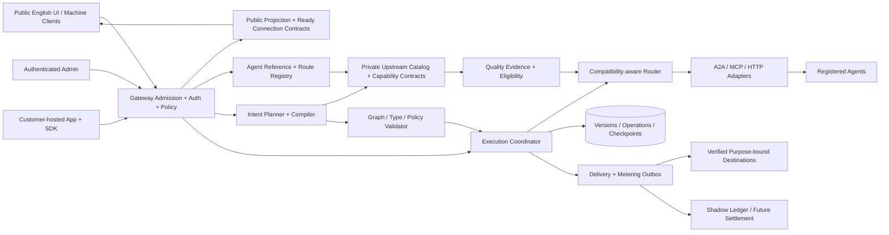

# Agent Concierge — Platform Advancement Design

> **최종 개발 마감 순서:** [개발 완료 최종 계획](DEVELOPMENT_COMPLETION_PLAN.md)의 1~9단계를 따른다. 아래 POST/R/N/AC 순서와 수용 기록은 기존 요구·구현 이력 대조용으로 보존한다. 원래 필수 범위를 제외하거나 개발 완료를 선언한 것은 아니다.

<!-- RND_CURRENT_SOURCE_START -->
### 수용 snapshot 및 재시작 후 점검 · 2026-10-19

**v1.41의 수용 당시 선택된 제한 source**를 동결 입력 957개·영향 모듈 142개·고유 회귀 **2,206개 통과**로 통합 확인했다. 실패/error/skip0·source drift0이며 [최종 검증](../reports/advancement-completion-2026-10-19/verification.json)과 [수용 source snapshot](../reports/advancement-completion-2026-10-19/accepted-source-snapshot.json)에 기록했다. exact corpus·manifest/admission/replan, 운영 자격·로컬 verdict, 비공개 조립/고객 authoring/목적별 알림, circuit 수동 제어, Privacy 검토, bounded bootstrap, 선택형 model proposal, 별도 opt-in public receipt, 수동 remote A2A polling UI/API, offline EIP-3009 crypto의 제한 범위다. **전체 설계 완료나 실제 운영 수용은 아니다.**

최종 native 내부 계약 93개는 해당 pytest 범위 안의 중첩 검사이며 회귀 2,206개에 더하지 않는다. 과거 v1.40의 1,313개·native80개·재시작 읽기38개와 component 재실행도 합산하지 않았다. 수용 당시 공개 콘텐츠 87개 위반0·SQL catalog 3238 statements/205 tables 정합성을 확인했다. scratch115,009건 HTML181.514/29.381ms 두 표본은 collector 경합·운영 p95/SLA/HA 수용 근거가 아니다.

재시작 후 [읽기 전용 점검](../reports/advancement-completion-2026-10-19/POST_RESTART_VERIFICATION.md)은 **46/46 통과**했고, 추가 변경의 격리 영향 회귀는 **15개 모듈·고유270개 통과**로 모듈별 최신 결과를 교체했다. 이 수를 기존2,206개에 더하지 않는다. 현재 프로세스의 HTML 함수 hash는 이전 수용본과 일치하고 현재 소스와 다르다. 보안 격리 대상의 과거 목록 재노출은 소스/격리 회귀에서 보완됐으며 새 SQL은 catalog3239/205에 등록됐다. 이후에도 다른 작업의 소스 변경과 catalog manifest 차이가 관측되어 **현재 전체 소스 승인과 최신 운영 반영은 보류**한다.

남은 항목은 **지정 대상이 필요한 실제 수용**과 **선택된 조건부 추가 source**다. persistent 전체 PostgreSQL cutover/rollback·HA, actual early-stop controller·threshold/실제 개입 증거, A2A session/streaming, 실제 first-party 업무 성과, actual PSP/finality/refund/payout, sole-owner recovery는 남아 있다. 제한 profile이나 callback 주입을 이 전체 범위의 완료로 표시하지 않는다.

기존 POST139R ID는 요구 추적에 유지하며, 최종 실행 순서는 [개발 완료 최종 계획](DEVELOPMENT_COMPLETION_PLAN.md)의 1~9단계를 따른다. R/N/AC와 아래 과거 절은 이력이다. 공개 Workspace·광고 전달·실거래 off, 고객 로그인 프론트엔드 전용, 개별 관리자/desktop을 유지한다. 사용자 재시작 보고를 확인했다. **다른 수정 마감 → catalog 재생성/정합성 → 최종 변경분 검증 → 사용자 터미널 재시작·새로고침 한 번**으로 묶은 뒤 현재 build의 인증된/비공개 수용을 확인한다. 에이전트가 운영 서버를 재시작하거나 운영 DB·외부 제공자·실거래를 조작하지 않았다.
<!-- RND_CURRENT_SOURCE_END -->

사업투자제안서 고도화 개발 설계 · v1.39 · 2026-10-19 · 내부 개발·투자 검토용

### R&D 설계 보완 · RND-2026-10-19-r1

첨부 심층 연구안을 [R&D 보완 계약](PLATFORM_RND_REFINEMENT.md)과 [구조화 원본](platform-rnd-refinement.json)으로 반영했다. 제품 기준은 v1.39 그대로이며 2차 설계는 **2.0-draft.3**다. 구현/운영 완료 선언이 아닌 설계 수정이다. 논문 버전·분모, 잘못된 EvoSteer 인용, SDK private 필드의 보안 한계, 프로토콜별 정산/환불, 조건부 지원금 자격을 원 출처와 대조했다.

다음 신규 개발은 **P2-01-TYPED-EVIDENCE**다. 기존 typed 실행/관측/체크포인트/암호화 증거를 연결한 하나의 lineage에 run/node/attempt·실제 resolved input/output·분기/projection·버전/목적/현재 권한·unknown을 고정한다. Action-MR/oracle·반복 일관성 표면, 관측 가능한 Dual-Clock/milestone shadow, 라우팅·기여도는 이 출처를 재사용한다. 새 DAG 실행기·평가 scheduler·수신기·금융 원장을 병렬로 만들지 않는다. 삭제된 원문 hash는 독립 품질을 입증하지 않는다.

MR은 양쪽 목표 성공·의미 보존·seed/clock/locale/fault/oracle 버전을 고정하고 실패/unknown/미평가/coverage를 포함한다. 단계 감시는 실제 관측 metadata만 사용하고 숨은 CoT를 요구하지 않는다. 먼저 replay/shadow에서 오탐·성공 손실·판정 오버헤드를 평가한다. 다음 admission은 business call1회/replacement0·기존 R-06과 상호 배타이며 unknown을 재호출로 덮지 않는다. 재계획은 새 draft/revision의 검토이며 진행 중 pin 변경이 아니다.

기존 SDK2/BFF·PKCE·제약 capability·원자적 quota를 기준으로 누락만 보완한다. 공개 SDK1.x와 프로토콜 profile 호환은 유지한다. #private/deepFreeze는 client robustness일 뿐 비밀 금고가 아니다. 현재 HMAC 수락 receipt와 조건부 새 공개 비대칭 receipt를 구분한다. 정산은 authorization/commitment/claim/settlement/finality·환불/지급과 업무/품질/전달을 분리하며 실제 법적 계약·sandbox·G2/별도 승인 이후다.

기존 **POST139R-01~09**는 유지하고 15개 연구 하위 계약을 해당 순서에만 연결한다. 각 계약은 재사용 코드·단일 owner/artifact identity·새 차이·source 선행·실제 수용 조건·종료/중단 기준을 가진다. 현재 [9개 권장 순서](REMAINING_WORK_BATCHES.md)를 실행 큐로 사용하며 예전 AC/R/N/B 식별자는 이력/범위 참조다. 문서 보완에 제품 회귀/재시작을 반복하지 않는다. 관련 검증 입력649개의 불변과 문서/JSON/Canvas 정합성을 확인하며 실제 제공자·수신·금전·운영 DB는 조작하지 않는다.

### v1.39 재시작 이후 현재 상태 · 2026-10-19

사용자 재시작·관리자 새로고침 후 읽기 표본 **22/22건 통과**: health/관리자200, 현재 관리자 자산5개 일치/CSP nonce, 새 worker/receiver 상태를 포함한 비인증API401, 공개 고객/auth와 private inbox404를 확인했다. 검증 입력649개 변경0이다. 제품 코드는 수정하지 않았고483개 회귀를 반복하지 않았다. **추가 재시작은 필요 없다.** [재시작 근거](../reports/remaining-work-plan-2026-10-19/post-v139-restart-readonly.json).

기존 평가 adapter/기본 off worker·영속 receiver·발송/검증 adapter와 관리자 UI는 완료다. 재시작만으로 worker가 활성화되는 것은 아니며 실제 운용은 현재 owner의 명시적 활성화가 필요하다. 비인증 읽기 표본은 실제 인증 기능·외부 연동·독립 품질·운영 전체 수용이 아니다. [기존 격리483건](../reports/advancement-phase2-integration-2026-10-19/verification.json)을 보존한다.

**다음 문장은 v1.39 당시 계획 이력이다. typed 다중 노드 실행 증거는 이후 구현되었으므로 현재 신규 작업으로 반복하지 않는다.** 당시에는1·2번의 관리자/CI·환경 준비와 병행하도록 계획했다. 실제 평가/IdP·SDK/수신/복구 수용은 지정 대상이 필요하며, 신뢰/온라인 라우팅·범용 앱·장기 profile 등 후속 소스도 남아 있다. 모든 잔여를 외부 설정 문제로 표현하지 않는다.

### v1.39 당시 구현 — 평가 실행·영속 머신 수신 연결 완료 · 2026-10-19

권장1·2번의 격리 관리자/설정 준비 검증을 보강하고3·4번의 제한 source를 연결했다. 현재 관련 입력649개·32모듈 **483개 고유 회귀 통과**, 실패/error/skip0이며 과거1,787개·개별 검사·진단 실행 수는 합산하지 않는다. [최종 검증](../reports/advancement-phase2-integration-2026-10-19/verification.json).

docs/news MCP technical evaluator·현재 권한 최종 fence·기본 off worker·명시적 owner 활성화/철회·단회 dispatch/unknown 무재실행을 연결했다. 기술 계약 성공은 독립 업무 품질이 아니다. receiver는 원자적 영속 event/nonce/dedupe claim 후에만 receipt를 반환한다. 기존 주소 proof, 목적별 동의, 수신처별 파생 키, bounded HTTPS webhook/제한 A2A 왕복, 새 복원 권한의 과거 패킷 거부를 적용했다. 관리자 desktop의 기존 중앙 모달에 상태·동의·활성화/철회를 연결했다.

고정3048 SQL쌍/192테이블·실제 격리 native 계약63개를 확인했다. 정적14개 Python의 원본 High0/Medium14/Low13은27개 모두 개별 검토·보존했고 신규 source 경고0·새 억제0이다. 기존 선택 억제1개도 별도 검토 기록했다. 공개 콘텐츠79개 위반0·HTML mirror와 변경 JS2개 구문/브라우저를 확인했다. 이는 전체 플랫폼 취약점0·실제 외부 수용 인증이 아니다.

이 구현 당시 필요했던 재시작/새로고침은 사용자 보고와 위22개 읽기 표본으로 반영을 확인했다. 이번 계획 갱신에는 추가 재시작이 필요 없다. 직전 v1.38의18/18 읽기 표본은 이 새 source의 운영 수용이 아니다. 운영 서버·DB·외부 제공자/알림·금전은 조작하지 않았다. 공개 Workspace·광고·실거래는 off를 유지한다. 실제 관리자/hosted CI·Google/GitHub/HTTPS SDK2·승인 제공자/독립 평가자/수신처·운영 부하/DR와 조건부 공개/라우팅·범용 profile·상용 확대는 [현재 순서](REMAINING_WORK_BATCHES.md)에 남긴다.

### v1.38 당시 — 권장9개 작업의 제한 소스 구현·검증

현재 관련 입력 638개를 고정해 113모듈 **1,787개 통과**, 실패/error/skip0을 확인했다.3개 파일 shard의 고유 case 합집합이며 과거·개별 결과는 더하지 않는다. 관련 없는 batch 삽입/생성 스크립트는 제외 목록으로 남겼다. [최종 근거](../reports/advancement-phase2-core-2026-10-19/verification.json).

P2-01의 계획/케이스/코호트·목적별 암호화 보존·현재 실행 연결·독립 자격 판정, P2-02의 기본 off 승인 corpus·예산/jitter·coverage·일회 dispatch/unknown, P2-03의 비공개 만료/중립 미리보기, P2-04의 규칙 offline/decision shadow를 구현했다. 평가기 미설정은 unassessed이며 shadow의 business call은0이다. 공개 배지·온라인 학습·실사용 자동 전환을 활성화하지 않는다.

P2-05/06에는3개 고정 계약 앱 템플릿·정확한 입력/대상 검토·원자적 typed flow 저장·현재 소유자 SDK admission/만료/카탈로그와 기존 이력 읽기 호환을 추가했다. 자동 선택은 제한 영어 keyword 규칙이다. P2-07은 현재 제공자 소유권과 검증 수신처/목적을 별도로 확인하고 서명·nonce·audience·중복·수락 receipt·unknown·철회/복원 경계를 구현했다. 수락은 업무 완료가 아니며 기본 sender는 없다. P2-08은 자체 문서 corpus와 원본 terminal run 기반 지원 관측/철회·논리 집계까지다. staff 해결 상태와 반복 실행 이력은 업무 성공·고객 유지·제공자 품질을 입증하지 않는다.

관련 정적24개 Python의 원본 High0/Medium30/Low29,59건을 검토·보존했으며 신규 profile의 경고0, 억제 추가0이다. JavaScript6개 구문·공개 콘텐츠79개 위반0·HTML mirror를 확인했다. 독립 검토에서 발견한 머신 알림의 계약 downgrade/gain·양성 근거 TTL·최종 수신처 만료 경계를 수정하고 재검증했다. 이는 전체 플랫폼 취약점0이나 운영 침투 인증이 아니다. 관리자 경로/자산114개 검사와3개 템플릿 실행 수용은 별도 근거로 남기며 통합 수에 합산하지 않는다.

PostgreSQL은 고정 SQL3033쌍/189테이블에 신규25개 테이블을 포함하고 실제 격리 API/실행/복원 경로를 검증했다. 서명 이력은 유지하고 과거 consent/control/plan/job/policy/review/subscription에 영구 복원 차단을 둔다. 원문 증거는 복원 시 삭제한다. native/구조 수치는 full_application_ready·운영 backup/RPO/RTO/DR/HA 판정이 아니다.

관리자 → 조직 작업공간에 **Reliability evidence**, **Evaluation and routing**, **App factory and SDK**, **Verified machine updates**를 연결했다. 공개 Workspace access는 계속 off, 관리자 데스크톱·기존 개별 세션·Google/GitHub 고객 전용 경계를 유지한다. 기존 공개 테스트·워크플로우·SDK/웹앱 다운로드 호환을 검증했다. 운영 서버·DB·외부 대상은 변경하지 않았다. 이 소스 묶음은 이후 사용자 재시작·새로고침과 위18개 읽기 표본으로 반영을 확인했다. 현재 계획 갱신에는 추가 재시작이 필요 없다.

실제 IdP/HTTPS/BFF·키/복구 책임·승인 제공자/독립 평가자·검증 수신처·대표 부하/DR와 hosted CI, 법적/결제 sandbox 수용은 남는다. P2-09/10의 실제 운영·상용 조건과 전체1차/2차 완료를 선언하지 않는다. [현재 권장 순서](REMAINING_WORK_BATCHES.md)에서 구현된 소스를 재개발하지 않고 필요한 실제 수용을 진행한다.

### v1.37 당시 소스 — 승인된7개 묶음·운영 준비·보존 증거 확장

사용자 승인으로 [7개 실행 묶음](REMAINING_WORK_BATCHES.md)의 현재 가능한 소스와 격리 검증을 함께 마감했다. 기존 완료 모듈을 재개발하지 않고 PostgreSQL finite SQL/consumer·명시적 이전 대사/전환 준비, 일반 archive credential·복원 현재 소유권, 외부 환경 준비 기록, 합성 성능 측정, P2-01 보존 증거와 TEST_UNIT sandbox를 연결했다. 현재2922개 고정 SQL쌍/164개 table·조사된78개 호출 메서드 미구현0과 실제 consumer/명시적 이전 준비 소스를 마감했다. 공개 추천·URL 중복, 방문 에이전트·관리자 테스트/대체 후보·GC/비교/RAG/SNS를 실제 native 경로로 검증하며, Chat 후보의 기존 시간·JSON 판별식만 검증된 memory TEMP/savepoint에 재사용하고 순위 산정은 기존 Python을 유지한다. 다른 consumer는 고정 native 조회/FTS projection을 사용한다. 구조/메서드 수가 전체 application/운영 준비를 뜻하지 않는다.

일반 archive API는 caller-owned DB identity/연결·목적별 일회용 credential provider·고정 tool argv/비밀 pgpass·필수 AES-GCM archive를 사용한다. 별도 control schema의 pending/failed/quarantined gate는 정상 Store attach에서도 검사하고 현재 외부 소유자 proof 재승인 전까지 닫힌다. 재승인은 DB 검토 가능 상태만 열며 실행 제어·옛 grant/배포·알림·결제 intent를 복원하지 않는다. 일반/기존 private archive **53개 격리 통과**는 실제 운영 backup/RPO/RTO/HA 승인이 아니다. [API·보안·소유권 근거](../reports/advancement-batch7-2026-10-19/archive/scope.json).

P2-01의 현재 버전/기한·권한·unknown·중복 제거·영구 철회를 반영하는 읽기 전용 보존 증거 API/관리자 데스크톱은 **29개 격리 통과**다. 결과를 복호화하거나 새 실행 성공·품질 평가·운영 적격성을 만들어 내지 않는다. [검증 범위](../reports/advancement-batch7-2026-10-19/evidence/README.md). 서버 서명 TEST_UNIT sandbox는 intent/동의/만료/withdrawal·중복/현재 소유권·capture/refund를 원장/receipt/감사와 동일 transaction에 기록한다. 별도 core23개·desktop browser3개를 확인했으며 실제 결제사·금전·지급·법적 수용이 아니다.

합성 카탈로그5,000개씩의 실제 조회 측정은 SQLite ingest2.903초/검색 중앙값4.783ms/Explore cold14.359ms/Insights cold28.083ms, PG ingest7.905초/검색 중앙값9.866ms/Explore cold86.036ms/Insights cold115.230ms다. 적격 fixture 준비3.065초/10.680초는 ingest에서 제외했다. PG 준비를100행 묶음으로 나누고 기존5초 statement 제한을 올리지 않았다. [측정 원본](../reports/advancement-batch7-2026-10-19/catalog-benchmark.json)은 운영 용량·지연 SLA·동시성·RPO/RTO·HA를 인증하지 않는다.

실제 private IdP/별도 SDK2 환경과 승인된 제공자·알림·결제 sandbox가 없다는 사용자 확인을 준비 상태에 반영한다. 비밀값·운영 DSN을 수집/자동 탐색하거나 운영 DB·키·서버·외부 제공자를 조작하지 않았다. 공개 Workspace는 계속 기본 off, 어드민은 데스크톱 기준이며 실제 결제·광고·발송은 활성화하지 않는다. [Integration preparation](OPERATING_INTEGRATION_PREPARATION.md)은 서버 코드가 주입한 typed ConfigurationCheck만 현재 설정으로 읽고 기본 sources=None이면 누락이다. 기존 readiness 참조 선언은 별도이며 실제 외부 검증으로 승격하지 않는다.

별도2~6노드 typed SDK2는 whole-graph 입력/대상 공유 동의, 현재 고객/배포/버전·매 dispatch/성공 확정 검사를 갖춘 source/API/BFF/ZIP·desktop102개와 별도 native6개 중첩 계약을 검증했다. 실제 IdP/독립 hosting 수용은 아니다. CI는 기본 실행을 보존하고4개 file-shard job을 준비했다.207모듈의52/52/52/51 합집합·중복0·빈/잘못된 shard21개 시험을 확인했지만40분 제한 내 hosted 성공/시간은 측정하지 않았다.

최종777개 입력·97모듈 동일소스 영향 범위 **1,604개 통과**, 실패/error/skip0(813.977초)이며 개별 시험이나 v1.36의404개를 더하지 않는다. [최종 검증](../reports/advancement-batch7-2026-10-19/verification.json). 정적43개 Python raw High0/Medium92/Low55의147개 관찰을 각각 검토하고 자동 억제0을 유지했다. JavaScript6개 구문·공개 콘텐츠78개 위반0·HTML mirror 일치를 확인했다. 개별 경고의 근거/잔여 한계는 [보안 검토](../reports/advancement-batch7-2026-10-19/security-review.json)에 보존하며 전체 플랫폼 취약점0·운영 침투 인증을 주장하지 않는다. 이전723개 입력/21모듈404통과와 이후 아래 역사 기록은 당시 근거로 보존한다. full_application_ready=false·operating_backup_ready=false·운영 수용/전체1차 완료=false를 유지한다. 2차는 P2-01의 제한 소스부터 착수한 상태이며 전체2차 구현·출시가 아니다. 해당 묶음은 이후 사용자 재시작/새로고침과 위 읽기 표본으로 반영을 확인했다. 최근 성능 변경분의 별도 회귀와 인증된 운영 수용은 남는다.

### v1.36 당시 소스 — PostgreSQL 잔여 메서드·고객 실행·복구 호환

기존 미지원 Store28메서드를 구현해 조사된78개 호출 메서드 모두 concrete다. native 수집 스케줄/관찰 fencing, explicit stable-key 자격증명과 가상 credit/clearing, 실제 customer/SDK2 BFF 동의·실행/replay/철회, private worker의 SIGKILL/heartbeat/fence/checkpoint/outbox와 fresh-target archive/quarantine을 격리 검증했다. 기존 공개 workflow와 웹앱 다운로드 계약은 유지한다.

고정 조회 admission/방문 기록, hostile SLA·wrong-key mutation·손상 가상 계정, cursor cleanup 불확실성, 2,000건 초과 upper median, rollback FTS epoch ABA와 public cache 검증 표시/escape 회귀를 수정했다. 관리자 사용은 데스크톱 기준이고 공개 Workspace access는 계속 기본 off다. 운영 서버·DB·키·IdP·제공자/결제/발송은 변경하지 않았다.

현재 723개 입력을 동결한21모듈 **404개 통과**, 실패/error/skip0이며 과거 수를 더하지 않는다. 별도 native profile subcheck는 application36·collector22·finance39·worker/private archive27이다. 콘텐츠75개 위반0, 정적7모듈 High0/Medium28/Low12 원본을 보존·검토했다. [검증 보고서](../reports/advancement-pg-compatibility-2026-10-19/README.md)를 기준으로 한다.

전체 dynamic query/consumer·migration reconciliation과 운영 credential/backup·대표부하·전환/rollback·DR/HA, 실제 IdP/별도 hosting·제공자/독립 품질/cohort·실거래는 별도 조건이다. full_application_ready=false/operating_backup_ready=false를 유지하고 전체12개·2차 개발 완료로 표시하지 않는다. 사용자 재시작·새로고침 이후 기본 HTTP/권한 경계와 관리자JS 반영을 표본 확인했다. 현재 권장 순서는 [잔여7개 실행 묶음](REMAINING_WORK_BATCHES.md)이며 다음 개발2번과 외부 준비3번을 병행한다. 이번 문서 정리에는 추가 재시작이 필요 없고 공개 출시 보류는 유지된다.

### v1.35 당시 소스 — 공개 Workspace access 보류와 남은 소스 확장

사용자 요청으로 **Workspace access를 공개하지 않는다.** 메뉴 링크를 제거하고 고객 페이지·로그인·조직·SDK2 권한 API를 기본 비활성화했다. Google/GitHub 설정으로 자동 개방하지 않으며 관리자 기능은 기존 개별 관리자 세션을 유지한다. 비활성·거부 callback의 일회용 code/state도 ASGI 접근 로그 전에 제거한다. 사용자 서버는 제어하지 않았고 소스 반영은 사용자 재시작1회가 필요하다.

관리자 사용은 데스크톱 기준이며 추가 모바일 작업은 제외한다. 공개 프론트엔드 반응형 접근성은 유지한다.

고객 owner/초대/탈퇴·권한 철회, 버전 키링·선택 AES-GCM 출력/backup 암호화, 제공자 재인증/이전, 최대6노드 private typed MCP와 조건/projection·전체 공유 동의, 실제 runtime TEST_UNIT 계량, 공개 목적만 공유하는 AI 검토 안내, 기본 off 자체 docs MCP, 불변 모의 계약/70:30·부분환불 관리자 기능을 추가했다. PostgreSQL은 native application Store/검색/권한/vector·공개 workflow/ZIP를 제한 profile로 검증했고, 수집/credential/기존credit·clearing28메서드와 native worker/backup/전체 dynamic SQL 분기는 잔여다. 미지원 SQL은 fail closed한다. 이를 전체 Store/HA나 N01~N12 전체 완료로 표시하지 않는다.

동결147모듈 **3,026통과**, 별도 최종 관리자/UI25·PG248·CI도구45통과이며 native PG30계약·독립 경계10개를 확인했다. case ID 합집합3,054는 단일 전체 동일소스 실행 수가 아니다. 최종711개 입력과 분리 검증한 source delta를 대사했고, 공개 콘텐츠75개 위반0이다. 정적34모듈은High0/Medium34/Low16 원본 경고를 보존하고 고정SQL/placeholder·HTML·정리 경로를 검토했다. 운영 Gate·전체 플랫폼 침투 인증은 아니다.

[현재12개 작업과 잔여 소스·외부 조건](REMAINING_WORK_BATCHES.md) 및 [현재 묶음 검증](../reports/advancement-finalization-2026-10-18/README.md)을 따른다. 실제 IdP/별도 hosting·제공자/독립 품질/운영 cohort·PG 전체 경로/부하/DR/HA·법적 계약/실거래는 별도 수용이다. 2차 설계는 이 구현을 재사용하되 출시·품질·무중단·자동 G2/G3 승격을 주장하지 않는다.

### v1.34 당시 소스 — 제한 profile 통합과 공개 About

고객 Google OIDC·GitHub OAuth 로그인은 **공개 프론트엔드만** 제공하고 어드민은 기존 개별 관리자 인증을 유지한다. 현재 viewer/runner 고객 링크·BFF, private bounded 보존/unknown 메모, 불변 MCP 단건 release/SDK2, HTTPS endpoint control proof, 실행 전 검토 할당·staff 점수, 제한 제품 계약 시험, 수동 모의 원장·검토형 안내/patch·준비 조회를 연결했다. 고객 owner/초대·탈퇴/전체 lifecycle, 키·암호화/복원 소유 증명, 전체 application Store/PostgreSQL repository·검색/권한 parity, 실제 IdP/제공자/전문가/운영 cohort·상용 계약은 잔여다. N01~N12 전체 완료로 처리하지 않는다.

공개 **About**을 List Your Agent 오른쪽에 추가하고 중복 Home 메뉴는 제거했다. 로고·서비스명 홈 링크는 유지한다. 서비스 설명·가치·미래 비전은 영어와 로컬 Lucide로 제공하고 Home/소셜 메타·sitemap/LLM 안내를 맞췄다. 시스템·개발·개인 정보나 미확인 운영 보증을 소개에 넣지 않는다. 초기 문서 압축 크기는 **124,583bytes**로 기존125,000bytes 기준을 유지한다.

동결 baseline106모듈은2,601통과/23실패였고 누락된 rubric 정적 자료를 포함한 별도 입력에서 해당23개 전부 통과했다. 공개37모듈은429통과/압축 크기1실패였고 About 정적 copy/CSS만 줄인 최종8모듈 **84개 통과**로 검증했다. 실행 JavaScript와 다른 Python 함수 AST는 그대로다. 반복·과거·실패 건을 더하지 않으며 이는 단일 전체 실행 결과가 아닌 소스 delta별 검증이다. 최종674개 입력·콘텐츠73개 위반0, 원본 정적 경고와 개별 검토·native API/Chromium·private PG36table 한계를 [완료 보고서](../reports/advancement-completion-2026-10-18/README.md)에 기록했다.

[2차 고도화 설계](PLATFORM_ADVANCEMENT_PHASE2_DESIGN.md)는 **설계안**이며 실제 구현/운영 Gate 통과를 의미하지 않는다. 이번 Python 소스 반영에는 사용자 터미널의 서버 재시작·탭 새로고침1회가 필요하다. 아래 PID/재시작·수치는 각 버전 당시 이력이다.

### v1.33 당시 재시작·잔여 작업 정리

최신 사용자 서버 PID46163(22:16:46)에서 v1.33 private 실행 API/화면 반영과 미인증401, Home/admin/script200·CSP·현재 JS bytes를 읽기 전용 확인했다. 이전 동결458source bytes와 일치하며 실제 관리자/멤버십 운영 수용은 별도다. 이번 변경은 계획 문서/캔버스뿐이므로 **추가 재시작과 제품 회귀 재실행은 필요 없다.** 이전 v1.33 검증2,400개를 새 시험 결과로 합산하지 않는다.

전체 남은 권장 착수 순서는 **인증 운영/G0 수용 → 고객 신원·BFF → private 보존·unknown/복원 → 불변 실행 릴리스·SDK2 → 제공자 소유권 → 실제 독립 평가 → 기존 읽기 폴백/자동화 운영·G1 → 전체 Store/PG·부하/DR/HA → 계약별 DAG/제품/장기 profile 확대 → 모의 원장 → AI 지원/자체 에이전트 → 조건부 실거래/G2·생태계G3**다. 번호는 직렬 완료 요구가 아니며 고객 신원+private 생명주기, 외부 평가/소유권/운영 수용, 저장소 설계, 원장+초기 지원을 병행한다. R-10 초기 지원은 실제 과금보다 먼저 제공할 수 있다.

[남은 전체 작업·완료 기준·외부 조건·병행 순서](REMAINING_WORK_BATCHES.md)와 기계 계획 next_development_order의12개 묶음이 현재 기준이다. R/AC 원래10/14개 체계와 기존 완료 근거는 유지한다. 현재 private 단건 실행/controlled pair/제품 offline/수집·vector·catalog 기반을 재개발하지 않는다. 실제 IdP/소유권·검토자/자료·운영 이전 대상·상용 계약은 외부 조건이다. G0/G1은 각각 현재 제한 profile exit로 판정하며 후기 R08~R10 전체 완성을 선행조건으로 뭉뚱그리지 않는다. 실제 과금/광고/전달/입력 공유 권한을 계획 작성에서 활성화하지 않는다.

### v1.33 당시 구현 현황 — R-08 비공개 읽기 전용 MCP 단건 실행

[비공개 실행 계약](WORKSPACE_PRIVATE_EXECUTION.md)을 기존 조직 저장 기반에 별도 권한으로 연결했다. 저장본의 manual trigger1개+등록된 읽기 전용 MCP 도구1개·literal 입력만 지원한다. 실제 관리자 세션의 owner/editor가 네트워크 없는 준비에서 정확한 입력과 대상을 검토한 뒤 기본 미선택 입력 전송·1회 실행 동의를 해야 한다. 고객/OIDC·제공자 소유권·SDK2 인증으로 표현하지 않는다. JSON 저장본은 여전히 실행·게시·배포 권한이 아니다.

별도2개 table의 wpt_/wpr_ 객체만 생성한다. 기존 workflow/run/version/outbox에 비공개 본문을 넣지 않아 전역 관리자 이력·복구·비교 경로로 우회되지 않는다. 5분 서명 ticket은 실제 session·현재 역할·workspace/member revision·snapshot hash/state·현재 도구/연결·관찰 generation·control revision을 고정한다. full schema는 저장되어 있을 때 포함하며 없는 조사를 완전한 schema 인증으로 표시하지 않는다. 실제 tools/call 직전 현재 권한을 다시 확인하고 dispatched를 먼저 commit한다. 네트워크 동안 writer lock을 보유하지 않는다.

12초 고정 예산·ticket당 업무 호출1회·공유 worker4개/DB 활성4개와 한도를 적용했다. schema handshake는 별도 protocol 요청이며 HTTP1회 보장이 아니다. 같은 ticket 재요청은 같은 실행만 조회하고 자동 재호출하지 않는다. 응답 유실·기한 후 미완료는 unknown이며 늦은 결과가 성공으로 덮어쓰지 않는다. 목록은 metadata-only, 결과는 현재 멤버·부모/snapshot 권한으로 조회하고 credential/binding projection·본문 한도·textContent를 유지한다. 복원은 ticket도 철회하며 서명 실행 본문을 임의로 재서명·재전송하지 않는다.

관련 **88모듈 2,400개 통과·신규118·실패/error/skip0**, 소스/테스트/지원 **458개 동결**이다. 동시 ticket 사용·URL/schema/member/control ABA·별도 writer 세션 철회·실제 accepted SQL rollback/commit 응답 유실·전송 후 timeout/늦은 결과·현재 로그인별 조회·실제 Chromium을 포함한다. 초기 certainty 분류 실패10개는 업무 전송 차단은 이미 유지했고 미전송 건의 unknown 표기를 denied/failed로 정밀화했다. 두 초기 browser/review 실패는 다중 저장본 locator와 stale revision fixture이며 원본을 보존했다. 정적5모듈 원본 High0/Medium16/Low16은 기존32개 표현식과 개별 대조했으며 신규 core/service0건이다. 콘텐츠66개 위반0·공개 frontend/기존 SDK bytes 불변. [보고서](../reports/advancement-r08-private-runs-2026-10-18/README.md).

사용자가 재시작한 PID39965(21:55:45)에서 기존 조직 소스 반영·홈/health/script200·인증401을 확인했다. 이번 비공개 실행 소스는 그 이후이므로 완료 묶음 끝 사용자 재시작·관리자 새로고침1회가 필요하다. 서버 제어·직접 운영 DB 쓰기·실제 조직/제공자/모델/알림 호출은 없다. 실제 운영 인증 수용·고객/OIDC/BFF·불변 실행 릴리스·배포/SDK2·소유자/복원 재승인·private 보존/대사·전체 R-08/G0/G1/G2는 남는다. 다음 독립 소스는 고객 신원·BFF와 불변 비공개 실행 릴리스 계약이다.

### v1.32 당시 구현 현황 — R-08 조직·비공개 저장 기반

[조직 작업공간 계약](WORKSPACE_ACCESS.md)을 별도 저장소5개 table과 관리자 메뉴로 구현했다. 실제 `admin_sessions`의 개별 로그인·현재 계정/역할과 명시적 owner/editor/viewer 멤버십을 각 요청에서 검사한다. 전역 operator는 읽기 전용이며, 최고관리자의 조직 생성 권한은 타 조직 내용 조회 권한이 아니다. 기존 ADMIN_TOKEN·로컬 fallback·방문/연락처/SDK 키에서 조직 인증을 추정하지 않는다. 이름·연락처·세션 토큰·본문을 제외한 내부 ID 기반 변경 감사와 구성원 revision tombstone을 남긴다.

초안·저장본은 기존 `agent_workflows`와 분리한 ws_/wd_/wv_ ID다. native BEGIN IMMEDIATE 안에서 세션·멤버십·현재 역할·CAS와 변경을 함께 확인하고 마지막 유효 소유자 제거·조직 간 중첩 ID 혼합·질의/본문 권한 위조를 거부한다. 불변 저장본 hash/HMAC은 저장 데이터의 무결성 근거이며 실제 실행/품질/게시/배포 권한이 아니다. owner 전용 보관·철회, 메타데이터 전용 이력, 인증된 JSON 다운로드와 복원 후 조직·멤버 비활성화를 구현했다. 고객 OIDC·제공자 claim·비공개 실행·SDK2·고아 소유자/복원 재승인은 후속이다.

실제 철회 저장본의 본문 이력 노출과 editor 보관 권한 불일치를 재현해 수정했다. 잘못된 Unicode surrogate가 저장 후 JSON 응답 오류를 만드는3개 재현도 저장 전 엄격한 UTF8 검사로 막았고 정상 supplementary Unicode는 보존했다. 임의 ID 충돌 보완은 기존 scoped 반환/rollback이 막던 건의 방어·오류 분류 개선이며 기존 committed 유출로 표현하지 않는다. UI는 native 중앙 dialog·textContent·선택/로그아웃 epoch와 늦은 artifact 응답 차단, raw JSON 중복 키 보존, 별도 nonce script를 사용하고 10초 새로고침이 폼을 닫지 않는다. CSP를 완화하지 않았다.

소스/테스트/지원 **453개 동결**, 관련 **84모듈 2,282개 통과·신규134·실패/error/skip0**다. 과거/집중/실패 실행은 합산하지 않았다. 소유4 Python 모듈 Bandit 원본 High0/Medium16/Low16 모두 개별 검토했고 신규 core/service는0건이다. 콘텐츠66개 위반0, 공개 front/HTML·기존 SDK11개 불변, 실제 API/Chromium/TLS·native rollback/경합/복원·기존 private PG/Redis 검증을 포함한다. [보고서](../reports/advancement-r08-workspaces-2026-10-18/README.md).

사용자가 재시작한 PID33503(21:32:45)에서 이전 Redis·캐시 수정 반영 시각과 주요 조회200·인증 경계401/403을 확인했다. 새 R-08 소스는 그 이후이므로 묶음 끝 사용자 재시작·관리자 새로고침1회가 필요하다. 서버 제어·운영 DB 직접 쓰기·실제 조직/멤버 생성·제공자/모델/알림 호출은 하지 않았다. 전체 R-08/AC-09·G0/G1/G2는 완료하지 않는다. 다음 독립 소스 묶음은 고객 인증·BFF·비공개 실행·SDK2 권한 계약이다.

### v1.31 당시 구현 현황 — 실제 벡터 게시·검색, 초기 화면 교착과 분류 버전 보강

실제 Store67·RagPipeline·backfill·직접 helper를 [벡터 게시 계약](LEGACY_VECTOR_INDEX_GUARDS_PLAN.md)에 연결했다. private metadata5개 table의 generation·불변 job·token/fence/90초 lease·source/corpus/선언 model 검증 뒤 실제 vector·provenance·정확한 ACK를 한 transaction으로 확정한다. provenance 없는 과거 벡터는 자동 승계하지 않는다. 동일 시각 enqueue·ABA·category/auth/schema/active 변경·늦은 완료·SQL rollback·commit_unknown을 방어하고 검색 점수·최종 Store 상세/필터를 같은 read snapshot으로 묶었다. 임베딩 HTTP는 DB lock 밖에서 수행한다.

실제 sqlite-vec0.1.9의 tiny finite vector 거리 -Infinity와 큰 norm 왜곡을 재현하여768차원 유한 float32·squared norm1e-30..1e30을 검사하며 임의 정규화하지 않는다. 알려진 인코딩 credential/따옴표 assignment·URL/email/로컬 경로를 제한된 corpus에서 제거한다. 선언 model은 weights·의미 품질 인증이 아니다. 단건 요청·본문 제한·압축/redirect/proxy 거부와 명시 cosine schema, 원자 vector/provenance/ACK·새 연결 unknown 조회를 격리 검증했다.

통합 중 실제 HTML 첫 요청이 cache Lock을 중복 획득하는 교착을 재현했다. RLock 한 곳으로 수정하고 cold/different Store/expired cache3개 child-process 검증을 추가했다. 동시 작업의 Redis namespace 및 최신 분류 키워드를 보존했다. 기존535표본 품질 기준은 정밀도85.46%·재현율97.71%로 통과하며, 변경 규칙을 같은 version7로 건너뛰지 않도록 version8과 실제 Store 재시작 migration 검증을 적용했다. FTS 태그 정규화/version2 backfill, 재분류 enqueue reason·진행 로그와 조기 native extension load도 보완했다.

시작 시 소스·테스트·지원·requirements **446개 동결**, 관련 **72모듈 2,011개 통과·신규199·실패/error/skip0**다. 과거/집중/초기 중단 실행은 합산하지 않았다. 최초 회귀는866개 진행 표식 뒤 bootstrap 교착 stack을 남겨 종료했다. 다음70모듈은1979통과/2실패였고 Redis가 cooldown 뒤 요청 스레드에서 기본 재시도로6.7초 대기하는 원인을 확인했다. 임계값을 높이지 않고 단일 background 재접속·명시 retry0·epoch/종료 fence를 보완했다. 실제 private Redis에서는 같은 timestamp 요청이 ZSET에서 합쳐지는2실패도 재현하여 nonce member로 정확히 집계했다. 다음72모듈은1999통과/1실패로 캐시의 이전 성공 표시를 발견했다. overview/insights/explore·bootstrap DTO/JSON에서 최신 로컬 증거를 확인하고 삭제된 자원의 계약 표시를 지우도록 보완했다. 초기/중간 결과는 모두 보존했다. 실제 API/Chromium/TLS·기존 private PG 및 새 private Redis Lua/race 회귀·콘텐츠66개 위반0·HTML 소스와 SDK11개는 불변이다. 소유7모듈 원본 정적 High0/Medium54/Low39는 개별 검토·미억제 상태다. [최종 보고서](../reports/advancement-legacy-vector-index-2026-10-18/README.md).

최초115,009건 재분류 중 시간 초과 이후21:08 시작한 새 사용자 서버를 확인했다. health·홈 HTML·템플릿·예제·공개 연결 조회200, CSP/영문 표식, classifier8/FTS2/vector5개 table을 확인했고 최고관리자 조회401·비로컬Host401·교차Origin403을 확인했다. 실제 인증 세션을 이용한 운영 수용은 별도다. 서버·운영 DB·실제 모델은 조작하지 않았다. **벡터·bootstrap·분류 수정은 새 프로세스 시작 이전 소스이며, 그 뒤 보강한 Redis 요청 경로·최신 검증 표시 수정은 최종 사용자 재시작1회가 필요하다.** Redis healthy-client I/O는 지정 timeout을 유지하고 불가 상태의 재연결만 요청 경로 밖으로 옮겼다. 이는 모든 네트워크 요청의 무조건 무지연 보장이 아니다. 새 규칙의 재분류는 속도 최적화를 사용하지만 합성 측정은 실제 전체 시작 시간/SLA가 아니다. 검증한 sqlite-vec0.1.9와 redis client8.1.0을 requirements에 명시했다(환경 재설치 검증 아님). 실제 모델/의미·운영 Redis/HA·전체 PostgreSQL Store/권한/원장/cutover/load/DR/HA·G0/G1은 별도이며 다음 독립 소스 묶음은 R-08 조직·비공개 범위다.

### v1.30 당시 구현 현황 — 현행 Store·수집기 관찰 결과 경합 방어

[권장 묶음](LEGACY_OBSERVATION_GUARDS_PLAN.md)을 실제67필드 SQLite Store와 health/MCP/A2A/auth·정적 평가 경로에 연결했다. 외부 작업 전에 원본 스냅샷·영속 generation/owner 순서를 예약하고, 주소 A→B→A·인증/스키마 변경·더 최신 작업·토큰 재사용·시각 역행을 거부한다. 두 별도 metadata table로 공개 resource 열을 늘리지 않는다. 합성 성공이나 health 응답을 새 호출/전문가 품질 증거로 만들지 않는다.

원본 일치 확인부터 schema/auth/usage/evaluation/Registry/FTS/vector intent·owner 소비까지 native writer transaction으로 묶었다. 중첩 tx는 이 context 안에서만 SAVEPOINT이며 내부 오류를 잡아도 전체 결과를 rollback한다. commit 응답이 불확실하면 해당 Store의 후속 관찰 가드 사용을 차단한다. 기존 unguarded tx/query 차용·서명은 보존한다. 실패 survey는 이전 payload/grade 이력을 보존하되 freshness/eligibility를 지우고, full schema 없는 새 조사와 마지막 도구 삭제를 안전하게 반영한다. 제공자 quote는 별도 registry hash 경로로 처리한다. 정상 연결 확인은 기존 도구 단계 인증을 해제하지 않으며, 평가 계산 자체가 실패한 조사 결과는 review 상태로 두고 최신 품질·호출 적격성을 해제한다.

고정 복사본 **436개 source/test/support·관련58모듈 1,772개 통과·신규137(97+22+16+2)·실패/error/skip0**다. 과거1,290와 집중/초기/RED를 더하지 않았다. 6개 소유 모듈 정적 원본 **High0/Medium24/Low12**를 개별 검토했고 신규 고정 allowlist trigger1개와 이전 표현식35개를 구분한다. 콘텐츠66개 위반0·HTML 동기화·SDK11개 bytes 불변이다. [최종 보고서](../reports/advancement-legacy-observation-guards-2026-10-18/README.md).

사용자가 별도 보안 수정을 진행 중이라고 확인했다. 이 변경을 덮어쓰지 않았으며 public/security와 Redis 의존성을 고정 복사본에 분리 기록했다. Redis 검사는 예약된 비수신 loopback의 fallback뿐이다. **현재 작업 폴더 전체/실제 Redis/운영 수용은 해당 작업 완료 후 확인**하며, 이번 server-imported 변경은 **모든 관련 작업을 마친 뒤 사용자 재시작1회**가 필요하다. 운영 서버/DB/제공자/모델 호출·알림·광고·backend 전환은 수행하지 않았다.

다음 독립 소스는 [현행 벡터 게시·정확한 Outbox 확인 가드](LEGACY_VECTOR_INDEX_GUARDS_PLAN.md)다. 완성한 private catalog/이전/collector 가드를 반복 개발하지 않는다. 전체 PostgreSQL Store·기존 권한 이전·운영 worker drain·부하/DR/HA와 R-07/AC-08/G0/G1은 계속 별도 조건이다.

### v1.29 당시 구현 현황 — 명시한 소유 복사본 이전 리허설 완료

[권장 묶음](CATALOG_COPY_REHEARSAL_PLAN.md)을 명시한44필드/4원본 table·거부 manifest·stable ID/원본 hash·owner highwater·새 revision/index·실제 SQLite/PG 실패/복구·보안/API/브라우저 회귀까지 완료했다. [구현 계약](CATALOG_COPY_CONTRACT.md). 기존418개 source/test/support bytes와 Store/수집/공개 frontend/SDK·requirements는 불변이며 신규6개 Python만 추가했다. 서버 import/route/운영 schema 변경이 없어 **이번 묶음 자체에는 재시작이 필요 없다.** 앞선 별도 변경 운영 반영은 계속 미확인 조건이다.

새 empty·disabled target에서 ID7/41·key·first_seen0·last_seen·inactive/NULL·조사/평가 tombstone을 보존한다. 원래 stored hash/NULL은 mapping에 따로 남기고 strict prospective registry/corpus/model과 source epoch5→revision6을 명시한다. baseline owner clock은 cp_ copy receipt에 연결하며 가짜 ob_ 관찰/실행 증거·승인·현재 eligibility·grant·session을 만들지 않는다. 실제artifact는 copy후 새 fenced job으로 구축한다. PG setval은 이후 ID를41보다 크게 발급하지만 sequence는 비트랜잭션이며 gap-free/sequence rollback을 보장하지 않는다.

원본 context는 SQLite BEGIN IMMEDIATE와 PG 제어 행 lock을 보유한다. SQLite 일반 writer는 차단하지만 PG는 같은 제어 행을 따르는 참여 writer만 막으며 모든 SQL writer가 차단됐다고 하지 않는다. 원본 row는 바꾸지 않지만 native read-only transaction도 아니다. 일곱 제외 domain의 nonzero/unknown·extra columns/tables/control/manifest를 거부하고 known credential 패턴을 모든 text에서 검사한다. 일반 개인정보/임의 secret 탐지나67필드 전체 Store 이전을 주장하지 않는다.

추가 metadata/cardinality 누락, 인코딩/일반 필드의 known credential, 메모리 cached source 변조와 native target type affinity로 ID/hash가 바뀌는 실제 실패를 재현·보존했다. 모든 source/target 열 확인·fresh source 재조회·원자 INSERT RETURNING 값 대조로 보완했다. target 논리 row·revision·index intent·mapping·baseline·receipt는 한 transaction이며 commit_unknown은 새 연결 reconcile/정확한 replay로 확인하고 자동 재시도하지 않는다. 합성 이전 generation/invalid token 시험을 실제 운영 worker drain 증거로 표시하지 않는다.

동결424개에서 관련 **39개 모듈 1,290개 통과·신규115·실패/error/skip0**다. 신규74+25+16개이며 과거1,175/1,063/947/814/369/845/2,878개와 초기/RED 실행을 더하지 않았다. 실제 PostgreSQL14.22/psycopg3.3.624개 계약에서 두 DB별7개 accepted-SQL 논리 rollback·actual commit 뒤 응답 유실/fresh receipt·원본 protocol writer 차단·재열기·실제 index와 typed 새 ID를 확인하고 private cluster 종료·삭제했다. [최종 보고서](../reports/advancement-catalog-copy-2026-10-18/README.md).

신규3모듈 정적 원본 **High0/Medium14/Low1**의 source-owned fixed SQL14개·합성 fixture 암호1개를 개별 검토했다. 원본을0으로 바꾸지 않았다. 콘텐츠66개 위반0·HTML 동기화·SDK11/공개4개 불변이다. 전체 플랫폼 무결함 인증이 아니다. 다음은 [현행 수집기 관찰 generation/시각 방어](LEGACY_OBSERVATION_GUARDS_PLAN.md)이며 operating copy/전체 Store/권한/FTS/vector·operator cutover/rollback·부하/DR/HA·R-07/AC-08/G0/G1은 별도 조건이다.

### v1.28 당시 구현 현황 — 관찰 소유권·일관된 읽기 전용 캡처 완료

[권장 묶음](CATALOG_INTEGRATION_PLAN.md)을 health/survey/evaluation 소유권·독립 시각·원자 무효화·실제 SQLite/PG 동시성/복구·consistent capture·보안/API/브라우저 회귀와 [통합/cutover 계약](CATALOG_CUTOVER_CONTRACT.md)까지 완료했다. [구현 계약](CATALOG_OBSERVATION_CONTRACT.md). 기존410개 source/test/support bytes와 Store/수집/공개 frontend/SDK·requirements는 불변이며 신규8개 Python만 추가했다. 서버 import/route/운영 schema 변경이 없어 **이번 묶음 자체에는 재시작이 필요 없다.** v1.25의 앞선 별도 변경 운영 반영은 계속 미확인 조건이다.

관찰 command는 기존 revision을 사전에 고정하고 owner별 시각과 기존 필드 시각을 검사한다. 같은 작업은 immutable 원래 영수증만 재생하고 다른 입력 재사용·과거 관찰을 거부한다. registry ID/first·last_seen/content/corpus/model과 immutable 승인/실행 이력은 보존하며 resource·revision·현재 eligibility 삭제·index head/job·owner clock·receipt를 한 transaction에 저장한다. revision.updated_at은 기존 registry last_seen 의미를 보존하고 관찰 시각은 따로 기록한다. 헬스는 등록 가격/auth/trial을 바꾸지 않으며 도구 조사·평가는 새 callable/계약/독립 품질 증거를 만들지 않는다.

도구 조사 성공에서 full schema가 없으면 기존 full schema를 명시적으로 지운다. 실패는 이전 payload를 보존하되 조사 최신 표시를 지운다. 성공·실패 조사 모두 eval_at을 무효화하되 이전 등급/보안/평가 owner clock은 보존한다. 새 평가는 최근 survey head 또는 남아 있는 조사 시각보다 오래될 수 없다. 기존 평가가 최신으로 남는2개 실패와 owner head 없는 retained 조사 시각을 빠뜨리는1개 실패를 보존·수정했다. caller 시각과 실제 원본 관찰 사실을 인증했다는 뜻은 아니다.

새 캡처는 명시한 adapter만 받아 fixed qualified base table의44개 자원 필드와4개 index metadata를 native read-only repeatable transaction에서 수집한다. dirty reads·TEMP shadow·PG READ COMMITTED·unsupported schema를 거부하고100자원/1000총행/2MiB 한도 초과나 오류는 부분 원문 없이 불완전으로 반환한다. 실제 동시 writer가 commit해도 capture 안은 이전 상태, 다음 snapshot은 새 상태다. 두 DB의 캡처는 각각 일관되며 서로 같은 원자 시점이 아니다. owner clock/journal·authority·artifact 검색 품질과 원본 진실은 이 선택 capture의 검증 범위가 아니다.

동결418개에서 관련 **36개 모듈 1,175개 통과·신규112·실패/error/skip0**다. 신규37+37+22+16개이며 과거1,063/947/814/369/845/2,878개와 집중/RED 실행을 더하지 않았다. 실제 PG14.22/psycopg3.3.623개 계약에서 두 DB별4개 connection CAS 단일 승자·6개 accepted-SQL 실패 전체 rollback·commit 뒤 응답 유실과 fresh reconcile·동시 writer 중 캡처를 확인하고 private cluster 종료·삭제했다. [최종 보고서](../reports/advancement-catalog-observations-2026-10-18/README.md).

신규4모듈 Bandit 원본 **High0/Medium5/Low1**은 fixed source-owned SQL5개·합성 fixture 암호1개로 개별 검토했고 숨기거나0으로 바꾸지 않았다. 콘텐츠66개 위반0·HTML 동기화·SDK11/공개4개 불변이다. 전체 플랫폼 보안 무결함·운영 부하/DR/HA·실제 독립 품질 인증을 주장하지 않는다. 다음은 [명시한 소유 복사본 이전 리허설](CATALOG_COPY_REHEARSAL_PLAN.md)이며 operating writer/search 연결·전체 Store/권한/원장·operator cutover/rollback 및 R-07/AC-08/G0/G1은 별도 조건이다.

### v1.27 당시 구현 현황 — 실제 lexical 인덱스·bounded shadow 완료

[계획한 묶음](CATALOG_INDEX_CONSUMER_PLAN.md)을 실제 산출물 본문·단어 posting·현재 revision/model/작업자 fence 아래 원자 publish·SQLite/PG 검색·읽기 전용 shadow 정합성·보안/API/브라우저 회귀까지 완료했다. [구현 계약](CATALOG_INDEX_ARTIFACTS.md). 기존402개 중401개 bytes는 불변이고 private outbox의 완료 처리를 같은 session에서 재사용하도록1개만 변경했다. 신규8개 Python이며 Store/수집/공개 frontend/SDK·requirements·서버 import/route는 불변이다. **이번 파일럿 자체에는 재시작이 필요 없다.** v1.25의 앞선 별도 변경 운영 반영은 계속 미확인 조건이다.

별도 canonical artifact와 실제 posting을 저장한다. 공개 projection→HTML/percent3회 결합 정규화→비밀값 재마스킹→URL/email 제외 후 ASCII2–32자 단어를 소문자·중복 제거한다.128개를 넘으면 자르지 않고 거부한다. 원본 corpus hash와 산출물 SHA를 구분하며 model hash는 lexical recipe/Unicode boundary 정체성이다. 양 DB는 같은 B-tree·정확한 AND·ID순·protocol/limit 계약을 구현한다. 실제 FTS/BM25/vector/embedding 또는 추천 품질 동등성을 주장하지 않으며 기존 공개 검색/추천은 바꾸지 않았다.

기존 token/fence/lease/head를 재사용해 job ack·projection metadata·실제 본문·이전 posting 제거·새 posting 저장을 같은 transaction에 커밋한다. 변경된 head는 이전 산출물을 즉시 숨긴다. 읽기 때 원본을 다시 projection하여 canonical body/hash/scope를 검증하고 현재 active/health/quarantine을 확인한다. 이것은 실행 권한·fresh callable/품질 증거의 대체물이 아니다. 변조 posting은 문서 내 실제 단어까지 대조한다. SQL 중간 실패는 전체 rollback, 실제 commit 뒤 응답 유실은 commit_unknown·연결 재사용 차단·새 연결 조회이며 자동 retry가 없다.

Shadow는 명시한 두 flat snapshot만 비교해 ID/key·관찰·정규화·proposed hash/corpus/model/revision/head/job/projection 차이의 집계를 반환한다. 원본 URL/ID/key/비밀값·hash 값은 보고하지 않는다. legacy hash는 저장된 값을 비교하고 재계산/채택하지 않는다. 한쪽100자원·1000총행·2MiB/16KiB scalar 한도를 적용하며 잘못된 입력은 불완전·미평가 null이다. atomic 원본 수집·artifact 본문/검색 품질·실제 제공자 진실은 이 pure 비교의 검증 범위가 아니다.

동결410개에서 관련 **32개 모듈 1,063개 통과·신규116·실패/error/skip0**다. 신규38+43+19+16개이며 과거947/814/369/845/2,878개와 집중/RED 실행을 더하지 않았다. 실제 PostgreSQL14.22/psycopg3.3.622개 계약에서 본문/posting/검색 일치·stale revision/model/lease·각 DB4개 SQL 실패 경계·commit 불확실성과 재열기를 확인하고 private cluster 종료·삭제했다. [최종 보고서](../reports/advancement-catalog-index-2026-10-18/README.md).

인코딩된 credential이 정규화 뒤 단어로 노출되는 실제3개 실패를 보존하고 후단 마스킹을 수정했다. 혼합 HTML/percent를 포함한 최종4개 사례가 통과한다. 새/변경5모듈 정적 원본 **High0/Medium3/Low1**은 고정 source-owned SQL3개·합성 fixture 암호1개를 개별 검토했다. 콘텐츠66개 위반0·HTML 동기화·SDK11/공개4개 불변이다. 전체 플랫폼 무결함·일반 개인정보 탐지·운영 검색 품질 인증이 아니다.

다음은 [관찰 쓰기 소유권·일관된 shadow 수집·통합 준비](CATALOG_INTEGRATION_PLAN.md)다. 실제 legacy writers/검색 연결·전체 Store/권한/원장 이전·cutover/rollback·대표 부하/DR/HA와 실제 사람/제공자 수용·R-07/AC-08/G0/G1은 별도 조건으로 유지한다.

### v1.26 당시 구현 현황 — 원자 catalog writer·revision 기반 index intent 완료

[권장 쓰기 단위](POSTGRES_CATALOG_WRITER_PLAN.md)를 strict registry command·명시적 revision/작업 영수증·atomic invalidation/index intent·실제 SQLite/PG·보안/API/브라우저 회귀까지 완료했다. [실제 계약](CATALOG_ATOMIC_WRITER.md). 기존394개 source/support bytes와 Store/수집/공개 frontend/SDK·운영 requirements는 불변이며 신규8개 Python만 추가했다. 이번 별도 모듈은 서버 import/route/운영 schema를 추가하지 않아 **파일럿 자체에는 재시작이 필요 없다.** 앞선 v1.25 동시변경2건의 운영 반영은 여전히 미확인 조건이다.

정확한 key/ID·최초 시각과 registry/관찰 데이터 소유권을 구분한다. 긴 문자는 자르지 않고 거부하며 JSON 중복 key·비유한 수·깊이/크기·시간/정수 한도를 검사한다. legacy와 다른 canonical hash profile을 명시하고 revision 없는 기존 자원은 자동 채택하지 않는다. write control 기본중지·PG control row lock/SQLite BEGIN IMMEDIATE 아래 resource·revision·현재 eligibility 삭제·index head/job·immutable 성공/충돌 영수증을 한 transaction에 커밋한다. 동일 operation은 원래 결과만 재생하며 stale revision/과거 관찰과 입력 변경 재사용을 거부한다. 같은 내용의 새 관찰도 revision 증가·새 index intent를 만든다. schema/grade/관찰 payload와 immutable version/approval/evidence 이력은 새 검증으로 만들지 않는다.

인덱스는 자원별 현재 revision/corpus/model head 하나를 사용한다. 모델 교체 뒤 이전 모델의 head가 남는 실제 실패를 재현·수정했다. claim의 token·fence·lease·9개 바인딩을 확인하며 stale/model이 다른 작업은 새 projection이나 새 pending job을 덮어쓰거나 ack하지 못한다. 실패는 고정 상태로 남고 자동 재시도하지 않는다. **현재 projection은 hash metadata일 뿐 실제 FTS·vector·embedding·산출물 본문은 구현하지 않았다.** 원본 Store/수집기를 이 writer로 연결하거나 운영 PostgreSQL을 활성화한 뜻이 아니다.

현재402개 동결 소스에서 관련 **28개 모듈 947개 통과·신규133·실패/error/skip0**다. 신규는52+47+18+16개이며 과거814/369/845/2,878개와 중복 집중 실행은 더하지 않았다. 독립8개 accepted-SQL 실패와 두 DB별4개 중간 실패에 대해 논리적 전체 rollback을 확인했다. 실제 commit 뒤 응답 실패를 주입해 commit_unknown·adapter 재사용 차단·새 연결 영수증 조회·동일 op의 무중복 재생을 확인했다. 실제 PostgreSQL14.22/psycopg3.3.6의22개 contract에서 각 DB4개 연결의 같은 key 생성/수정 단일 승자를 검증하고 private cluster 종료·삭제를 확인했다. sequence gap-free·운영 처리량·HA 보장은 아니다. [최종 보고서](../reports/advancement-catalog-writer-2026-10-18/README.md).

신규4모듈 Bandit 원본은 **High0/Medium5/Low1**다. source-owned SQL column/placeholder·고정 fixture table 이름5개와 합성 미사용 암호1개를 독립 검토했고 원본을0으로 바꾸지 않았다. [검토](../reports/advancement-catalog-writer-2026-10-18/static-review.json). 콘텐츠66개 소스/수정스크립트 위반0·HTML 동기화·기존SDK11/공개4개 bytes 불변이다. bounded AST 목록122개 Python/미해결 SQL표식122개는 migration 완결을 의미하지 않는다. 전체 플랫폼 무결함 인증이 아니다.

다음은 [인덱스 산출물·shadow 정합성](CATALOG_INDEX_CONSUMER_PLAN.md)이다. 현재 metadata ack를 실제 검증된 artifact와 같은 revision fence 아래 묶고 명시한 범위의 index consumer와 read-only 정합성 검사를 진행한다. legacy 전체 writer/page/search/인증/수집/원장·cutover/rollback/대표 부하·DR/HA, 실제 사람·제공자 수용/R-07/AC-08/G0/G1은 계속 별도 조건이다.

### v1.25 당시 구현 현황 — 카탈로그 읽기 repository·격리 호환 검증 완료

[권장 파일럿](POSTGRES_CATALOG_REPOSITORY_PLAN.md)을 private 조회 계약·SQLite/PG 실제 검증·보안/API/브라우저 회귀·[원자 쓰기 이전 설계](CATALOG_WRITE_MIGRATION_CONTRACT.md)까지 한 묶음으로 완료했다. 기존388개 scoped source/support 중386개 bytes는 불변이다. Store·기능 조사2개 파일의 별도 동시변경을 감지해 첫764개 통과 실행은 동결 수용에서 제외하고 보존했으며, 현재394개를 다시 동결하고 usage/evaluation 검사를 추가했다. 이 파일럿은 기존 파일을 수정하지 않고 서버 import/route/schema를 추가하지 않아 **파일럿 자체에는 재시작이 필요 없다.** 두 동시변경의 운영 반영은 확인하지 않았다. 운영 UI/API를 이번에 새로 조작하지 않았으며 앞선 v1.22 조회는 당시 관찰로 보존한다.

[새 읽기 계약](CATALOG_REPOSITORY_CONTRACT.md)은 선택28개 private 필드의 ID/key 조회, 최대50개 batch·ID 오름차순 keyset 목록·동일 filter 전체 count를 제공한다. batch 중복은 최초 위치만 유지하고 누락 ID를 따로 반환한다. inactive/down/quarantine·원본 연결·SQL NULL·빈/잘못된 JSON text와 기존 해시는 그대로 보존하며 실행 적격성이나 품질 증거를 만들지 않는다. content_hash 사전조건은 조회 시점 레지스트리 상태일 뿐 cv_ 또는 실행 권한이 아니다. selected subset이며 전체 Store.resource·검색/추천 순위·public DTO의 대체물이 아니다.

읽기 context는 native read-only transaction과 같은 snapshot을 사용한다. PG의 실제 REPEATABLE READ/SERIALIZABLE을 검사하고 기본 READ COMMITTED를 거부한다. SQLite의 read_uncommitted=1도 거부하며 일반/TEMP 동명 테이블이 설정값0을 위장하는 재현을 수정해 함수형 PRAGMA probe로 실패 시 차단한다. caller 설정을 바꾸지 않고 만료/타 thread를 거부한다. 두 연결 WAL·실제 PG 외부 commit 전후 old-inside/new-outside, 주입 형태 bound값·한도·stale hash·기존 public_agent(store=None) 연결/비밀값/스키마/citation 변환을 검증했다.

동결394개에서 관련 **24개 모듈 814개 통과·신규100·실패/error/skip0**다. 신규는 새3개 test 모듈의65+19+16개이며 이번 선택에 추가된 기존 검사를 신규로 세지 않았다. 과거369/845/2,878개나 집중 검사는 더하지 않았다. 실제 PostgreSQL140022/psycopg3.3.6의17개 contract·private socket/noTCP·깨끗한 child환경·종료/삭제를 확인했다. CAS/rollback은 trusted fixture SQL 검사이며 catalog write API 구현을 뜻하지 않는다. 콘텐츠66개 소스/수정스크립트 위반0, HTML 동기화, 기존SDK11/공개4개 bytes 불변이다. [최종 보고서](../reports/advancement-catalog-repository-2026-10-18/README.md).

신규3모듈 정적 결과는 **High0/Medium5/Low1**이며 숨기거나0으로 바꾸지 않았다. Medium5는 고정 column/WHERE/placeholder 조립으로 값이 전부 binding되는 SQL 표식이며 Low1은 합성 미사용 local-trust fixture 암호다. 실제 주입 경로가 아님을 독립 검토했고 [원본·검토](../reports/advancement-catalog-repository-2026-10-18/static-review.json)를 보존했다. 전체 플랫폼 무결함 인증은 아니다. 고정 소스 AST 목록은119개 Python/미해결 SQL표식122개이며 receiver/runtime/전체 이전 완결을 의미하지 않는다.

[쓰기 계약](CATALOG_WRITE_MIGRATION_CONTRACT.md)은 key/ID 안정성, 기존 content hash와 연결/실행 증거의 차이, 중첩 Store.tx, 잘림/빈 tool FTS, revision 없는 vector ack 경계를 사실과 미래 요구로 구분한다. writer는 아직 구현하지 않았다. 다음은 [원자 catalog writer·revision 기반 인덱스 outbox](POSTGRES_CATALOG_WRITER_PLAN.md)다. 전체 Store/검색/인증/수집/원장 전환·cutover/rollback/대표 운영 부하·DR/HA와 실제 사람·제공자 수용/R-07/AC-08/G0/G1은 계속 별도 조건이다.

### v1.24 당시 구현 현황 — 명시적 저장소 adapter·정적 목록·실제 PostgreSQL 계약 완료

[권장 기반 작업](POSTGRES_STORE_ADAPTER_PLAN.md)을 새 low-level adapter·정적 소스 목록·안전한 factory·실제 격리 PG 계약·보안/회귀·문서까지 한 묶음으로 완료했다. 기존379개 소스·테스트/supporting bytes는 그대로이며 서버가 새 모듈을 import하지 않는다. 공개 frontend·SDK·기본 SQLite·운영 requirements와 schema를 유지해 **추가 서버 재시작이 필요 없다.** 이번에는 운영 UI/API를 새로 조작하지 않았으며 앞선 v1.22 인증된 검사 조회는 당시 관찰로 보존한다.

[새 adapter 계약](STORAGE_ADAPTER_CONTRACT.md)은 명시적 caller-owned exclusive 연결과 별도 SQLite/PostgreSQL SQL variant·바인딩 인자·세션/행 snapshot을 제공한다. SQL을 치환하거나 임의 DSN·환경 backend를 받지 않는다. 새 transaction은 중첩을 거부하고 오류를 내부에서 잡아도 전체 rollback하며, native persistent read-only·만료 session/thread·결과/인자 한도를 검사한다. ID는 RETURNING, rowcount는 driver-native다. 커밋 응답 유실은 rollback 실패 뒤에도 commit_unknown이며 재사용·자동 재시도가 없다. BEGIN 응답/커서 정리 실패의 잠금과 정리 중 취소 마스킹도 재현·수정했다. 기존 Store의 중첩 context가 조기 commit/rollback하는 동작은 바꾸지 않고 회귀로 고정했다. factory의 application backend는 SQLite만 지원하며 PostgreSQL/알 수 없는 값은 경로·import·I/O 전에 거부한다. 새 low-level PG가 전체 Store의 대체물이라는 뜻이 아니다.

고정 agent_market Python117개 파일을 실행/import 없이 AST로 조사했다. 소스만 읽고 source 상대 위치·분류·해시를 출력하며 SQL/문자열 값은 출력하지 않는다. DB·config·네트워크에는 접근하지 않는다. 문법상 SQL 호출 표식 중122개가 미해결이며 alias/receiver/runtime·중첩 소유권/전체 이전은 미검증이다. 반복 별칭 확장의 과도 연산을 계수 제한으로 재현·수정하고 인용/주석 mask를 선형 처리해 file/AST/해석 단계·문자열 예산 초과를 불완전 결과로 표시한다. [현재 목록](../reports/advancement-storage-adapter-2026-10-18/storage-boundary-inventory.json).

별도 임시 환경 psycopg3.3.6과 PostgreSQL14.22로 실제17개 계약을 검증했다. 새0700 디렉터리·Unix socket/noTCP·깨끗한 child 환경으로 운영 PG 자격증명/service/home 상속을 차단한다. ID/정수·실수·null·text/bytes·선언 decimal/UTC text·rollback/읽기 전용·동시4개 선점 단일 승자·stale fence·한도/세션을 확인하고 종료·삭제했다. 두 종료 시도가 실패해 private pid가 남으면 살아 있을 수 있는 파일을 삭제하지 않고 보존한다. 이는 작은 driver 계약이며 application Store·카탈로그/FTS/인증/수집/원장 이전·운영 용량/HA/RPO/RTO가 아니다. [실제 PG 결과](../reports/advancement-storage-adapter-2026-10-18/postgres-adapter-final.json).

동결388개에서 관련 **19개 모듈 369개 통과·신규153·실패/error/skip0**다. 과거845/2,878개나 중복 집중 검사는 더하지 않았다. 기존 SQLite 저장소·영속/복구·권한 API/CSRF·Chromium·TLS·32table 상태 PG 회귀를 포함한다. 신규Python8개 구문·콘텐츠66개 소스/수정스크립트 위반0·HTML 동기화와 기존SDK11/공개4개 bytes를 확인했다. 정적4모듈 High0/Medium0/Low3이며 고정 subprocess와 합성 미사용 암호의 세 경고를 실제 경계로 검토했다. 전체 플랫폼 무결함 인증은 아니다. 초기 실패·재현·검증 한계는 [최종 보고서](../reports/advancement-storage-adapter-2026-10-18/README.md)에 보존했다.

다음은 [카탈로그 repository 계약·파일럿](POSTGRES_CATALOG_REPOSITORY_PLAN.md)이다. 완료한 adapter/목록/리허설을 재개발하지 않고 resource 조회/batch/count/filter와 원자 upsert/version/FTS-outbox 효과의 실제 계약을 설계·검증한다. 전체 Store/검색/인증/수집/원장 전환·cutover/rollback/HA, 실제 사람·제공자·운영 수용과 R-07/AC-08/G0/G1은 계속 별도 조건이다.

### v1.23 당시 구현 현황 — 격리 저장소·보존·부하·복구 리허설 일괄 완료

사용자 재시작·관리자 새로고침 후 v1.22 **Inspect product semantics v2** dialog와 빈 입력·schema/options 조회가 정상 반영된 것을 읽기 전용으로 확인했다. 익명 보호 API403/no-store·공개 연결200/no-store이며 실제 샘플 POST·운영 제공자/승인/grant/발송은 수행하지 않았다. [관찰 근거](../reports/advancement-storage-rehearsal-2026-10-18/restart-readonly.json).

다음 권장 [저장소 리허설](STORAGE_DR_LOAD_REHEARSAL_PLAN.md)을 독립 CLI·합성 fixture·불변식/API/보안 검증까지 한 묶음으로 완료했다. 기존 유지보수·온라인 백업·새 경로 복원·재승인 인벤토리·읽기 관측을 재사용하며 운영 DB/서버 경로 인자를 받지 않는다. 명시적 `--run`, 새 임시0700 디렉터리, 합성 키/관리자, in-memory MCP만 사용한다. 운영 업데이트 키 변수는 값 조회 없이 거부하며 초기 관리자 설정도 읽지 않는다. stdout은 고정 오류/집계만 출력하고 새 보고서는 nonsymlink 부모 descriptor·배타0600 파일로 생성한다. 빈/누락/비boolean 검사로 통과할 수 없다.

완료·활성·unknown·잘못된 서명·대기 전달과 실제 합성 SDK1.2/1.3·게시·자동화 발급/철회 기록을 구성한다. claim/fence/dispatched 복구5개, 보존15개, 복원18개 하위 불변식을 검증한다. 합성91일 미래 시각에서 활성 작업은 정리를 거부하고, 유휴 본문 최대20개와 metadata1개 배치만 적용한다. 이번 실제 본문14개·metadata1개를 정리하고 남은 후보12개를 표시했다. 전부 정리했다는 뜻이 아니다. unknown·변조·대기 전달을 보존하고 서명 archive와 시도/idempotency/철회 tombstone을 유지하며 실제 loader가 과거 본문을 새 호출/게시/비교 근거로 재사용하지 못한다.

유지보수 후 새 queued/prepared2개를 넣어 백업·새 경로 복원을 검사한다. 모든 해당 grant 비활성/revision 증가·제어 중단·미완료/전달 unknown·세션 제거·인벤토리 비밀값 부재와 재실행 차단을 확인한다. 복원 직전 유효했던 status/read capability가 복원 후 거부되는 것을 별도로 검증한다. 소비된 ticket은 이미 보존 정리 뒤 거부되므로 복원 효과로 해석하지 않고 전후 재사용 차단으로 명명했다. 물리 checkpoint/VACUUM은 제어가 중단된 일회용 복원본만 대상으로 무결성과 선택된 핵심 실행/재실행 상태를 대조했다.

실제 CLI 최대 설정(읽기4/쓰기4·각50회)에서 쓰기200/읽기 snapshot200, 별도 held-writer busy 거부1, 전체 1349.691ms를 기록했다. 이는 작은 합성 SQL 경합이며 workflow 처리량·운영 용량·HA/SLA/RPO/RTO가 아니다. busy와 budget-skipped를 숨기지 않으며 phase별 cooperative 예산만 있고 전체 hard deadline은 없다. 정상·처리 예외 정리는 검증했지만 SIGKILL 후 디렉터리 자동 삭제 보장은 아니다.

소스 동결 후 관련 **36개 모듈 845개 통과 / 신규83 / 실패·error·skip0**다. 과거 전체2,878개는 이번 실행 수에 더하지 않았다. CLI·API/CSRF/역할 철회·Chromium·TLS·SIGKILL·32개 실행 상태 PG 회귀를 포함한다. 새 Python3개 Bandit High0/Medium0/Low0·신규7개 구문, 콘텐츠66개 소스/수정스크립트 위반0·HTML 동기화와 기존 SDK/공개15개 bytes를 확인했다. 기존372개 소스/test/supporting bytes와 최종379개 해시는 불변이다. 이는 전체 플랫폼 무결함 인증이 아니다. [최종 보고서](../reports/advancement-storage-rehearsal-2026-10-18/README.md) · [실측 JSON](../reports/advancement-storage-rehearsal-2026-10-18/rehearsal-final.json).

초기 합성 timeout 진단의 CLI 식별자 노출과 운영 bootstrap 설정을 읽는 fixture 경로를 수정했다. 잘못된 테스트 가정(이미 닫힌 Store 참조, 존재하지 않는 tick, 독립 시스템 관리자 token의 역할)은 원본 실패를 보존하고 실제 계약에 맞게 보정했다. 기존 서버/권한/공개 frontend·SDK·운영 schema는 변경하지 않았으며 **추가 서버 재시작이 필요 없다.** 다음 독립 소스 묶음은 [명시적 저장소 adapter 경계·SQL 목록·격리 계약](POSTGRES_STORE_ADAPTER_PLAN.md)이다. 전체 Store/FTS/인증/수집/원장 전환·cutover/rollback/HA, 실제 사람/제공자·운영 수용과 R-07/AC-08/G0/G1은 남아 있다.

### v1.22 당시 구현 현황 — 제품 v2 의미 계약·관리자 검사·보안 일괄 완료

재시작·관리자 새로고침 후 v1.21 자동화 dialog/profile 코드와 기존 workflow 화면이 반영된 것을 읽기 전용으로 확인했다. 저장소 비인증 GET403/no-store, 공개 목록200/no-store·없는 게시404/no-store를 확인했으며 실제 제공자·승인·게시·배포/자동화 grant·발송은 만들지 않았다. [관찰 근거](../reports/advancement-product-semantics-2026-10-18/restart-readonly.json).

다음 권장 소스 묶음인 [제품 의미 계약](WORKFLOW_PRODUCT_SEMANTICS.md)을 완료했다. `products.compare.v2`는 기존 v1을 보존하며 제품/variant/선언 식별자, 일곱 차원의 제한 단위, 원본과 정확한 Decimal 정규화, 열 개 통화의 프로젝트 allowlist, 가격 기준·관측/수집 UTC·출처·명시적 missing/partial을 검증한다. 통화·가격 기준·관측 시각이 다르면 직접 비교하지 않으며 환율·암묵적 반올림·가격 나눗셈·누락의0채움·승자/전문가 등급은 없다. 수집은24h, 관측은 해당 수집 이전24h이므로 검사 기준 관측은 최대48h일 수 있음을 명시한다. 선언 출처/시각/동일성은 실제 사실 검증이 아니다.

최고관리자 Workflows의 **Inspect product semantics v2** 중앙 dialog는 빈 입력에서 명시적으로 offline sample을 검사하고 원본/정규화 값·통화/기준·출처/시각·불일치 사유를 표시한다. private schema/options/validate API는 현재 활성 최고관리자·CSRF·strict JSON(중복/비유한/128KiB/깊이12/노드3000)·no-store·고정 오류를 적용한다. 샘플 저장·제공자/DNS 호출·승인/실행/품질 증거 쓰기0이며 기존 계약 승인/실호출과 분리한다. 기존 명시적 v2 승인·시험 경로에는 정확한 전체/축약 schema와 hint, 현재 실제 실행 증거, 전후 버전/승인 및 현재 역할 검사를 적용한다. 승인 DML은 writer lock 안에서 역할을 확인한다. UI가 중복 JSON 키를 소거하지 않도록 원문을 보존해 서버가 거부하게 했다.

격리 실호출 시험에서 필드 `key`가 기존 비밀값 마스킹에 의해 치환되는 실제 통합 결함을 발견하고 새 계약만 `criterion_id`로 변경했다. 기존 마스킹/projection은 유지한다. 서로 다른 submicrosecond 시각이 같은 값으로 축약되는 경계를 추가 발견해 v2만 최대 소수6자리 UTC로 제한했다. 초기 회귀는 초반 중단·보존하고 최종 소스 동결 뒤 전체 회귀를 새로 실행했다. multicast/내부·credential 주소와 알려진 플랫폼 호출 gateway를 근거 출처로 받지 않으며 출처를 fetch하지 않는다. 전역 Decimal/DefaultContext 변화, 동시 역할 철회, JSON 중복·늦은 응답·logout·XSS/CSRF를 검증했다. 초기 실패와 테스트 harness 보정도 [최신 보고서](../reports/advancement-product-semantics-2026-10-18/README.md)에 남겼다.

소스 동결 후 전체 **2,878개 통과**, JUnit 고유 최신2,878/신규263/실패·error·skip0이다. 공개 콘텐츠66개 소스/수정스크립트 위반0·HTML 동기화, 기존 SDK/패키지11+메인/공개연결4개 bytes 불변이다. source/test 372개 해시 불변, Python5·공개3/admin1 script 구문, 정적 High0/Medium14/Low16의 모든 경고 코드가 입력 기준선과 같음을 확인했다. 범위가 달라 전 버전 수치와 단순 비교하거나 전체 무결함으로 주장하지 않는다. 신규 table0이며 제품의 전체 compiler/폴백/public SDK·실제 사실성/전문가/운영 수용은 활성화하지 않았다.

새 Python 반영은 묶음 마지막 사용자 터미널 재시작·관리자 새로고침1회가 필요하다. 실제 제공자 데이터/명시 승인에 의존하는 제품 실행 확대와 사람 평가만 조건부 대기하고, 다음 독립 소스 묶음은 기존 보존·온라인 백업·새 경로 복원·재승인 도구를 재사용한 [격리 부하·복구·복사본 compaction 리허설](STORAGE_DR_LOAD_REHEARSAL_PLAN.md)이다. 기존 읽기 관측이나 이번 offline 계약을 재개발하지 않는다. 전체 Store/catalog/FTS/auth/수집/원장 PG adapter·cutover/HA, 조직/원장/지원과 전체 R-07/AC-08/G0/G1은 남아 있다.

### v1.21 당시 구현 현황 — 자동화·관측·보안 일괄 완료

[남은 작업과 일괄 진행 순서](REMAINING_WORK_BATCHES.md)를 추가했다. 완료된 제한 compiler·private pair·canonical 게시·SDK1.2/1.3을 재구현하지 않고 계약→실행→API→관리자→철회/복원→보안/전체 회귀→설계 갱신을 한 묶음으로 진행한다. 중간 단계별 재시작 요청 없이 마지막에만 사용자 터미널 재시작을 안내한다. 승인 데이터가 없어 실행할 수 없는 운영 수용만 조건부 대기하고 다음 독립 소스 작업을 계속한다.

사용자 재시작 후 인증된 관리자에 SDK1.3 dialog/script와 기존 공개 연결 검토 화면이 반영됐고 공개 GET200/404/no-store를 확인했다. 현재 승인 후보·게시가 없어 실제 게시/배포/운영 실행은 만들지 않았다. [읽기 전용 관찰](../reports/advancement-automation-batch-2026-10-18/restart-readonly.json).

다음 권장 단위인 [독립 자동화](WORKFLOW_CONNECTION_AUTOMATION.md)를 종단 구현했다. 이미 검토·게시된 canonical news→docs에 한해 고정 뉴스 입력/절대 UTC 시작·문서 수신자·아직 모르는 첫 제목 공유 규칙과 trigger/빈도/한도/만료를 검토한다. 미래 공유와 예약·이벤트 권한은 각각 기본 미선택이며 게시·SDK·방문자 단건 동의에서 상속하지 않는다. 예약300~86400초, 관리자 인증 이벤트 최소60초, 최대1~100회, 만료300~86400초(원 게시/시험 유효성 이내), 발급소유자시간당20개다. 공개 외부 webhook·동적 입력·결과 전달·광고는 포함하지 않는다.

실제 run/slot receipt/quota/서명 authority를 같은 writer transaction에서 접수한다. 동일 event ID는 같은 실행을 조회하며 모호한 POST는 UI에서 반복하거나 새 ID로 대체하지 않는다. 현재 게시·grant/owner/제어 epoch·불변 정의·pin·원본 provenance를 접수/dispatch/복구에서 검증한다. 기존25초·2회 호출·lease/fence·CP·unknown 격리를 유지하고 실제 SIGKILL2건을 검증했다. 활성/unknown 접수는 다음 접수를 막는다. 오래된 부적격 예약의 starvation은 최대32개 순환 조회/최대4개 접수로 방지하고 catch-up burst를 만들지 않는다. 철회/게시 철회는 후속 dispatch를 차단하고 대기 실행을 취소 요청하며 복원은 비활성/revision 증가/tombstone 보존이다.

초기 독립/API 검사에서 새 workflow_automation 관측 분류가 누락돼 접수 후 응답이 실패하는 실제 통합 결함을 발견해 fixed source enum을 추가했다. 관리자 화면 검증 중 기존 SDK1.1에서도 확인된 logout 응답 대기 중 유효 ZIP이 Blob/download되는 문제를 재현하고 epoch/token/role/현재 workflow/modal 및 즉시 폐기로 차단했다. 패키지 source bytes는 유지한다. 모호한 기존/신규 요청은 읽기 전용 이력으로 확인하며 자동 재시도하지 않는다.

[읽기 전용 저장소 관측](WORKFLOW_STORAGE_OBSERVATION.md) CLI/최고관리자 GET도 병행 구현했다. 파일/WAL 용량·할당/여유 page·실행/전달 큐를 짧은 ro/query_only snapshot에서 읽고 경합/시간 초과는 부분 범위로 표시한다. 경합 계측·완전 관측을 주장하지 않으며 Store 초기화·큐 복구·SQL 데이터 변경·checkpoint/VACUUM0회다. 정상 WAL reader의 shared-memory 조정 가능성은 별도 명시했다.

제품 소스 동결 후 전체 회귀 **2,615개 통과**, 최종 JUnit 대조 **고유 최신2,615/신규123/실패·error·skip0**이다. 콘텐츠66개 소스/수정스크립트 위반0, SDK/패키지11+메인/공개연결4개 bytes 불변, Python9개·JS 구문/HTML 동기화, 동결 source/test365개 해시 불변을 확인했다. 정적9모듈 High0/Medium34/Low16의50개 경고 코드는 모두 시작 기준선과 같고 신규 core/service/storage0이다. 범위가 다르므로 전체 무결함 인증은 아니다. 신규2개를 포함한 실행 상태 PG32개 table 실제 권한/접수/서명 왕복은 전체 Store 이전/HA가 아니다. [전체 근거·초기 실패·한계](../reports/advancement-automation-batch-2026-10-18/README.md).

운영 서버 조작·DB 직접 쓰기·운영 제공자/model·게시/배포/자동화 grant·발송·canary·운영 유지보수0회다. 새 기능 반영에는 **이번 묶음 마지막에 사용자 터미널 재시작·관리자 새로고침1회**가 필요하다. 이후 승인 데이터가 있을 때 실제 수용한다. 다음은 실제 평가 근거와 병행 가능한 제품/단위 계약→유휴 유지보수·복구/부하→전체 PG/HA→조직/원장/지원이다. 전체 R-07/AC-08/G0/G1은 open이며 아래는 당시 기록이다.

### v1.20 당시 구현 현황 — 연결형 SDK 1.3·독립 배포 권한

사용자 재시작·관리자 새로고침 후 v1.19 **Review public connection** 중앙 dialog와 인증된 options/시험·게시 이력, 별도 공개 프론트엔드 GET의 profile·빈 목록·no-store 및 없는 ID의 안전한 404를 확인했다. 현재 승인 뉴스/문서 후보·시험·게시가 없어 시험/게시 버튼은 정확히 비활성 상태였다. 운영 승인·제공자 시험·게시를 만들어 채우지 않았다. [운영 관찰](../reports/advancement-connected-sdk-2026-10-18/restart-readonly.json).

다음 단위로 이미 별도 canonical 시험·게시된 news→docs 연결을 **선택형 SDK 1.3 ZIP/단일 HTML**로 배포하는 기능을 구현했다. 최고관리자가 정확한 origin·고정 뉴스 입력·문서 수신자/설정·미래 제목 공유 규칙·한도·만료를 검토한 뒤 독립 배포 grant를 승인한다. 게시 자체가 배포를 허가하지 않고, 배포도 방문자의 실행을 허가하지 않는다. 사용자는 매 실행 미선택인 제목 공유·단건 실행을 각각 승인한다. 미래 제목은 뉴스 호출 전 알 수 없으며 실제 같은 실행의 확실한 서명 source CP·보존된 source projection의 provenance/hash·안전한 제목을 확인한 뒤 문서 검색에 전달한다. [계약·API·한도](WORKFLOW_CONNECTED_SDK13.md).

새 app/grant는 기존 workflow_apps 밖의 별도 table에 저장하며 공개 key는 해시만 보존한다. export proposal nonce는 원자적으로1회 소비하고 발급은 소유자당 시간당20개로 제한한다. 접수/dispatch/복구에서 현재 게시·배포·소유자·pin·제어 시각·origin·nonce·만료를 확인한다. 기존25초·최대2회 도구 호출·lease/fence·prepared/dispatched/unknown 보수적 복구를 유지하고 실제 SIGKILL2건을 검증했다. 게시 철회는 연결된 배포의 대기 실행에도 취소를 요청하며, 취소 유실은 dispatch 재검사로 차단한다. 상태/취소 조회는 새 호출 준비 상태와 구분하되 현재 grant/게시/owner/origin/capability는 검증한다. 구 SDK·공개 연결 key로 우회할 수 없다.

동적 브라우저 검사에서 **로그아웃 확인 후 서버 응답을 기다리는 동안 늦은 ZIP 응답이 다운로드되는 새 경합**을 재현했다. 새 SDK 상태를 즉시 폐기한 뒤 기존 SDK 1.2에서도 logout 응답 보류 중 늦은 ZIP이 다운로드되는 같은 경합을 추가 재현했다. 공통 clearComposer를 확인 직후/await 이전으로 이동해 모든 workflow 리뷰 상태를 즉시 폐기하고 기존/신규 SDK 42개와 새 UI22개를 통과했다. 수정 전 진행 중이던 자체 통합은 중단·보존/집계 제외하고 최종 코드로 새 전체 회귀를 실행했다. 모호한 발급 응답은 재발급 POST 없이 읽기 전용 이력 새로고침으로 확인/철회한다. 프레임 안의 준비/실행을 거부하며 meta CSP만으로 frame-ancestors를 보장하지 않고 호스트 HTTP header를 안내한다. 별도 실제 브라우저 TLS CONNECT fixture에서는 **SDK bytes와 https biz URL을 바꾸지 않고** native OPTIONS204·단건 실행, 미등록 origin OPTIONS403/POST0, 게시 철회 차단을 확인했다. 임시 fixture SPKI만 격리 Chromium에 허용했으며 사용자 신뢰·운영 TLS는 변경/검증하지 않았다.

최종 통합은 **2,492개 실행·2,491개 통과·기존 단일 버튼 선택자 검사1개 실패**였다. SDK 검토 버튼이 추가되어 모호해진 테스트만 정확한 Withdraw publication 명칭 선택으로 수정하고 공개 게시 browser 모듈20개를 재검증했다. 첫 모듈 재검사에서 기존 Stop 테스트가 전송 후 취소의 정상 unknown 잠금을 확정 취소로 잘못 가정한 것도 확인했다. 테스트 fixture만 전송 전 queued 상태로 고정해 실제 cancel/worker 처리와 제공자 호출0을 확인했으며 기존 unknown 잠금 검사를 유지했다. 제품 소스 변경 없이 최종 모듈 관찰로 대체하고 최종 core48/API35/기존 영향75/공통 SDK UI42/native CORS1/PG1의 JUnit을 대조한 **고유 최신 2,492개·신규 108개·실패/error/skip0**이다. 이제 CI 선택에 모든 관리자 SDK browser/package가 포함된다. 최종 통합 시작 후 제품 소스는 불변이며 점검 범위 source/test **357개 중 356개 해시 불변·위 browser test 모듈1개만 선택자·전송 전 취소 fixture를 후속 수정**, Python11/공개3·관리자1 inline JS/새asset2 구문·HTML 동기화, 기존 SDK/package8+메인front2+공개연결page2 바이트 불변을 확인했다. 콘텐츠는 **66개 소스·수정 스크립트 검사/위반0**이며 페이지 수가 아니다. 정적11모듈 High0/Medium34/Low16의50개 경고 코드는 시작 기준선과 같다. 이전13모듈 중 변경 없는 front.py 등을 제외한 다른 범위이므로 취약점 감소·전체 무결함 인증이 아니다. [전체 근거·초기 실패와 한계](../reports/advancement-connected-sdk-2026-10-18/README.md).

신규 배포 table1개를 포함한 PostgreSQL 실행 상태30개 table의 실제 서명 게시/배포/공개 실행 왕복을 검증했다. 복원은 비활성화·revision 증가·tombstone 유지·제어 중단을 적용하며 전체 Store/FTS/인증/수집/원장 이전·cutover·HA는 아니다. 운영 서버 조작·직접 DB쓰기·운영 제공자/model·게시/배포 grant·알림/마케팅·canary·자동정리0회다. **새 Python은 다시 사용자 터미널 재시작·관리자 새로고침·인증 수용이 필요하다.**

다음은 운영 수동 SDK 배포 수용 → 별도 예약/이벤트 자동화 입력 공유·trigger·철회 계약 → 실제 독립 검토자/출처/접근/선행 할당·품질 증거 → 제품/단위/cascade → 확대 저장소/운영 수용이다. 비공개 pair 공개·전체 R-07/AC-08/G0/G1은 open으로 유지한다. 아래 기록은 당시 범위다.

### v1.19 당시 구현 현황 — 별도 공개 뉴스→문서 연결·게시 권한

사용자 재시작·관리자 새로고침 후 v1.18의 인증된 pair 후보 비가용 안내와 **Review SDK 1.2 deployment** 중앙 dialog·기존 비컴파일 템플릿의 정확한 비가용/버튼 비활성 상태를 확인했다. 운영 승인·시험·배포·철회는 만들지 않았고 캔버스 선택을 원래대로 되돌렸다. 새 v1.19 기능의 운영 수용은 아니다. [읽기 전용 관찰](../reports/advancement-public-release-2026-10-18/restart-readonly.json).

다음 단위로 **별도 canonical 공개 뉴스→문서 연결**을 구현했다. 기존 비공개 typed/pair와 다른 audience/정의로 새 시험을 실행하고, 확실한 서명된 성공·실제 해결 입력·원본 provenance를 검증한 뒤 독립적인 게시 grant를 명시 승인한다. 공개 방문자는 고정 뉴스 입력·수신자·문서 설정 및 첫 제목 전달 규칙을 검토하고 매번 공유·단건 실행을 각각 승인한다. **실행 전 미래 제목을 안다고 표시하지 않는다.** [정의·API·한도](WORKFLOW_PUBLIC_CONNECTIONS.md).

접수·dispatch·복구에서 현재 권한·grant revision·정의/pin·제어 시각·만료·정확한 actor/nonce와 보존 source provenance를 확인한다. 최대 도구 호출2회·절대25초·prepared/dispatched/unknown 경계를 유지하며 실제 SIGKILL2건으로 뉴스 checkpoint 재사용/문서만 재개와 문서 전송 이후 unknown 격리를 검증했다. 새 capability는 기존 공개 run 경로로 우회할 수 없다. 결과 불명은 브라우저에 명시하고 새 시작을 잠그며 Resume은 기존 조회만 한다. 실패/unknown 결과 조회는 새 호출 적격성·원본 게시 시험 보존과 구분한다. fallback·credential·extended·예약/이벤트·결과 전달·마케팅 권한은 없다.

공개 상태 API가 MCP 부가 wrapper/진단을 넘기는 초기 결함과 제공자 실행 주소를 출처로 표시하는 초기 결함을 격리 재현해 수정했다. 원본 CP/증거는 유지하고 공개 응답은 허용 뉴스/문서 항목만 제공한다. 서명 grant에 disclosure-only binding을 보존하여 이미 알려진 원본 연결 주소는 정제하고 변환될 citation은 삭제하며 gateway를 출처로 바꾸지 않는다. 일반 실제 출처 링크는 보존한다. 과거 본문/사실성·모든 개인정보 판별을 보장하는 것이 아니다.

통합 2,352개와 최종 권한/API/브라우저/SDK/PG JUnit을 대조해 **고유 최신 2,384개 통과·신규 114개·실패/error/skip 0건**이다. 통합 원본은 2,351개 통과와 메타데이터 고정650자 검사1개 실패였다. 태그가 실제 존재함을 확인하고 해당 테스트를 실제 영역 검사로 바꾼 뒤 모듈 전체 재검증으로 최신 관찰을 대체했다. 제품 소스는 불변이고 source/test239개 중 이 테스트1개만 후속 변경했으며 Python13 모듈·공개3/admin1 inline script·새 JS 구문, HTML 동기화와 기존 SDK1.0/admin1.1/literal1.2 패키지 소스8개 불변을 확인했다. Bandit13모듈 High0/Medium42/Low27의69개 경고 코드는 시작 기준선과 같으며 이전 범위에 없던 frontend19개를 포함한다. 새 공개 연결 모듈 경고0이나 전체 플랫폼 무결함 인증은 아니다. [재현·수정·검증 범위](../reports/advancement-public-release-2026-10-18/README.md).

앞서 **공개 콘텐츠61개**는 웹페이지/게시물/에이전트 수가 아니라 프론트엔드 관련 소스·웹앱 생성기/자산·수정 스크립트를 포함한 검사 대상 파일 수다. [당시61개 위치](../reports/advancement-public-release-2026-10-18/public-content-files.txt)를 보존했다. 이번 공개 page builder와 JS가 추가되어 **현재63개 검사·정책 위반0건**이며 [현재 위치](../reports/advancement-public-release-2026-10-18/public-content-files-current.txt)는 `python scripts/check_front_content.py --list`와 같다. 실제 화면 HTML은 front.py의 HTML 상수와 extracted_html.txt다.

새 publication grant table1개를 추가해 PostgreSQL 실행 상태29개 table의 실제 서명 게시/공개 실행을 왕복 검증했다. 복원은 grant 철회·revision 증가·tombstone 유지와 제어 중단을 적용하고 원래 운영/테스트 DB를 덮어쓰지 않는다. 전체 Store/catalog/FTS/수집/인증/원장 cutover는 아니다. 운영 서버 조작·DB 직접 쓰기·운영 제공자/model·게시/배포 grant·발송·canary·자동 정리0회다. **새 Python 적용에는 다시 사용자 터미널 재시작·관리자 새로고침·인증 수용이 필요하다.**

현재 공개 페이지와 Workflows의 선택형 게시 목록을 지원하되 비공개 pair 게시·연결형 SDK 내보내기·자동화 및 전체 R-07/AC-08·G0/G1은 open이다. 다음은 운영 반영 확인 → 별도 연결형 웹앱 배포/예약·이벤트 purpose·철회 계약 → 제품/단위·cascade → 확대 저장소/운영 수용이다. 실제 독립 검토자·출처·접근 통제·선행 평가 할당과 실제 품질 증거도 별도 확보한다. 아래 기록은 당시 범위다.

### v1.18 당시 구현 현황 — 선택형 SDK1.2 배포·단건 실행 권한

사용자 재시작/관리자 새로고침 후 v1.17의 인증된 **Run controlled pair** dialog와 활성 backend 표식을 확인했다. 승인 계약 집계는0건이었고 후보 API가 일반409로 표시됐다. 새 소스는 승인 후보가 없으면 정상 unavailable 응답·정확한 사유·비활성 준비를 제공하고 이력은 조회한다. 후보/품질 근거를 만들거나 보안을 낮추지 않았다. 실제 운영 pair 실행이나 새 SDK 수용 완료는 아니다. [읽기 전용 관찰](../reports/advancement-sdk12-consent-2026-10-18/restart-readonly.json).

다음 권한 기반으로 **선택형 SDK1.2**를 종단 구현했다. 기존에 공개되고 현재 승인·확실한 성공 시험을 보존한 literal 뉴스/문서 compiler 템플릿만 지원하며 입력은 고정한다. 최고관리자가 원본 정의/승인 대상·실제 인자·Origin·제한·만료를 준비/검토하고 별도 배포 grant를 발급한다. 새 앱은 매번 실제 입력/수신자를 표시한 뒤 공유·단건 실행을 각각 기본 미선택으로 승인받고 서버 서명 ticket으로 실행한다. 공개 projection이나 publish key를 실행 주체·사용자 신원·공유 동의로 취급하지 않는다. [계약·API·한도](WORKFLOW_SDK12_AUTHORITY.md).

**안전 경계:** canonical graph/pin·독립 grant revision·현재 owner role·Origin·정의/입력·제어 시각·만료를 접수/dispatch/재개에서 확인한다. actor/nonce와 기존 durable idempotency를 묶어 같은 승인 재전송은 원래 run/key로 귀결되고 uncertain 외부 시도는 자동 반복하지 않는다. 기존25초/lease/fence/체크포인트·unknown을 유지하며 실제 SIGKILL2건을 검증했다. 실패/unknown 뒤에도 현재 provider 적격성과 분리한 기존 capability로 결과를 조회한다. 동적 입력·fallback·credential·extended·전달·자동화·typed/pair 공개를 허용하지 않는다. 절대 뉴스 기간을 숨겨 이동하거나 과거 query를 새24h 뉴스로 표현하지 않는다.

**재현·수정:** 내부 registry 메타데이터 nested commit 뒤 grant 검증 실패가 활성 미승인 앱을 남기는 결함을 격리 재현했다. 등록은 inactive로 시작하고 grant 저장 후 마지막 DML에서 활성화하므로 중간 실패는 실행 불가 orphan만 남는다. 브라우저의0.0→0 JSON 변환으로 HMAC가 어긋난 실제 다운로드 오류는 전체 Store 객체 대신 정의 hash를 서명하고 server-side 재구성하여 수정했다. 숫자는 서명 전에만 정규화하고 검증은 엄격히 유지한다. 접수 뒤 HTTP400도 미접수 증명이 아니므로 앱은 불확실 상태로 중복 시작을 잠근다.

통합2,238개와 최종 core44/service·독립56/새 SDK browser·package23/기존 SDK1.1 browser9를 JUnit으로 대조해 **고유 최신 2,270개 통과·현재 신규 134개(이번 SDK/후보 가용성 129개와 별도 SEO/발견 5개 포함)·실패/error/skip 0건**이다. Python/권한/admin HTML은 통합 시작 후 불변이고, 마지막 v12 전용 결과 renderer는 별도 최종 browser23개로 검증했다. 공개 콘텐츠 범위를 생성 패키지까지61개로 확대해 위반0, HTML 동기화·Python11/script공개3/admin1/새asset2 구문을 확인했다. 보존 코드14개(기존 SDK/패키지5개 포함)는 해시 불변이다. Bandit11모듈 High0/Medium34/Low16의50개 경고 코드는 변경 전과 같고, 이전6모듈 범위에 없던 backup/격리PG 경고를 포함한다. 전체 무결함 인증이 아니다. [최종 범위·경합/브라우저 수정 보고서](../reports/advancement-sdk12-consent-2026-10-18/README.md).

새 grant table1개를 추가했고 PostgreSQL 실행 상태28개 table에서 실제 서명 grant/run purpose를 왕복 검증했다. 전체 app/catalog/Store/FTS/수집/인증/원장 전환은 아니다. 복원은 grant active 해제·revision 증가·제어 중단과 인벤토리/tombstone 보존을 적용한다. 기존 public SDK1.0/admin SDK1.1 패키지 소스는 유지한다. 시작 snapshot 이후 다른 메타데이터·sitemap/LLM 안내/MCP manifest 변경이 front.py와 HTML에 함께 반영됐으므로 해당 두 파일의 해시 불변은 주장하지 않는다. 통합 시작 전 현재 소스로 고정된 범위를 검사했다. **새 Python 반영은 사용자 터미널 재시작·관리자 새로고침·인증 수용이 필요하다.** 운영 서버 조작·운영 DB 직접 쓰기·운영 제공자/model·승인/grant·발송/게시·canary/자동 정리0회다.

전체 R-07/AC-08·G0/G1은 open이다. 다음은 **별도 canonical 뉴스 제목→문서 공개 release·시험/기간 정책·안전 projection·철회 가능한 게시 권한·공개 단건 공유 purpose**다. 이후 연결 SDK/자동화는 독립 scope로 확대하며 이번 literal 배포 grant나 private pair 동의를 상속하지 않는다. 실제 독립 검토자 자격/이해충돌·검토 출처·접근 통제·선행 평가 할당을 병행하고 실제 품질 주장 전에 증거를 확보한다. 제품/단위·cascade 및 확대 저장소/운영 수용을 이어간다. 아래 기록은 당시 범위다.

### v1.17 당시 구현 현황 — 비공개 동일 문맥 paired 실행·게시 조건 분리

권장 순서의 다음 단위로 **Run controlled pair**를 구현했다. 최고관리자가 뉴스1개·서로 다른 문서 에이전트2개를 선택해15분 서명 계획을 검토하고, 제목/고정 입력 공유와 실제 단건 실행을 각각 명시 승인한다. 한 durable run 안에서 뉴스를 한 번 조회하고 검증된 첫 제목·완전한 동일 인자·같은 서명 원본 checkpoint를 A와 B에 전달한다. 그래프는 source→A/source→B이며 실행 순서는 source/A/B로 고정한다. 준비는 제공자/model 호출·workflow/run 예약0회이나 후보 검사는 내부 registry metadata를 갱신할 수 있다. [기능·권한·API 계약](WORKFLOW_CONTROLLED_PAIRS.md).

**실행 안전성:** 기존 standard25초 절대 deadline·최대 도구 호출3회·nonce/소유자 idempotency·lease/fence·prepared/dispatched/unknown을 유지한다. B 준비와 실제 dispatch 시점 모두 A의 서명된 확실한 성공·원본/입력 일치·권한/현재 정책을 재확인한다. A 실패/취소/unknown이면 B를 호출하지 않으며, 완료 checkpoint는 복구에 재사용하고 불확실한 외부 전송은 자동 반복하지 않는다. 별도 실제 SIGKILL2건으로 pre-B 재개와 B-dispatched 격리를 확인했다.

격리 독립 시험에서 **계획 검증 후 접수 전 pause/resume이 발생해 과거 계획으로 실행되는 경합을 재현하고 수정**했다. 원래 검토 시각 `reviewed_at`을 계획/양쪽 바인딩에 서명하고 접수·각 dispatch·재개에서 execution control 변경 시각과 대조한다. 제어/복원 후에는 새 검토가 필요하다. 과거 정상 실행 증거는 원래 승인/호출 시각으로 검증하며, 이 운영 철회 시각을 독립 사전 예약·holdout 증거로 취급하지 않는다.

**조회·게시 경계:** 중앙 dialog는 기존 builder를 보존하고 계획/동의를 memory에만 두며 세션/선택/닫기/늦은 응답을 무효화한다. 실제 query·partial/날짜·A/B 결과/기록 지연을 조회하되 승자/전문가 등급을 만들지 않는다. 역사 조회는 같은 read-only snapshot에서 정의/권한/체크포인트/시도/전체 원본·해결 인자를 검증하고 호출·증거 쓰기0회다. 원본 hash는 보존 privacy projection의 인증이며 raw wire·사실성 증명이 아니다. 공개 게시·SDK/배포·자동화·결과 전달은 계속 차단하고4개 미충족 권한을 설명한다. 사용되지 않는 게시 동의는 받지 않는다.

통합2,127개와 최종 영향 core72/service43/admin69/독립9/SDK9/최종 문구 Chromium18개를 JUnit case로 대조해 **고유 최신2,136개 통과·신규144개·실패/error/skip0건**이다. 마지막 admin 안내 문구만 통합 시작 후 고쳤고 별도 Chromium18개로 검증했으며 Python/동작 변경은 없다. 공개 콘텐츠54개 위반0, embedded/extracted HTML 동기화, Python6개/script공개3개·admin1개 구문 확인, 보존20개 소스(공개 frontend/SDK/패키지7개 포함) 해시 불변이다. Bandit6모듈 High0/Medium14/Low16의30개 기존 dashboard 경고 코드가 이전 검토와 같고 새 pair/service 및 변경 typed/compiler/runtime 경고0이다. 전체 무결함 인증이 아니다. [최종 검증·경합 수정·범위](../reports/advancement-r07-controlled-pairs-2026-10-18/README.md).

새 DB table은 없고 기존27개 실행 상태 table의 pair 서명/체크포인트/시도 PostgreSQL 왕복을 검증했다. 전체 catalog/Store/FTS/수집/인증/원장 adapter 전환은 아니다. 운영 서버 조작·운영 DB 직접 쓰기·운영 제공자/model 업무·발송/게시·canary 활성화·자동 정리0회다. **새 Python 반영은 사용자 터미널 재시작과 관리자 새로고침·인증 수용이 필요하다.** 이전 v1.16의 인증된 빈 목록 관찰을 v1.17 수용으로 재사용하지 않는다.

전체 R-07/AC-08·G0/G1은 open이다. **다음 순서:** 사용자 재시작·인증 수용 → 공개 제목 공유/단건 게시·SDK1.2/배포·자동화 purpose와 철회 계약 → 제품/단위·추가 cascade 계약 → 확대 저장소/운영 수용. 실제 독립 검토자 자격/이해충돌·검토 출처·접근 통제·시간상 선행 평가 할당을 병행하고, 품질/holdout 주장 전에 실제 증거를 확보한다. 현재 고정 순서 pair나 합성 fixture를 사람 품질 평가·자동 승자·무작위 실험으로 바꾸지 않는다. 아래 버전 기록은 당시 범위다.

### v1.16 당시 구현 현황 — 평가 거버넌스 계획 검증·인증된 빈 목록 수용

사용자 재시작·관리자 새로고침 후 PID99561(12:11:30 시작), Home/admin GET200+CSP·최신 표식·익명 관리 API403을 확인했다. 기존 최고관리자 세션에서 중앙 연결 시험 조회와 검토 준비 항목이 표시되고, 보존 시험0건에 맞게 준비·다운로드가 비활성화된다. 자료가 없어 실제 운영 자료 준비/다운로드까지 수용한 것은 아니다. 폴백 off/정책0건이며 서버 조작·운영 DB 직접 쓰기·운영 제공자/모델 호출은0이다. [관찰 범위](../reports/advancement-r07-evaluation-governance-2026-10-18/restart-readonly.json).

권장 순서의 다음 단위로 **오프라인 평가 거버넌스 계획 검증 도구**를 구현했다. 명시적 기존 manifest/plan 두 파일을 읽어 기존 후보 검사와 기준 version/hash를 고정하고 과제군·사례·split의 정확한 할당, 작성자/보관자/실행자/별도 출처 검토자/2명 이상 결과 검토자/중재자 역할 분리, 알려진 동일 신원 commitment의 겸임, 후보 사전 접근 선언, 자료·절차 상태와 전체 계획 hash를 검증한다. 점수·과거 실행·완료/인증 주장·임의 필드·경로/URL 참조를 받지 않고 파일/DB/네트워크 쓰기나 자동 보정은 없다. [계약·실행 방법](WORKFLOW_EVALUATION_GOVERNANCE.md).

이것은 **작성한 계획의 구조 검증**이다. 모든 선언을 채워도 `needs_human_actions`이며 실제 인원 배정·신원/자격·독립성·출처 검토·접근 통제·시간상 선행 예약·미노출 holdout은 미확립이다. SHA/로컬 문서만으로 사전 예약을 증명하지 않는다. 별도 자료 없이 제목/날짜 worksheet를 사실성 증거로 바꾸거나 전문가·점수·고객 성과를 만들어내지 않는다. 공개 합성 fixture는 미배정 역할/대기 자료만 있는 테스트용이다.

기존 기능 격리 회귀1,847개, 새 단위/CLI/독립 검증136개, 기존 SDK Chromium9개를 대조해 **고유 최신1,992개 통과·신규136개·실패/error/skip0건**이다. 공개 콘텐츠54개 위반0, embedded/extracted HTML 동기화·공개 실행 script3개/어드민1개 구문 확인, 기존20개 소스/재고(공개 frontend/SDK/패키지7개 포함) 해시 불변이다. 정적 범위는 오프라인 CLI2개만이며 High/Medium/Low0이다. 이전 어드민 경고를 없앴다는 뜻이나 전체 플랫폼 무결함 인증이 아니다. [최종 보고서](../reports/advancement-r07-evaluation-governance-2026-10-18/README.md).

**이번에는 서버 모듈/화면/SDK를 변경하지 않아 추가 서버 재시작이 필요 없다.** 전체 R-07/AC-08·G0/G1은 open이다. 다음 개발은 **실제 입력·원본 문맥을 맞춘 controlled pair·별도 게시 동의 계약**이다. 실제 독립 검토자·출처 자료·접근 관리·선행 예약 운영 절차를 병행하고, 측정/게시 전에 실제 증거를 확보한다. 이후 SDK1.2·자동화 동의 → 제품/단위·cascade → 확대 저장소/운영 수용 순서를 유지한다. 아래 버전 기록은 당시 범위다.

### v1.15 당시 구현 현황 — 사람 검토 자료 준비·평가 후보 분리 검증

사용자 재시작 후 새 PID91921(11:49:44 시작), Home의 명시적 HTML 요청200+CSP·게이트웨이 캐시v3/과거 보고서 표시, 관리자 최신 증거 조회 소스, 관리 API 익명403을 확인했다. 독립 읽기 전용 DB에서 폴백 off/정책0건이다. 기존 로그인 브라우저 탭은 이전 화면 소스를 유지했고 자동화의 새 관리자 탐색은 cross-site guard가 차단했다. 인증 토큰을 추출하거나 보호를 변경하지 않았으며 **최신 기능의 인증된 운영 수용을 완료했다고 보지 않는다**. 서버/운영 DB는 조작하지 않았다.

기존 권장 순서의 다음 단위로 **Prepare review worksheet**와 명시적 오프라인 **평가 후보 매니페스트 검증**을 구현했다. 기존30개 공개 기계 사례는 입력 안전성 검증 자료로 유지하며 전문가/미노출 holdout 결과로 재분류하지 않는다. 실제 사람의 판단·자격·독립 심사·보류 과제 보호는 여전히 후속 절차다. [검토 자료 계약](WORKFLOW_REVIEW_PACKETS.md) · [후보 분리 계약](WORKFLOW_HOLDOUT_REVIEW.md).

- **최고관리자 검토 자료:** 기존 연결 실행의 서명된 정의/공유 동의/권한·과거 만료/원본·실제 입력 provenance를 같은 읽기 snapshot 안에서 검증한다. 원래 뉴스 검색 목적과 실제 문서 검색어, 고정 Source/Target 별칭, 제한된 제목·날짜·partial만 제공한다. 내부 실행/에이전트 ID·등급·지연·현재 적격성·출처 host/URL·요약/발췌·raw proof는 제외한다. 식별 정보 최소화이며 익명/맹검 보장은 아니다. 실제 입력은 변조해 표시하지 않고 공개 정제에 의해 달라질 문맥은 내보내기를 거부한다.
- **사람 평가 경계:** 버전/hash가 고정된 6개 기준은 판단null·검토자 미설정이다. 사실성·출처 충실도는 이 메타데이터만으로 평가할 수 없다고 표시한다. 별도 HMAC domain의 불투명 case 참조는 자료 내용과 보존 증거/기준을 결합하며 외부 검증 서명·승인/전문가 자격 증명은 아니다. 실행/품질 증거 쓰기·새 등급·승자·게시·외부 발송·새 테이블은 없다.
- **화면/배포 호환:** 기존 중앙 Inspect connected test에서 준비→text-only 전체 미리보기→기본 미선택 확인→로컬 JSON 다운로드를 제공한다. 외부 업로드/전송은 없다. 선택/갱신/Inspect/닫기/Escape/로그아웃/만료와 늦은 응답을 분리하고 Blob URL을 해제한다. 기존 입력 중인 builder를 유지한다. 새 Python만 반환하는 정확한 capability 표식이 없으면 준비 버튼을 비활성화해 이전 서버에404 요청을 보내지 않는다.
- **오프라인 매니페스트:** 명시적 기존 파일만 최대512KiB/200건으로 검사한다. 중복 JSON키·NaN·심볼릭 링크/파이프·변경 파일·잘못된 계약·비공개/실행성 입력을 거부한다. task 정규화 hash·정확한 전체 입력 hash·전체 manifest hash를 검증하며 임의로 고치지 않는다. 과제군/동일 목적/동일 입력/정규화 query의 개발·평가 후보 간 중복을 거부한다. 공개30개 사례의 버전/hash도 고정해 이름/origin/입력 제한을 바꿔 재사용하는 것을 막는다. 다만 의역·주제 유출·거짓 과제군·대표성은 판정하지 않는다. SHA는 내용 고정이지 사전 할당·미노출·사람 승인 증명이 아니다. 출력은 집계/hash/고정 사유만이며 입력 원문·경로를 출력하지 않는다. `python -B` 호출로 인터프리터 캐시 쓰기도 억제할 수 있고 도구 자체의 artifact/DB 쓰기는0이다.

통합1,847개와 최종 증거99/API·브라우저37/매니페스트133/독립4/SDK9개를 classname/name으로 대조해 **고유 최신1,856개 통과·신규140개·실패/skip0건**이다. 공개 콘텐츠54개 위반0, 보존 대상13개(공개 frontend/SDK/다운로드7개 포함) 해시 불변이다. Python4개 Bandit High0·Medium14·Low16의30개 어드민 경고 코드가 이전 검토 코드와 동일함을 대조했으며 새 자료/읽기 검증/CLI 경고0이다. 전체 플랫폼 무결함·전문가 품질 인증은 아니다. 검증 범위와 최종 수치는 [이번 검증 보고서](../reports/advancement-r07-review-preparation-2026-10-18/README.md)를 기준으로 한다. 공개 frontend/SDK/다운로드와 기존 literal 비교·실행 권한/unknown/대체 한도·기계 사례 원본을 유지한다. 전체 R-07/AC-08·G0/G1·전문가 품질 인증은 open이며 새 Python 반영은 사용자 재시작과 인증된 확인이 필요하다.

**다음 순서:** 새 소스 사용자 재시작·인증 수용 → 실제 독립 검토자/자격·별도 검토된 출처 자료·과제군/접근 관리와 실행 전 평가 할당 설계 → 실제 입력·원본 문맥을 맞춘 controlled pair/게시 동의와 명시적 측정 → SDK1.2·자동화 동의 → 제품/cascade 계약 → 확대 저장소·운영 수용. 실제 사람 평가나 비공개 holdout 점수는 자동 생성하지 않는다. 아래 기록은 당시 범위다.

### v1.14 당시 구현 현황 — 공개 게이트웨이 정제·실제 입력 증거 조회

사용자 첨부와 현재 소스를 교차 검토했다. 기본 Chat은 이미 `QualityRecommender → public_agent`를 사용하고 상세 보고서도 재귀 정제를 적용하고 있어, 저장 DB의 원본 주소만으로 현재 공개 유출을 단정할 수 없다. 읽기 전용으로 두 DB의 보고서 각836건을 확인했으며 프로토콜 불일치25/95건·두 번째 DB의 원본 누락117건을 구분했다. 원본 주소·wire·버전/승인 hash를 DB에서 일괄 바꾸면 라우팅과 증거 의미가 손상되므로 공개 경계부터 보완했다.

**권장 작업 순서와 반영:** 알려진 실행 주소/경로의 정규화·목적 구분 → 보고서 resource/protocol/과거 주소/개인·내부정보 정제 → REST/A2A/MCP 최종 Chat 정제 → 과거 보고서 표시·캐시 무효화 → 쓰기 도구의 명시적 읽기 전용 전환 → 기능/보안 회귀 → 기존 R-07 후속인 실제 입력 증거 조회. 출처 링크는 보존하고 제공자 suffix를 gateway에 붙이지 않는다. 불명확한 root-origin 일반 문장은 전부 치환하지 않는 제한된 정책이다. 누락된 등급/상태를 A/200으로 만들지 않고 과거 wire를 새 실제 시험으로 표시하지 않는다. 공개 HTML/영어 콘텐츠/CSP와 SDK1.0/1.1·다운로드 패키지 경계를 유지한다. [상세 분석·적용 순서](GATEWAY_PROJECTION_FOLLOWUP.md).

최고관리자 전용 **Inspect connected test** 화면과 읽기 전용 API를 추가했다. 한 뉴스→문서 연결 실행의 실제 문서 검색어, 같은 실행 원본 checkpoint와 대상 입력 provenance, 계약 검증·기록 지연/출처를 조회한다. 정의/노드/공유 고지/실행 권한·내부 주체/HMAC와 당시 실행 시작 시각의 유효기간을 검사하고 현재 적격 상태는 별도로 표시한다. 현재 만료만으로 유효했던 과거 실행을 부정하지 않으며 권한 만료 후 시작한 성공 호출은 거부한다. 실패/unknown/증거 보존 만료는 사실대로 미평가한다. 조회 시 제공자·모델 호출/새 실행·품질 증거 쓰기/등급·승자/게시·승격은0회다. 기존 literal-input 비교는 타입 연결을 계속 제외한다. [실제 입력 증거 계약](WORKFLOW_RESOLVED_EVIDENCE.md).

통합1,484개와 최종 영향820개, 마지막 출력 스키마150/260개를 소스 세대별 classname/name으로 대조해 **고유 최신1,716개 통과·신규278개·실패/skip0건**이다. 마지막 보강 후 전체 통합은 반복하지 않고 영향 경로를 재검사했다. 공개 콘텐츠54개 위반0, HTML 동기화·SDK/패키지5개와 기존 literal 비교 구현 불변이다. Python14개 Bandit High0·Medium27·Low28의55개 경고를 개별 검토했으며 전체 플랫폼 무결함 인증은 아니다. 지원하지 않는 입력 스키마를 넓히거나 gateway `$ref`로 바꾸지 않고 목록에서 제외하며, 유효한 배열 출력 스키마와 일반 인자명·조건을 유지한다. 검증 수치와 마지막 소스 보강 범위는 [통합 검증 보고서](../reports/gateway-projection-followup-2026-10-18/README.md)를 기준으로 한다. 사용자 재시작 뒤 기본 Home/admin GET200+CSP·익명 관리 API403·타입 연결 화면 표식·폴백 off/정책0건만 읽기 전용으로 관찰했다. 새 Python 변경의 재시작·인증된 운영 수용은 별도 대기다. 서버 조작·운영 DB 직접 쓰기·실제 외부 제공자/모델 업무·발송/게시·canary/자동 정리는 실행하지 않았다. 전체 R-07/AC-08·G0/G1·전문가 품질 인증은 open이다.

**다음 순서:** 사용자 재시작·인증된 게이트웨이/관리자 수용 → 전문가 검토/holdout·의미 평가 → 실제 입력·원본 증거에 대한 controlled paired 비교/게시 동의 설계와 명시적 시험 → SDK1.2·자동화 동의 → 제품/cascade 계약 → 확대 저장소·운영 수용. 아래 버전 기록은 당시 범위다.

### v1.13 당시 구현 현황 — R-07 비공개 타입 출력 연결·평가 사례

사용자 재시작 후 PID72182와 Home/admin HTTP200+CSP, 기존 비교/합성 화면 표식, 관리 API 익명403을 읽기 전용으로 확인했다. 폴백 off/정책0건을 유지하며 인증된 운영 기능 수용과 전체 G0/G1 완료는 아직 증명되지 않았다.

최고관리자가 선택하는 **News title to documentation search** 연결을 추가했다. `news.search.v1` 첫 결과의 `items[0].title`만 `docs.search.v1.query`로 전달하며, 모델/표현식/임의 경로·URL·fan-out은 허용하지 않는다. 대상 노드의 별도 서명 profile은 원본/대상 노드·계약·pin·원본 바인딩 hash(검토한 원본 입력 포함)·정확한 경로·고정 입력·공유 고지를 결합한다. 같은 pin의 다른 유효 원본 초안으로 바꿔도 접수 전에 거부한다. 미리보기 서명은 실행을 승인하지 않으며, 별도 미선택 공유 동의와 검토 저장 후에만 실행 가능한 노드를 발급한다. 실제 시험 역시 별도 동의다.

실행은 같은 run/정의/node/input의 성공한 원본 체크포인트 HMAC·전체 출력 일치·관측 시간·계약을 검증한 뒤 제목을 해석한다. `structuredContent`를 정규화하고 빈 결과·500자 초과·주소/비밀값/템플릿/마크업/제어문자는 차단한다. 잘라내기·기본 검색어·자동 재호출은 없다. dispatch에서 현재 pin/권한을 재검사하고 대상 체크포인트에 원본 증거 hash를 보존한다. 재개는 완료 원본의 서명 증거를 재사용하며 불확실한 전송은 기존 unknown 장벽을 유지한다. 시간 검토에서 발견한 음수/boolean 지연·미래 관측 기록의 의미 검증도 보강했다.

이번 profile은 **비공개 최고관리자 수동 시험**으로 제한한다. 공개 projection/게시, schedule/event, deployment/verification 주체와 기존 literal-input 비교는 명시적으로 거부한다. 공개 게시/비교는 실제 resolved input·원본 증거·공유 고지 계약을 설계한 뒤 확대한다. 독립 검색의 기존 게시/비교와 공개 frontend·SDK1.0/1.1 다운로드 구현은 유지한다. 새 테이블은 없고 기존27개 실행 상태 테이블을 재사용한다.

30개 기계 평가 사례와 6개 미평가 심사 기준을 추가했다. 승인 데이터가 아니라 **사람 전문가 검토 대기** 자료이며 사실성·관련성·승자·등급을 자동 부여하지 않는다. fixture가 실제 제공자 성공 증거나 전문가 품질 인증으로 바뀌지 않는다. [타입 연결 계약](WORKFLOW_TYPED_FLOW.md) · [기계 사례](workflow-evaluation-cases.json) · [검증 보고서](../reports/advancement-r07-typed-flow-2026-10-18/README.md).

통합 1,414개와 최종 영향 212개를 classname/name으로 대조해 고유 최신 1,438개 통과·실패/skip0건이다(신규 104개). 마지막 시간/자동화 설정/읽기 제한/원본 입력 hash 보강은 영향 세트에서 검증했고 전체 통합은 반복하지 않았다. 공개 콘텐츠53개 위반0, 공개/SDK7개 구현 불변, 타입 연결 증거의 PG27개 테이블 왕복을 확인했다. 관련 Python5개 정적 검사 High0·Medium14·Low16은 기존 관리자 경고이며 개별 검토했고 새 연결 모듈 경고0이다. 범위와 한계는 위 보고서의 최종 JUnit 대조를 기준으로 한다. 새 Python 소스 반영은 사용자 터미널 재시작이 필요하다. 운영 서버 조작·직접 live DB 쓰기·실제 제공자/model/발송/게시·canary 활성화·자동 정리는 수행하지 않았다. **다음 순서:** 재시작·인증 확인 → 전문가 검토/holdout·의미 평가 → resolved-input 증거 비교/게시 설계·명시적 paired 시험 → SDK1.2/자동화 동의 → 제품/cascade 계약 → 전체 저장소·운영 수용. 전체 R-07/AC-08·G0/G1은 open이다. 아래 버전별 기록은 당시 범위다.

### v1.12 당시 구현 현황 — R-07 동일 입력 완료 시험 비교·평가

사용자 재시작 후 새 listener PID64849, Home/admin HTTP200+CSP, 이전 composer 화면 표식과 생성/게시·제어/보존 API의 익명403을 확인했다. 운영 폴백은 읽기 전용 조회에서 off/정책0건이다. 이는 기본 반영/접근 거절 근거이며 인증된 실제 기능 수용·전체 G0/G1 완료와는 구분한다.

다음 R-07 작업으로 **Compare completed tests** 관리자 화면과 읽기 전용 비교 API를 구현했다. 같은 뉴스/문서 계약·같은 literal input(뉴스 기간 포함)·다른 에이전트의 완료한 시험만 나란히 평가한다. snapshot digest, 노드 계약/input/버전 승인 서명, 실행 권한/내부 주체 서명, checkpoint audience/run/definition/node/input/HMAC를 확인한다. 계약 유효성은 서명된 관측 시점으로 평가하고 현재 정의/승인 일치·현재 적격 상태는 별도로 표시한다.

기록된 노드 지연·결과 수·서로 다른 출처 URL 수·partial·출처 제목/host/게시·조회 시각·문서 버전과 URL집합 overlap을 제공한다. 실패/unknown/확실성·증거 누락은 미평가이며 자동 승자·사실성/관련성 등급을 만들지 않는다. 비교는 **제공자/model 호출0·새 run/품질 증거 쓰기0·게시/승격0**인 조회다. 원본 URL·입력문·raw JSON·서명·private binding은 응답/화면에 복제하지 않는다. 비신뢰 제목은 text node로 렌더링하고 외부 URL을 열거나 fetch하지 않는다.

파일 DB는 일관된 mode=ro snapshot, memory DB는 lock/savepoint를 사용한다. 최대100개 선택 기록에서30개 최근 후보를 반환하고, 본문/증거 읽기 크기를 제한한다. 정상 runtime 초기화에 최근 이력 `(source,created DESC)` 인덱스만 추가하며 새 table/비교 원문 저장은 없다. 기본27개 상태 테이블과 SDK계약은 유지한다. native 중앙 dialog는 builder/페이지 갱신을 유지하고 선택 변경·닫기·로그아웃·세션 만료 이후 늦은 응답을 무시한다.

통합 **1,324개 통과**, 최종 영향 **108개 통과**를 classname/name으로 대조해 **고유1,334개 통과·실패/skip0건**이다. 최종 영향 세트에는 새 비교36개, 기존 compiler43개, runtime20개, SDK/browser9개가 포함된다. 마지막 인덱스/갱신 보강 후 전체 통합은 반복하지 않고 영향 경로를 검사했다. 콘텐츠53개 위반0, 공개 frontend/SDK/ZIP 구현7개 해시 불변이다. Python3개 변경 모듈의 Bandit High0·Medium14·Low16을 개별 검토했고 새 비교 evaluator 경고0이다. 전체 플랫폼 무결함/전문가 품질 인증은 아니다. [구현 계약](WORKFLOW_COMPARISON.md) · [검증 보고서](../reports/advancement-r07-comparison-2026-10-18/README.md).

**남은 권장 순서:** 새 비교 API/index의 사용자 재시작·인증 확인 → R-07 typed output/dataflow와 전문가·holdout 사례 → 별도 동의/예산의 능동 paired 시험 → SDK1.2/자동화 동의 → 제품·cascade 계약 → 전체 저장소/운영 수용. 전체 R-07/AC-08·G0/G1은 open이다. 운영 서버 조작·직접 DB 쓰기·실제 외부 업무/모델/발송/게시·canary/자동 정리는 실행하지 않았다. 아래 기록은 당시 범위이며 현재는 v1.12를 우선한다.

### v1.11 당시 구현 현황 — R-07 제한된 뉴스·문서 계약 컴파일러

첨부 분석의 현재 서버 PID 57509와 정상 GET 200/CSP·기존 관리 API 익명 403은 읽기 전용으로 확인했다. **인증된 최신 기능 검증·전체 G0/G1 완료 증거와는 구분**한다. “실행당 대체1회 유지 + 한 노드 대체2회”는 상충하므로 기존 한도를 유지한다. 제품 단위/통화 정규화, SDK1.2/자동화 동의, 자동 보존·VACUUM·전체 PostgreSQL adapter는 별도 수용 조건을 먼저 설계한다.

**권장 순서:** 운영 반영 확인 → R-07 제한 컴파일러(이번 구현) → 의미 평가/타입 데이터흐름/정식 비교 확대 → SDK1.2·자동화 동의 → 제품 계약·추가 대체 승인 → 유지보수·전체 PG adapter. 임의 인기 에이전트 조합을 제거하고 검증된 계약의 컴파일러부터 구현했다. [세부 설계·후속 순서](WORKFLOW_COMPOSER.md).

- **IntentSpec/후보:** 공개 데이터·영어·수동 실행과 `news.search.v1`/`docs.search.v1`에 한정한다. 계약당 최신 승인/정확한 스키마·안전 annotations·성공 실행/계약 증거를 가진 후보 최대3개, 계약별 조회 최대30개다. 한 trigger와 독립 검색 노드 최대2개이며 무제한 DAG·원시 출력 연결을 생성하지 않는다.
- **모델/컴파일:** 기본 카탈로그 계획은 모델 호출0회다. 최고관리자의 실행별 별도 동의 시에만 설정된 planner에 공개 목적과 후보ID/계약만 전달한다. 임의 endpoint·tool·input·권한 생성, 리다이렉트, 응답 초과를 거부하고 자동 수정/다른 모델 재시도 없이 종료한다. 서버가 graph와 고정 input을 구성하고 15분 owner-bound 제안·노드별 현재 버전/승인/input 증거를 서명한다.
- **검토/시험/게시:** 네트워크 없는 fixture 검사는 성공 실행 증거를 만들지 않는다. 검토 저장·실제 에이전트 시험·공개 게시를 분리하고 동의는 미선택이다. 동일 입력의 후보 교체는 새 초안/시험으로 분리한다. 실제 dispatch에서 pin을 재검증하고 출력 계약을 확인한다. 정확한 성공 버전·현재 pin·서명 checkpoint가 맞아야 게시한다. 기존 create/update/publish 경로도 compiled 정의의 시험 근거를 확인한다. 현재 실제 이력 비교는 가능하나 정식 paired 비교 화면/통계 인증은 후속이다.
- **UI/기존 경계:** 중앙 native dialog·입력/후보 검토·상태별 정확한 안내·세션 만료/닫기/로그아웃 초기화·늦은 응답 차단을 적용했다. 공개 게시에는 검색 입력과 후보가 공개됨을 고지한다. 공개 frontend/SDK/ZIP 구현7개 파일은 해시 불변이고 생성 템플릿의 공개 실행/기존 ZIP을 검증했다. 새 schema/table은 없으며 27개 PG 상태 테이블에 새 signed snapshot/checkpoint를 왕복 검증했다. compiled profile은 자동 폴백을 추가하지 않는다.

통합 **1,283건 중 최초2건 실패**는 닫힌 details 텍스트를 읽는 브라우저 fixture와 옛 날씨 인기 매칭 기대값이었다. 경계241건 중 같은 옛 기대1건이 남았으며 수정 후 최종 컴파일러/런타임 **63건 통과**로 확인했다. 최신 JUnit 결과를 대조해 **고유1,298건 통과·미해결 실패/skip0건**이다. 마지막 보강 후 전체 통합은 재실행하지 않고 영향 경로를 검사했다. 콘텐츠53개 파일 위반0, 4개 Python 모듈 Bandit **High0·Medium14·Low16** 개별 검토, 새 composer 경고0이다. 이전9개 모듈 스캔보다 좁은 범위이며 전체 무결함 인증이 아니다. [검증 보고서](../reports/advancement-r07-2026-10-18/README.md).

**R-07 초기 profile 소스 구현이며 전체 R-07/AC-08 완료는 아니다.** 새 Python 코드는 사용자 터미널의 frontend/admin 재시작과 인증된 운영 확인이 필요하다. 실제 승인 제공자/model 평가, 정식 paired 비교·typed mapping·확대 DAG, 전체 G0/G1·외부 재호스팅·부하/HA·원격 CI는 남아 있다. 이 작업의 운영 서버 조작·직접 DB 쓰기·실제 provider/model 호출·게시/발송·canary 활성화·자동 정리는0회다. 아래 버전별 기록은 당시 범위이며 현재는 v1.11을 우선한다.

### v1.10 당시 구현 현황 — R-07 이전 R-05/R-06 운영 보강

제공된 분석의 주요 문제를 코드로 확인하고 **반복 실패 폴백 → 다중 노드 편집/전달 권한 안내 → 실행 예산/heartbeat → unknown 사후 처리 → 보존/복원 → PostgreSQL/보안 회귀** 순서로 개발했다. 과거 PID·행 번호와 “전체 P0/G0 완료”는 현재 운영 증거로 사용하지 않는다. 실제 복구 API는 `/admin/api/workflows/runs/{run_id}/recovery`다. 준비/전송 기록은 불확실한 외부 작업의 자동 반복을 막는 경계이며 전역 at-most-once 보장이 아니다. 전송 뒤 타임아웃은 자동 폴백 사유가 될 수 없다.

1. **반복 실패 폴백:** 구성·shadow에서는 주/대체 양측의 최신 성공 증거를 요구한다. 이미 승인·서명된 canary 실행에서는 주 연결의 현재 활성/안전 상태·스키마·도구 승인을 검증하고, 대체 연결에 최신 성공 증거를 계속 강제한다. 주 연결의 직전 실패가 다음 명시적 동의 실행의 폴백을 막지 않도록 수정했다. 같은 unknown 요청을 자동 반복하거나 기존 취소·권한·revision·예산 경계를 완화하지 않는다.
2. **관리자 편집/권한:** 최대 6개 노드의 쌍을 추가/삭제하고 불러온 전체 정책을 보존한다. 정책 변경 시 철회한 전달 grant 수와 재승인 안내/바로가기를 제공하며 선택 workflow 일정 문맥을 별도로 유지해 저장 전 builder를 덮지 않는다.
3. **계층형 예산:** 공개·다운로드 앱·예약/이벤트·기본 관리자 실행은 총 25초를 유지한다. 최고관리자가 실행별로 명시한 경우에만 서명된 총 60초/일반 노드 15초 프로필을 허용한다. canary 주 12초/대체 8초와 최초 deadline은 유지한다. heartbeat는 스레드 전용 짧은 timeout 연결을 재사용하고 내구성 설정은 낮추지 않는다.
4. **unknown 사후 처리:** 원래 unknown을 변경하지 않는 서명/CAS 확인 이력을 추가했다. 최신 미수신 확인·현재 검증 inbox·별도 재전송 권한·중복 위험 동의가 있을 때 원본 전달당 새 event를 최대 1개 승인한다. 기존 성공 결과만 전달하고 provider를 재실행하지 않는다. 새 event도 전송 후 불명확하면 unknown이며 자동 반복하지 않는다. 수동 unknown은 확인만 가능하고 재전송 체인을 만들지 않는다.
5. **보존/복원:** 기본 미리보기와 명시적 단건 배치 최대 20개, 본문 14일·선택 이력 90일 정책을 구현했다. apply는 유휴 DB만 허용하고 snapshot/checkpoint/archive 서명·scope 변조는 삭제하지 않고 보류한다. 활성/unknown·미확정 전달과 replay tombstone을 보존한다. SQLite 페이지 회수는 재사용이며 자동 VACUUM/파일 축소를 보장하지 않는다. 복원은 `0600`의 제한된 ID/상태 인벤토리를 남기고 새 검증/승인을 안내하며 과거 키/권한을 자동 부활시키지 않는다.
6. **격리 이전/검증:** R-05 15개+R-06 7개+예산/운영/보존 5개, 총 **27개 상태 테이블**을 PostgreSQL로 왕복 검증했다. owner CAS, canary 상한, 수동 전달 원본 중복 거부까지 포함한다. 전체 Store/FTS/인증/collector adapter나 운영 cutover는 아니다.

통합 **1,241건 중 최초 TLS fixture 경로 충돌 1건**을 수정했고, 최종 경계 **225건** 및 마지막 운영/증거 보강 **48건**이 통과했다. classname/name별 마지막 결과를 대조해 **고유 1,255건 통과·미해결 실패/skip 0건**이다. 마지막 보강 후 전체 통합은 재실행하지 않고 영향 경로를 검증했다. Chromium/API/실제 격리 TLS/SIGKILL·lease/변조/철회/중복 거부를 포함한다. 콘텐츠 53개 파일 위반 0, 공개 프론트엔드/SDK/웹앱 구현 7개 파일 해시 불변이다. 9개 Python 모듈 Bandit **High 0·Medium 36·Low 18**을 개별 검토했으며 고정 SQL/기존 관리자/격리 PG 경고를 포함한다. 전체 플랫폼 무결함 인증은 아니다.

**남은 권장 순서:** 사용자 프론트엔드·어드민 재시작 → 최고관리자 controls/policy/budget/recovery/reconciliation/보존 미리보기 확인 → 승인된 실제 shadow/canary cohort·전체 G0/G1 수용 → R-07 목적 기반 합성. 현재 로컬 GET은 200/CSP이며 읽기 전용 운영 DB 조회에서 폴백 off/정책 0건이다. `AGENTS.md`의 사용자 터미널 운영 규칙에 따라 서버를 조작하지 않았다. 운영 DB 직접 변경·보존 apply·수동 발송·외부 provider 호출·canary 활성화는 0회다. 인증된 운영 확인·확대 부하/HA·외부 재호스팅·원격 CI는 별도 잔여다.

[설계와 실제 운영 계약](WORKFLOW_OPERATIONS_HARDENING.md) · [검증 보고서](../reports/operations-hardening-2026-10-18/README.md). 아래 버전별 내용은 당시 범위이며 현재 상태는 v1.10을 우선한다.

### v1.9 당시 구현 현황 — R-06 제한된 호환 검색·shadow·명시적 canary

사용자 재시작 후 정상 공개 워크플로우 1건이 성공했고 독립 read-only DB에서 **R-05 체크포인트 3건·성공한 도구 시도 2건·완료 이벤트 1건·공개 결과 전송 없음**을 확인했다. Home/CSP와 관리자 복구 API의 익명 403도 정상이다. 인증된 운영 관리자 조회는 자격증명이 없어 우회하지 않았다.

**R-06 소스 구현:** 현재 버전의 성공 실행/계약 증거와 정확한 입출력 스키마·조회 annotations를 가진 **MCP 뉴스/문서 검색**에 한해 관리자가 명시한 대체 연결을 승인한다. 기본 off의 독립 CAS 제어, 서명 정책/실행별 동의, 대체 호출을 전혀 하지 않는 shadow, 최대 10%·100회·24시간의 opt-in canary와 전체 실행당 대체 시도 1회를 구현했다. 원래 25초 deadline 안에서 주 12초·대체 8초 예산을 사용한다. 수락 후 응답 유실·취소·권한/정책/스키마 변경은 자동 반복하지 않는다. 실제 전송 직전에 현재 주체·역할·소유권·취소·버전·승인·증거·kill switch를 재검증한다.

별도 ordinal 시도/고정 판단 사유와 24시간 집계, 최고관리자 정책/복구 화면, 미리 선택되지 않는 공개·관리자 실행별 입력 공유 동의와 로그아웃 초기화를 추가했다. 성공한 대체 응답을 검증하고 checkpoint에 넣은 경우에만 서버 `fallback_used`를 반환한다. 정책 변경은 이전 결과 전달 grant를 철회하며 복원본은 제어를 중지하고 정책/shadow 증거를 제거한다. 공개 Home/메타·영어 UI·HTML을 동기화했고 기존 공개 SDK 1.0·어드민 SDK 1.1 및 다운로드 구현은 유지했다. [구현 계약](WORKFLOW_FALLBACK.md).

통합 **1,192건 중 초기 3건 실패**는 메타 설명 길이와 기존 오류 문구 호환을 수정했다. 최종 영향 경로 **326건 통과**를 포함해 중복 제외 **1,213건 통과·미해결 실패/오류/skip 0건**이다. 실제 격리 SIGKILL·독립 runtime 경합·변조/철회/unknown·Chromium/API/HTTP/TLS·SDK/ZIP을 검사했다. 콘텐츠 **53개 위반 0건**, 6개 Python 모듈 정적 경고 **High 0·Medium 22·Low 29**는 개별 검토했고 새 router/runtime/persistence/backup 모듈 경고는 0건이다. 전체 무결함/공급자 사실성 인증은 아니다. [검증 보고서](../reports/advancement-r06-2026-10-18/README.md).

**새 R-06 소스는 사용자 프론트엔드·어드민 재시작이 필요하다. 실제 운영 전환은 활성화하지 않았다.** 정상 실행 smoke 외 서버 조작·운영 DB 직접 쓰기/수동 migration·외부 알림/광고/결제 활성화는 0회다. 전체 G0/G1과 인증된 운영 조회/실제 승인 후보의 shadow·canary cohort는 남아 있다. 제품 비교 단위/의미, A2A task/session, x402/쓰기/결제/자격증명 폴백, 전문가 benchmark는 제외한다. R-05 PostgreSQL 리허설은 기존 15개 실행 테이블만 대상으로 하며 새 R-06 routing 테이블/전체 Store adapter는 포함하지 않는다. 다음 소스 개발은 **R-07 AI 워크플로우 합성·검증·비교**다.

### v1.8 당시 구현 현황 — R-05 영속 실행·체크포인트·결과 outbox·복원

사용자 재시작 후 R-04 정상 공개 workflow 1건이 실제 성공했고, 공통 DB의 서명된 `public` 주체·`workflow-runtime-v1` audience·관리자 grant 비상속을 읽기 전용으로 확인했다. Home의 변경 문구/CSP와 관리자 API 익명 거절도 확인했다. 인증된 운영 관리자 조회는 자격증명 부재로 우회하지 않았다.

**R-05 소스 구현:** SQLite DB 대기열·claim CAS·8초 lease/2초 heartbeat·증가 fence를 적용하고 같은 DB의 활성 workflow를 4개로 제한한다. prepared/dispatched 증거·원래 deadline·snapshot digest·서명/redacted checkpoint로 완료한 단계만 재사용한다. 전송 뒤 완료 증거가 없는 외부 업무는 unknown을 보존하고 자동 반복하지 않는다. 최종 결과·카운트·명시적 grant의 결과 outbox를 같은 트랜잭션에 기록하며, 전송 후 응답 유실도 unknown으로 남겨 중복 재전송을 막는다.

격리 워커의 실제 SIGKILL·늦은 응답·취소·서명/snapshot 변조·deadline·복원 replay 차단을 검증했다. 백업은 online backup/integrity/hash·700/600·키 보존을 사용하고 복원은 새 경로에만 한다. 복원본의 미완료 실행/전송을 격리하고 이전 배포 키·grant·수신처 인증·이벤트 키·관리자 세션/활성 알림을 무효화한다. 관리자 오류/워크플로우 이력에서 중앙 복구 dialog를 조회한다. 운영 서버를 새로 띄우지 않는 명시적 worker/backup CLI도 추가했다. [현재 구현 계약](DURABLE_WORKFLOWS.md).

PostgreSQL은 **실행 상태 15개 테이블의 격리 이전 리허설**로 제한했다. private Unix socket 임시 클러스터에서 전체 row/서명/따옴표·역슬래시/attempt/grant/outbox 일치, 8개 contender 중 단일 claim·stale-owner·중복 outbox 거절을 확인하고 종료했다. 운영 저장소는 여전히 SQLite이며 전체 Store·FTS·collector·인증의 PostgreSQL adapter/운영 cutover를 완료한 것은 아니다.

통합 **1,130개 통과** 후 마지막 snapshot/시간 상한/복원 권한 보강의 관련 **274개 통과**, 중복 제외 **고유 1,131개 통과·실패/skip 0건**이다. 공개 콘텐츠 53개 파일 위반 0, HTML 동기화와 공개 SDK/앱/어드민 builder 해시 불변을 확인했다. 8개 변경 Python 모듈의 정적 경고는 **High 0·Medium 35·Low 29**로 개별 검토했다. 새 persistence/backup/worker/observability는 경고 0건이며 범위가 다른 이전 점검과 단순 비교/전체 무결함 인증을 하지 않는다. [검증 보고서](../reports/advancement-r05-2026-10-18/README.md).

**새 R-05 소스는 다음 사용자 프론트엔드·어드민 재시작과 인증된 운영 복구/outbox 조회가 필요하다.** 사용자 서버 조작·직접 운영 DB 쓰기/migration·실제 알림/광고/결제 활성화는 0회다. 전체 G0·확대 용량/보존·HA/전역 wall-time SLA·외부 exactly-once는 미완료다. 다음 개발은 **R-06 제한된 읽기 계약의 호환 폴백 → shadow → opt-in canary**이며 이번에 자동 전환은 활성화하지 않았다.

### v1.7 당시 구현 현황 — R-04 실행 권한·전달 grant·운영 제어

사용자 재시작 후 정상 뉴스 예제 1건의 실제 성공(simulated=false), 독립 read-only DB의 **R-02 succeeded/finished 완료 기록**과 **R-03 현재 실행 증거**를 확인했다. 로컬·공개 홈은 정상 HTML 요청에서 검증 표시와 CSP를 제공했다. 도구 환경에 관리자 자격증명이 없어 인증된 운영 조회는 우회하지 않았다.

**R-04 소스 구현:** 인증된 관리자·공개 실행·활성 배포·예약/서명 이벤트의 서버 발급 주체와 `workflow-runtime-v1` audience를 불변 실행에 서명했다. 현재 역할/배포/자동 실행 설정을 재검사하고, 인증된 수신처·workflow digest·주체·출처·30일 만료에 묶인 명시적 결과 전달 grant를 추가했다. 공개 실행과 SDK 1.0/어드민 1.1 다운로드 앱은 관리자 inbox를 상속하지 않는다. **기존 수신처 인증도 새 명시적 grant 없이는 결과 전송 권한이 아니다.**

최고관리자 **오류 → 실행·결과 전달 제어**에서 invoke/workflow/result delivery를 독립 중단·재개한다. SQLite 영속 설정과 revision CAS·감사 이력, 새 접수/단계/실제 dispatch 검사를 적용했다. 타임아웃 worker의 새 dispatch와 관측 저장 실패를 통한 우회도 차단한다. 전송 직전 철회/중단은 성공한 산출물을 실패로 덮지 않는다. 이미 제공자가 수락한 호출/전송을 취소하거나 exactly-once를 보장하지 않는다. [현재 구현 계약](EXECUTION_AUTHORITY.md).

최종 격리 기능·동적 API/Chromium/HTTP·TLS 보안·호환 회귀 **1,116개 통과, 실패·skip 0건**, 공개 콘텐츠 **53개 파일 위반 0건**이다. 공개 SDK/app JS/다운로드 builder와 어드민 builder는 이전 해시를 유지했다. 14개 Python 모듈 정적 경고는 **High 0·Medium 46·Low 40**으로 개별 검토했으며 새 authority/registry/contracts/observability는 경고 0건이다. 전체 무결함 인증이 아니다. [검증 보고서](../reports/advancement-r04-2026-10-18/README.md).

**새 R-04 Python 코드는 다음 사용자 프론트엔드·어드민 재시작 후 인증된 운영 확인이 필요하다.** 서버 조작·운영 DB 직접 쓰기/수동 migration·외부 알림/광고/결제 활성화는 하지 않았다. 전체 G0와 AC-07 canary는 완료하지 않았으며, 인증된 운영 smoke·historical surface inventory·용량/외부 배포 검증을 별도 남긴다. 다음 개발은 **R-05 영속 worker·lease/fencing·checkpoint·outbox·DB 복구**다. 조직/고객별 객체 권한은 R-08 범위다.

### v1.6 당시 구현 현황 — R-03 버전·계약·최신 증거 및 준비 상태

사용자 재시작 후 R-02 추적 테이블과 관리자 API의 익명 접근 거절을 확인했다. 공개 뉴스 예제 1건도 실제 완료됐고 독립 read-only DB에서 동일 지원 참조의 업무·전송 시도를 확인했다. 다만 최종 trace가 running으로 남는 경합이 발견됐다. 긴 카탈로그 reader lock과 관측 Store lock의 충돌을 피하도록 파일 DB 관측을 독립된 짧은 SQLite 쓰기로 보강했고 held-reader 재현 검사를 추가했다. 실제 writer 경합으로 빠지는 관측은 여전히 best effort다. 도구 환경에 관리자 자격증명이 없어 운영 인증 조회를 우회하지 않았으며, 다음 재시작 후 정상 완료 기록과 인증 조회를 확인해야 한다.

**R-03 소스 구현:** 영속 agent ref·내부 binding/profile/full-schema 버전, 뉴스·문서 검색·제품 비교 3개 계약 검증기, 현재 버전 도구 승인과 명시적 실호출 계약 테스트, 실제 실행 시각 기반 증거·만료·최신 실패/unknown gate 및 eligibility projection을 추가했다. 전체 스키마 변경은 실제 도구 호출 전에 차단하고, workflow snapshot도 새 버전을 고정한다. 과거 보고서를 새로 작성했다고 최근 실행으로 올리거나 주소/인증/스키마가 바뀐 버전에 이전 성공을 승계하지 않는다.

관리자 **오류 → 에이전트 버전·품질 증거**에서 중앙 dialog로 현재 버전과 실행/기록 시각을 조회하고, 계약 승인과 실제 테스트를 분리한다. 공개 화면에는 고정된 영어 연결 검증 문구만 표시하고 Home/메타데이터/embedded HTML을 동기화했다. 공개 SDK 1.0·어드민 1.1 다운로드 builder는 유지한다. 현재 DTO inventory·검증 의미·legacy 호환·운영 한계는 [R-03 구현 계약](CONNECTION_EVIDENCE.md)을 우선한다.

통합 **1,033개 통과** 후 승인 변경·늦은 응답의 최종 경계 회귀 **223개 통과**를 확인했다. 중복을 제외한 **고유 1,036개 통과, 실패·skip 0건**이며 콘텐츠 **53개 파일 위반 0건**이다. 13개 모듈의 정적 경고 High 0·Medium 47·Low 40은 고정 migration SQL을 포함해 개별 검토했고 새 registry/contracts/observability 모듈의 경고는 0건이다. 이전보다 넓어진 점검 범위이며 전체 무결함 인증은 아니다. 최종 검증 결과는 [R-03 보고서](../reports/advancement-r03-2026-10-18/README.md)에 기록한다. 새 Python 코드의 배포 확인과 전체 G0는 남아 있다. 다음은 재시작 smoke 후 **R-04 caller/actor·배포별 전달 권한과 실제 실행 중단 장치**다. 계약 승인이나 fixture 통과를 공급자 전수 semantic 인증, 자동 폴백 권한, 전문가 검토 benchmark, 장기 복구·SLA·상용 권한으로 해석하지 않는다.

### v1.5 당시 구현 현황 — R-01 운영 확인, R-02 공통 관측 소스 검증 완료

사용자 재시작 후 로컬·공개 HTML의 R-01 초기 로딩 보호 가드, 실제 예제 4개·템플릿 3개의 목록을 확인했다. 공개 뉴스 예제 1건도 실제 제공자 호출로 완료됐으며 simulated=false, 안전한 지원 참조와 CSP가 유지됐다. 이번 확인에서 이전 4개 예제·3개 workflow 실호출을 모두 반복한 것은 아니다.

**R-02를 구현했다.** 공통 카탈로그 SQLite에 업무 operation·개별 attempt·고정 이벤트 메타데이터를 저장하고, Chat 추천·Testbench/관리형/기존 proxy 실행·workflow 단계·동의된 전달을 연결한다. 추천/실행/workflow/전달의 분모, 거절/실패/unknown, 재시도와 최종 결과를 분리한다. 관리자 **오류 → 공통 실행 추적**에서 superadmin 권한으로 지원 참조를 검색하고 중앙 상세·이력 dialog를 조회한다. 목록 새로고침이 열린 상세를 닫지 않는다.

타임아웃 후 늦은 결과는 확정 상태를 성공으로 바꾸지 않는다. 격리 검증 중 발견한 종료 요청의 늦은 worker 기록 경합은 요청 범위에서 결과를 기록하고 worker의 trace를 분리해 수정했다. 오래 남은 미완료 관측은 조회 시 unknown으로 표시하며 실행 상태를 수정·재개하지 않는다. 이는 R-05 영속 실행 복구의 구현이 아니다.

최종 통합 회귀 **942개 통과**, 추가 저장 장애/온라인 백업·복원의 별도 2개를 포함해 **고유 944개 통과, 실패·skip 0건**이다. 콘텐츠 **53개 파일 위반 0건**, embedded HTML 동기화를 확인했다. 전체 어드민 dashboard까지 넓힌 9개 Python 모듈의 정적 경고는 **High 0·Medium 22·Low 30**으로 개별 검토했다. 새 observability 모듈 경고는 0건이며, 이전 좁은 스캔과 단순 증감 비교하거나 플랫폼 무결함 인증으로 해석하지 않는다.

**v1.5 당시 새 Python 코드의 운영 반영은 다음 사용자 재시작·인증된 관리자 조회 smoke가 필요했다. 현재 R-02 운영 확인 및 보강 결과는 위 v1.6을 우선한다.** 어드민 HTML은 요청 시 파일을 읽어 새 화면이 보이지만 Python API 반영 증거가 되지 않는다. 이번에는 서버 운영·운영 DB 직접 쓰기·외부 알림·광고·결제를 하지 않았다. 공개 SDK 1.0·어드민 1.1 다운로드 계약은 유지했다. 다음은 R-03 소스 구현 후 다음 배포 확인과 **R-04 권한·실행 제어**다. R-03–R-10과 전체 G0는 open이다.

관측에는 입력/출력·URL·연락처·방문자·토큰을 복제하지 않는다. 7일 목표의 증분 정리·최대 20,000업무/업무당 100시도이며, 저장 장애·보존 삭제로 빠진 분모가 있어 `coverage_complete=false`를 명시한다. 사용자별 추천 전환 퍼널·provider CPU 시간·수신자 도착·과금 지표는 측정하지 않는다. 세부 의미·보존·복원·한계는 [R-02 구현 계약](OPERATIONAL_OBSERVABILITY.md), 근거는 [검증 보고서](../reports/advancement-r02-2026-10-18/README.md)와 구조화 백로그를 따른다.

### v1.4 당시 구현 현황 — R-01 소스 검증 완료, 운영 반영 대기

사용자가 적용한 프론트엔드 보안 조치와 시작·저장소·로그 개선을 유지한 상태에서 전체 기능 회귀를 먼저 확인했다. 변경 전 787개 중 786개 통과·1개 실패가 있었으며, 실패는 공개 게이트웨이 주소가 같아 실제 연결 주소 변경을 알림 발송 미리보기에서 감지하지 못한 경우였다. 미리보기 및 대기 발송을 내부 연결 HMAC에 묶어 수정했다. 원본 주소는 공개 payload로 추가하지 않았다. 단순 설명·수집 시각 변경은 승인 무효화 대상에서 제외했다.

권장 순서의 **R-01 안정화 구현**으로 초기 목록 갱신이 명시한 Run Now 선택/입력/콜백을 덮지 않도록 했고, 실행 중 다른 recipe의 중복 dispatch를 막았다. 공유 오류 분류와 독립적인 지원 참조번호를 Testbench·관리형 실행·workflow에 추가했다. 진단 로그에는 고정 사유/단계·예외 종류·공개 resource ID만 남기고 입력·원본 URL·토큰·방문자 정보는 기록하지 않는다. 수동 입력 안내와 격리 회귀 CI 진입점/워크플로우도 추가했다.

최종 통합 회귀 **835개 통과**와 추가 경합/오류·최종 알림·시작/저장소/로그 회귀를 합친 **고유 861개 통과, 실패·skip 0건**이다. 여러 실행의 중복은 제외했다. 콘텐츠 **53개 파일 위반 0건**이다. 로컬 전수 audit는 자원 **106,487개·MCP 도구 정의 280,723개**, 예외 0건·위험 변형 5,955개 거부이며 외부 제공자 실호출은 0회다. 정적 점검의 기존 Medium 8·Low 12 경고는 개별 검토 기록과 함께 유지한다. 이전 Low 11 스캔보다 proxy.py를 넓혀 포함해 기존 경고 1건이 추가된 범위이며, 전체 플랫폼 무결함 인증으로 해석하지 않는다.

**v1.4 검증 당시 서버는 R-01 변경 전 HTML을 제공했다. 이후 반영 확인은 위 v1.5 기록을 우선한다.** 사용자의 터미널 재시작과 정상 흐름 배포 smoke가 필요하다. 이번에는 서버 운영·보안 규칙·운영 DB 직접 쓰기·외부 알림 발송을 하지 않았다. GitHub CI는 설정과 동일 진입점을 로컬에서 검증했으며 원격 job 성공은 아직 확인하지 않았다. R-01의 운영 반영 확인 후 **R-02 공통 operation/trace·측정·관리자 통합 조회**로 진행한다. R-02의 영속 레지스트리와 전체 지표, R-03–R-10 및 전체 G0는 완료 처리하지 않는다.

근거: [R-01 구현·회귀 보고서](../reports/advancement-r01-2026-10-17/README.md), [관리형 연결 계약](MANAGED_AGENT_GATEWAY.md), `scripts/run_frontend_regressions.py`. 보고서 폴더 날짜는 작업 시작일이며 최종 검증은 2026-10-18에 완료했다.

### v1.3 변경 요지 — 실행 복구 결과와 권장 착수 순서

v1.2 이후 Testbench·workflow·다운로드 앱의 읽기 도구 오탐, `pattern`이라는 입력 필드의 스키마 오인, 등록되지 않은 shortcut·불완전한 예제 입력, 상세 응답의 선택 순서 경합을 수정했다. 기본 예제 4개는 실제 등록된 MCP 에이전트를 호출하고, 기존 형식 demo 4개는 별도로 유지한다. 공개 SDK 1.0·ZIP builder와 어드민 SDK 1.1 계약은 유지했다.

이번 사용자 재시작 후 **공개 브라우저에서 실제 예제 4개 완료**, **공개 API에서 workflow 3개 성공·ZIP 3개 다운로드**를 확인했다. 로컬/공개 최신 배포·HTML CSP nonce·보안 헤더와 어드민 health도 확인했다. 격리 회귀 **138개 통과**, 영어 콘텐츠 **52개 파일 위반 0건**이다. 제품 소스 11개는 직전 **305개 회귀 통과** 스냅샷과 일치한다. 두 테스트 수는 중복되므로 합산하지 않는다. ZIP을 별도 외부 서버에 배포해 실행하는 검증은 이번에 반복하지 않았다.

v1.3 당시에는 최초 목록 로딩 중 `Run Now`가 갱신에 밀려 시작되지 않는 현상을 한 번 관측했다. 이 항목은 R-01에 편입했고 v1.4에서 지연/순서 역전 재현 테스트와 함께 수정했다. v1.3 문서 개정 자체는 제품 코드나 서버 설정을 변경하지 않았다.

권장 착수 순서와 항목별 완료 기준은 **15.1절 R-01–R-10**을 우선한다. 기존 AC-00–AC-13 작업 ID와 4개 Gate는 유지한다. **G0 전체는 아직 open**이며, AI 자동 합성·영속 복구·자동 폴백·조직 인증·정산이 이미 구현됐다는 의미가 아니다. 최신 근거는 [재시작 검증](../reports/post-restart-advancement-readiness-2026-10-17/README.md), [실행 복구](../reports/gateway-execution-fix-2026-10-17/README.md), [카탈로그 정책 전수 점검](../reports/catalog-gateway-policy-audit-2026-10-17/README.md)이다.

### v1.2 변경 요지 — 관리형 게이트웨이 구현·재시작 검증 반영

`/api/gateway/{kind}/{resource_id}`의 제한된 MCP·A2A·x402 연결, 공통 공개 projection, 실행 admission과 Testbench 정직성 개선을 **구현된 현재 기준선**으로 편입했다. 이전 v1.1에서 도입 중인 URL helper로 기록했던 부분을 실제 handler와 지원 범위로 교체한다. v2 agent ref·불변 full-schema registry·장기 task·영속 실행·폴백·AI 합성·조직 인증·정산은 후속 설계다.

v1.2 당시 구현 검증은 **고유 테스트 494개 / 실행 500회 통과**, 영어 콘텐츠 51개 파일 위반 0건이었다. 당시 재시작 확인은 초기 42개·차단 자연 만료 후 정상 경로 38개와 격리 보안/TLS 회귀 113개였다. 당시 운영 검증은 metadata 중심이었으며 실제 업무 성공의 근거가 아니었다. 이후 실제 읽기 제공자 및 이번 재시작 실행 검증은 위 v1.3 근거로 추가한다. 공격·장애·보안 회귀는 계속 격리 환경에서 수행하며 결제·광고 발송을 활성화하지 않는다. 과거 임시 차단 기록은 [당시 검증 기록](../reports/gateway-restart-verification-2026-10-17/README.md)에 보존한다.

G0는 **현재 제한 profile의 구현·회귀 기준선 검증 완료 / 전체 출시 Gate는 잔여 조건 확인 전까지 open**으로 구분한다. 동작하는 경로의 존재와 모든 카탈로그 항목의 즉시 실행 가능성을 같게 취급하지 않는다. 공개 workflow v1.0 ZIP/SDK와 어드민 v1.1은 유지하며, 원본 주소 은닉을 완전한 외부 우회·스크래핑 방지나 상용 권한으로 설명하지 않는다.

## 1. 목표와 설계 결론

**검증 데이터를 공통 실행 계약으로 연결하고, 안전한 읽기 전용 폴백을 먼저 입증한 뒤 AI 합성·상용 정산·개발지원으로 확장한다.** 서비스의 기술적 차별화는 에이전트 수 자체보다 “어떤 업무에서, 언제, 어떤 버전으로 성공했는지”를 실행과 대체 연결에 재사용하는 데 둔다.

기존 투자 제안서 05·06·08·10·11장의 고도화 항목을 개발 가능한 단위로 구체화했다. 12개월 일정, 디자인 파트너 10개 팀, 상용 파일럿 3개 팀은 계속 **제안 목표**이며 확보된 고객·매출·성능 실적이 아니다. T0는 착수 시점이다. 본 문서는 구현된 기준선과 후속 제안을 함께 관리하는 설계서다. 게이트웨이 기준선의 구현·검증 근거는 2절에 연결하고, 후속 기능은 별도 완료 증거가 있기 전까지 제안으로 유지한다.

권장 개발 순서는 다음과 같다.

1. P0 / R-01: 초기 로딩 클릭 경합·실행 실패 진단·입력 안내와 배포 smoke 자동화.
2. P0 / R-02–R-04: 측정/trace → 버전 계약·증거/readiness → 전달 권한·실제 실행 중단 장치·전체 G0 확인.
3. P0 / R-05: 영속 실행·체크포인트·중복 확정 방지·DB 복구.
4. P1 / R-06: MCP 뉴스/문서의 제한된 호환 폴백·shadow·명시적 canary 소스 검증 완료. v1.10 운영 보강 소스 검증 완료. 운영 전환은 off이며 사용자 재시작·인증된 운영 조회·실제 cohort·전체 G0/G1은 대기. 이후 R-07.
5. P1 / R-07: 뉴스/문서 제한 컴파일러·선택형 모델·명시적 시험/증거 게시 소스 구현. 운영 반영과 의미 평가·typed mapping·정식 비교 확대는 대기.
6. P2 / R-08–R-09: 소유권·조직 인증·v2 배포 → 모의 원장 → 조건 충족 시 별도 상용 파일럿.
7. P3 / R-10: AI 개발지원·동일 품질 기준 자체 에이전트. R-07·R-08 이후 R-09와 독립 진행 가능.

현재 공개 프론트엔드 워크플로우 다운로드와 SDK v1.0은 유지한다. 최근 개선한 어드민 SDK v1.1 배포도 호환성을 유지하며, 조직 인증·비공개 정의·장기 실행은 별도 v2 계약에서 도입한다. 공개 키나 Origin 검사로 회원 인증·유료 접근 통제를 대신하지 않는다.

## 2. 현재 구현과 추가 개발의 경계

아래 기준은 현재 작업 소스와 누적 검증 기록이다. v1.3 당시 재시작 확인에서는 공개 브라우저 예제 4개와 공개 workflow 3개의 실제 성공 표본을 확인했다. v1.7의 이번 재시작 범위는 위 정상 뉴스 1건과 완료 기록·실행 증거이며 이전 전수를 반복하지 않았다. 모든 등록 제공자·모든 업무의 성공률이나 장기 가용성을 측정한 결과는 아니다.

- **평가·추천 기반:** `collector/evaluation.py`, `collector/health.py`, `concierge/selection.py`에 수집 평가, 상태 확인, 최근 검증 중심 추천이 있다. 현재 등급을 모든 업무의 정답률이나 SLA로 해석하지 않는다. 추가할 것은 업무별 데이터셋, 버전·표본·실행 시각이 명확한 품질 증거다.
- **실행 기반:** `workflows.py`에 DAG 검증, 실제 프로토콜 호출, 불변 스냅샷, 실행 이력, 예약·검증된 결과 전달이 있다. 현재 외부 호출 예산 25초, 로컬 실행 스레드 4개, 대기열 12개인 제한된 실행기다. 분산 실행·장기 A2A task 추적·상태 이전형 폴백은 추가 개발이다.
- **합성 기반:** `gateway/dashboard.py`의 목적 입력은 등록 카탈로그 매칭 기반 초안이다. 실제 모델 기반 합성, 의미적 호환성 검증, 자동 수정 루프는 추가 개발이다.
- **배포 기반:** `workflow_webapp.py`와 `concierge/workflow_app.js`는 공개 v1.0, `admin_workflow_webapp.py`, `workflow_apps.py`, `gateway/webapp/`는 어드민 v1.1이다. v1.1에는 입력 바인딩·공개 배포 키·출처·호출 한도·철회·상태 재시도·취소 잠금이 있다. 자동 에이전트 교체와 사용자 인증은 별도다.
- **연락·관리 기반:** `concierge/task_updates.py`, `gateway/visitor_desk.py` 등에 수신처 검증, 목적별 동의와 관리자 대응 기능이 있다. 신규 추천 발송을 자동 워크플로우 교체 권한이나 광고 동의로 확대하지 않는다.
- **거래 기반:** `payments.py`, `ledger.py`, `concierge/clearinghouse.py`, `gateway/store.py`에 결제 검증·가상 크레딧·예약/정산 요소가 존재한다. 이를 계약된 공급자 지급, 복식 원장, 환불·분쟁·대사까지 갖춘 7:3 마켓플레이스 완료로 간주하지 않는다.
- **관리형 게이트웨이 기준선:** `concierge/connections.py`, `execution_policy.py`, `managed_gateway.py`와 `proxy.py`가 실제 공개 projection·등록 대상 admission·제한된 per-agent handler를 제공한다. `/chat`·기존 `/mcp`·기존 `/a2a` 추천도 공통 projection을 사용한다. `POST /api/test/execute`는 독립 직접 HTTP 호출 대신 관리형 실행기를 사용한다.
- **지원/비지원 경계:** MCP는 stateless JSON-RPC initialize/ping/tools/list/tools/call, A2A는 동기 텍스트/data 메시지, x402는 무지출 GET probe와 명시적 probe wrapper다. 세션·장기 task·streaming·자동 결제·자동 fallback은 이 연결 profile의 제공 기능이 아니다.
- **예산과 격리:** 관리형 연결/Testbench는 최대 8초, process-wide 4개 실행 슬롯, 대기열 없음이다. 타임아웃 worker는 종료 시까지 슬롯을 유지한다. 기존 workflow 실행기의 25초·4개 스레드·12개 대기열은 별도 실행 풀이다. 두 풀을 합쳐 서비스 전체가 4개로 제한된다고 설명하지 않는다.
- **공개 출력·상태:** 상세 allowlist, 명시적인 invocation/card binding 치환, 정상 뉴스·문서 출처 보존, 정확한 gateway origin 검증, 구형 캐시/세션 이력 폐기가 구현됐다. 기본 Live Agent Examples 4개는 등록된 제공자를 호출한다. 별도 형식 demo 4개는 provider를 호출하지 않는다. transport/protocol/task/execution 상태는 별도 필드다.
- **설계 이후 실행 복구:** 안전한 정보 조회 도구의 단어 충돌 오탐을 경계/annotation 조건으로 수정하고, 실제 위험 동작 거부는 유지했다. 이름이 `pattern`인 입력과 실제 스키마 제약을 구분하며 Testbench·workflow가 공유 validator를 사용한다. 등록 도구/검증된 예제 입력·선택 버전 보호가 추가됐다. 초기 로딩 목록 갱신과 명시적 Run Now의 경합은 v1.4 R-01에서 수정·격리 검증했고 v1.5 시작 시 사용자 재시작의 보호 가드·정상 실호출을 확인했다.
- **전수 점검의 범위:** 로컬 저장 자원 106,270개·MCP 도구 정의 280,681개를 평가해 오탐 정의 2,029개(고유 이름 1,191개)를 복구했다. 위험 이름 변형 5,955개는 거부했다. 수동 입력 필요 33,260건과 자동 예제 검증 거부 98건은 남겨 두었다. 이를 모두 결함이나 모두 실행 가능으로 해석하지 않는다. 전체 외부 서비스에 실제 요청을 보낸 결과가 아니다.
- **남은 계약 기반:** 현재는 숫자 resource ID와 고정 경로 및 `connection_available` 등을 사용한다. 영속 `agent_ref`/binding/profile version registry와 full-schema pinning은 v1.6 R-03에서 구현했다. R-04는 현재 workflow actor/audience/grant를 구현했으며 workspace·stateful 세션/task 확장은 후속이다. R-02 operation/attempt 완료와 R-03 증거 생산자는 재시작 확인했고 인증된 운영 조회는 남아 있다. 공통 최소 admission은 이미 있지만 모든 실행 문맥의 권한·deadline·상용 정책이 동일한 것은 아니다.

검증 근거는 [구현 계약](MANAGED_AGENT_GATEWAY.md), [초기 기준선 보고서](../reports/managed-gateway-hardening-2026-10-17/README.md), [이후 실행 복구](../reports/gateway-execution-fix-2026-10-17/README.md), [카탈로그 정책 점검](../reports/catalog-gateway-policy-audit-2026-10-17/README.md), [이번 재시작 검증](../reports/post-restart-advancement-readiness-2026-10-17/README.md)이다. 초기 전체 스캔은 기존 Medium 9건·Low 12건, 이후 변경 경로 스캔은 Medium 8건·Low 11건을 남겼다. 범위가 다르므로 경고 감소나 전체 보안 무결함으로 해석하지 않는다. 정적 경고의 개별 분류·개선/수용 근거도 R-01–R-04의 보안 산출물에 포함한다. 테스트 통과 수를 고도화 전체 완료, 독립 보안 인증, 운영 SLA나 고객 업무 성공률로 환산하지 않는다.

## 3. 제품 원칙과 사용자 흐름

### 3.1 기존 공개 서비스

Chat은 가입 없이 이용하고 관련성·안전성 필터 후 최근 성공 검증(테스트 보고서 또는 실행 확인), 최근 활성 확인, 품질 등급 순서로 한 에이전트를 추천한다. 새 질문에 명시 프로토콜이 없으면 A2A, 명시적인 선택기가 있으면 질문의 프로토콜 표현보다 선택기 우선이다. 후속 상세·대안 요청은 선택한 프로토콜을 유지하며 `Any protocol`은 세 종류를 모두 검색한다. 추천 프로토콜과 알림 전달 수단은 구분하고 최신 답변을 먼저 보여준다. 적합한 후보가 없을 때는 관련 없는 에이전트나 가짜 검증 결과를 만들어 한 개를 채우지 않는다.

공개 프론트엔드와 주석·메타데이터는 영어로 작성한다. 모던 레이아웃, 로컬 Lucide 아이콘, 키보드 접근성, 라이트/다크·reduced motion을 유지한다. Chat과 상세 화면에는 금액·결제·과금·지갑·업셀 표현을 노출하지 않는다. 시스템 구성, 모델 실행 정보, 진단, 개인 정보, 원시 토큰도 공개하지 않는다.

공개 `Connection endpoint`와 `Copy connection URL`에는 실제 지원되는 게이트웨이 경로만 제공한다. 공식 서비스 연락처, 뉴스·논문·문서의 출처 링크는 목적에 맞게 유지하되 원본 에이전트의 실행 주소·인증 정보는 반환하지 않는다. 아직 대응 호출 계약이 없는 에이전트는 연결 준비 중으로 표시하고 작동하지 않는 URL을 실행 가능한 것처럼 제공하지 않는다.

### 3.2 신규 워크플로우 빌더

`Describe your task` → `Review workflow` → `Test workflow` → 비교·수정 → `Publish version` → `Download Web App` 순서다. 초안 생성은 외부 업무 실행이나 결제를 동반하지 않는다. 시험 실행은 선택한 입력과 권한 범위 안에서만 한다. 공개 API로 실행 가능한 범위는 기존처럼 공개된 안전한 정의다.

초안·비공개 앱·팀 이력의 영구 저장을 원하는 시점에 별도 workspace 인증을 도입한다. 방문 토큰과 연락처 등록을 계정 인증이나 조직 소유권으로 바꾸지 않는다. 기존 Chat·연락처 등록 흐름에 가입을 강제하지 않는다.

### 3.3 공급자와 관리자

`List Your Agent`는 계정 가입과 구분한다. 공개 에이전트 등록 → 제공자 소유권 확인 → 도구·스키마 수집 → 격리된 검증 → 공개 리포트 → 워크플로우 후보 등록 순서다. 관리자는 증거, 호환성, 실패 사유, 공급자 계약, 배포 상태와 전달 목적을 각각 조회한다. 운영자 자체 에이전트도 동일한 평가·추천 규칙을 적용하고 first-party임을 공개한다.

## 4. 목표 아키텍처

초기에는 **기존 Python/FastAPI의 모듈 경계부터 정리**한다. 여러 서비스를 한꺼번에 분리하지 않는다. 장기 실행과 평가 작업은 HTTP 처리와 분리된 영속 워커가 수행하고, 업무 상태는 DB를 기준으로 판단한다.



### 4.1 공개 주소와 내부 실행 주소의 분리

`resources.url`과 수집·헬스·스키마 피닝에 필요한 원본 주소는 내부 저장소에서 유지한다. 이를 게이트웨이 주소로 덮어쓰면 수집 중복 판별, endpoint hash, 제공자 인증과 실제 호출이 깨지거나 자기 자신을 호출하는 루프가 생길 수 있다. 공개 응답은 별도 DTO로 만든다.

**목표 v2 계약:** 공개 식별자는 안정적인 `agent_ref`, 연결 계약은 `connection_profile`, 내부 바인딩은 `upstream_binding_id`로 구분한다. R-03의 영속 registry는 구현됐으며 기존 resource ID를 대체해 없애지 않고 stable agent ref와 함께 유지한다. stateful v2 scope는 후속이다. 논리 매핑은 `agent_ref + capability_version + policy_version → approved upstream binding`이며 공개 ref만으로 실행 권한이 생기지 않는다. 기존 숫자 resource ID의 호환 입력이 필요하면 서버에서 같은 정책으로 변환한다. opaque ID도 권한 검사·호출 한도·목록 수집 방어를 대신하지 않는다.

목표 v2 공개 DTO에는 agent ref, 이름, 관련성·품질 요약, 최근 검증 시각, 공개 리포트 링크, 지원되는 게이트웨이 연결 profile만 둔다. 현재 기준선은 숫자 `id`, `kind`, 관리형 `url`/`usage_endpoint`, `connection_available`을 사용하며 demo에는 `simulated`를 명시한다. 원본 endpoint, provider credential, 내부 host/path, private Agent Card, raw auth_info, 원본 input/output wire와 관리자 진단은 제외한다. 향후 v2에서 `url` 같은 기존 필드를 유지하더라도 게이트웨이 연결임을 schema version·`connection_mode=gateway`로 명시하고 실사용 가능성을 검증한다. 이 추가 version/mode 필드는 현재 DTO에 이미 존재한다고 가정하지 않는다.

현재 공개 연결 URL은 고정된 `https://agentconcierge.biz`와 검증된 종류/양수 resource ID로 생성한다. 목표 v2에서는 여기에 버전 있는 route registry를 적용한다. 요청 Host/Forwarded 값이나 사용자의 임의 base URL로 조립하지 않는다. profile은 실제 method·protocol version·허용 operation·준비 상태를 포함하고, 준비되지 않으면 호출 endpoint 필드를 내보내지 않는다.

### 4.2 공통 적용 표면과 URL 분류

정책 적용 범위는 Explore 목록·상세, Chat 추천·Calling details, Testbench 선택·실행·오류·Telemetry·세션 JSON 다운로드, 테스트 리포트·Markdown·메타데이터, 추천 알림, 워크플로우 공개 정의·export 설정, `/mcp`·`/a2a` 탐색 결과, Agent Card·llms.txt·JSON-LD·SEO·공개 export/cache다. 실제 제공 중인 표면의 목록을 작성하고 동일 projection 회귀에 연결한다. 존재하지 않는 export가 이미 구현돼 있다고 가정하지 않는다.

공개 연결 URI, 사용자 업무 산출물의 출처 링크, 검증된 고객 수신처, 제공자 원본 실행 URI, 인증/결제 URI는 별도로 분류한다. 모든 외부 URL을 무작정 지우거나 `agentconcierge.biz`로 바꾸지 않는다. 예를 들어 뉴스 원문 링크는 실제 출처를 유지하고, 제공자 호출 endpoint는 공개 상세·리포트에서 제거한다. 사용자가 자신의 webhook을 검증하는 화면의 연락처는 해당 소유자/목적의 권한으로 관리한다. 그 주소를 에이전트 게이트웨이 경로로 치환하지 않는다.

중첩 JSON, 자유 텍스트, 제공자 오류, 응답 헤더의 Location/Link/WWW-Authenticate, artifact/resource 링크에서의 재노출도 검사한다. 1차는 허용 필드 projection, 2차는 등록된 민감 endpoint·credential의 검증된 비노출 처리다. 사용자·관리자 토큰을 일반 로그에 남기지 않고, 클라이언트가 보낸 값을 원본 wire인 것처럼 반사하지 않는다. 내부 원문과 공개 정제 보고서는 별도 버전/해시로 추적한다.

게이트웨이 연결 origin 허용 검사는 URL을 파싱하여 scheme·정규화한 hostname·port를 정확히 비교한다. `startsWith("https://agentconcierge.biz")`만으로 같은 origin이라고 판정하지 않는다. 접미사가 붙은 유사 도메인, userinfo·인코딩·비표준 port를 합성 테스트에 포함한다. 일반 출처 링크의 허용 정책은 연결 endpoint의 exact-origin 정책과 별도다.

### 4.3 실행 가능한 연결 계약

프로토콜 중립 JSON wrapper, MCP server endpoint, A2A endpoint/Agent Card는 서로 다른 계약이다. 아래 `/api/v2/agents/{agent_ref}/...`는 **신규 제안**이며 현재 운영 경로가 아니다. 실제 전면 게이트웨이 구현이 다른 경로를 채택하면 route registry와 profile에 그 검증된 경로를 등록한다.

현재 `/api/gateway/{kind}/{resource_id}`는 실제 구현된 경로다. 별도 v2 registry를 기다리며 재구현할 필요 없이 해당 profile을 향후 registry에 편입한다. URL의 proto·ID를 신뢰하지 않고 등록된 에이전트의 실제 종류·허용 capability와 대조한다. 프로토콜 정보가 없거나 잘못된 경우 임의로 MCP 주소를 만들어 광고하지 않는다. Chat 질문의 기본 A2A 선택과 연결 profile의 검증은 다른 규칙이다. 음수 preset ID는 Testbench의 명시적 비실시간 demo로만 사용하며 실행 가능한 gateway 주소·실측 등급·성공 이력을 만들지 않는다.

**구현된 제한 profile:**

- MCP: `GET /api/gateway/mcp/{id}`는 405/`Allow: POST` 및 지원 profile을 반환한다. POST는 `initialize`(`2025-06-18`), `ping`, `tools/list`, `tools/call`, `notifications/initialized`를 지원한다. 공개 연결의 session/streaming/resource/sampling/cancel은 지원하지 않는다. provider와의 내부 handshake·임시 세션 정리는 공개 client 세션과 별개다.
- A2A: `GET /api/gateway/a2a/{id}`는 관리형 0.3 카드다. POST는 `message/send`와 `SendMessage`를 동기 텍스트/data 응답으로 제공한다. 같은 등록 origin의 JSON-RPC guide endpoint·기록된 method override를 사용한다. 작업 대기/실패를 완료로 바꾸지 않고 provider task/context ID를 공개하지 않는다. informational screening은 보수적 휴리스틱이며 독립 provider 내부 부작용을 완전히 통제하는 sandbox가 아니다.
- x402: `GET /api/gateway/x402/{id}` 및 POST `{"action":"probe"}`만 제공한다. v1/v2 challenge의 구조를 확인하고 v2는 `PAYMENT-REQUIRED` 헤더에도 제공한다. HTTP 402·유효 challenge·업무 완료는 별개다. 금액·수취인 등 machine 필드는 유지하지만 자동 승인·지출·settlement·유료 replay는 지원하지 않는다.

**향후 v2 확장 계약:**

- JSON wrapper `invoke`: 선택된 capability·선언 입력을 서버 정책기로 전달한다. 임의 URL·Host·인증 헤더·임의 도구·그래프를 받는 범용 프록시가 아니다.
- MCP profile: 지원 버전의 discovery/initialize, 허용된 tools/list·tools/call, session·취소·error semantics를 검증한 경우에만 MCP endpoint로 광고한다. Concierge `search` 도구를 제공하는 `/mcp`에 원본 도구명을 보내면 실행된다고 안내하지 않는다.
- A2A profile: 게이트웨이가 실제 지원하는 Agent Card·인증·메시지/task·artifact·취소/상태 조회만 광고한다. 단순 JSON wrapper를 A2A server로 위장하지 않는다. Agent Card의 서비스 주소·문서·아이콘·security metadata도 공개 projection과 지원 계약을 검토한다. [A2A Agent Discovery](https://a2a-protocol.org/latest/topics/agent-discovery/)
- Resource/artifact: 승인된 참조 ID와 권한으로 게이트웨이를 통해 읽는다. 외부 URI를 인자로 받아 가져오는 open proxy를 만들지 않는다. 공개 출처 링크와 보호된 실행 artifact는 분리한다.

향후 stateful profile을 추가할 때 MCP session, A2A task/context, stream cursor는 게이트웨이 소유의 공개 ID와 제공자별 내부 ID를 매핑한다. 현재 제한 profile에는 영속 session/task/cursor 매핑이 없으며 그 기능을 광고하지 않는다. 공개 ID는 caller/workspace/deployment·계약·TTL에 묶고, 다른 에이전트나 세션으로 바꿔 요청하면 거부한다. 제공자 세션 ID나 credential을 그대로 브라우저로 돌려보내지 않는다. 구현하지 않은 streaming·long-running·인증 기능을 capability에 표시하지 않는다.

### 4.4 단일 정책 진입점과 인증 경계

`execution_policy.py`의 공통 최소 admission은 Testbench/관리형 연결·MCP proxy·workflow에 구현됐다. 등록·활성/격리·endpoint·bounded 입력 검증을 재사용한다. 향후 일반 v2 invoke와 조직/배포 인증을 포함하는 `ExecutionAdmission` 계약으로 확장한다. 등록·활성/격리 상태, endpoint/schema version, 안전한 도구와 입력, 호출 주체·목적·권한, deadline·횟수·플랫폼 예산, egress, 취소·사용량을 실행 전에 검사한다. 실제 서버 중개가 있다는 사실만으로 모든 경로가 같은 schema pinning·위험 도구 방어를 이미 통과한다고 간주하지 않는다. 기존 Testbench 직접 HTTP 분기는 공통 관리형 실행기로 전환했고 거부 시 provider 호출 0회와 정상 호출을 검증했다. 다만 public managed의 건강 상태·인증/금액 제한·8초 예산과 기존 workflow/별도 승인 legacy call 정책은 문맥별로 다르다. 전체 경로의 caller/actor·권한·budget 버전과 token audience를 통일하는 작업은 남아 있다.

여기서 단일 관문은 외부 클라이언트의 실행 계약과 정책을 뜻한다. 내부 수집·헬스·평가·워커가 매번 자기 공개 HTTP 주소로 다시 접속할 필요는 없다. 서비스 주체의 목적·권한으로 공통 admission/egress 모듈을 사용해 제공자와 통신하고 관측 ID를 이어간다. 공개→내부→자기 게이트웨이의 재귀 호출로 deadline·quota가 중복 적용되거나 권한이 확대되는 경로를 만들지 않는다.

익명 사용자는 제한된 공개 read-only 기능, 조직 사용자는 승인 scope만 이용한다. 게이트웨이용 사용자 token과 upstream credential은 audience·용도·저장소를 분리한다. downstream에 gateway bearer/visitor/admin token을 그대로 전달하거나, caller의 임의 Authorization을 플랫폼 계정 권한으로 승격하지 않는다. OAuth를 제공할 때는 연결별 client 동의·redirect 검증·상태 검증과 자격증명 재사용 경계를 검토한다. 인증에 필요한 합법적인 외부 identity flow는 제공자 실행 endpoint 노출과 구분하고 별도 검토한 profile에서만 지원한다. [MCP Security Best Practices](https://modelcontextprotocol.io/docs/2025-11-25/tutorials/security/security_best_practices), [MCP Authorization](https://modelcontextprotocol.io/specification/2025-06-18/basic/authorization)

브라우저 CORS·CSP는 보조 경계다. API를 직접 호출하는 클라이언트에도 같은 서버 권한·quota·크기/동시성·도구 제한이 적용되어야 한다. 고객 호스팅 웹앱은 지정된 HTTPS 게이트웨이만 호출하고 쿠키/관리자 인증을 싣지 않는다. 관리자 upstream 진단은 별도 권한과 감사 아래 최소한만 조회하며 원문 secret을 다시 표시하지 않는다.

### 4.5 Testbench 관측의 진실성

현재 공개 Inspector는 `request_wire.scope="client-to-gateway"`, `sanitized=true`로 실제 `/api/test/execute` client envelope를 표시한다. `response_wire.scope="gateway-result"`는 gateway result summary이며 raw provider packet이 아니다. 목표 v2의 `inspection_scope=client_to_gateway` 개념과 이 현재 payload 필드를 구분한다. endpoint뿐 아니라 method·body·headers도 그 구간과 일치시킨다. 제공자로 보낸 원본 JSON-RPC body/인증 헤더를 남긴 채 URL만 게이트웨이로 바꿔 실제 패킷처럼 표시하지 않는다. 현재 `request_wire`는 URL·path·POST method·허용 header·정제 body를 담는다. visitor/authorization/cookie는 공개 wire에 포함하지 않는다. 영속 projection/profile/schema version 필드는 후속 v2다.

현재 `latency_scope="gateway-operation"`은 gateway에서 잰 실행 구간이고 브라우저 왕복이나 provider 단독 측정이 아니다. Demo 시간은 local demo 처리로 명시한다. `transport_ok`, `protocol_valid`, `task_status`, `execution_succeeded`, `simulated`를 구분하고 HTTP 200/MCP tool error·A2A pending/failed·402 challenge를 성공 완료로 합치지 않는다. 향후 `Gateway latency`, `Provider execution time`, `Total elapsed`는 실제 측정 가능한 구간만 별도로 추가한다. 에러도 브라우저 전송 실패, 게이트웨이 정책 거절, 제공자 실행 실패로 분류한다. 공개 provider 진단은 정제된 요약·correlation ID로 제공하고 raw upstream trace는 관리자 전용이다. 세션 JSON·다운로드 로그도 화면과 동일한 정제 스키마를 쓴다.

### 4.6 우회·스크래핑·가용성에 대한 사업적 해석

원본 URL 비노출은 **이 서비스가 통제하는 공개 표면에서 연결 주소의 노출을 줄이는 정책**이다. 다른 사이트에 공개된 제공자 주소, 이미 내려받은 과거 자료, 클라이언트 코드 변조, 공개 카탈로그의 재수집을 완전히 막지 못한다. 서버 인증·rate limit·허용된 기능·목록/검색 한도는 별도로 필요하다. 비공개 제공자와 실제 경유 강제가 필요한 계약은 제공자 측 gateway credential·mTLS/접속 제어 등까지 합의해야 하며 모든 공개 제공자에게 일괄 적용됐다고 주장하지 않는다.

게이트웨이 장애는 전 제공자 실행에 영향을 줄 수 있으므로 provider fallback과 gateway 자체 가용성을 분리한다. 원본 주소로 redirect하는 장애 우회는 허용하지 않는다. 게이트웨이 오류는 정확한 unavailable/Retry-After로 처리하고, 향후 gateway replica·DB/queue·capacity·복구 시험을 별도로 갖춘다. 유지율은 주소 은닉 자체보다 검증·호환 연결·운영 이력의 가치와 실제 재사용으로 평가한다.

### 4.7 호환성·기존 데이터 전환

내부 원본 카탈로그와 증거는 유지하고 공개 API/보고서 직렬화만 새 projection으로 전환한다. 과거 공개 리포트·세션 예제·검색 캐시·서비스워커·CDN이 존재하면 버전 갱신/무효화를 검토한다. 이미 외부로 복사된 주소를 회수했다고 주장하지 않는다. 오래된 링크를 유지하려고 원본 endpoint를 복원하지 않는다.

현재 공개 discovery 캐시는 `concierge_swr_gateway_v2_`, Testbench 이력은 session key `agent_testbench_history_v2`로 전환했고 구형 관련 항목은 재사용하지 않는다. 개인 설정과 저장된 workflow canvas는 보존한다. 향후 캐시는 영속 projection/profile version과 공개/조직 권한 범위를 구분한다. 개인 실행·인증된 진단·token이 포함된 응답을 공개 캐시와 공유하지 않는다. 브라우저 실행의 connect-src/요청 관측도 게이트웨이 allowlist로 검증하되 기존의 정당한 알림·인증 흐름과 충돌하는지 별도 확인하고 CSP를 느슨하게 풀어 해결하지 않는다.

기존 공개 workflow ZIP/SDK v1.0과 어드민 v1.1의 실행·입력·취소 계약은 그대로 회귀한다. agent detail/discovery API의 원본 URL 필드는 보안 정책에 맞춰 제거/게이트웨이화할 수 있으며, 이 의미 변경은 별도 스키마와 이전 안내로 관리한다. 게이트웨이 profile이 준비되지 않았다면 호출 기능을 비활성화하거나 제한 사실을 응답하고 가짜 endpoint를 제공하지 않는다. 새 기능의 롤백도 URL 재노출·제공자 direct call 복원 없이 기능만 중단하는 방식이어야 한다.

권장 논리 모듈은 `public_projection`, `connection_registry`, `admission`, `contracts`, `evidence`, `planner`, `execution`, `routing`, `deployments`, `delivery`, `commerce`, `support`다. 기존 파일은 호환 façade로 유지하고 단계적으로 내부 구현을 추출한다. 이 명칭은 신규 제안이며 기존 모듈이 이미 있다는 뜻은 아니다.

SQLite는 단일 운영자 검증과 로컬 개발에서 유지한다. 다중 워커·다중 조직·상용 원장의 기준 저장소는 PostgreSQL로 전환하는 안을 채택한다. 변경 전 저장소 인터페이스와 트랜잭션 회귀를 만든다. 큐는 작업 깨우기 용도이고, 예약·상태 전이는 DB 트랜잭션과 outbox로 확정한다. 처음부터 Redis·Kubernetes·외부 워크플로우 엔진을 모두 도입하는 것은 선행 조건으로 삼지 않는다.

## 5. 공통 에이전트 실행 계약

### 5.1 프로토콜과 결제 능력 분리

A2A는 에이전트 협업·task, MCP는 도구·리소스 연결 역할이다. 이름이나 입출력 JSON이 비슷해도 서로 교환 가능한 에이전트라는 뜻은 아니다. [A2A 공식 비교](https://a2a-protocol.org/latest/topics/a2a-and-mcp/)

x402는 HTTP 결제 표준이다. 기존 UI의 A2A/MCP/x402 선택과 카탈로그 `kind` 호환은 유지하되 내부 계약에는 `transport_protocol`과 `payment_protocol`을 분리한다. x402 후보라고 자동 결제를 허용하지 않는다. 지원 버전·네트워크·자산·제공자별 결제 흐름을 명시적으로 협상한다. [x402 공식 v2 사양](https://github.com/x402-foundation/x402/blob/main/specs/x402-specification-v2.md)

### 5.2 CapabilityContract

현재 R-03은 아래 식별/스키마/시각·출처/한정된 실호출 계약을 구현했다. 전체 공급자의 의미적 호환성·상태 이전·회복 인증은 후속 설계이며 [현재 구현 계약](CONNECTION_EVIDENCE.md)과 구분한다.

버전이 있는 계약 한 개는 논리 업무 한 개를 나타낸다. 예: `news.search.v1`, `docs.search.v1`, `products.compare.v1`.

- 식별: `agent_ref`, `capability_id`, `contract_version`, `agent_version_id`, `adapter_version`, `schema_hash`, `gateway_profile_version`. 원본 URL과 upstream binding은 내부 전용이다.
- 형식: 제한된 JSON Schema의 `input_schema`, `output_schema`, 필수 필드, 단위, 시간대, 언어, 빈 결과 의미.
- 업무 의미: 원천 데이터 종류, 최신성 한도, 정렬·중복 제거 기준, 출처 링크 요건, 결과 부족·권한 부족의 의미.
- 보안: 허용 도구·호스트, 데이터 분류, 데이터 전달 허용 범위, 자격증명 참조, 인증 scope.
- 실행: `side_effect_class` = `read_only | idempotent_write | non_idempotent_write | unknown`, deadline, 취소·상태 조회 가능 여부.
- 복구: 공급자 중복 방지 지원 근거, 조회 가능한 외부 operation/task ID, 체크포인트 변환기.
- 증거: 호환성 인증 ID, 적용 데이터셋 버전, 최근 성공·실패와 만료 시각.

MCP의 input/output schema를 검증에 활용하되 공급자 `readOnlyHint`, `idempotentHint`는 증명으로 신뢰하지 않는다. 플랫폼의 도구 검토·테스트·계약 정책으로 승인한다. [MCP 공식 Tools 사양](https://modelcontextprotocol.io/specification/2025-06-18/server/tools)

### 5.3 예: News Search 계약

입력은 `query`, `from_utc`, `language=en`, `limit<=10`. 출력은 `items[].title`, `url`, `source`, `published_at`, `retrieved_at`, `summary`와 `partial`을 갖는다. 최신순·출처 존재·중복 URL 제거를 검사한다. 게시일을 확인할 수 없는 항목에 현재 시각을 게시일로 넣지 않는다. 가격 분석·투자 권유 같은 다른 업무를 이 계약으로 대체하지 않는다.

단순 JSON Schema 통과 외에 동일 질의·기간·단위·권한으로 동일 업무를 수행하는지 검증해야 폴백 후보가 된다. 승인된 deterministic adapter만 형식을 변환하며, 모델이 임의로 필수 값을 생성해 호환된 것처럼 만들 수 없다.

## 6. 품질 증거와 빠른 추천

### 6.1 증거 데이터

R-03의 `capability_evidence`는 실제 실행/기록 시각·현재 버전·scope·판정·만료·검증기/데이터셋·표본 수와 선택적 output hash를 저장한다. raw 입력/출력/연락처/visitor/token은 저장하지 않는다. 다음 전체 지연 분포·벤치마크·운영 분석은 추가 범위다.

기존 리포트를 유지하면서 `evidence_id`, 실행 시작·종료 시각, 보고서 생성 시각, 에이전트·스키마 버전, 테스트 유형, 데이터셋·검증기 버전, 사례 수, 성공/실패 수, 지연 분포, 판정 사유와 산출물 해시를 추가한다. 과거 실행을 새로 문서화했다고 최신 실행으로 승격하지 않는다. 스키마·주소 변경 시 이전 버전의 성공을 새 버전에 승계하지 않는다.

평가는 네 축을 별도 표시한다: 연결 가능성, 프로토콜·스키마 준수, 업무 결과 품질, 운영 보안. HTTP 200·initialize 성공·402 응답은 각각의 연결 증거일 뿐 업무 성공이나 정산 완료가 아니다. 등급은 테스트 범위와 표본 수를 함께 보여주며 낮은 표본의 결과에 과도한 확신을 부여하지 않는다.

### 6.2 스케줄과 예산

사용자가 설명한 6시간 상태 확인, 선정된 활성·고품질 후보의 10분 검증은 운영 목표로 유지한다. 모든 에이전트를 10분마다 호출한다는 뜻으로 확대하지 않는다. `next_due_at`, 실행 지연, 누락, per-host concurrency, 공급자별 허용 한도, 일일 플랫폼 시험 예산을 관리한다. 신규 버전·실패 급증은 우선 검증하고, 반복 실패는 circuit breaker와 backoff를 적용한다. 실결제·외부 변경이 필요한 테스트는 일반 수집 작업에서 실행하지 않는다.

### 6.3 평가 벤치마크

초기 세 분야를 리서치/뉴스, 개발문서, 제품 비교로 제한한다. 각 분야 최소 30개 검토 사례와 경계·실패 사례 10개를 출발점으로 제안한다. 이는 통계적 품질 보증 수치가 아니다. 정답이 고정된 검사는 deterministic validator, 요약 충실도는 출처 근거 검사와 표본 이중 검토를 사용한다. 평가용 정답·프롬프트가 제공자에게 유출되거나 학습 데이터처럼 재사용되지 않도록 holdout을 분리한다.

### 6.4 추천 경로

요청 시 전체 보고서를 재실행하지 않는다. 검증 결과로 갱신하는 eligibility projection에서 관련성·프로토콜·검증 최신성·최근 활성·등급을 조회한다. 기존 Chat의 최신 검증 우선 정책을 보존하고 회원 등급·자체 공급자 여부로 순서를 바꾸지 않는다. 캐시는 질의·프로토콜·정책 버전으로 구분하며 실패·격리·스키마 변경은 즉시 무효화한다. 캐시가 오래되면 오래된 성공 배지를 붙여 반환하지 않는다.

## 7. 목적 기반 AI 워크플로우 합성

초기 compiler는 [WORKFLOW_COMPOSER.md](WORKFLOW_COMPOSER.md), 기록 비교·평가는 [WORKFLOW_COMPARISON.md](WORKFLOW_COMPARISON.md), v1.13 비공개 타입 연결은 [WORKFLOW_TYPED_FLOW.md](WORKFLOW_TYPED_FLOW.md)를 따른다. 아래 전체 파이프라인/최대6노드/정식 A/B는 후속 목표를 포함하며 현재2개 독립 검색 노드 구현과 구분한다.

### 7.1 컴파일 파이프라인

1. **IntentSpec:** 목적, 입력/출력, 필요한 최신성, 언어, 실행 방식, 데이터 분류를 구조화한다. 미기재 값은 제한된 기본값을 사용하고 필수 값만 사용자에게 요청한다.
2. **Retrieve:** 승인된 카탈로그·계약·증거에서 후보를 찾는다. 모델에는 `agent_ref`·capability·정제된 schema만 주고 원본 endpoint·credential을 주지 않는다. 모델이 URL·도구명·resource ID를 새로 만들어 넣지 못한다.
3. **Plan:** 승인된 capability ID, 노드·간선·바인딩만 포함하는 제한된 JSON 초안을 생성한다. 첫 버전은 최대 6개 실행 노드·12개 간선·모델 수정 1회로 제안한다.
4. **Compile:** 그래프 무순환, 참조된 상위 노드, 입력 필수값, 출력 매핑, 형식·단위·업무 의미·권한·deadline을 검증한다. 비공개 데이터가 외부 제공자로 흘러가는 경로를 검사한다.
5. **Dry run:** 네트워크 없는 fixture로 타입·분기·오류를 확인한다. 이를 실제 에이전트 성공으로 표시하지 않는다.
6. **Live test:** 사용자가 선택한 시험 입력으로 승인된 읽기 전용 작업만 실행하고 실제 결과·외부 호출 수·지연·판정 근거를 기록한다.
7. **Review/Publish:** 차이와 실패 사유를 보여주고 불변 버전을 게시한다. 모델이 테스트 실패를 숨기거나 스스로 운영 배포하지 못한다. 실행 가능한 게이트웨이 profile을 가진 후보만 게시/다운로드의 연결 대상이 되며, 예제 코드도 공통 SDK/검증된 경로만 사용한다.

카탈로그 설명, 에이전트 응답, 외부 문서는 비신뢰 데이터다. 모델 지시·운영 정책과 분리하고 비밀키·개인 원문·관리자 이력을 프롬프트에 넣지 않는다. 실행 권한은 LLM이 아니라 서버 정책기가 결정한다. 승인되지 않은 스키마 기능, `$ref`, 복잡한 정규식과 무제한 재귀는 초기 검증기에서 거부한다.

### 7.2 교체·비교

`Compare agents`는 같은 계약·입력·버전·평가기준으로 A/B 결과를 비교한다. 병렬 시험도 제공자 허용량과 플랫폼 예산 안에서 수행한다. 기존 실행 중 그래프를 수정하지 않고 새 workflow version을 만든다. 다음 실행부터 새 버전을 적용하며 실행 중 교체는 아래 폴백 정책을 따른다.

## 8. 호환 폴백과 상태 보존

### 8.1 진입 조건

후보는 동일 capability·스키마/의미·언어/단위·데이터 권한을 만족하고, 유효한 호환성 인증과 최근 성공 증거가 있어야 한다. 최신 실패·격리·인증 만료·변경된 schema hash가 있으면 제외한다. 첫 버전은 승인된 read-only 작업, 순차 폴백 1회, 고객 opt-in으로 제한한다. 쓰기·결제·전송·삭제는 초기 자동 폴백 대상이 아니다.

폴백은 게이트웨이 내부에서 후보를 선택하고 바인딩한다. 클라이언트에 후보 원본 URL 목록을 내려보내 직접 재호출하게 하지 않는다. 공개 operation ID·연결 주소는 유지하되 선택된 실제 에이전트 ref, 대체 여부와 검증 결과는 사실대로 표시한다. 계약/스키마를 바꾸는 대체는 기존 연결 뒤에 숨기지 않고 새 버전/명시적 검토로 처리한다. 게이트웨이 장애와 제공자 장애를 구분하고 gateway 자체 장애를 provider 교체 성공으로 집계하지 않는다.

읽기 전용 요청의 연결 실패·허용된 502/503/504·deadline 초과 등은 후보 전환을 검토한다. 입력 오류, 고객 권한 부족, 취소, 정책 위반은 전환하지 않는다. 429는 Retry-After와 총 예산을 먼저 검사한다. 품질 미달 출력은 계약의 필수 검사를 통과하지 못한 경우에만 처리하며, 모델의 주관적 평가만으로 무제한 재호출하지 않는다. 402는 장애로 간주해 자동 지불하지 않는다.

### 8.2 상태 모델과 불변식

워크플로우와 노드의 진행 상태, 외부 요청의 확실성을 별도 저장한다.

```text
Operation: queued → running → waiting_external → validating → succeeded
                       ↘ cancelled / failed / needs_reconciliation
Attempt: prepared → dispatched → completed | failed | unknown
```

- `logical_operation_id`는 한 업무, `attempt_id`는 특정 공급자에게 보낸 한 시도다. 재전달·폴백이 새로운 고객 업무로 계산되지 않는다.
- 전송 전 `prepared`와 입력 해시·정책·버전을 DB에 기록한다. 완료 결과는 현재 fencing token을 가진 워커만 원자적으로 확정한다.
- 공급자가 요청을 수락했는지 모르는 타임아웃은 `unknown`이다. 쓰기 작업은 자동 재실행·교체하지 않고 상태 조회·대사·사람의 판단으로 넘긴다.
- 로컬 unique key만으로 외부 부작용의 exactly-once를 보장하지 않는다. 공급자의 검증된 중복 방지·상태 조회가 없으면 재개를 차단한다. 서로 다른 제공자에게 같은 idempotency key를 보내도 중복 부작용 방지 계약이 생기지 않는다.
- read-only 교체가 동시에 끝나더라도 한 시도의 결과만 commit하고 다른 산출물은 사용하지 않은 시도로 기록한다. 외부 호출 수와 제공자 원가는 각각 남긴다.
- 총 deadline·호출 횟수·권한·허용 지출 범위는 최초 승인에서 확정한다. 폴백이 이를 늘리지 못한다.

### 8.3 체크포인트와 A2A

완료된 노드의 검증 산출물, 입력/출력 해시, 계약/스키마 버전과 artifact 참조를 체크포인트로 저장한다. 복구 시 완료 노드는 반복하지 않고 미완료 노드만 검토한다. 공급자별 내부 대화·세션·숨겨진 상태를 다른 에이전트가 그대로 복원한다고 가정하지 않는다.

A2A의 `taskId`·`contextId`는 해당 제공자에 묶어 저장한다. 다른 제공자에 이식하지 않고, 승인된 최소 문맥으로 새 task를 시작할 수 있는 계약만 폴백한다. `input-required`, `auth-required`는 사용자 입력·권한 대기이며 성공이 아니다. terminal task를 다시 실행 중으로 바꾸지 않는다. [A2A 공식 task lifecycle](https://a2a-protocol.org/latest/topics/life-of-a-task/)

MCP 세션도 제공자 간 복사하지 않는다. 스트리밍은 attempt별 partial 결과를 분리하고 검증 완료한 최종 산출물만 downstream에 전달한다. 사용자는 `Recovering connection`, `Alternative agent used`, `Action required` 같은 실제 상태만 본다. 서버 이벤트가 확인된 경우에만 기존 SDK onFallback을 활성화한다.

### 8.4 실행 예산과 장애 실험

기존 v1 실행 25초 제한을 유지한 상태에서 폴백 예산도 그 안에 배분한다. 예를 들어 주 요청 12초·대체 8초·검증 3초는 제안 정책이며 남은 실제 시간에 맞춰 감소시킨다. 장기 task는 별도 v2 async profile에서 최대 10분을 초기 상한으로 검토하며 기존 API timeout을 단순 연장하지 않는다. 사용자 취소는 진행 중인 모든 시도에 전달하고 확인 전에는 완료 취소라고 표시하지 않는다.

장애 주입에는 전송 전 단절, 제공자 수락 후 응답 유실, 워커 종료, lease 만료, 늦은 중복 응답, 취소와 폴백 경합, 스키마 변경, 후보 없음, 양쪽 제공자 장애, 실제 결제 결과 불확실을 포함한다. shadow는 실제 업무를 두 공급자에 중복 전송하는 방식이 아니라 기록·fixture·허가된 시험 요청으로 정책 결정을 비교한다.

## 9. 배포·조직 인증·버전 정책

공개 workflow SDK v1.0과 어드민 v1.1은 기존 다운로드·실행 계약을 유지한다. agent detail·탐색·테스트 리포트의 원본 주소 응답은 4절의 게이트웨이 정책에 따라 바뀔 수 있으며 이를 workflow ZIP 호환성과 혼동하지 않는다. 추가적인 조직 보안과 비공개 정의는 SDK v2 opt-in profile로 분리한다. 비공개·상용 workflow를 기존 공개 템플릿 API에 노출해 우회 실행 가능하게 만들지 않는다.

v2에는 `workspace_id`, `deployment_id`, 불변 `workflow_version_id`, `contract_version`, `input_schema`, 배포 정책 버전, 지원 SDK 범위를 둔다. 현재 v1.1은 그래프 변경 시 재발급이 필요하지만 v2는 명시적으로 게시된 불변 버전을 pin한다. 정책·보안 사고에 따른 별도 철회는 버전 고정과 무관하게 즉시 적용한다.

고객 정적 웹앱에 secret을 내장하지 않는다. 익명 공개 실행은 제한된 공개 기능만 제공한다. 조직·비공개·상용 실행은 고객 서버/BFF 또는 사용자 인증을 거친 platform token broker에서 짧은 수명·audience·scope·operation 한도의 토큰을 발급받는다. 신규 인증은 표준 OIDC 연동을 우선 검토하며 ID 검증·소유권·조직 권한 검사를 서버에서 수행한다. 공급자 credentials는 vault reference만 사용한다.

공급자 소유권은 지정 HTTPS 위치의 challenge와 endpoint 안전성 검증 등으로 확인하고, 소유권 이전·도메인 만료·키 회전은 재검증한다. 소유권 확인은 에이전트 출력의 정확성·보안 인증과 구분한다.

## 10. 신규 추천·결과 전달과 관리자 연동

`interest → eligible evidence change → recommendation event → outbox → consent recheck → verified destination` 경로를 사용한다. 추천 순위가 일시적으로 흔들리는 현상은 변경 안정화 구간과 event deduplication으로 줄인다. 추천을 받았다고 기존 워크플로우가 자동 교체되지는 않는다. `Review replacement`에서 diff·시험 결과·적용 버전을 확인한다.

알림 이벤트에는 schema version, event ID, 생성/만료 시각, 추천 사유 코드, 공개 검증 링크와 선택적 회신 경로만 포함한다. webhook은 목적별 키로 서명하고 수신자가 event ID로 중복을 제거한다. 전달은 at-least-once 전제로 설계하며 `accepted`는 사람이 읽었다는 의미가 아니다. A2A는 지원 Agent Card·버전에 맞는 메시지/아티팩트로 감싼다. 별도 독점 inbox 프로토콜이 국제 표준이라고 주장하지 않는다.

추천의 호출 연결 정보는 준비된 gateway profile과 공개 agent ref만 담는다. 고객이 등록한 수신 webhook/A2A inbox는 배송 목적지이며 에이전트 제공자의 호출 endpoint와 별개다. 수신처 원본을 게이트웨이 URI로 덮어쓰거나 추천 발송을 계기로 제공자 credential을 수신자에게 전달하지 않는다.

전달 직전 수신처 인증·요청 목적·동의 철회·TTL을 재검사한다. 연락처 인증, 관심 알림, workflow result, 광고 동의를 서로 재사용하지 않는다. 광고 발송은 기존 비활성 정책을 유지하며 별도 출시 판단 대상이다. 방문 에이전트 메뉴는 문의·관심·추천·수신처 검증·동의 변경·전달 이력을 목적별로 조회하고 토큰·서명키는 노출하지 않는다.

**P0 전달 권한 재설계:** 현재 실행 종료 로직은 `source != public` 조건으로 workflow 저장 목적지 전달을 분기한다. 신규 어드민 앱은 `source=webapp`을 사용한다. 따라서 배포별 결과 전달 권한을 출처 문자열로 추정하지 말고 `delivery_grant_id`와 수신 목적·소유자를 실행 snapshot에 명시해야 한다. 일반 다운로드 앱은 관리자 저장 inbox를 자동 상속하지 않는 것을 신규 수용 기준으로 둔다. 이는 소스에서 확인한 검토 항목이며 이번 설계 작업에서 운영 발송을 재현하거나 변경하지 않았다.

## 11. 7:3 거래·정산의 단계적 개발

### 11.1 지금과 상용화 분리

현 운영 정책은 유지하고 먼저 shadow metering·모의 원장으로 검증한다. 고객에게 실제 금액을 청구하거나 자동 x402 결제를 시작하지 않는다. 향후 상용 실험은 별도 인증된 workspace와 명시적 계약에서만 opt-in한다. Chat의 공개 답변·상세 화면에는 상업 조건을 끼워 넣지 않는다.

게이트웨이 경유와 원본 URL 비노출은 과금 동의나 수익 발생의 근거가 아니다. 과금은 서버가 승인한 논리 업무/계약과 실제 사용량 이벤트에 연결하고, 테스트·상태 poll·재전달을 별도 고객 작업으로 중복 청구하지 않는다. x402 등 표준 머신 결제 필드를 UI 주소처럼 임의 치환하지 않는다. upstream 결제 요건은 서버에서 평가하고, 향후 실제 판매 주체·승인된 결제 계약에 맞는 gateway challenge를 제공할 수 있을 때만 지원한다. 금액·수취인·자산·네트워크를 허위로 바꾼 challenge를 내보내거나 upstream 지갑/credential을 무심코 반사하지 않는다. 지원하지 않는 결제 계약은 실행 불가/추가 승인 필요로 처리한다.

### 11.2 업무·사용량·결제·지급 분리

- 업무: 검증된 논리 작업의 완료/부분 완료/실패/불확실 상태.
- 사용량: 어떤 에이전트 버전과 시도가 실제 외부 자원을 사용했는지 기록.
- 결제: 견적 버전, 승인 한도, 결제 의도, 제출·확인·실패·불확실 상태와 제공자 증빙.
- 정산: 계약 버전, 배분 기준액, 원장 전표, 공급자 채권, 보류·환불·지급·대사.

성공 HTTP 응답이나 `sla_verified` 같은 기존 필드만으로 최종 지급을 확정하지 않는다. 결제 불확실은 실패로 바꾸어 무조건 재결제하지 않고 대사한다. 공급자 비용이 발생해도 사용자에게 자동 이중 청구하지 않는다. 읽기 전용 폴백이라도 첫 결제의 확인이 불확실하면 승인 예산과 대사 정책을 따른다.

### 11.3 원장과 배분 정책

금액은 통화/자산별 정수 최소 단위로 기록한다. 하나의 `billable_operation_id`에는 하나의 확정 고객 청구만 허용한다. ledger transaction별 차변·대변 합계가 동일해야 하며 통화·체인·자산이 다르면 별도 원장이다. 전표는 삭제·수정 대신 역분개한다. PSP·온체인 이벤트는 검증된 서명, 재전송 방지, 외부 ID unique 제약을 통과해야 한다.

7:3은 계약 버전이 있는 제안 기본값이다. 세금·환불·결제 수수료·원가의 부담 주체와 배분 기준액을 계약으로 확정한 후 적용한다. `developer_share = floor(distributable_base × 7000 / 10000)`, `platform_share = distributable_base - developer_share`로 반올림 잔액까지 일치시킨다. 다른 비율·지역·계약 변경은 과거 실행에 소급 적용하지 않는다.

환불·분쟁은 공급자 지급 보류·역분개·마이너스 이월로 추적하고 지급 파일/외부 영수증과 일일 대사한다. 공급자 계약, 정산 상대·신원, 처리 지역·세금 방식, 환불 정책과 결제 사업자 연동 검토가 완료되어야 실거래를 연다. 자체 에이전트 수입도 모델·인프라·데이터·지원 원가를 차감하기 전 수익이며 100% 이익으로 표시하지 않는다.

## 12. AI 개발지원센터와 자체 에이전트

개발지원센터는 승인된 workflow schema·계약·문서·샘플 실행을 검색하고 구성 설명, 실패 원인, 호환 교체안, 배포 가이드를 제공한다. 첫 버전은 설명과 JSON patch 제안이다. 비밀키 입력, 임의 터미널 명령, 고객 서버 접근, 자동 운영 배포·결제·메시지 발송 권한을 갖지 않는다. 변경 diff → 검증 → 명시적 시험 → 승인된 게시 순서로 진행한다.

고객에게 생성하는 호출 예제·README·도움말·코드는 게이트웨이 profile/SDK를 사용한다. 내부 문서의 원본 endpoint·개인 이력·debug wire를 RAG로 다시 공개하지 않도록 검색 corpus를 공개/관리자 용도로 분리하고 생성 결과도 같은 공개 projection 기준으로 검사한다.

자체 에이전트는 초기 핵심 분야의 데이터 공백을 메우는 뉴스 출처 정규화, 문서 근거 추출, 구조화 비교부터 검토한다. 외부 데이터 사용 권한·원천 표기·갱신 주기·독립 테스트를 갖춘다. 같은 운영 인프라에 있는 자체 에이전트 둘을 독립 장애 도메인의 폴백으로 계산하지 않는다. 서로 다른 모델·호스트만으로도 데이터 원천·인증·공통 게이트웨이 장애가 분리되었다고 단정하지 않는다.

## 13. 데이터·API·이벤트 설계

### 13.1 저장 모델

기존 `resources`, `agent_test_reports`, `agent_workflows`, `workflow_versions`, `workflow_runs`, `workflow_node_runs`, `workflow_apps`, `workflow_app_runs`, `workflow_destinations`, `workflow_deliveries`를 읽기 호환한다. 명칭과 책임은 다음 신규 논리 엔터티로 분리한다. 실제 migration은 각 단계 시작 시 작성한다.

- `agent_versions`, `capability_contracts`, `compatibility_certifications`: endpoint/schema/adapter hash, 승인 상태·유효 기간. 버전·정책 조합 unique.
- `agent_gateway_bindings`, `gateway_connection_profiles`, `gateway_session_maps`: 공개 agent ref·지원/준비 상태·gateway 경로/버전과 내부 upstream binding·MCP session/A2A task 매핑을 분리한다. 공개 DTO는 내부 매핑을 읽어 반환하지 않는다. session/task는 소유 scope·만료를 가진다.
- `eval_suites`, `eval_cases`, `eval_executions`, `quality_evidence`: 테스트·입력/산출물 참조·판정·최신성. 생성 시각과 실제 실행 시각 분리.
- `workflow_specs`, `workflow_releases`, `workflow_input_bindings`: 초안·불변 게시 버전·선언 입력. 조직/릴리스 ID로 소유권 제한.
- `operations`, `attempts`, `checkpoints`, `run_events`: 논리 작업, 외부 시도, 복구 상태, 순서 있는 사건. `(workspace_id,idempotency_key)` unique, 다른 payload hash면 409.
- `fallback_policies`, `routing_decisions`: 후보·탈락 사유·선택된 증거/정책 버전·deadline. 운영자 판단을 재현할 수 있게 저장.
- `workspaces`, `memberships`, `provider_claims`, `deployment_versions`, `delivery_grants`: 사용자·조직·공급자·배포·수신 목적 권한. 전역 카탈로그와 개인 데이터를 분리.
- `outbox_events`, `delivery_attempts`, `consent_events`: 사건 ID unique, dequeue 시 동의 재검사, 재전달·중단 사유 추적.
- `usage_events`, `commercial_contract_versions`, `payment_intents`, `ledger_transactions`, `ledger_entries`, `payouts`, `reconciliation_cases`: 불변 거래 근거와 대사. 자산별 균형·외부 이벤트 중복·한 논리 청구의 유일성 제약.

### 13.1.1 현재 관리형 연결 API

`GET/POST /api/gateway/mcp/{resource_id}`, `GET/POST /api/gateway/a2a/{resource_id}`, `GET /api/gateway/x402/{resource_id}`, `POST /api/gateway/x402/{resource_id}`(`action=probe`) 및 `POST /api/test/execute`는 현재 구현이다. MCP GET 405와 미지원 action 400도 해당 profile의 정상 응답이다. `POST /mcp`는 Concierge 탐색과 별도 `call(resource_id,tool,arguments)` wrapper를 유지하며 per-agent 원본 도구명을 바로 호출하는 새 경로와 구분한다. 기존 `/a2a`는 Concierge 대화용이다. 단순 metadata의 `connection_available`은 모든 provider에 대한 실시간 성공 증거나 버전 있는 readiness registry가 아니다.

### 13.2 제안 v2 API

다음은 신규 계약안이다. 기존 경로를 교체하거나 이미 제공되는 API라고 표기하지 않는다.

```text
GET  /api/v2/agents/{agent_ref}/connection     # 준비된 공개 gateway profile
POST /api/v2/agents/{agent_ref}/invoke         # 정책 검증된 JSON wrapper; MCP/A2A와 구분
POST /api/v2/agents/{agent_ref}/mcp            # 지원 검증 후에만 제공하는 MCP profile
POST /api/v2/agents/{agent_ref}/a2a            # 지원 검증 후에만 제공하는 A2A profile
POST /api/v2/workflow-drafts                  # IntentSpec → 검증 가능한 초안
POST /api/v2/workflow-drafts/{id}/validate     # 네트워크 없는 검증
POST /api/v2/workflow-drafts/{id}/test         # 명시적 제한 시험
POST /api/v2/workflow-drafts/{id}/publish      # 조직 권한 + 불변 릴리스
POST /api/v2/deployments/{id}/operations       # 선언 입력 + Idempotency-Key
GET  /api/v2/operations/{id}                   # 조직/배포 scope 검증
POST /api/v2/operations/{id}/cancel            # 취소 요청; 상태 별도 확인
GET  /api/v2/operations/{id}/events            # cursor 기반 재연결; SSE 선택 지원
GET  /api/v2/agents/{id}/evidence              # 안전한 공개 증거 projection
POST /admin/api/v2/routing/simulations        # fixture/기록 기반 장애 시뮬레이션
POST /admin/api/v2/settlements/reconcile      # 인증된 대사 작업
```

모든 객체 조회·목록·artifact·이벤트 cursor에 조직/배포 권한 검사를 적용한다. 요청의 workspace ID만 믿지 않고 서버 인증 주체에서 scope를 결정한다. URL에 bearer/run capability를 넣지 않는다. SSE가 필요하면 fetch 기반 header 인증을 쓰고 연결 수·TTL·cursor 권한을 제한한다. 초기 SDK는 polling을 유지하고 SSE는 지원이 검증된 새 버전에서만 제공한다.

`OperationEnvelope`는 `operation_id`, `workflow_release_id`, `status`, `result_ref`, 정제된 `error_code`, `event_cursor`, `fallback_summary`를 반환한다. provider URL, 입력 원문, 토큰, stack trace와 내부 과금 원장은 공개 응답에서 제외한다. actor·원장·진단 정보는 인증된 관리자 projection으로만 제공한다.

### 13.3 이벤트 계약

`quality.evidence.published`, `workflow.release.published`, `operation.started`, `attempt.unknown`, `operation.fallback.selected`, `operation.completed`, `delivery.accepted`, `usage.recorded`, `settlement.reconciled`에 schema version과 event ID를 둔다. DB 상태 전이와 outbox 삽입을 한 트랜잭션에서 처리한다. 소비자는 event ID로 중복을 제거하고 이벤트 유실·역순·재전달을 재현한다. 원시 입력·비밀값을 이벤트 버스·분석 로그에 복사하지 않는다.

`gateway.profile.ready`, `gateway.binding.revoked`를 추가하고 projection/profile/binding 버전을 연계한다. 공개 telemetry는 gateway route·agent ref·정제된 상태만, 내부 운영 trace는 제한된 upstream binding과 실제 attempt를 갖는다. 공개 응답이나 correlation ID 조회로 내부 trace를 역조회할 수 없도록 권한을 분리한다.

## 14. 보안·운영·성능 수용 기준

### 14.1 보안 검증

위협 모델의 경계는 익명 방문자, 조직 사용자, 관리자, 공급자, 모델, 작업 워커, 결제/알림 시스템이다. SSRF/DNS rebinding·리다이렉트·내부 메타데이터 접근, 객체 권한 우회, prompt injection, schema drift, resource exhaustion, XSS/CSP, 토큰 탈취, 결제·webhook replay와 작업 중복을 검사한다. URL 문자열 검사만으로 SSRF를 해결했다고 보지 않고 DNS·연결 시점 검증과 egress 정책을 유지한다. [OWASP SSRF 가이드](https://cheatsheetseries.owasp.org/cheatsheets/Server_Side_Request_Forgery_Prevention_Cheat_Sheet.html)

각 단계는 secret/dependency scan, 서버 입력 검증·출력 마스킹 리뷰, 격리된 API·브라우저 동적 검사, 부작용·결제 경합 시험을 통과해야 한다. 공급자 원문을 HTML·명령·모델 상위 지시로 실행하지 않는다. 사용자 입력과 실행 산출물은 암호화·접근 통제·삭제 정책을 적용하고 일반 관측에는 해시·길이·집계만 남긴다. 증거의 무결성 해시는 정확성이나 독립 감사 인증을 대신하지 않는다.

게이트웨이화의 필수 보안 사례는 공개 JSON/HTML/Markdown/헤더/세션 다운로드의 원본 endpoint·credential 재노출, 브라우저의 제공자 직접 호출, `url/host` override와 upstream→gateway 루프, 다른 agent/session/task/cursor 권한 우회, 사용자 token passthrough, 공통 admission을 거치지 않는 테스트·프로토콜 분기, 공개 검색의 과도한 목록 수집이다. 고정된 합성 provider 도메인·token을 여러 중첩/오류/출력 필드에 주입하고 표면별로 거부/정제됨을 확인한다. 동시에 뉴스·문서 출처 URL과 정상 입력·실제 반환 내용의 유용성이 유지되는 양성 대조군도 검증한다. 내부 네트워크 검증 없이 운영 제공자나 수신자에게 시험 요청을 보내지 않는다.

### 14.2 초기 측정 목표안

다음은 개발 수용 기준의 초안이며 현 측정치나 고객 SLA가 아니다. 기준 환경과 실제 baseline을 W1에 확정하고 불가능한 값은 근거를 남겨 조정한다.

- Chat 추천 서버 응답 p95 ≤ 500ms: 카탈로그 1만 건, 동시 사용자 20명, 5 req/s, 30분, 단일 측정 지역. 캐시 hit/miss와 gateway/network 지연을 따로 기록. 외부 에이전트의 실제 업무 완료 시간은 이 지표에 포함하지 않는다.
- 워크플로우 초안 p95 ≤ 15초: 최대 6개 노드·수정 1회·검증을 포함하는 고정 평가셋. 외부 모델 제한·실패를 별도 기록하고 초과 시 초안 실패로 정직하게 표시한다.
- 폴백 후보 결정 p95 ≤ 100ms: 이미 생성된 eligible projection 기준. 제공자 작업 완료 시간과 전체 복구 지연은 별도 측정한다.
- 안전성: 고정 장애 매트릭스에서 권한 없는 실행/전달, 중복 확정 청구, 검증되지 않은 쓰기 재시도는 0건이어야 출시한다. 테스트 0건이 운영상 영구 0건을 보장하지 않는다.
- 복구: 자동 전환 허용 조건을 만족한 장애 중 계약을 충족하며 deadline 내 완료한 비율과 표본 수를 공개 가능한 수준으로 집계한다. 대체 후보 없음도 해당 정책의 실패로 기록하고 분모에서 숨기지 않는다.

실제 가용성은 업무 성공·허용된 요청 접수·증거 최신성을 분리해 측정한다. 용량 부족으로 거절된 정상 요청을 고객 quota 초과처럼 제외하지 않는다. 6시간 probe 비율을 연중무중단 SLA로 바꾸지 않는다. 충분한 운영 데이터·지원체계·계약 없이 99.9%나 무중단을 보장하지 않는다.

### 14.3 보존·복구 초안

v1.10 실행 상태 보존은 [운영 보강 계약](WORKFLOW_OPERATIONS_HARDENING.md)의 명시적 본문 14일/선택 이력 90일·최대20개 배치·활성/unknown/서명 증거 보호를 우선한다. 자동 삭제/SLA나 모든 개인정보·백업의 보존 정책이 아니다. 아래 별도 데이터 분류 제안과 구분한다.

R-02 관측은 개인정보 없는 메타데이터를 7일 목표로 새 업무 시작 시 증분 정리하며 최대 20,000업무를 보관한다. 유휴 시 정리 지연과 저장 누락을 명시하고 무조건 7일 삭제를 보장하지 않는다. 이후 원시 입력/출력 기본 보존 7일, 정제된 실행 메타데이터 90일은 별도 제안의 검토 시작값으로 두고 사용자 선택·처리 목적·계약에 맞춰 확정한다. 원장·계약 기록의 보존은 별도 사업/지역 요건으로 결정한다. 삭제 시 artifact·로그·분석·수신처와 백업 잔존 기간을 함께 처리하며 집계 지표에 개인 원문을 남기지 않는다.

SQLite는 지원되는 온라인 backup 방식으로 일관된 사본을 만들고 WAL 포함 복구 절차를 시험한다. 실행 중 DB 원본 파일을 단순 복사하거나 자동 복구·덮어쓰지 않는다. 암호화 키도 분리된 접근 통제로 복구 가능하게 보관한다. 초기 제안 RPO 24시간·RTO 4시간은 복구 훈련으로 검증할 목표이며 운영 보장이 아니다. 상용 원장은 이 값으로 충분한지 별도 결정하고 지급 전 최신 대사·증빙을 복구한다. 복원 후 `unknown` 작업을 자동 반복하지 않는다.

## 15. 개발 단계와 출시 Gate

### 15.1 현재 기준 권장 착수 순서 — 잔여 작업 포함

R 번호는 **실행 순서용 묶음**이며 신규 AC 작업을 추가하거나 기존 의존성을 삭제하지 않는다. AC-00–AC-13 총 14개를 유지한다. 기존 W1–W6/M0–M12는 3–4명 투입 가정의 목표 창이며, 과거 기준선 완료일을 새 개발 착수일이나 확정 납기로 취급하지 않는다. R-01부터 실제 잔여 범위를 추정한 뒤 일정을 다시 잡는다.

1. **R-01 / P0 · 현재 기능 안정화와 회귀 자동화** — AC-00·AC-01·AC-13의 보완. 최초 로딩/목록 재조회가 명시적인 recipe 선택·입력을 덮거나 실행 callback을 취소하지 않도록 한다. 공개 오류는 정책 거절·인증 필요·입력 오류·스키마 변경·제공자 오류·시간 초과·용량 초과 등 안전한 코드/요약과 correlation ID로 구분하고, 내부 상세 원인은 관리자 권한·보존 정책으로 제한한다. 수동 입력/자동 예제 미지원 이유를 안내하며 인증·실제 위험 도구·지원하지 않는 스키마를 임의 허용하지 않는다. **완료:** 초기 응답 지연/순서 역전에서도 한 클릭에 요청한 도구·입력으로 정확히 한 번 dispatch; 네 실제 예제·세 workflow·다운로드 앱의 격리 브라우저 회귀; 전체 저장 정의 audit를 정책 변경 CI에 포함. 운영은 승인된 작은 읽기 canary만 사용하고 10만 제공자 일괄 호출은 하지 않는다. 기존 정적 경고는 개별 triage한다.
2. **R-02 / P0 · 측정 기준·공통 operation/trace** — AC-01. 서버 추천/선택·실제 업무·logical operation/attempt·전달을 구분한다. 현재 구현은 wall time과 adapter round trip을 관측하며 provider CPU 시간이나 방문자별 추천 전환 퍼널로 해석하지 않는다. 거절/실패/unknown/전달을 별도 집계한다. 개인정보·raw wire를 공개 지표에 포함하지 않는다. R-01의 오류 표현은 이 단계의 영속 trace와 연결한다. **완료:** 합성 이벤트로 분모·중복·정책 거절 집계를 검산하고 관리자 화면에서 동일 operation의 시도와 최종 결과를 조회한다. 현재 예제 4개 성공 표본을 전체 카탈로그 성공률로 외삽하지 않는다.
3. **R-03 / P0 · 버전 계약·실행 준비 상태·최신 증거** — AC-00·AC-02·AC-04·AC-13 잔여. 뉴스/문서/상품 비교 3개 CapabilityContract, 안정된 agent_ref·내부 binding·지원 profile·전체 schema version을 저장한다. `discovered`, `policy_eligible`, `verified_callable`, `auth_required`, `stale`, `unavailable` 등을 구분하고 승인/실패/정책·계약 버전 근거를 연결한다. annotation·저장 해시·경로 존재만으로 준비 완료를 선언하지 않는다. **완료:** 최신 실패·만료된 성공·schema drift·인증 경계 fixture와 공개 DTO 전체 표면 inventory 통과. 보고서 작성 시각과 실제 성공 실행 시각을 분리한다. 현재 기본 A2A와 최신 성공 우선 Chat 정책은 유지한다. stateful session/task는 해당 profile 도입 시에만 추가한다.
4. **R-04 / P0 · 전달/실행 권한·실제 중단 장치·G0 잔여** — AC-03·AC-13 및 AC-07의 선행 운영 통제만 먼저 구현. 공개/어드민/배포 actor·token audience·동의 목적·철회 범위를 연결하고, 일반 다운로드 앱이 관리자 inbox를 상속하지 않음을 검증한다. 실제 invoke kill switch와 관측/용량 한도·canary·복구 절차를 갖춘다. **완료:** 미인가 객체/배포 접근 거부, 연락처 검증·광고 동의 분리 회귀, 중단/rollback 시 upstream 주소 비노출, 공개 SDK 1.0/어드민 1.1 및 ZIP 호환. 전체 공개 표면·오류·헤더·과거 artifact 범위와 안전한 운영 검증을 확인한 후에만 **현재 제한 profile의 G0 통과를 검토**한다. 후속 stateful 기능을 미리 활성화하지 않는다.
5. **R-05 / P0 · 영속 실행·저장소·복구** — AC-05. 앞선 계약/권한/관측을 바탕으로 operation/attempt·lease/fencing·checkpoint·transactional outbox와 저장소 인터페이스를 구현한다. 과거 SQLite 손상 경험을 반영해 백업·무결성 확인·복원 리허설·PostgreSQL 전환을 격리 데이터로 시험한다. **완료:** worker 종료·늦은 응답·취소 경합·DB 복원 후 결과 중복 확정/중복 전달 방지. 외부 수락 여부가 불명확하면 `unknown`을 보존하고 작업을 무조건 재전송하지 않는다. 현재 로컬 실행기를 분산 복구 완료로 표현하지 않는다.
6. **R-06 / P1 · 읽기 전용 호환 폴백·운영 canary** — AC-06·AC-07 나머지. 업무 의미·입출력·언어/단위·권한·최신성까지 검증된 후보만 남은 예산 내 순차 대체한다. **완료:** 후보 없음·양쪽 장애·시간 초과·수락 후 응답 유실·취소·늦은 응답 fixture, 추가 시도/지연/품질 지표, 중복 외부 업무를 만들지 않는 shadow, 작은 opt-in canary와 즉시 중단. R-04가 전체 AC-07 완료를 의미하지 않는다. G1 조건 충족 후에만 제한 확대하며 쓰기/결제 자동 재시도는 제외한다.
7. **R-07 / P1 · 목적 기반 AI 워크플로우 합성** — AC-08. 현재 카탈로그 매칭 초안을 IntentSpec→승인된 계약→제한 JSON→graph/type/권한 validator→fixture→명시적 실제 테스트→불변 게시로 확장한다. **완료:** 임의 endpoint/secret/미지원 도구 생성 거부, 동일 입력으로 에이전트 교체 비교, 실행 근거와 게시 버전 보존, 공개/어드민 기존 export 회귀. 모델 생성만으로 workflow 성공을 선언하지 않는다.
8. **R-08 / P2 · 공급자 소유권·조직 인증·v2 배포** — AC-09. 기본 공개 Chat의 가입 없는 흐름과 별도로 공급자 claim, workspace/배포별 객체 권한, 비공개 정의·고정 버전·철회 기능을 도입한다. **완료:** secret이 없는 static app, 인증된 실행/결과 접근, 철회와 tenant 경계 동적 회귀. 공개 SDK 1.0·어드민 SDK 1.1을 강제 변경하지 않고 비공개/장기 실행은 opt-in v2로 분리한다.
9. **R-09 / P2 · 모의 사용량·원장 → 조건부 상용화** — AC-10→AC-11. 승인된 논리 업무와 시도를 분리한 shadow metering·자산별 균형 원장·환불 역분개·공급자 대사를 먼저 검증한다. **완료:** 중복 이벤트·불확실 결제·환불·실지급 증빙·공급자 계약과 7:3 배분 기준을 검토하고 별도 G2를 충족한 경우에만 상용 파일럿을 연다. 사용자 확보 단계에서는 실제 과금·자동 결제·광고 발송을 후순위로 유지하며 공개 Chat에 가격/결제 표현을 추가하지 않는다.
10. **R-10 / P3 · 개발지원센터·자체 에이전트** — AC-12. R-07·R-08 이후 R-09와 독립적으로 진행 가능하다. 읽기/제안 중심 workflow 구성 지원, 명시적으로 승인되는 patch, 같은 계약·증거·격리 기준을 적용한 자체 에이전트를 추가한다. **완료:** 실제 업무 완료/4주 재사용 근거와 지원 이력. 자사 에이전트·고객 등급을 추천 우선순위로 끼워 넣지 않는다.

**모든 묶음의 공통 완료 조건:** 영향 범위 시큐어코딩 점검, 격리 DB/API/브라우저 동적 보안 회귀, 영어 콘텐츠·메타데이터·접근성/CSP, 기존 공개/어드민 SDK·다운로드 호환을 확인한다. 운영 반영이 필요한 단계는 사용자의 터미널 재시작 후 정상 흐름 smoke를 별도로 기록한다. 저장 스키마를 변경하는 단계는 마이그레이션·복원 근거가 필요하다. 전수 로컬 audit·제한 실제 표본·장애/보안 fixture를 서로 다른 증거로 보고한다.

### 15.2 설계 이후 완료·잔여 구분

현재 v1.13 상태를 우선한다: 비공개 단일 타입 연결·기계 사례를 추가했으며 전문가 검토/확대 profile은 후속이다. v1.12 동일 입력의 서명된 완료 시험 비교는 독립 literal-input profile을 유지한다.  제한된 뉴스/문서 compiler·선택형 모델·검토/명시 시험/게시를 소스 검증했다. 전체 R-07은 미완료다. v1.10의  R-05 public 영속 실행의 이전 재시작 확인과 R-06 제한된 소스 검증에 더해 반복 실패/다중 행/예산/unknown/보존/복원/27개 테이블 리허설을 보강했다. 새 Python 코드의 사용자 재시작·인증된 운영 확인·실제 cohort와 전체 G0/G1은 남아 있다. 이후 R-07 확대 범위를 진행하며 전체 Store 전환·조직/상용 기능은 별도다. 아래 이전 이력은 v1.5 당시 범위다.

- **완료:** `get_latest_signals` 등 안전한 조회 도구의 부분 문자열 오탐 복구, 위험 변형 거부 유지, `pattern` 필드/스키마 구분, 등록된 도구와 검증된 예제 입력, 상세 선택 버전 보호, 실제 예제/형식 demo 분리, 공개 Testbench 4개 및 workflow 3개 실제 실행 표본, ZIP 3개 다운로드와 게이트웨이 대상 확인. 같은 기능을 다시 만드는 작업은 잡지 않는다.
- **R-01에서 소스 검증 완료:** 초기 목록 갱신 경합·입력 보존·중복 dispatch 방지, 안전한 오류 분류/지원 참조와 최소 진단 로그, 수동 입력 안내, 회귀 CI 진입점·기존 정적 경고 triage, 알림 승인/대기 발송의 private binding 변경 감지. v1.5 시작에 사용자 재시작의 로컬/공개 가드와 실제 뉴스 1건 성공을 확인했다. 원격 CI 성공 확인은 남아 있다.
- **R-02 소스 검증 완료 / 즉시 다음 잔여:** 공통 operation/attempt·측정·프로세스 간 관리자 조회는 구현·고유 944개 회귀 검증 완료다. 다음 사용자 재시작 후 인증된 공유 기록 조회를 확인하고 R-03 버전 readiness/증거로 진행한다. best-effort 관측을 전체 분모·영속 실행·방문자 퍼널 완료로 해석하지 않는다. 새 오류를 보안 정책 완화로 해결하지 않는다.
- **증거 확장 잔여:** 계약별 승인한 실제 제공자 표본과 A2A 동기/x402 무지출 profile의 배포 점검 확대, 다운로드 앱의 별도 배포 환경 실행 회귀. metadata eligibility를 실제 성공률로 부르거나 x402 결제를 시험 조건으로 추가하지 않는다. 전체 공개·어드민 재감사 및 capacity/장기 운용 검증도 이번 범위로 완료 처리하지 않는다.
- **고도화 잔여:** 버전 registry/full schema·증거 모델·권한·runtime flag·전체 G0, 영속 worker/복구·자동 폴백·모델 합성·조직/v2·정산·지원센터는 위 R 순서로 개발한다. R-03의 현재 registry/계약 validator/증거·준비 상태는 소스 구현했으며, 배포와 공급자 benchmark·R-04 이후 기능은 분리한다.

### G0 · Gateway Public Surface & Connection Readiness — 전면 게이트웨이 공개 전

**현재 상태: 제한 profile 기준선 구현·회귀 및 재시작 smoke 검증 완료 / 전체 G0 open.** 이미 구현한 공개 projection·제한 호출·입력/egress·상태 표시를 유지하고 다음 잔여 항목을 G1 전에 마무리한다.

1. 실제 공개 표면 목록과 새 projection/profile version이 확정되고, 중첩 값·리포트·오류·로그 다운로드·머신 탐색·관련 캐시에 원본 실행 endpoint/credential이 남지 않음.
2. 광고하는 연결 경로마다 실제 GET/POST/JSON-RPC 등 **해당 profile의** 지원 동작과 미지원 응답을 검증. 이름만 gateway인 URL이나 Concierge 탐색 경로를 제공자 도구 프록시로 오인시키지 않음.
3. 브라우저/SDK 실행은 정해진 gateway 경로를 사용하고 임의 upstream URL·Host·인증 헤더를 주입할 수 없음. 뉴스/문서 출처·수신처 인증 같은 별도 목적의 링크/통신은 분리 검증.
4. Testbench·workflow·직접 invoke·지원되는 MCP/A2A 분기가 같은 안전성/권한/예산/egress admission을 통과하며 gateway token이 upstream으로 전달되지 않음.
5. Wire/Telemetry·오류·다운로드 기록이 실제 관측 구간을 설명하고, 내부 진단은 관리자 권한 없이 조회할 수 없음. 기본 수신 목적·광고 동의 정책도 유지.
6. 공개 workflow v1.0 ZIP/SDK와 어드민 v1.1 실행 회귀 통과, 영어·Lucide·접근성·메타데이터 일치, 기능 중단 시 원본 주소를 다시 공개하지 않는 롤백 검증.

G0 전체를 통과 완료로 기록하지 않는다. 완료 근거는 제한 profile의 구현·격리 검증·배포 smoke까지이며 다음 항목은 남아 있다.

- R-03 registry/full-schema/계약·증거/준비 상태의 새 소스 배포 확인과 명시적 현재 버전 provider benchmark 확대. 빈 도구·인증 필요/만료·최신 실패는 현재 검증 성공과 구분하며 전체 카탈로그 검증 완료로 해석하지 않는다.
- 전체 공개 표면의 profile/version·오류/헤더/artifact·이전 export에 대한 범위 목록과 재현 가능한 검증. 이미 외부로 복사된 주소를 회수했다고 주장하지 않는다.
- caller/actor/배포별 권한·token audience·예산 정책의 문맥 일관성, R-02 관측의 배포 확인·coverage 한계와 전체 schema version 계약.
- 실제 설정 가능한 invoke kill switch·원본 주소 비노출을 유지하는 비활성화/rollback·운영 canary·capacity/복구 검증. 제안 flag 이름을 현재 구현된 운영 기능으로 취급하지 않는다.

 원본 주소 비노출의 실증 범위는 통제 가능한 표면의 고정 테스트다. 전 세계의 제공자 주소 비공개·우회 불가능·스크래핑 불가능을 증명하는 조건이 아니다.

### M0–M3 · Foundation & Design Partners

전면 게이트웨이 공개/호출 계약과 G0를 먼저 정리한 후 계약·증거·전달 권한, 영속 작업·관측·안전한 읽기 폴백과 6노드 AI 초안을 제한 공개한다. 리서치/콘텐츠/개발도구 분야 디자인 파트너 10개 팀을 모집 목표로 둔다. 참여·테스트 성공·반복 사용은 각각 기록한다. 기존 6주 작업에 게이트웨이 표면/프로토콜 구현이 추가되므로 인력·진행 중 작업의 검증 결과에 따라 세부 일정을 재산정한다.

**G1:** G0 통과, 고정 계약·데이터셋·격리 테스트, 출처별 전달 권한, 중복/권한/장애 매트릭스, 기존 공개 다운로드 호환성, 실제 첫 실행 증거를 갖춘다. 이 조건을 통과하기 전 자동 폴백을 전체에 켜지 않는다.

### M4–M6 · Controlled Commercial Pilot

조직 인증·공급자 소유권·불변 v2 배포·shadow 원장을 개발한다. 결제/정산 gate를 통과한 경우에만 별도 opt-in 상용 파일럿 3개 팀을 목표로 전환한다. 상용 조건이 늦어지면 모의 정산 검증을 계속하고 일정 때문에 실거래를 열지 않는다. 기본 공개 Chat 정책은 유지한다.

**G2:** 조직 경계·호출 예산·실행 권한 검증, 환불/불확실 결제/중복 webhook/원장 균형/지급 대사, 공급자 계약, 실제 운영 지표와 지원 절차가 준비되어야 한다.

### M7–M12 · Marketplace & Developer Support

호환성 데이터 확장, 인증된 장기 A2A task, 제한된 상태 복구, 검증된 공급자 지급과 개발지원센터를 확대한다. 실제로 필요한 자체 에이전트를 추가한다. 전면 쓰기 폴백은 공급자 멱등성·상태 조회를 개별 입증한 계약만 후보로 검토하며 일반 제공을 일정의 필수 조건으로 삼지 않는다.

**G3:** 4주 재사용·업무 성공·복구 표본·정산 대사·공급자 대응·운영 비용이 검토 가능해야 한다. 확대는 결함·오류 예산·고객 피드백을 기준으로 결정하며 매출 목표나 SLA를 임의 확정하지 않는다.

### 첫 6주 실행 백로그 — 기존 작업 ID와 목표 창

아래는 기존 AC 작업의 범위다. 현재 남은 작업의 실제 착수 순서는 15.1절을 우선한다. AC-07의 중단/rollback 기초 통제는 R-04에서 먼저 갖추고, 폴백 canary/운영 전체 수용은 R-06에서 완료한다.

- **AC-00 기준선 구현 완료 / W1 잔여:** 전면 게이트웨이 공개 DTO·표면 목록·이전 계약. 기준선 수용: Explore/Chat/Testbench/리포트/로그/머신 응답의 원본 주소·비밀값 비노출, 출처 링크 보존, 현재 구현과 제안 경로 구분.
- **W1 / AC-01:** baseline·측정 이벤트·공통 trace/operation ID 정의. 완료: 추천/실행/전달의 분모와 수집 목적을 문서화하고 합성 이벤트로 검산.
- **W1 / AC-02:** 세 분야 계약 및 schema/version registry. 완료: 계약 샘플 3개, 허용/거부 fixture와 drift 시나리오.
- **AC-13 제한 profile 구현 완료 / W1–2 잔여:** 실제 gateway connection profile·agent/session/task 매핑·공통 admission. 확장 수용: 지원 프로토콜/작업만 광고, 실제 호출·임의 대상 거부·token audience·Testbench 동등성 및 G0 검증. 현재 stateless/동기/probe 기준선은 유지한다. AC-02의 full-schema/CapabilityContract를 선행하는 stateful·조직 권한·관측 확장은 남아 있으며 session/task 매핑을 이미 완료한 것으로 처리하지 않는다.
- **W1–2 / AC-03:** 실행/배포별 delivery grant. 완료: 일반 webapp·public 실행이 관리자 inbox를 상속하지 않는 API 테스트, 철회·조직 경계 검증.
- **W2 / AC-04:** 증거 모델·실행시각·정책 버전·eligibility projection. 완료: 오래된 성공, 최신 실패, schema drift, 평가 생성/실행 시각 혼동을 거부.
- **W3–4 / AC-05:** 저장소 경계·영속 워커·lease/fencing·outbox·checkpoint. 완료: 워커 강제 종료·늦은 응답·복원 후 중복 확정 방지. PostgreSQL 전환 리허설과 백업 복구.
- **W4–5 / AC-06:** read-only fallback router와 장애 시뮬레이터. 완료: 호환·비호환·남은 예산·unknown·취소·후보 없음 매트릭스. 실사용 shadow는 중복 업무 발송을 하지 않음.
- **W5–6 / AC-07:** 작은 범위 opt-in canary·운영 화면·kill switch. 완료: 원인/선택 증거/시도/최종 결과 조회, 즉시 전환 중단, 기존 공개 ZIP 회귀와 콘텐츠 검사.

총 14개 작업으로 기존 AC-01–12 식별자는 유지하고 AC-00·AC-13을 추가했다. 이후 AC-08 AI 합성 검증기, AC-09 소유권·조직 인증·v2 배포, AC-10 shadow metering·복식 원장, AC-11 상용 대사·지급, AC-12 개발지원센터·자체 에이전트 순으로 진행한다. 병렬화는 담당·의존성·공유 DB 경계를 정한 뒤 시행한다.

## 16. 인력·투자 검증과 구현 경계

위 일정은 기술 리드/백엔드, 실행·데이터 백엔드, 풀스택 각 1명과 평가·QA/보안의 부분 투입을 갖춘 약 3–4명 기술 인력을 가정한다. 채용 확정이나 견적이 아니다. 창업자 단독이면 선행 순서를 유지하되 한 번에 한 모듈씩 완료하고 달력 일정을 재산정한다. 원장·공급자 계약·실지급에는 별도 사업 운영 검토가 필요하다.

투자 검토 자료는 실제 데이터로 다음을 갱신한다.

- 주간 활성 개발팀: 인증된 팀 중 한 주에 정상 업무를 1회 이상 실행한 팀. 방문자 수와 섞지 않는다.
- 추천→실행 전환율: 유효한 추천을 받은 세션 중 측정 기간에 실제 실행한 세션의 비율. 필요한 측정 동의·집계만 사용한다.
- 4주 재사용률: 첫 실행 주의 팀 cohort 중 네 번째 주에 다시 정상 실행한 팀의 비율과 팀 수.
- 성공 실행당 원가: 관측된 제공자·모델·인프라·실패 시도 원가 합계를 성공한 논리 업무 수로 나눈 값. 미측정 원가는 별도 표시한다.
- 폴백 개선: 동일 계약·고정 장애 집합에서 폴백 전/후의 업무 성공·지연·추가 시도·원가를 함께 비교한다. 성공률 하나로 원가·품질 악화를 숨기지 않는다.

**후속 기능의 제안 운영 정책:** 신규 실행 기능은 실제 flag·인가·관측이 구현된 후 기본 off로 배포한다. 현재 관리형 route는 startup에서 등록되며 별도의 `gateway_agent_invoke` runtime flag가 구현됐다고 주장하지 않는다. `gateway_agent_invoke`, `advanced_evidence`, `durable_execution_v2`, `readonly_fallback`, `ai_composer_v2`, `workspace_auth_v2`, `commerce_shadow`, `commerce_live`, `support_assistant`를 분리한다. 공개 projection은 배포 후 반드시 유지하는 보안 정책/버전으로 관리하고 flag rollback으로 원본 주소를 복원하지 않는다. 향후 `gateway_agent_invoke`를 구현할 경우 off이거나 준비되지 않았으면 실행만 제한한다. 계약/입력 snapshot을 보존하고 canary 대상만 확대한다. commerce_live는 shadow 통과만으로 자동 활성화하지 않는다.

과거 v1.3 문서 개정은 실행 복구·재시작 실호출 표본·잔여 항목·권장 순서를 설계서·구조화 백로그·기존 Canvas에 반영한다. 제품 코드·서버 실행·운영 설정·상업 동의는 변경하지 않는다. 정상 workflow 시험 3건은 일반 API를 통해 실행 이력을 생성했으며 운영 DB에 직접 쓰지 않았다. 이번 점검은 scanner 경로나 보안 규칙 변경을 사용하지 않았다. 개발 시 시큐어코딩·동적 API/브라우저 보안 검증을 각 Gate의 필수 산출물로 남긴다.

v1.5는 R-02 제품 코드를 구현·격리 검증하고 설계서/구조화 백로그/기존 Canvas를 갱신했다. 정상 공개 예제 1건은 일반 API로 호출했다. 서버 운영·보안 규칙·운영 DB 직접 쓰기와 외부 전달 활성화는 하지 않았다. 전체 G0와 후속 기능은 별도 완료 근거가 필요하다.

v1.6은 registry/계약/증거/준비 상태와 R-02 관측 경합 수정을 제품에 반영했다. 운영 서버 조작·DB 직접 쓰기/수동 migration·광고/결제 활성화는 하지 않았다.

## 17. 근거와 관련 자료

내부 근거:

- `docs/CONNECTION_EVIDENCE.md`, `reports/advancement-r03-2026-10-18/README.md`: R-03 실제 구현·DTO inventory·보안/호환 회귀·운영 확인 한계.

- `docs/OPERATIONAL_OBSERVABILITY.md`, `reports/advancement-r02-2026-10-18/README.md`: R-01 운영 확인, R-02 구현·944개 고유 회귀·메타데이터 보존/분모/복원·남은 배포 확인.

- `output/investor-proposal-2026-10-17/README.md`, `prompts.json`, `images/11-roadmap.png`: 고도화 범위, 목표와 가정.
- `docs/WORKFLOW_IMPLEMENTATION.md`: 기존 실행·예약·배포·자격증명 구조. 어드민 배포의 최신 변경은 아래 문서를 우선한다.
- `docs/ADMIN_WORKFLOW_WEBAPP.md`, `reports/admin-webapp-upgrade-2026-10-17/verification.json`: 현재 어드민 SDK v1.1와 검증 범위.
- `docs/MANAGED_AGENT_GATEWAY.md`, `reports/managed-gateway-hardening-2026-10-17/verification.json`: 실제 제한 profile·공개 projection·실행 경계와 494개 고유 회귀 검증.
- `reports/gateway-restart-verification-2026-10-17/`: 이번 사용자 재시작 후 로컬/공개 HTTPS smoke 및 격리 재검증.
- `reports/gateway-execution-fix-2026-10-17/`: 공유 도구 정책·Testbench 입력/선택·workflow 실행 복구와 격리/실제 읽기 제공자 근거.
- `reports/catalog-gateway-policy-audit-2026-10-17/`: 로컬 카탈로그 전수 정책 audit, 실제 예제 분리와 최종 305개 회귀. 전체 원격 제공자 실호출 결과가 아님.
- `reports/post-restart-advancement-readiness-2026-10-17/`: 최신 사용자 재시작 후 공개 예제 4개·workflow 3개·ZIP 3개, 보안 헤더·138개 격리 회귀 및 초기 로딩 잔여 관측.
- 위에 기재한 현재 소스 모듈. 과거 분석 Canvas의 수정 전 finding을 현재 미구현 사실로 재사용하지 않았다.
- 사용자 첨부 `1c33edb0-31f3-44d3-a33a-68ed6bc88f08/붙여넣은 텍스트.txt`: Explore/Chat/Testbench의 연결 정보·wire·telemetry·로그 노출 검토와 전면 게이트웨이화 방향. 첨부의 경유 강제·스크래핑 완전 방지·일괄 보안성 주장은 4절처럼 실제 통제 범위로 한정했다.

외부 기술 문서는 2026-10-17 확인했다. `latest` 문서와 기존 배포 버전이 일치한다고 가정하지 않고 실제 구현에서는 버전·capability를 고정/협상한다. 본 문서의 아키텍처·일정·성능 목표·스키마·API는 당사 개발 제안이며 표준에서 요구하는 제품 설계라고 주장하지 않는다.

- [A2A and MCP](https://a2a-protocol.org/latest/topics/a2a-and-mcp/): 두 프로토콜의 역할 구분.
- [A2A Life of a Task](https://a2a-protocol.org/latest/topics/life-of-a-task/): task/context와 lifecycle.
- [MCP Tools, 2025-06-18](https://modelcontextprotocol.io/specification/2025-06-18/server/tools): 도구 스키마·출력 검증·비신뢰 annotation. 버전 지정 참고 자료다.
- [x402 v2 specification](https://github.com/x402-foundation/x402/blob/main/specs/x402-specification-v2.md): HTTP 결제 역할. 현재 managed profile은 v1/v2 challenge 구조를 확인하는 무지출 probe다. 결제 승인·settlement·상용 v2 adapter 완료를 뜻하지 않는다.
- [OWASP SSRF Prevention](https://cheatsheetseries.owasp.org/cheatsheets/Server_Side_Request_Forgery_Prevention_Cheat_Sheet.html): URL/DNS/연결 경계 검토.
- [MCP Security Best Practices](https://modelcontextprotocol.io/docs/2025-11-25/tutorials/security/security_best_practices): 프록시의 token passthrough·confused deputy·session 경계 검토. 확인 시 이 버전 문서로 연결되었으며 지원 완료를 뜻하지 않는다.
- [MCP Authorization, 2025-06-18](https://modelcontextprotocol.io/specification/2025-06-18/basic/authorization): resource/audience·인증 경계의 버전 지정 참고.
- [A2A Agent Discovery](https://a2a-protocol.org/latest/topics/agent-discovery/): 실제 제공 profile과 일치하는 Agent Card 설계 참고.
- [OWASP REST Security](https://cheatsheetseries.owasp.org/cheatsheets/REST_Security_Cheat_Sheet.html): API 접근 통제·입력·상태·응답 정책 검토.

현재 권한/제어 구현은 [EXECUTION_AUTHORITY.md](EXECUTION_AUTHORITY.md) 및 v1.7/R-04 보고서를 우선한다. 위 과거 버전의 미구현/배포 대기 설명은 당시 기록이다.

현재 영속 실행/복원 범위는 [DURABLE_WORKFLOWS.md](DURABLE_WORKFLOWS.md)와 v1.8/R-05 보고서를 우선한다. 이전 버전의 R-05 미구현/배포 대기 설명은 당시 기록이다.
