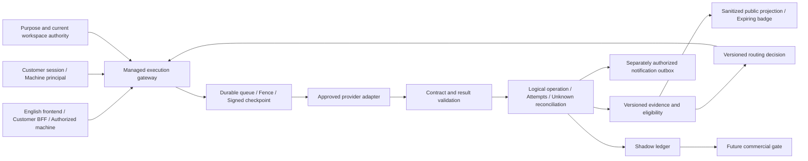

# Agent Concierge — Phase 2 Advancement Design

> **최종 개발 마감 순서:** [개발 완료 최종 계획](DEVELOPMENT_COMPLETION_PLAN.md)의 1~9단계를 따른다. 아래 POST/R/N/AC 순서와 수용 기록은 기존 요구·구현 이력 대조용으로 보존한다. 원래 필수 범위를 제외하거나 개발 완료를 선언한 것은 아니다.

<!-- RND_CURRENT_SOURCE_START -->
### 수용 snapshot 및 재시작 후 점검 · 2026-10-19

**v1.41의 수용 당시 선택된 제한 source**를 동결 입력 957개·영향 모듈 142개·고유 회귀 **2,206개 통과**로 통합 확인했다. 실패/error/skip0·source drift0이며 [최종 검증](../reports/advancement-completion-2026-10-19/verification.json)과 [수용 source snapshot](../reports/advancement-completion-2026-10-19/accepted-source-snapshot.json)에 기록했다. exact corpus·manifest/admission/replan, 운영 자격·로컬 verdict, 비공개 조립/고객 authoring/목적별 알림, circuit 수동 제어, Privacy 검토, bounded bootstrap, 선택형 model proposal, 별도 opt-in public receipt, 수동 remote A2A polling UI/API, offline EIP-3009 crypto의 제한 범위다. **전체 설계 완료나 실제 운영 수용은 아니다.**

최종 native 내부 계약 93개는 해당 pytest 범위 안의 중첩 검사이며 회귀 2,206개에 더하지 않는다. 과거 v1.40의 1,313개·native80개·재시작 읽기38개와 component 재실행도 합산하지 않았다. 수용 당시 공개 콘텐츠 87개 위반0·SQL catalog 3238 statements/205 tables 정합성을 확인했다. scratch115,009건 HTML181.514/29.381ms 두 표본은 collector 경합·운영 p95/SLA/HA 수용 근거가 아니다.

재시작 후 [읽기 전용 점검](../reports/advancement-completion-2026-10-19/POST_RESTART_VERIFICATION.md)은 **46/46 통과**했고, 추가 변경의 격리 영향 회귀는 **15개 모듈·고유270개 통과**로 모듈별 최신 결과를 교체했다. 이 수를 기존2,206개에 더하지 않는다. 현재 프로세스의 HTML 함수 hash는 이전 수용본과 일치하고 현재 소스와 다르다. 보안 격리 대상의 과거 목록 재노출은 소스/격리 회귀에서 보완됐으며 새 SQL은 catalog3239/205에 등록됐다. 이후에도 다른 작업의 소스 변경과 catalog manifest 차이가 관측되어 **현재 전체 소스 승인과 최신 운영 반영은 보류**한다.

남은 항목은 **지정 대상이 필요한 실제 수용**과 **선택된 조건부 추가 source**다. persistent 전체 PostgreSQL cutover/rollback·HA, actual early-stop controller·threshold/실제 개입 증거, A2A session/streaming, 실제 first-party 업무 성과, actual PSP/finality/refund/payout, sole-owner recovery는 남아 있다. 제한 profile이나 callback 주입을 이 전체 범위의 완료로 표시하지 않는다.

기존 POST139R ID는 요구 추적에 유지하며, 최종 실행 순서는 [개발 완료 최종 계획](DEVELOPMENT_COMPLETION_PLAN.md)의 1~9단계를 따른다. R/N/AC와 아래 과거 절은 이력이다. 공개 Workspace·광고 전달·실거래 off, 고객 로그인 프론트엔드 전용, 개별 관리자/desktop을 유지한다. 사용자 재시작 보고를 확인했다. **다른 수정 마감 → catalog 재생성/정합성 → 최종 변경분 검증 → 사용자 터미널 재시작·새로고침 한 번**으로 묶은 뒤 현재 build의 인증된/비공개 수용을 확인한다. 에이전트가 운영 서버를 재시작하거나 운영 DB·외부 제공자·실거래를 조작하지 않았다.
<!-- RND_CURRENT_SOURCE_END -->

설계 v2.0-draft.3 · RND-2026-10-19-r1 · 2026-10-19 · 제품 기준 v1.39 · 내부 개발 설계 · 제품 v2.0 출시 선언이 아님

### R&D 보완 범위 · 2026-10-19

새 첨부의 연구과제1~4를 기존 P2/N 범위의 하위 계약으로 통합한다. [연구 보완 계약](PLATFORM_RND_REFINEMENT.md)과 [구조화 원본](platform-rnd-refinement.json)은 공통 typed 실행 증거, Action-MR/oracle·표면 실험, 관측 가능한 Dual-Clock shadow, 제한 admission·검토된 재계획, 기존 BFF 기준 보안 차이와 조건부 정산을 정의한다. 아래 본문의 해당 P2 절에 적용 계약을 요약했다. 이는 **설계 revision**이며 제품 소스·완료 기능·운영 활성화 상태는 v1.39에서 바뀌지 않는다.

실행 순서는 [현재 작업 순서](REMAINING_WORK_BATCHES.md)의 **POST139R-01~09 단일 큐**를 따른다. 연구 태그를 별도 로드맵으로 만들지 않으며 다음 신규 source는 기존 **P2-01-TYPED-EVIDENCE / POST139R-03**이다. 완료된 평가 worker·영속 receiver·typed 엔진·SDK2/BFF·TEST_UNIT 원장을 재개발하지 않는다. 이번 문서 보완은 기존483개 회귀·native63개 계약·재시작22개 표본을 재실행하거나 새 성과로 더하지 않으며 추가 재시작도 요구하지 않는다.

### v1.39 재시작 이후 현재 상태 · 2026-10-19

사용자 재시작·관리자 새로고침 후 읽기 표본 **22/22건 통과**: health/관리자200, 현재 관리자 자산5개 일치/CSP nonce, 새 worker/receiver 상태를 포함한 비인증API401, 공개 고객/auth와 private inbox404를 확인했다. 검증 입력649개 변경0이다. 제품 코드는 수정하지 않았고483개 회귀를 반복하지 않았다. **추가 재시작은 필요 없다.** [재시작 근거](../reports/remaining-work-plan-2026-10-19/post-v139-restart-readonly.json).

기존 평가 adapter/기본 off worker·영속 receiver·발송/검증 adapter와 관리자 UI는 완료다. 재시작만으로 worker가 활성화되는 것은 아니며 실제 운용은 현재 owner의 명시적 활성화가 필요하다. 비인증 읽기 표본은 실제 인증 기능·외부 연동·독립 품질·운영 전체 수용이 아니다. [기존 격리483건](../reports/advancement-phase2-integration-2026-10-19/verification.json)을 보존한다.

**다음 문장은 v1.39 당시 계획 이력이다. typed 다중 노드 실행 증거는 이후 구현되었으므로 현재 신규 작업으로 반복하지 않는다.** 당시에는1·2번의 관리자/CI·환경 준비와 병행하도록 계획했다. 실제 평가/IdP·SDK/수신/복구 수용은 지정 대상이 필요하며, 신뢰/온라인 라우팅·범용 앱·장기 profile 등 후속 소스도 남아 있다. 모든 잔여를 외부 설정 문제로 표현하지 않는다.

### v1.39 당시 구현 — 평가 실행·영속 머신 수신 연결 완료 · 2026-10-19

권장1·2번의 격리 관리자/설정 준비 검증을 보강하고3·4번의 제한 source를 연결했다. 현재 관련 입력649개·32모듈 **483개 고유 회귀 통과**, 실패/error/skip0이며 과거1,787개·개별 검사·진단 실행 수는 합산하지 않는다. [최종 검증](../reports/advancement-phase2-integration-2026-10-19/verification.json).

docs/news MCP technical evaluator·현재 권한 최종 fence·기본 off worker·명시적 owner 활성화/철회·단회 dispatch/unknown 무재실행을 연결했다. 기술 계약 성공은 독립 업무 품질이 아니다. receiver는 원자적 영속 event/nonce/dedupe claim 후에만 receipt를 반환한다. 기존 주소 proof, 목적별 동의, 수신처별 파생 키, bounded HTTPS webhook/제한 A2A 왕복, 새 복원 권한의 과거 패킷 거부를 적용했다. 관리자 desktop의 기존 중앙 모달에 상태·동의·활성화/철회를 연결했다.

고정3048 SQL쌍/192테이블·실제 격리 native 계약63개를 확인했다. 정적14개 Python의 원본 High0/Medium14/Low13은27개 모두 개별 검토·보존했고 신규 source 경고0·새 억제0이다. 기존 선택 억제1개도 별도 검토 기록했다. 공개 콘텐츠79개 위반0·HTML mirror와 변경 JS2개 구문/브라우저를 확인했다. 이는 전체 플랫폼 취약점0·실제 외부 수용 인증이 아니다.

이 구현 당시 필요했던 재시작/새로고침은 사용자 보고와 위22개 읽기 표본으로 반영을 확인했다. 이번 계획 갱신에는 추가 재시작이 필요 없다. 직전 v1.38의18/18 읽기 표본은 이 새 source의 운영 수용이 아니다. 운영 서버·DB·외부 제공자/알림·금전은 조작하지 않았다. 공개 Workspace·광고·실거래는 off를 유지한다. 실제 관리자/hosted CI·Google/GitHub/HTTPS SDK2·승인 제공자/독립 평가자/수신처·운영 부하/DR와 조건부 공개/라우팅·범용 profile·상용 확대는 [현재 순서](REMAINING_WORK_BATCHES.md)에 남긴다.

## 1. 목적과 출발점

목표는 **검증 근거를 누적하고, 실제 업무 성공을 측정하며, 안전하게 다른 에이전트를 선택할 수 있는 운영 플랫폼**이다. 현재 서비스의 우선순위인 빠르고 정확한 추천, 명확한 실행 결과, 글로벌 영어 UX를 유지한다. 사용량 확보 전의 상업화·등급 우선 추천·Chat 업셀은 도입하지 않는다.

입력은 사용자가 제공한 「고도화 개발 사항…초격차 전략 보고서」(첨부 e103ab1d-8997-4eaa-995c-91ffcf356af6)와 「초격차 기술 심층 조사 및 단계별 R&D 실행 연구 계획서」(첨부 fdb36a04-0541-4985-b23b-ea9d9ca35d64), [1차 설계](PLATFORM_ADVANCEMENT_DESIGN.md), [현재 POST139R-01~09 작업 순서](REMAINING_WORK_BATCHES.md), 현재 소스와 검증 보고서다. 앞선 N01~N12의7개 실행 묶음은 구현 이력으로 보존하며 현재 큐를 대신하지 않는다. 첨부의 사업 방향은 채택하되 “전 기능 완료”, “무중단 보증”, “완벽한 토큰 은닉”, “고객획득비용 0”, “자체 에이전트 매출총이익 100%”는 구현·계약·실측으로 확인되기 전의 가정으로 정정한다.

2차 설계를 작성했다는 이유로 1차 잔여 작업을 완료 처리하지 않는다. 1차 N01~N12 식별자는 유지하고, 이 문서의 P2 식별자는 후속 확장이다. 구현, 격리 시험, 실제 공급자 수용, 운영 Gate 통과를 각각 기록한다.

### 재사용할 기반

- 공개 게이트웨이 projection, 버전·스키마·의미 계약, 실행 증거, 목적별 권한·kill switch.
- 영속 실행·checkpoint·fence·결과 outbox·unknown 격리, 제한된 news/docs 읽기 폴백.
- 제한된 compiler·typed 연결·비교/검토·게시와 기존 SDK 1.0~1.3. 기존 프론트엔드 다운로드 호환 계약 유지.
- 조직 초안/불변 저장본과 별도 비공개 MCP 단건 실행. 저장 JSON 자체는 실행·배포 권한이 아니다.
- 고객 인증·생명주기·SDK2·endpoint control proof·검토 할당·모의 원장·지원은 v1.34 및 v1.35 소스 delta별 실제 검증 결과와 해당 제한 profile 범위만 기반으로 인정한다. 전체 1차/운영 Gate 완료를 의미하지 않는다.

### v1.35 출발점과 명시적으로 남겨 둘 1차 조건

고객 소유 조직/초대·탈퇴·권한 철회, 선택형 키 회전/출력·backup 암호화, 제공자 재인증·이전, private 최대6노드 typed MCP·조건/projection, runtime TEST_UNIT 계량, 공개 목적만 공유하는 모델 안내·검토 patch, 기본 off 자체 docs MCP, immutable 모의 70:30 agreement/부분환불은 1차의 추가 구현이다. [v1.35 검증 이력](../reports/advancement-finalization-2026-10-18/README.md)와 각 실제 검증 profile 범위만 기반으로 인정한다. 이미 구현한 항목을 2차 신규 구현으로 반복하지 않는다.

사용자 요청에 따라 공개 **Workspace access는 출시 보류**이며 메뉴·고객 page/auth/org/SDK2 권한 라우터는 기본 off다. Google/GitHub가 설정돼도 자동으로 열지 않는다. 실제 IdP·별도 hosting 수용, 독립 검토자/자료, 승인된 제공자와 cohort, 전체 Store PostgreSQL 운영 전환·대표 부하/DR/HA, 공급자 법적 계약·실거래는 남는다. native PG application repository와 검색/vector parity의 격리 검증은 운영 이전·HA의 근거가 아니다. 키링/암호화 소스는 운영 키 보관·회전·보존·복원 소유 책임의 승인을 대신하지 않는다.

### v1.36 기반 대사

v1.36 당시 조사된 Store78메서드는 모두 구현됐고 native application/customer SDK2, collector, credential/가상 원장, explicit private worker/archive를 검증했다. [새 동결 검증](../reports/advancement-pg-compatibility-2026-10-19/README.md)의21모듈 404통과와 해당 제한 profile을 재사용한다. 앞서 기록한28미지원 메서드는 과거 상태이며 다시 개발하지 않는다. 당시 잔여였던 finite native consumer·명시적 이전 대사와 일반 archive credential 소스는 v1.37에서 마감했다. 대표부하·운영 전환/rollback/DR/HA 수용은 남는다. full_application_ready=false와 operating_backup_ready=false이며 실제 IdP·공개 Workspace·실거래를 활성화하지 않는다. 관리자 개발은 데스크톱 기준이다. 전체2차 출시가 아니며 이후 제한 소스 구현은 아래 절에서 구분한다.

### v1.37 소스 묶음과 P2-01의 첫 구현

7개 실행 묶음은 실제 외부 시험 환경이 없는 현재 조건에 따라 연동 소스·합성/격리 검증부터 진행했다. 명시적 전체 알려진 스키마 복사·서명 대사·전환/rollback 준비와 영구 target 격리, 실제 credential provider를 받는 암호화 PostgreSQL backup/복원·외부 소유자 재승인, 관리자 설정 준비 조회, 서명 TEST_UNIT 이벤트 어댑터를 추가했다. 실제 Chat/관리자/RAG·SNS·알림 조회의 native consumer를 보완하고, 별도2~6노드 typed SDK2 export/BFF와 기존 단건 SDK2·공개 SDK1.x의 계약을 구분했다. 운영 DB·IdP·과금·알림은 활성화하지 않는다. 최종 동일소스 통합 검증은777개 입력·97모듈·1,604개 통과(실패/오류/skip0, 소스 변동0)이며 공개 콘텐츠78개 위반0이다. 정적43개 Python의 원본 경고 High0/Medium92/Low55는147건 모두 개별 검토·보존했다. 개별/과거 시험 수는 합산하지 않는다. [v1.37 보고서](../reports/advancement-batch7-2026-10-19/README.md)에 근거를 고정했다. 사용자 재시작·새로고침 후13개 읽기 표본을 확인했으며 추가 재시작은 필요 없다. 이후 성능 변경분의 영향 회귀와 실제 운영 수용은 별도다.

P2-01의 첫 제한 구현은 `bounded-evidence-rollup-v1`이다. 기존의 현재 버전/기한/권한이 맞는 보존된 증거만 읽어 집계하며 관리자 `Current evidence`에서 조회한다. 조직별 범위, 논리 실행 중복 제거, 서명 철회 tombstone, 원본 삭제·버전 변경·만료·권한 변경에 따른 ETag/304 재검증을 적용했다. 비공개 실행은 서명 metadata만 읽고 output을 복호화하지 않는다. 샘플 기준 충족은 현재 품질이나 operating qualification을 부여하지 않는다. 격리29개 시험과 세부 범위는 [증거 보고서](../reports/advancement-batch7-2026-10-19/evidence/README.md)를 따른다. v1.37 당시 전체 evaluator/cohort/source-fidelity·reliability plane은 후속 설계였다. v1.38 제한 구현은 아래 새 절을 따른다.

### v1.38 — 권장9개 작업의 제한 소스 구현·검증

현재 관련 입력 638개를 고정해 113모듈 **1,787개 통과**, 실패/error/skip0을 확인했다.3개 파일 shard의 고유 case 합집합이며 과거·개별 결과는 더하지 않는다. 관련 없는 batch 삽입/생성 스크립트는 제외 목록으로 남겼다. [최종 근거](../reports/advancement-phase2-core-2026-10-19/verification.json).

P2-01의 계획/케이스/코호트·목적별 암호화 보존·현재 실행 연결·독립 자격 판정, P2-02의 기본 off 승인 corpus·예산/jitter·coverage·일회 dispatch/unknown, P2-03의 비공개 만료/중립 미리보기, P2-04의 규칙 offline/decision shadow를 구현했다. 평가기 미설정은 unassessed이며 shadow의 business call은0이다. 공개 배지·온라인 학습·실사용 자동 전환을 활성화하지 않는다.

P2-05/06에는3개 고정 계약 앱 템플릿·정확한 입력/대상 검토·원자적 typed flow 저장·현재 소유자 SDK admission/만료/카탈로그와 기존 이력 읽기 호환을 추가했다. 자동 선택은 제한 영어 keyword 규칙이다. P2-07은 현재 제공자 소유권과 검증 수신처/목적을 별도로 확인하고 서명·nonce·audience·중복·수락 receipt·unknown·철회/복원 경계를 구현했다. 수락은 업무 완료가 아니며 기본 sender는 없다. P2-08은 자체 문서 corpus와 원본 terminal run 기반 지원 관측/철회·논리 집계까지다. staff 해결 상태와 반복 실행 이력은 업무 성공·고객 유지·제공자 품질을 입증하지 않는다.

관련 정적24개 Python의 원본 High0/Medium30/Low29,59건을 검토·보존했으며 신규 profile의 경고0, 억제 추가0이다. JavaScript6개 구문·공개 콘텐츠79개 위반0·HTML mirror를 확인했다. 독립 검토에서 발견한 머신 알림의 계약 downgrade/gain·양성 근거 TTL·최종 수신처 만료 경계를 수정하고 재검증했다. 이는 전체 플랫폼 취약점0이나 운영 침투 인증이 아니다. 관리자 경로/자산114개 검사와3개 템플릿 실행 수용은 별도 근거로 남기며 통합 수에 합산하지 않는다.

PostgreSQL은 고정 SQL3033쌍/189테이블에 신규25개 테이블을 포함하고 실제 격리 API/실행/복원 경로를 검증했다. 서명 이력은 유지하고 과거 consent/control/plan/job/policy/review/subscription에 영구 복원 차단을 둔다. 원문 증거는 복원 시 삭제한다. native/구조 수치는 full_application_ready·운영 backup/RPO/RTO/DR/HA 판정이 아니다.

관리자 → 조직 작업공간에 **Reliability evidence**, **Evaluation and routing**, **App factory and SDK**, **Verified machine updates**를 연결했다. 공개 Workspace access는 계속 off, 관리자 데스크톱·기존 개별 세션·Google/GitHub 고객 전용 경계를 유지한다. 기존 공개 테스트·워크플로우·SDK/웹앱 다운로드 호환을 검증했다. 운영 서버·DB·외부 대상은 변경하지 않았다. 이 소스 묶음은 이후 사용자 재시작·새로고침과18개 읽기 표본으로 반영을 확인했다. 현재 계획 갱신에는 추가 재시작이 필요 없다.

실제 IdP/HTTPS/BFF·키/복구 책임·승인 제공자/독립 평가자·검증 수신처·대표 부하/DR와 hosted CI, 법적/결제 sandbox 수용은 남는다. P2-09/10의 실제 운영·상용 조건과 전체1차/2차 완료를 선언하지 않는다. [현재 권장 순서](REMAINING_WORK_BATCHES.md)에서 구현된 소스를 재개발하지 않고 필요한 실제 수용을 진행한다.

## 2. 첨부 문서의 기술·사업 가정 정정

**연구와 자체 실적을 구분한다.** [ReliabilityBench](https://arxiv.org/abs/2601.06112)는 반복·동일 의미 입력 변형·도구 장애를 함께 평가할 근거다. 해당 실험이 임의의 외부 에이전트 간 상태 이식이나 무조건적 폴백의 우월성을 증명하지는 않는다. 논문의 수치와 모델별 비용을 본 플랫폼의 품질·원가 실적으로 전용하지 않는다.

[NetGPT 연구](https://arxiv.org/abs/2511.22217)는 cloud/edge 네트워크 조건을 고려한 라우팅을 다룬다. 이 결과로부터 우리 서비스의 계약 간 호환성이나 온라인 학습 안전성이 입증되었다고 추론하지 않는다. [MechMath](https://arxiv.org/abs/2607.04394)는 수학 연구용 제어·실행 분리 사례이며, [PANDA](https://arxiv.org/abs/2609.38482)는 분산 에이전트 협업·복구 연구다. 이들로부터 얻는 설계 영감과 자체 환경에서 확인해야 할 가설을 분리한다.

**WeakMap은 서버 비밀 보관소가 아니다.** 브라우저가 사용하는 값은 XSS·확장 프로그램·개발자 도구·네트워크 관찰에 대해 완전히 비밀일 수 없다. SDK2의 비밀은 BFF 서버에 보관하고 브라우저에는 HttpOnly 세션과 필요한 CSRF 값만 둔다. 정적 앱의 `file://` 지원을 조직용 인증·보안 배포의 전제에 넣지 않는다. 지원된 HTTPS origin과 BFF가 필요한 이유를 명확히 알린다.

**단독 호스팅 가능성과 런타임 의존성을 구분한다.** 다운로드 앱은 고객 호스트에 배포할 수 있지만 실행·권한 확인은 Agent Concierge 게이트웨이에 의존한다. “Zero-Dependency” 대신 이 의존성과 장애 시 동작을 README/manifest/화면에서 사실대로 설명한다. 숨은 추적 센서나 강제 과금 경로로 설계하지 않는다.

**전송 후 불확실성은 자동 교체 조건이 아니다.** timeout이 수신 거부를 뜻하지 않는다. `dispatched` 이후 결과가 불명확하면 기존 unknown 경계를 유지한다. 쓰기·결제·장기 task는 제공자 멱등 키·상태 조회·취소 계약이 확보된 별도 profile에서만 다룬다.

**상업 성과와 목표를 구분한다.** 99.9% 가용성, 1분 생성, 템플릿 50개, 고객 수·기간·마진은 측정 또는 계획 가정이다. 현재 SLA·실적·출시일로 표시하지 않는다. 7:3은 향후 계약 정책이며 기준액·세금·수수료·원가·환불·실제 기여자가 확정돼야 정산할 수 있다.

이번 첨부의 논문 수치·버전·프로토콜 주장은 [연구 보완 계약 §1](PLATFORM_RND_REFINEMENT.md#1-반영-결정과-근거의-한계)의 출처별 정정을 따른다. `pass^k`와 `pass@k`, 반사실적 replay와 실제 중단 절감, 특정 장애 실험 완료율과 정답률/SLA를 구분한다. 논문 내 최댓값·예측 우월성을 우리 서비스의 품질·무중단·보안 보장으로 전용하지 않는다. 숨은 제공자 추론을 수집하거나 무조건적 외부 hot-swap을 허용하는 근거로도 사용하지 않는다.

## 3. 반드시 유지할 제품·보안 경계

1. Google OIDC와 GitHub OAuth 고객 로그인은 **프론트엔드에만** 둔다. 어드민은 기존 개별 관리자 세션이다. 이메일 일치·공급자 profile role로 계정을 합치거나 관리자 권한을 부여하지 않는다. 기계 에이전트는 별도 서명 주체와 목적별 capability를 사용한다.
2. 글로벌 프론트엔드 copy·소스 주석·메타데이터는 영어, 현대적인 Lucide 디자인, 키보드·명암·reduced motion 접근성을 유지한다. 비공개 운영 정보·개인정보·원본 자격증명은 공개하지 않는다.
3. Chat은 최신 성공 검증→최근 활동→품질 등급을 적용한 관련 에이전트 한 개를 추천한다. 명시 선택/질문 속 protocol을 우선하고 새 요청 기본값 A2A, 후속 요청은 현재 선택을 유지한다. Chat/상세에 가격·결제·wallet·등급 업셀을 추가하지 않는다.
4. 추천 protocol, 입력 공유, 실행, 결과 전달, 관심 알림, 마케팅, 향후 실거래는 별도 목적이다. 로그인이나 방문, endpoint 소유권 증명은 이 권한들을 포괄하지 않는다. 광고 발송은 비활성 상태다.
5. 검증된 수신처도 발송 목적·현재 동의·철회·기한을 매 전송에서 확인한다. 브라우저 Push의 실제 시험 알림 클릭 확인과 webhook/inbox challenge를 유지한다.
6. 운영 서버는 사용자가 터미널에서 관리한다. 개발 중 임의 재시작·운영 DB 전환·제공자 장애 주입·실거래를 하지 않는다. 완성 소스 묶음 단위로 한 번의 재시작과 수용 검증을 안내한다.

## 4. 목표 아키텍처

제어면은 권한·계약·릴리스·정책을 관리하고, 실행면은 결정된 범위만 수행한다. 분석면의 점수·예측 모델·공개 배지는 실행 권한을 발급하지 않는다. 추천의 빠른 조회용 projection과 원본 감사 증거를 분리하며, 각 projection에 source revision·expiry·재생성 근거를 둔다.

## 5. P2-01 — Evidence Plane and Reliability History

현재 구현된 제한 metadata rollup은 위 v1.37 절을 따른다. 아래 항목은 전체 evidence plane의 목표 설계다. v1.38의 비공개 제한 구현과 실제 독립 품질 수용·지원 profile 잔여를 위에서 구분한다.

우선순위 P0. 기존 operation/attempt/contract evidence를 다시 만들지 않고 원본 참조로 확장한다.

신규 설계 객체는 `reliability_cases`, `evaluation_cohorts`, `reliability_observations`, `evidence_rollups`, `evidence_revocations`다. 키는 agent/version/contract/case/dataset/rubric/evaluator/permission revision과 observation time을 묶는다. 조직별 비공개 근거와 공개 근거는 다른 scope다. raw prompt·개인정보·제공자 secret은 기본 수집하지 않는다.

평가 상태는 `planned → authorized → reserved → dispatched → completed | failed | unknown | expired`다. 완료 여부와 업무 정확도·출처 검증·독립 검토 상태를 별도 필드로 둔다. `unknown`을 성공이나 단순 실패로 재분류하지 않는다. 같은 논리 업무에 대한 개별 시도를 중복 성공 표본으로 집계하지 않는다.

집계는 sample 수, 성공/실패/unknown 분모, 관측 창, version 변경, p50/p95 지연과 지연 범위(gateway/provider), 검토자 일치와 미평가 비율을 함께 기록한다. 작은 표본은 “Insufficient evidence”다. 단일 종합 점수만으로 분야 간 품질을 순위화하지 않는다. 성공률 구간 추정과 최소 표본 기준은 평가 계획 버전에 고정한다.

실제 평가에 필요한 source/input/output bundle은 공개 rollup과 분리한 목적별 비공개 저장소에서 최소 범위·접근 권한·암호화·삭제 기한을 적용한다. 원문/실행 증거가 삭제·소실·만료되면 source fidelity는 unassessable이며 배지는 중립 상태다. hash만 남았다는 이유로 현재 품질을 계속 인증하지 않는다.

수용 기준: 동일 event/replay의 중복 집계 0, 철회·version 변경 후 stale rollup 사용 차단, 조직 간 조회/캐시 분리, 늦은 관측/시간 오차·재처리의 결정적 결과, raw 데이터 삭제 후 필요한 최소 감사·중복 방지 근거 유지.

**R&D 보완 계약 — P2-01-TYPED-EVIDENCE / POST139R-03.** 현재 단건 `workspace_private_runs` binding을 기존 typed run/step 출처에 연결하는 것이 다음 신규 source다. 하나의 논리 run 아래 node/attempt, graph/release/policy revision, agent immutable version·schema/contract, 원래 요청과 실제 resolved input, output source/hash, projection 부모 field path·branch 선택/미실행 이유를 묶는다. technical result·independent quality·source fidelity·business outcome·delivery receipt·payment status는 서로 다른 상태다. 하위 시도 수를 성공 표본으로 부풀리지 않는다.

기존 run/step/checkpoint·권한/동의·암호화/retention을 참조하고 두 번째 실행 저널이나 복제 executor를 만들지 않는다. raw/closed sequence·MR/fault/oracle/milestone은 향후 선택적 참조로 확장하며 아직 관찰하지 않은 이벤트를 추정 생성하지 않는다. 자료가 없거나 삭제됐을 때 hash만으로 현재 품질을 인증하지 않는다. 필요한 최소 ID는 workspace/purpose/revision/expiry를 검사하는 서버 resolver로만 역참조한다. 선형·분기·projection·부분/확정 실패·unknown·늦은 이벤트와 철회/삭제/복원·IDOR/ETag를 함께 검증한다. [공통 실행 증거 계약](PLATFORM_RND_REFINEMENT.md#3-공통-실행-증거-계약--다음-신규-개발).

## 6. P2-02 — Adaptive Continuous Evaluation

우선순위 P0, 선행 P2-01. 현재 주기를 모든 에이전트에 대한 정확도 보장으로 바꾸지 않는다. 6시간 health와 10분 리포트는 대상·수집 지연·실제 관측 시각을 표시하는 운영 목표다.

v1.39의 고정 시간 창·규칙과 per-host budget·jitter·중복 실행 방지·kill switch를 재사용한다. 최근 사용량, 계약/스키마 변경, 이전 장애, 증거 만료, 제공자별 허용 빈도에 따른 적응형 배정은 선택적 후속 source다. 빈 슬롯을 채우기 위해 변경/결제 도구나 비동의 제공자를 호출하지 않는다. 누락/지연은 coverage debt로 표시하며 시험 일자를 갱신해 성공처럼 보이게 하지 않는다.

반복 성공 일관성, 의미가 같은 질문의 변형, rate limit/schema drift/응답 유실은 별도 case다. 실제 사용자 입력을 자동 재전송하지 않고, 허용된 평가 corpus와 별도 실행 승인으로만 반복 측정한다. scheduler workload와 실제 사용자 업무의 성공률을 분리한다.

수용 기준: backlog에서도 호출 budget 준수, 동일 제공자에 동시 폭주 없음, 취소/권한 철회 후 dispatch 없음, 평가 오염/학습 데이터와 holdout 분리, 예산·버전·시간 창별 coverage 및 지연 확인.

**R&D 보완 계약 — P2-02-ACTION-MR-ORACLE·P2-02-SURFACE-OFFLINE / POST139R-04.** 완료된 default-off worker의 corpus/plan을 확장한다. dataset/rubric/evaluator/oracle/mutator/fault version, 의미 보존 승인, seed·초기 상태·reference time/timezone/locale와 예산을 manifest에 고정한다. 먼저 소수 읽기 계약의 검증 가능한 변환을 사용한다. 원본과 변형의 판정이 같아도 둘 다 실패하면 성공이 아니며, 잘못된 의미 변환·oracle 오류·agent 실패·source 부족을 구분한다. 스키마 검증 통과는 독립 업무 정확도가 아니다.

반복과 fault 주입은 별도 승인 평가 episode/fixture에서만 수행한다. 실제 고객 요청·unknown 업무를 반복하거나 운영 제공자에 장애를 주입하지 않는다. 최초 `R̂(contract, version, k, ε, λ)`는 이산 셀별 관측값이며 k회 모두의 목표 성공, sample/episode·paired 수·완료/실패/unknown/미평가·누락 coverage와 구간 추정을 함께 기록한다. 상관된 시도를 독립 표본으로 세거나 unknown을 유리하게 분모에서 빼지 않는다. 희소 셀의 보간·RTT 변화만으로 정밀한 구배·장애 임박·SLA를 주장하지 않으며 시간 분할 holdout·calibration·false quarantine·공통 의존과 baseline 비교 후 예측을 별도 승격한다. 연구 평가/LLM 심판은 Chat 추천 hot path에 넣지 않는다. [MR·oracle·표면 계약](PLATFORM_RND_REFINEMENT.md#4-rq1--action-mr상태-oracle신뢰성-표면).

## 7. P2-03 — Trust Pages and Expiring Verification Badges

우선순위 P1, 선행 P2-01·02. “10-Min Verified” 일괄 발급 대신 실제 시각·계약 범위를 보여 주는 `Last verified`/`Evidence pending`/`Verification expired` 배지를 우선 제공한다. 시간 조건을 만족한 경우에만 해당 관측 범위를 설명한다.

**제안 API, 아직 기존 경로가 아님:** `GET /api/reliability/agents/{agent_ref}`, `GET /api/reliability/agents/{agent_ref}/badge.svg`. 공개 projection만 읽고 요청 때문에 provider call을 하지 않는다. raw upstream, 내부 ws/user, 오류 stack, 입력/출력, 모델·배포 정보는 응답하지 않는다. SVG는 고정 템플릿·escaped text·허용 색상만 사용하고 script/foreignObject/외부 리소스·사용자 URL을 받지 않는다.

배지의 positive cache TTL은 evidence expiry 이하이며 positive stale-if-error/stale-while-revalidate는 금지한다. ETag/304 처리에서도 현재 revision·철회·expiry를 재검증하고 증거 만료·철회·원본 근거 소실 시 중립 상태로 돌아간다. 오프라인 복제 이미지는 신뢰할 수 있는 최신 증거가 아님을 상세 페이지가 설명한다. 배지 유입→실제 허용 실행 전환을 개인정보 최소화 집계로 측정한다. 광고 허용이나 “획득 비용 0”을 추정하지 않는다.

**R&D 보완 계약 — P2-03-PUBLIC-RECEIPT / POST139R-07.** 공개 제3자 offline 검증 요구가 확인될 때만 별도 profile로 설계한다. SHA-256은 내용 무결성 hash이며 issuer 인증·업무 정답·지급 증명이 아니다. 기존 수신처별 HMAC receipt는 공유키 상대의 전달 수락 근거로 유지하며 공개 비대칭 서명이라고 표시하지 않는다.

새 공개 검증 profile은 canonical payload·공개키 서명·issuer/key ID·알고리즘/발급 범위·신뢰키 배포/회전·expiry/revocation을 고정해야 한다. offline 검증만으로 최신 철회 여부를 알 수 없으며 raw 입력/출력·내부 주체·수신처·비밀은 담지 않는다. 현재 공개 signing key/API나 배지가 구현·활성화됐다고 간주하지 않는다. “10-Min Verified”도 현재 독립 자격·표본·실제 관측 기한을 만족한 범위에만 사용할 수 있다. [공개 receipt 경계](PLATFORM_RND_REFINEMENT.md#9-공개-offline-receipt와-알림의-경계).

## 8. P2-04 — Predictive Routing with Safe Admission

우선순위 P1, 선행 P2-01·02와 실제 호환 제공자·G1 수용. 기존 R-06의 호환 계약과 unknown 장벽을 보존한다.

라우팅 결정은 **외부 business dispatch 전**에 주/대체 중 적격한 하나를 고정한다. 예측은 정책에 서명된 계약·버전·schema·현재 성공 증거·승인·입력 공유 범위를 통과한 후보 사이에서만 사용한다. circuit breaker는 closed/open/half-open과 재검증 시각을 갖는다. half-open probe는 별도 승인 평가이며 사용자 업무를 복제하지 않는다.

최초 예측 profile은 admission에서 **선택한 제공자 하나, business call 최대 1회, 이후 추가 교체 0회**로 고정한다. 기존 R-06 primary→alternative 실행 profile과 상호 배타적이며 서로 겹쳐 호출 budget을 늘릴 수 없다. 이후 ordered candidate/전환 profile은 최대 전체 호출 수와 전환 수, 처음부터 대체를 선택했을 때의 소비 규칙까지 서명한 별도 정책·동의로만 승격한다.

첫 버전은 최근 오류·freshness·지연·공통 호스트/운영자 장애 상관에 대한 규칙으로 동작한다. 이후 시간 순서 분할 데이터로 예측을 검증한다. 학습 결과를 자동 배포하는 online RL은 제외하고, 고정 모델/특징 버전→offline 재생→대체 호출 없는 decision shadow→명시 opt-in canary 순서로 승격한다.

과거의 selected propensities, 적격 후보, 사유, 표본 수, 정책 hash를 기록해 선택 편향을 분석한다. 예측 점수는 의미 호환성 증명이 아니다. 별도 R-06 profile의 최대1회 대체 경계와 최초 P2 admission profile의 추가 교체0을 구분하고, 두 경우 모두 전송 후 불명확 재호출은 금지한다. 제품·쓰기·결제·stateful fallback은 별도 계약 승격 전까지 불가다.

수용 기준: baseline 대비 동일 corpus 업무 성공·지연·추가 시도·unknown 비교, kill switch 즉시 차단, 만료·권한/공유 변경 시 admission 거부, 두 제공자 동시 장애와 공통 의존 장애, shadow가 실제 대체 호출을 발생시키지 않음.

**R&D 보완 계약 — P2-04-SINGLE-ADMISSION / POST139R-07.** 예측 격리는 우선 다음 신규 admission에만 적용하고 현재 실행의 provider 세션을 이동하지 않는다. 별도 승인 half-open probe는 평가 job이며 고객 업무 복제가 아니다. 관측된 공통 host/운영자 출처와 현재 typed lineage를 사용하되 예측 점수가 계약 호환성·실행 권한을 발급하지 않는다. 최초 온라인 profile의 선택1·business call≤1·replacement0과 R-06 상호 배타를 단일 원자 admission에서 검증한다.

로컬 중단은 원격 취소가 아니다. `dispatched` 이후 timeout/응답 유실/취소 불확실성은 unknown·조정 필요이며 새 제공자·새 지급·자동 재계획을 허용하지 않는다. 실제 status/cancel/idempotency는 검증된 별도 장기 profile에서만 사용한다. checkpoint 재사용은 현재 권한·동일 pin·서명·절대 deadline과 기존 재개 가능 경계를 유지한다. [조기 종료·입장 라우팅 계약](PLATFORM_RND_REFINEMENT.md#6-조기-종료입장-라우팅검토된-재계획).

## 9. P2-05 — Contract-Driven App Factory

우선순위 P1, 선행 기존 compiler·제품 v2 검증과 P2-01. 자연어는 후보 선택용 intent이며 실행 코드·URL·권한을 직접 만들지 않는다. 목적→허용 계약→현재 적격 후보→입력 검토→불변 초안→명시 시험→릴리스의 단계를 유지한다.

기존 typed DAG의 literal·정의된 projection·조건 branch와 최대6노드 검증을 재사용한다. 추가 계약·bounded map 같은 새 범위는 필요한 schema/예산 계약으로만 확장한다. 각 edge는 source/target schema, field mapping, 단위·언어·freshness, 입력 공유 목적과 최대 크기를 가진다. 재귀·순환·임의 expression/eval·숨은 세션 이식은 허용하지 않는다. branch 조건은 서버의 열거된 연산자뿐이며 실행 전에 검증한다.

새 에이전트로 “교체”는 실행 중인 상태를 이전하는 hot-swap이 아니라 새 revision을 만들어 같은 입력·명시 승인으로 비교 시험하는 의미로 제한한다. 진행 중인 run은 원래 version pin을 유지한다. 장기 A2A task/MCP session/streaming은 수요와 status/cancel/idempotency 계약을 갖춘 async profile로 분리한다.

템플릿은 우선 실제 수용 가능한 소수부터 공개한다. 각 template은 현재 성공 시험, 입력 공개 범위, 권한, 기한, artifact scan과 지원 owner를 가져야 한다. “50개”는 초기 고정 납품 조건이 아니다. 실제 측정한 time-to-first-success와 재사용률로 확대한다.

**R&D 보완 계약 — P2-05-DUAL-CLOCK-SHADOW / POST139R-04.** 공통 typed lineage 위에 컨트롤러가 실제 관찰한 authorized request·정책 차단·prepared/dispatched·응답/status·검증/checkpoint·취소/unknown metadata의 인과 sequence `k`를 둔다. 숨은 제공자 추론·비공개 CoT·내부 토큰이나 존재하지 않는 `yield`를 수집/추정하지 않는다. closed action sequence `t`는 지원 profile의 확정 응답·검증·영속 checkpoint 완결 경계에서만 진행하며 성공/확정 실패/부분/unknown은 별도 결과다. MCP stateless와 장기 A2A/session/streaming에 같은 call-return-yield를 강요하지 않는다.

milestone은 공개 허용 입력·출처·계약의 목표/선행 관계·증거 조건과 부분 결과 표시 정책으로 고정하고 reference/holdout 정답 경로를 planner/provider에 주지 않는다. 다수 합의도 참을 보장하지 않으므로 기존 deterministic compiler·cycle/schema/field/purpose 검사를 통과해야 한다. 최초 replay/shadow는 새 호출·중단 권한을 주지 않으며 baseline 대비 탐지 지연·오탐/누락·판정 overhead·unknown을 측정한다. 반사실적 절감과 실제 중단 결과를 합산하지 않는다. [Dual-Clock 관측 계약](PLATFORM_RND_REFINEMENT.md#5-rq2--관측-가능한-dual-clock단계-감시).

**P2-05-EARLY-STOP-PILOT·P2-05-REVIEWED-REPLAN / POST139R-07.** 예측상 실패는 먼저 `would_stop`으로만 기록한다. 사전 고정 오탐·성공 손실·overhead 기준을 만족한 좁은 profile만 명시 opt-in 중단 pilot으로 승격한다. 기존 정책/권한 위반 차단은 즉시 유지한다. Fixer는 알려진 순수·계약 보존 변경을 검토 가능한 proposal로 제시할 뿐 금액·서명·권한·schema/tool pin·입력 공유·예산·사용자 의도를 조용히 고치지 않는다. 변경은 새 draft/revision→compiler 검증→입력 공유/차이 검토→명시 시험/릴리스이며 진행 중 run의 pin은 고정이다. variable slimming은 승인 projection/목적별 최소 참조를 재사용하고 provider의 `should_expose_answer`를 공개 권한으로 신뢰하지 않는다. 폴더 격리는 플랫폼이 통제하는 로컬 fixture에만 적용되며 원격 agent의 sandbox가 아니다. [검토된 재계획·중단 경계](PLATFORM_RND_REFINEMENT.md#6-조기-종료입장-라우팅검토된-재계획).

## 10. P2-06 — Customer Deployment and SDK Lifecycle

우선순위 P1, 선행 고객 인증·불변 릴리스·배포 권한·SDK2의 실제 수용. 기존 SDK1.x와 공개 프론트엔드 다운로드를 강제 업그레이드하지 않는다.

새 배포는 release hash와 정확한 origin, audience, scope, 만료, logical run/일 한도를 고정한다. Google/GitHub 로그인 UI는 공개 프론트엔드에만 제공한다. code/state/nonce/PKCE·Google issuer/JWKS·GitHub stable ID 검증과 고객 세션 발급은 프론트엔드 서비스의 서버/BFF에서 수행하며 브라우저의 profile·판정을 신뢰하지 않는다. 고객 BFF는 app/origin/PKCE에 바인딩된 단회 code를 짧은 app capability로 교환한다. query string/localStorage/static ZIP에 bearer를 넣지 않는다. 긴 상태 확인 권한은 정확한 run에 한정하며 새로운 실행 권한으로 재사용하지 않는다.

manifest에는 SDK/profile/schema 최소 버전·gateway 의존·지원 origin·deprecated 기한을 넣는다. 발급·철회·만료·호환성 상태 페이지, signed release catalog, rollback 계획을 제공한다. 버전 pin으로 중단된 제공자를 무조건 계속 허용하지 않고 현재 kill switch와 권한을 재검증한다.

권한의 구분: 고객 owner/editor/viewer/runner와 초대·역할·탈퇴 기능은 N02에서 구현한 소스를 재사용한다. 실제 IdP·계정 상실 복구·조직 운영 수용은 별도로 남기며 초기 viewer/runner 링크만으로 이를 완료 처리하지 않는다. 복원 후 옛 membership·session·배포·수신처가 부활하지 않도록 current proof로 새 권한을 발급한다.

**R&D 보완 계약 — P2-06-SDK-THREAT-DELTA / POST139R-05.** 현재 same-origin BFF·PKCE·서버 capability·현재 권한/논리 호출 한도와 artifact 노출을 기준으로 빠진 검사만 찾는다. 차이가 없으면 SDK를 다시 쓰지 않는다. `#private`·bounded deepFreeze는 검증한 JSON 설정의 방어적 복사·깊이/크기·순환·prototype/getter 제한 같은 필요한 client robustness에만 사용한다. 전역 prototype/fetch/WeakMap 잠금이나 함수 `toString` 검사를 신뢰 경계로 사용하지 않는다. 브라우저 사용 값은 DevTools·XSS·확장 프로그램에 완전히 비밀일 수 없다.

긴 bearer·upstream secret은 ZIP/manifest/query/localStorage/browser에 넣지 않는다. 실제 권한은 HTTPS BFF와 서버의 app/release/graph/origin/audience/subject/scope/expiry/current policy 및 원자적 admission에 둔다. CORS/Origin만으로 비브라우저 호출자를 인증하지 않으며 제약 토큰도 허용 범위 안에서 오용될 수 있다. 금전 spend limit·잔액/settlement 예약은 P2-10의 별도 서버 정책이다. SDK 제품 버전·gateway profile·MCP 날짜 revision·A2A version·x402 scheme/network 호환을 따로 고정하며 기존 공개 SDK1/다운로드를 일괄 변경하지 않는다. [SDK 위협 차이·호환 계약](PLATFORM_RND_REFINEMENT.md#7-rq4--sdk-위협모델-차이와-호환성).

## 11. P2-07 — Verified Machine Discovery and Inbox Updates

우선순위 P1, 선행 검증된 알림 수신처·목적별 grant·P2-01. 인간용 브라우저 알림과 machine용 webhook/A2A inbox를 UX·전달 상태에서 구분한다.

신규 구독 envelope는 schema_version, event_id, subscription_id, subject agent/version/contract, evidence ref/observed_at/expires, reason, purpose, dedupe key를 포함한다. 원본 secret·개인 질문·다른 조직 입력은 포함하지 않는다. machine은 endpoint challenge와 별도 서명 주체/짧은 purpose token으로 인증하며 고객 Google/GitHub 로그인이나 관리자 계정으로 위장하지 않는다.

수신자는 서명·audience·timestamp·nonce/event replay를 검증한다. 발송은 검증 수신처와 현재 동의, 한도, outbox와 accepted/unknown 상태로 관리한다. 전달 수락을 상대 에이전트의 업무 완료로 표시하지 않는다. 추천 수신은 워크플로우 자동 변경 권한이 아니다. 자동 업데이트는 새 revision의 검토·시험·승격 grant를 별도로 요구한다.

외부 A2A inbox의 실제 규격·receipt/status 조회 계약이 확인되지 않으면 generic HTTPS webhook으로 정직하게 표기하고 protocol 보장을 하지 않는다. [A2A 사양](https://a2a-protocol.org/latest/specification/)의 메시지·task·취소 의미와 플랫폼 구독 envelope를 구분한다.

**R&D 보완 계약.** v1.39의 영속 receiver·검증 주소 proof·수신처별 파생 HMAC·원자 replay claim과 lost-ack unknown 경계를 재사용하며 연구 알림용 서버를 다시 만들지 않는다. MR/라우팅 연구 결과도 현재 목적·입력 공유와 정제 범위·만료·철회를 확인한 metadata만 전송한다. 수락 receipt를 독립 품질·업무 milestone·정산 완료로 승격하지 않으며 추천 수신이 앱 자동 변경 동의가 되지 않는다. 기존 HMAC과 조건부 P2-03 공개키 receipt는 별도 profile이다. 브라우저 Push 시험 알림 클릭·별도 광고 동의와 광고 발송 off를 유지한다. 실제 TLS/별도 private ingress·수신처 왕복 수용은 기존 POST139R-05 파일럿에서 검증한다. [알림·receipt 경계](PLATFORM_RND_REFINEMENT.md#9-공개-offline-receipt와-알림의-경계).

## 12. P2-08 — First-Party Agents and Developer Support

우선순위 P1, 선행 실제 지원 수요·P2-01·05. 자체 에이전트는 public-source search, typed validation/normalization 같은 좁은 읽기 업무부터 선택한다. 같은 소유권·계약·sandbox/egress·품질 rubric·독립 평가·추천 순위를 적용한다. 계열 공급자라고 우선 추천하지 않는다.

지원센터는 허용 corpus 검색→설명→검증 가능한 JSON patch 제안→사람 검토→새 draft revision→별도 시험으로 진행한다. 문서/도구 출력은 untrusted data이며 명령·secret·시스템 프롬프트를 되돌려 주지 않는다. 자동 셸 실행·권한 증설·운영 게시·과금은 지원 권한에 포함하지 않는다.

초기 지원 수용과 장기 고객 성과를 분리한다. 문의 해결, rollback 가능 여부, 성공까지 수정 횟수와 4주 cohort 재사용을 실제 동의된 데이터로 측정한다. 자체 공급자의 계산·모델·운영·지원·장애 대응 원가를 기록하며 매출을 그대로 이익으로 표현하지 않는다.

**R&D 보완 계약 — P2-08-FIRST-PARTY-OUTCOMES / POST139R-08.** 기존 자체 docs 안내·지원/재사용 관측을 기반으로 실제 고객 수요가 확인된 소수 계약만 추가한다. OCR·웹 추출을 고마진 확정 분야로 선결정하지 않으며 데이터 사용 권한·PII/출처·악성 파일 payload·SSRF/egress·독립 품질과 실제 오류율/원가/지원 부담을 검증한다. 자체 agent도 공통 lineage·독립 oracle/rubric·추천 순위를 적용한다. staff 해결 상태나 호출 성공을 고객 업무 성공·유지로 표시하지 않으며 매출총이익100%를 가정하지 않는다. [자체 agent·성과 경계](PLATFORM_RND_REFINEMENT.md#10-자체-agent투자자금조달-연구).

## 13. P2-09 — Storage, Security and Recovery at Scale

우선순위 P0, P2-01과 병행. 기존 adapter·catalog pipeline·실행/private 스키마 리허설을 재사용하되 **finite native consumer와 명시적 이전/대사·암호화 복원 소스를 재사용하되 실제 운영 검색/권한 parity·대표 부하·전환/rollback·DR/HA 수용이 남아 있음을 표시**한다.

전체 schema/SQL 경계를 소스 hash에 고정하고 catalog·FTS/BM25/vector/ranking·collector·admin/customer/visitor·동의/credential·실행/조직·원장을 owner별로 매핑한다. unmapped 객체나 SQLite 전용 의미가 있으면 migration_ready=false다. 부분 DDL 복사·row count 일치가 runtime parity를 대신하지 않는다.

전환은 고정 snapshot+변경 캡처 완전성, writer drain/fence, shadow read 비교, 단일 writer 승격과 rollback 가능 창을 가진다. 자동 양쪽 쓰기나 무승인 운영 switch를 하지 않는다. 키·철회·중복 방지·unknown 근거를 포함한 backup/restore와 fresh ownership proof를 함께 검증한다. 암호화 키 회전·보존/삭제·backup 잔존은 실제 운영 정책과 표준 키 보관 수단을 확정한 뒤 구현한다.

부하는 승인된 대표 corpus·호스트 조건·동시성에서 측정한다. SQL fixture 속도를 고객 워크플로우 throughput/SLA로 표시하지 않는다. 실제 RPO/RTO·복구 경과·권한 parity·검색 품질·실행/전달 중복을 수용 기준으로 삼는다. [MCP 보안 지침](https://modelcontextprotocol.io/docs/2025-11-25/tutorials/security/security_best_practices)에 따라 토큰 audience, confused-deputy, SSRF 및 세션 경계를 검증한다.

## 14. P2-10 — Conditional Marketplace and Settlement

우선순위 P2, G2와 별도 실거래 승인 후. 현재 모의 원장과 실금전 원장을 연결했다고 간주하지 않는다. 현재 서비스와 Chat에 상업 표시·광고 발송을 추가하지 않는다.

공급자 계약은 payee identity, contract revision, 7:3 배분 기준액, 자산·최소 단위, 세금/수수료/원가 부담, 부분 성공·분쟁·환불·지급 주기를 고정한다. 논리 고객 주문은 하나이며 primary/alternative attempt는 다른 증거다. “대체 호출 발생”만으로 대체 공급자에게 지급하지 않고 검증된 작업 기여·고객 계약·중복 청구 방지에 따라 배분한다. 실패/unknown·분쟁액은 보류하며, 정정은 원본 변경 대신 균형 역분개로 처리한다.

결제 adapter는 quote/reserve/execute/confirm/refund/reconcile의 명시 상태와 외부 event unique, budget·double-spend 방지·audience를 갖춘다. x402는 결제 protocol 능력이지 A2A/MCP 업무 의미 계약이나 결제 허가가 아니다. [x402 공식 문서](https://docs.x402.org/introduction)를 기준으로 별도 provider/asset profile을 검증하고, wallet/외부 지급 권한은 일반 실행 권한과 분리한다.

실제 전환 선행은 현재 고객/공급자 권한·소유권, 독립 품질·안전한 운영 fallback, 전체 저장소/DR, 원장/환불/지급 대사, 지원·중단/rollback, 실제 계약과 결제 제공자 수용이다. G3 확대는 실제 재사용·성공·지원 부담과 수익성 증거로 판단한다.

**R&D 보완 계약 — P2-10-PROTOCOL-SANDBOX → P2-10-SETTLEMENT-RECONCILIATION / POST139R-09.** 기존 TEST_UNIT·불변 모의 계약·원자적 원장/event dedupe·누적 환불·unknown 대사를 재사용한다. protocol/transport revision·scheme·asset/network/binding·facilitator/contract 배포·구현 commit과 최소 단위/finality를 고정한다. x402 헤더 파싱, quote/mandate 권한, verify/commitment/claim/settle/finality, refund/payout는 별도 수용 단계다. 헤더 지원을 batch escrow·실결제·법적 정산 지원으로 승격하지 않는다.

실행/품질 milestone·delivery accepted·payment authorized/committed/claimed/settled/finalized를 분리하고 한 논리 주문 아래 attempt별 기여·upstream 청구·환불·정정 증거를 연결한다. 응답 유실 후 새로 결제하지 않고 원래 외부 event/거래 ID로 조정하며 조정이 외부 재호출 권한은 아니다. 마지막 성공 공급자에게 무조건 총액70%를 지급하지 않는다. 실패 upstream의 이미 발생한 청구는 계약 없이 없앨 수 없고 보전/환불은 원장 사실이다. x402 exact/batch·MPP의 최소액/finality/refund를 일반화하지 않으며 ERC-8004·wallet·OIDC·ProviderClaims·법적 주체와 실행/지급 권한도 별개다. 원문/PII·철회 자료는 체인에 넣지 않는다. 실제 제공자 sandbox·법률/세무·사고/rollback과 별도 거래 승인 전까지 금전·지급·광고는 off다. [프로토콜·기여도·정산 계약](PLATFORM_RND_REFINEMENT.md#8-rq3--프로토콜기여도정산의-분리).

## 15. 권장 착수 순서와 반복을 줄이는 묶음

현재 권위 순서는 [POST139R-01~09 단일 큐](REMAINING_WORK_BATCHES.md)와 `platform-advancement-plan.json.post_restart_recommended_order`다. 이 절은 별도6개 작업 큐를 유지하지 않는다. RQ1~4와 이 문서의 P2 하위 과제는 [구조화 보완 계약](platform-rnd-refinement.json)의 기존 ID alias로 관리한다. 이미 완료한 범위와 그 검증은 재사용하고 새 차이·실제 수용을 구분한다.

현재 **POST139R-01 관리자/CI·POST139R-02 실제 환경/책임 준비와 병행할 다음 신규 source는 P2-01-TYPED-EVIDENCE / POST139R-03**이다. 공통 lineage 뒤의 MR/oracle·이산 표면/단계 shadow와 필요한 SDK 위협 차이는 승인 fixture에서 병행할 수 있다. 완료된 evaluator/worker·영속 receiver·typed 엔진·SDK/BFF·TEST_UNIT 원장을 새 연구 과제로 다시 만들지 않는다.

실제 지정 환경이 준비되면 POST139R-04~06의 독립 품질/운영 주기·Google/GitHub/HTTPS SDK2/알림·대표 저장소/복구 수용을 묶고 필요한 준비를 병행한다. 단건 읽기 평가 파일럿에 모든 typed/R&D·전체 PostgreSQL/HA를 필수 선행으로 강제하지 않는다. POST139R-07의 제한 admission·조기 종료/검토 재계획과 POST139R-08의 앱/장기 profile·자체 agent 확대는 근거·수요·별도 권한에 맞춰 진행하며, 실제 계약/프로토콜 sandbox·정산 대사는 POST139R-09 마지막 조건부 단계다. 첨부의24/36개월이나 과거 W/M 목표 창은 납기 약속이 아니며 실제 인력·범위·표본·운영 Gate 이후 재산정한다.

각 묶음은 계약·core·API/관리자 desktop·fixture·권한/동의·철회/삭제/복원·SQLite/native parity·시큐어코딩·동적 API/브라우저·회귀·문서를 함께 닫는다. 새 SQL/보존 대상은 기존 고정 catalog/native rehearsal·restore/retention을 함께 확장한다. 소스 동결 후 필요한 관련 검증을 한 번 수행하며 실패·새 변경·미해결 우려에 대해서만 범위를 반복한다. 문서만 바뀌면 문서/JSON/Canvas 정합성과 소스 불변만 확인하고 제품 회귀·서버 재시작을 반복하지 않는다. 외부 환경 부재는 해당 실제 수용을 대기시킬 뿐 가능한 격리 source를 멈추거나 실제 성과를 추정하는 사유가 아니다.

**구현 이력과 현재 경계:** P2-01의 versioned bounded metadata rollup과 읽기 API/관리자 화면은 v1.37에서 구현·격리 검증했다. 당시 외부 provider/model 호출0, 새 평가 생성0이며 version·scope·expiry·서명·중복·철회·캐시/304·조직 격리를 검사했다. evaluator/cohort/source-retention·삭제/철회 계약의 비공개 제한 core는 v1.38에서 추가했고, 신뢰된 technical evaluator/authorizer adapter·default-off worker·영속 machine receiver 연결은 v1.39에서 완료했다. 이 완료 기록과 기존 검증 수를 보존한다. 현재 다음 source는 typed 다중 노드 증거 연결이며, MR/oracle·Dual-Clock·실사용 admission·일반 자연어 앱/장기 profile·실정산은 설계된 잔여 범위다. 실제 제공자 평가·배지 공개·운영 품질 인증에는 각자의 승인과 수용 근거가 필요하다.

## 16. 검증·출시 Gate

- **P2-Evidence:** 데이터 목적·소유·버전·시간·분모·독립 평가와 철회·retention이 재현된다. 실제 평가와 합성 fixture 결과를 분리한다.
- **P2-Routing:** 동등 계약·현재 증거·입력 공유·authority·deadline·횟수 한도와 불확실 재전송 차단을 통과하고 baseline보다 나아진 업무 지표가 실제 cohort에서 확인된다.
- **P2-Deployment:** 현재 IdP/BFF/원본·배포 origin·audience·scope·리플레이·조직 격리·철회/복원 및 이전 SDK 호환을 실제 지원 profile별로 수용한다.
- **P2-Scale:** 전체 Store/search/auth parity, writer fencing·rollback·DR/HA, 대표 부하/RPO/RTO가 검증된다. 제안 목표를 측정 성과로 표시하지 않는다.
- **P2-Commerce:** 계약·균형 원장·외부 지급/환불·unknown·지원·incident/rollback·명시적 실거래 승인. 체크리스트 선언만으로 통과할 수 없다.

공통 동적 시험은 cross-workspace IDOR, 공급자 mix-up·CSRF·만료/철회·세션 재사용, XSS/CSP·prompt injection·SSRF/DNS/redirect, schema drift·단위·언어·freshness, 중복/동시 admission·늦은 응답·SIGKILL·restore, malicious SVG/ZIP/manifest, 알림 동의·주소 인증·replay와 전송 후 unknown을 포함한다. 테스트는 격리 데이터와 명시 mock/fixture에서 시작하고 실제 제공자/IdP 수용을 별도로 기록한다.

## 17. 사업 실험·투자 검토 자료

측정할 것은 활성 빌더/조직과 추천→허용 실행→업무 성공 전환, 첫 성공까지 시간, 4주 재사용, 알림 수신 후 자발적 복귀, 계약별 검토 품질, 중복/unknown/복구, 성공 논리 업무당 실제 원가·지원 부담이다. 운영 주체를 식별하는 분석 목적/보존/선택권을 먼저 정하고 광고·모델 학습 동의로 확장하지 않는다.

라이브 데모는 격리 제공자에서 명시적 장애 시뮬레이션, 확인 가능한 제한 읽기 폴백, 정확한 gate/status와 SDK 배포 흐름으로 구성한다. 운영 제공자를 임의 중단하거나 개발자 도구에서 비밀을 볼 수 없다는 주장을 하지 않는다. 고객 결과·원가·실제 계약이 없는 매출/GMV/MRR는 제시하지 않는다.

TIPS는 기술 과제·증빙 준비 트랙이다. [2026-188호 공식 수정 공고](https://www.mss.go.kr/site/smba/ex/bbs/View.do?bcIdx=1066440&cbIdx=310&parentSeq=1066440)와 [정부 공고 요약](https://www.bizinfo.go.kr/sii/siia/selectSIIA200Detail.do?pblancId=PBLN_000000000119754)은 일반 최대8억원·딥테크 최대15억원·비R&D 최대3억원을 안내하지만 서로 다른 대상/선정 절차다. 요약상 비R&D는2025년까지 R&D 협약 완료 조건이 있어 신규 신청자의8+3 확보로 합산할 수 없으며 딥테크도 일반트랙 완료 등 별도 자격 심사가 필요하다.

이번 조사에서 공식 상세 첨부의 전체 자격 조항을 확인하지 못했다. 실제 신청 시점의 원문/전문기관을 통해 대상·업력/지분·해외 매출/투자·후속 투자·운영사 추천·기업부담·중복지원·기간/예산과 글로벌/스케일업 최신 조건을 확인해야 한다. 여러 트랙 한도를 합산해 확정 확보 금액으로 표시하지 않으며 최우수 졸업·후속 선정·특허 등록·논문 채택·매출/SLA나2027년 제도를 확정하지 않는다.24/36개월은 funding scenario이며 제품 의존 순서나 납기를 대신하지 않는다. [자금조달 연구의 확인 한계](PLATFORM_RND_REFINEMENT.md#10-자체-agent투자자금조달-연구).

## 18. 산출물과 결정 기록

### 워크스페이스 운영 통합관리 보완 · 2026-10-21

[Workspace Administration 통합관리 설계](WORKSPACE_ADMIN_CONTROL_DESIGN.md)를 고객 운영 control plane의 구체 설계로 연결한다. 기존 인증·조직·authoring·크레딧·관측·지원 코드를 재사용하고, 고객 단위 타임라인·제한된 관리자 조치·대사·고객 문의·수집 건강을 WAC-01~09 순서로 개발한다. 이 설계는 현재 PostgreSQL 기반 소스를 기준으로 하며 아직 구현/운영 수용 완료를 뜻하지 않는다. 고객 크레딧 원장과 TEST_UNIT·sandbox·공급자 정산을 분리하고 실제 결제/구독 활성화는 별도 상용화 Gate로 유지한다. 고객 비공개 자료 열람 권한을 통합 조회 기능에서 추론하지 않는다.

이 문서, `platform-advancement-phase2-plan.json`과 별도 2차 설계 캔버스는 설계2.0-draft.3 / RND-2026-10-19-r1 기준으로 맞춘다. [연구 보완 계약](PLATFORM_RND_REFINEMENT.md)·[구조화 원본](platform-rnd-refinement.json)에 연구 하위 과제의 기존 ID alias와 재사용/새 차이·진입/종료·중단 조건을 연결하며 제품 baseline은 v1.39로 유지한다. 각 P2 항목에는 owner role, 기존 의존 코드, 새 데이터/API 제안, 수용/중단 기준과 외부 조건을 연결한다. 제안 경로·테이블은 구현 완료 목록이 아니며 각 기능 개발 후 secure coding·격리 동적 보안·브라우저·호환 회귀 결과가 붙어야 구현 상태로 바뀐다.

결정해야 할 운영 입력은 실제 고객 로그인 등록, 고객 조직 소유/복구·개인정보 보존/키 정책, 평가 분야/허용 corpus·검토자, 실제 compatible 공급자·수신처, 전체 DB 전환 대상·부하/RPO/RTO, 지원 owner, 향후 공급자 계약과 실거래 승인이다. 이 문서 작성은 운영 flag·결제·마케팅·자동 교체를 활성화하지 않는다.
