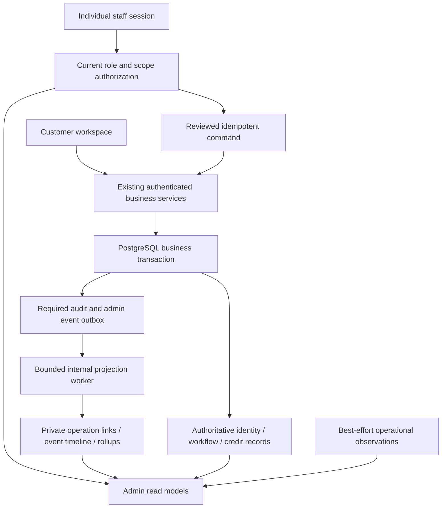

# Workspace Administration — 통합 운영·고객 대응 설계

설계 ID: WAC-1.0 · 작성일: 2026-10-21 · 상태: **소스 구현·격리 검증 및 재시작 후 운영 읽기 점검 완료**

구현·시험·실제 범위는 [완료 보고서](../reports/workspace-admin-control-2026-10-21/README.md)에 기록했다. 이하의 제안 명칭은 설계 당시의 논리 구조이며 실제 테이블·기존 원장 재사용·역할 경계는 보고서와 구현을 따른다. 운영 PostgreSQL 마이그레이션과 기존 이력 265건 연결은 적용했고 원본 고객/크레딧 기록은 수정하지 않았다. 실결제·구독·광고 또는 공개 Workspace 노출은 활성화하지 않았다. 사용자 재시작 후 운영 HTTP 12건과 PostgreSQL 수집 상태를 읽기 전용으로 확인했다. 실제 운영 직원 세션의 브라우저 조작·고객 변경은 수행하지 않았으며 해당 기능은 격리 환경에서 검증했다.

이 문서는 현재 고객 워크스페이스를 운영할 관리자 통합관리 기능의 범위와 완료 기준을 고정한다. 기존 서비스·원장·권한 코드를 재사용하고, 고객 단위 조회와 운영 대응의 연결 부분을 추가한다. 문서 작성으로 공개 링크, 관리자 권한, 결제 또는 구독을 활성화하지 않는다. 내부 설계 문서이며 공개 프론트엔드 콘텐츠가 아니다.

## 1. 결론과 이번 개발의 완료 범위

어드민에 **워크스페이스 통합관리** 진입점을 만들고 고객·조직·워크플로우·실행·크레딧·문의·장애를 연결한다. 핵심은 고객 한 명의 문제를 발견하고, 관련 사실을 확인하고, 허용된 조치를 하고, 처리 결과까지 추적하는 것이다.

이번 구현의 필수 범위는 다음과 같다.

- 로그인·가입·동의·세션, 조직·초대·권한 변경, AI 생성·저장·실행·배포·다운로드, 크레딧의 통합 조회.
- 실패·지연·결과 불명·이력 수집 장애 탐지, 담당자 배정, 고객 문의 연결, 감사 가능한 조치.
- 무료 가입 및 현재 크레딧 정책의 정확한 집계와 차감 오류 대응.
- 향후 결제·충전·구독을 연결할 명확한 인터페이스와 비활성 화면 상태.
- PostgreSQL 기반 성능·격리·복원·권한·보안 검증, 운영 읽기 확인과 인수 기록.

실제 유료 플랜 가격 결정, 결제사업자 계약, 자동결제·실결제·자동 환불·대량 마케팅은 별도 상용화 Gate이다. 준비 상태와 테스트 이력은 관리하되 이번 완료를 위해 실거래를 요구하지 않는다. 준비 중 기능을 운영 매출이나 활성 구독으로 표시하지 않는다.

**완료 판정:** 아래 WAC-01~09의 필수 수용 기준을 모두 충족하고 차단 결함이 0건이면 WAC-1.0 개발 완료로 고정한다. 이후 개선 아이디어는 차기 목록으로 이동하며 완료 범위를 계속 확장하지 않는다. 개발 중 발견한 보안·데이터 정합성·기존 기능 회귀는 해당 단계에서 해결한다.

## 2. 현재 소스에서 확인한 기반과 실제 공백

현재 기능이 전혀 없는 상태는 아니다. 기존 기능의 범위와 통합관리의 공백을 구분해야 중복 개발을 줄일 수 있다.

- **고객 인증:** `customer_identity.py`, `customer_identity_service.py`에 Google/GitHub 로그인, 고객 세션·로그아웃·BFF 토큰과 워크스페이스 연결이 있다. 고객 ID는 공급자/subject 기반이며 이메일 일치로 계정을 합치지 않는다. 로그인 성공·실패·만료·철회부터 이후 활동까지 연결하는 운영용 사건 이력은 추가해야 한다. 기존 `last_login`만으로 과거 로그인 횟수나 실패율을 재구성할 수 없다.
- **조직·활동:** `customer_organizations.py`의 조직·초대·회원·삭제 및 감사 기록, `customer_workspace_runtime.py`의 고객 실행 귀속, `workspace_access.py`의 개인 관리자 세션·멤버십 경계를 재사용한다. 조직 작업공간 메뉴는 이미 있지만, 플랫폼 운영자가 모든 고객의 상태 메타데이터를 조회하고 지원하는 화면과 권한은 별도 정의가 필요하다.
- **워크플로우·AI:** `customer_authoring_service.py`, `workspace_app_factory.py`, `workspace_ai_support.py`, `workspace_execution.py`, `workspace_typed_flows.py` 및 릴리스/배포 모듈이 있다. 고객의 생성 시도→저장 버전→실행→배포/패키지 발급의 연결과 실패 지점 안내를 추가한다. 사내 관리자용 작업공간 API와 고객 authoring API는 서로 다른 인증 경계를 유지한다.
- **크레딧:** `customer_credits.py`, `customer_credit_service.py` 및 구독/크레딧 메뉴에 계정 조회, 서명된 이력·동의 조회, 최고관리자 조정·중지 기능이 있다. 현재 검색은 고객 ID 중심이고 계정당 이력도 제한 조회이다. 기간별 대사, 고객 상황과 오류의 연결, 조정 승인 업무를 보강한다. 기존 계정·이벤트 원장을 새 원장으로 복제하지 않는다.
- **관측·실행 복구:** `observability.py`, `workflow_persistence.py`, 오류 메뉴에 실행·시도·결과 불명 상태가 있다. 공통 관측 저널은 최선 노력이며 고객 식별자를 넣지 않는 계약이다. 고객 통합 이력은 별도 접근 제한 링크와 업무 이벤트로 연결해야 한다. 현재 관측 기록 불가 경고도 수집 건강 상태의 대상에 포함한다.
- **고객 지원:** 고객 요청 메뉴와 `workspace_support_outcomes.py`가 있다. 후자는 실행 근거에 대한 목적 제한 지원 평가 기록이며 범용 문의 티켓이 아니다. 일반 문의 담당자·진행 상태·고객 회신과 실행 근거를 연결하는 운영 티켓을 추가하되 기존 기록을 덮어쓰지 않는다.
- **결제·계량:** `workspace_metering.py`의 TEST_UNIT, sandbox 결제, `stripe_sandbox.py`의 TEST 전용 흐름이 존재한다. 고객 워크스페이스 크레딧·현금 결제·에이전트 공급자 정산과 분리한다. 기존 결제 관리 메뉴의 공급자/거래 화면을 고객 구독 실적의 근거로 사용하지 않는다.
- **PostgreSQL:** 현재 운영 application store는 PostgreSQL이다. 이전 문서의 SQLite 중심 구현 설명은 해당 작성 시점의 계약으로 취급하고 신규 구현에서는 실제 Store 추상화·트랜잭션을 사용한다. 고객 원장 조회에 pgvector 유사도 검색은 필요하지 않다.

관련 기존 경로: `/admin/api/customer-credits`, `/admin/api/workflow-workspaces`, `/admin/api/observations`, `/admin/api/needs/summary`, `/api/customer-auth/*`, `/api/customer-organizations/{ws}/authoring/*`. 기존 경로를 폐기하거나 동일한 조정 API를 병렬로 만들지 않는다.

## 3. 화면 구조와 사용자 동선

기존 조직 작업공간 메뉴를 **워크스페이스 통합관리**의 진입점으로 확장한다. 기존 개인 작업공간 편집·권한 화면은 그 아래의 전문 관리 화면으로 유지한다. 구독/크레딧·고객 요청·오류 메뉴는 유지하면서 동일 고객·조직·지원 참조로 상호 이동한다. 같은 정보를 수정하는 두 개의 독립 화면을 만들지 않는다.

통합관리에는 다음 8개 탭을 둔다.

1. **운영 현황:** 로그인 장애, 신규 가입, 활성 이용, AI 생성, 저장·실행·다운로드, 차감·대사 이상, 미처리 문의, 수집 지연. 현재 값과 집계 시각·기간·누락 여부를 함께 보여 준다.
2. **고객·접근:** 고객 ID, 인증 공급자, 계정·가입 상태, 동의 버전, 조직 연결, 세션 수, 최근 활동. 고객 상세에서 세션 철회·이용 제한 요청과 사유를 처리한다.
3. **조직·워크플로우:** 소유·회원 상태, 초대 만료, 저장 버전, 실행·릴리스·배포·패키지 발급 상태. 기본 조회는 메타데이터이다.
4. **AI·실행:** 논리 생성 작업/시도, 대기·처리 시간, 캐시 여부, 저장 연결, 도구 실행과 결과 불명. 관리자 화면에서 필요한 내부 진단과 고객에게 보여 줄 안전한 설명을 구분한다.
5. **크레딧·구독:** 기존 구독/크레딧 화면과 같은 원장 서비스. 잔액, 지급·차감·조정, 동의, 다운로드 권리, 대사 이상을 연결한다. 결제·유료 구독은 `준비 중`으로 명시한다.
6. **오류·장애:** 원인별 묶음, 영향 고객 수, 영향 기간, 담당자, 관련 사건·실행, 확인·조치 이력. 로그 원문을 고객 화면으로 전달하지 않는다.
7. **고객 대응:** 문의 접수·배정·내부 메모·답변 초안·회신·보류·종료·재개. 계정·조직·실행·차감 사건을 첨부한다.
8. **감사·수집 상태:** 조회·조치 감사, 이벤트 수집 지연/누락, 대사 실행, 보존 처리와 복원 검토 상태.

고객 상세는 요약, 통합 타임라인, 워크플로우/실행, 크레딧, 접근/동의, 문의의 고정 탭으로 구성한다. 고객 ID만으로 조회가 가능해야 하며 이메일은 현재 신원 모듈이 보유·검증한 범위에서만 마스킹 표시한다. 이메일 검색을 위해 OAuth 권한을 추가하거나 이메일을 추측해 저장하지 않는다.

예시 동선: `차감 문의 → 고객 상세 → 해당 저장 버전·원장 이벤트 확인 → 대사 → 정정 조치 승인 → 보정 원장 확인 → 답변 → 종료`. 실행 실패만으로 차감 오류라고 판단하지 않는다.

관리자는 데스크톱 사용을 기준으로 설계한다. 기존 테마와 Lucide 아이콘, 키보드 포커스, 읽을 수 있는 대비를 유지한다. 상세·이력은 화면 중앙 dialog 또는 고정 상세 패널로 열고 목록 갱신이 입력값·선택·스크롤·열린 팝업을 지우지 않게 한다. 첫 클릭에 로딩·버튼 상태가 즉시 바뀌고 실패 시 재시도 경로를 제공한다.

## 4. 권한과 개인정보 경계

기존 관리자 역할을 보존하고 기능 권한을 추가한다. `operator`의 읽기 전용 제한을 그대로 유지한다. 새 기능 권한은 역할만으로 고객의 비공개 콘텐츠를 열어 주는 우회 수단이 아니다.

- `workspace.operations.read`: 승인된 운영 범위의 고객/조직 상태·최소 메타데이터 조회. 개인 관리자 세션 필수. 원문 프롬프트·출력·워크플로우 본문은 제외.
- `workspace.support.manage`: 담당 티켓 배정·메모·답변 초안·상태 변경. 실제 고객 회신은 확인된 채널과 별도 발송 확인이 있어야 한다.
- `workspace.sessions.revoke`, `workspace.access.restrict`: 제한된 대상·사유·현재 상태를 확인한 단건 조치. 계정 제한과 기존 세션 철회는 서로 다른 조치임을 표시한다.
- `workspace.credits.adjust`: 기존 최고관리자 원장 조정 서비스를 호출한다. 일반 지원 담당자는 정정안을 올리고 권한자가 승인한다.
- `workspace.content.support_read`: 고객의 특정 자료 공유 또는 별도 승인된 사고 대응 근거가 있을 때만 시간·대상·필드 제한으로 부여한다. 관리자 멤버십을 고객 조직에 자동 추가하지 않는다.
- `workspace.audit.read`, `workspace.export`: 목적·범위가 제한된 감사/내보내기. 대량 내보내기는 별도 강화 인증과 감사 대상이다.

개인 관리자 로그인과 현재 역할·활성 상태를 매 요청 확인한다. 시스템 `ADMIN_TOKEN`은 이 새 고객 관리 권한을 부여하지 않는다. 고객 ID/지원 참조/세션 해시/사건 ID는 조회 키이며 권한 증명이 아니다. 고객 대리 로그인, OAuth 토큰 열람, 원문 쿠키 복사 기능은 제공하지 않는다.

민감 원문을 열 경우 확인 사유·승인자·유효 기간·허용 자료를 감사하고 만료·철회 즉시 차단한다. 긴급 접근도 사유·시간 제한·사후 검토를 생략하지 않는다. 익명 로그인 실패를 기존 고객에게 임의 귀속하지 않는다. 고객/조직/버전의 소유 관계는 서버에서 검증한다.

## 5. 데이터 구조: 기존 원본 + 제한된 운영 연결

기존 고객 ID, 조직 ID, 버전, 실행, 원장 이벤트를 그대로 사용한다. 새 테이블 이름은 아래 제안이며 **아직 존재하는 것으로 간주하지 않는다**. DDL은 WAC-01에서 Store·네이티브 PostgreSQL 마이그레이션 규약에 맞춰 확정한다.

통합관리 명령은 기존 업무 서비스를 다시 거친다. 조회 projection을 직접 수정해 원장·권한·실행 상태를 변경할 수 없고, 공통 관측 저널의 유실이 크레딧 변경 근거를 지우지 않는다.

### 5.1 추가할 최소 구조

- `workspace_admin_event_outbox`: 업무 트랜잭션에서 생성한 최소 사건, 고유 키, schema_version, 처리 상태, 재시도 시각, lease/fence. 운영 이벤트를 외부 고객에게 발송하는 테이블이 아니다.
- `workspace_admin_events`: 조회용 append-only 사건 메타데이터. `event_id`, `event_type`, `occurred_at`, `recorded_at`, `customer_id?`, `workspace_id?`, `object_type/id?`, `operation_id?`, `attempt_id?`, `correlation_ref`, `outcome`, `safe_error_code?`, `source`, `source_event_key`, `schema_version`, `provenance`.
- `workspace_admin_operation_links`: 공통 관측 operation과 고객/조직/원본 업무 객체의 비공개 연결. 공통 `platform_operations`에 고객 프로필을 넣지 않는다. 부모 작업과 개별 시도는 구분한다.
- `workspace_admin_daily_rollups`: UTC 기준 일별 집계·집계 버전·watermark·complete 여부. 원본 원장이나 접근 권한의 기준으로 사용하지 않는다.
- `workspace_admin_cases`, `workspace_admin_case_events`: 일반 지원 티켓, 담당자, 우선순위, 상태, 최소 참조와 append-only 처리 이력. 기존 고객 요청을 `source_kind/source_id`로 연결하고 복제 접수하지 않는다.
- `workspace_admin_case_messages`: 내부 메모와 고객 회신의 구분된 대화 저장소. `visibility`, 작성 주체, 접수/발송 상태, 본문 길이 제한, 보존 시각을 둔다. 본문을 일반 운영 사건·집계·로그에 복사하지 않고 고객 조회에서는 허용된 외부 메시지만 반환한다. 최초 구현은 첨부파일 업로드를 제공하지 않는다.
- `workspace_admin_incidents`: 오류 묶음·영향 기간·담당자·진행 상태. 티켓과 연결하되 장애 해결이 고객 문의 자동 종료를 뜻하지 않는다.
- `workspace_admin_commands`: 조치 요청·승인·현재 revision·멱등 키·실행 결과. 동일 command_id에 다른 본문을 보내면 거부한다.
- `workspace_admin_disclosures`: 지원 자료 열람 승인·만료·철회와 감사 참조. 원문은 기존 보안 저장소에 남기고 일반 사건 테이블에 복제하지 않는다.
- `workspace_admin_ingestion_state`: 소스별 cursor/watermark, 마지막 성공, 누락·재시도·정합성 상태, 재구축 진행률.

금융 또는 구독을 위한 신규 주문·구독 테이블은 상용화 단계에서 별도 추가한다. 이번 단계에서는 기존 credit 계정/이벤트/권리 테이블이 유일한 크레딧 원본이다.

### 5.2 기록 원칙

성공한 가입·동의·차감·조정·접근 변경·관리자 조치는 업무와 감사/outbox를 **같은 트랜잭션**에 기록한다. 원장 쓰기 또는 필수 감사가 실패하면 해당 변경 전체를 롤백한다. 운영 조회 projection 장애만으로 이미 완료한 업무를 실패로 되돌리지는 않는다.

원본 트랜잭션에서 outbox에 넣고 별도 작업자가 이벤트 projection·집계를 갱신한다. 내부 처리는 at-least-once + `UNIQUE(source, source_event_key)`로 중복 효과를 막는다. claim에는 lease/fence, 실패에는 횟수 제한·지연 재시도·격리 목록을 둔다. 외부 호출을 DB 트랜잭션 안에서 기다리지 않는다.

프론트엔드의 버튼 클릭·렌더·페이지 체감 속도는 보조 telemetry이다. 브라우저 재전송·조작이 가능하므로 가입·차감·실행 성공의 증거가 될 수 없다. 민감 원문·쿠키·OAuth code/token·사용자 입력 전체·원본 API body·무제한 URL은 이벤트에서 거부한다. 클릭 수집은 서비스 운영에 필요한 최소 범위를 정하고 공지·선택권과 일치시킨다.

로그인 실패는 고객 식별 전의 짧은 익명 auth attempt 참조로 기록한다. 공급자, 실패 단계, 안전한 오류 분류만 남기며 OAuth state/code나 계정 존재 여부를 노출하지 않는다. 성공 시 서버가 확정한 고객 ID만 연결한다.

### 5.3 과거 데이터와 이력 순서

과거 원장·조직 감사·실행 기록처럼 실제 근거가 있는 행만 cursor 기반으로 연결한다. 기존 last_login을 로그인 사건 여러 건으로 바꾸거나 과거 AI 요청·실패를 추측해 생성하지 않는다. backfill은 원본 식별 키를 사용해 재실행 가능해야 하며 `historical_reconstruction`과 수집 시작 시각을 표시한다.

UTC 시각을 저장하고 타임라인은 `(occurred_at, event_id)` 정렬·커서로 조회한다. 늦게 도착한 사건은 recorded_at도 보여 준다. 같은 업무의 인과 관계는 operation·parent·원본 revision으로 판단하고 타임스탬프만으로 결제 순서를 확정하지 않는다.

## 6. 필수 사건 목록과 측정 정의

사건명은 아래 범주를 고정하고 세부 명세·본문 크기·허용 필드를 WAC-01 계약 파일로 관리한다.

- **접근:** auth.begin/succeeded/failed, session.logged_out/revoked/expired, enrollment.accepted/closed, account.restricted/deletion_requested/deletion_completed.
- **조직:** organization.created/archived, member.changed/left, invitation.created/accepted/expired/revoked, ownership.transferred.
- **AI:** generation.accepted/started/completed/failed/unknown/cancel_requested, proposal.reviewed/applied/rejected. 현재 구현이 지원하지 않는 취소 기능은 사건 정의만으로 실행 가능해지지 않는다.
- **워크플로우:** draft.saved, snapshot.created, execution.accepted/dispatched/succeeded/failed/unknown/denied, release.created/revoked, deployment.created/revoked, package.issued/failed.
- **크레딧:** welcome.granted, credit.debited/adjusted, entitlement.created/download_marked, reconciliation.mismatch/resolved. 원장 action 명칭과 어댑터에서 명시적으로 매핑한다.
- **대응:** case.opened/assigned/updated/replied/resolved/reopened, incident.opened/mitigated/resolved, command.approved/applied/denied/unknown, disclosure.granted/used/revoked.
- **수집:** ingestion.degraded/recovered, integrity.failed, restore.quarantined/reconciled.

운영 지표는 분모와 근거를 화면에 명시한다.

- 가입 수는 동의·등록이 커밋된 고객, 신규 계정은 최초 신원 등록 고객이다. 로그인 수와 혼합하지 않는다.
- 활성 고객은 해당 기간 인증된 업무 사건이 있는 고유 고객이다. 단순 로그인·주기적 상태 조회는 별도 지표로 둔다.
- AI 생성 성공률은 종료 결과가 확인된 논리 생성 작업을 기준으로 하고 중복 클릭·재시도는 시도 수로 분리한다. 캐시 hit는 별도 표시한다. unknown과 미완료를 숨기지 않는다.
- 저장 성공과 실행 성공은 별개이다. 실행 성공이 사용자의 업무 성과를 증명한다고 표시하지 않는다.
- 패키지 발급은 서버의 발급 성공일 뿐 사용자 파일 저장·실행 성공이 아니다. 브라우저의 확인 없는 다운로드 완료율을 만들지 않는다.
- 기간 말 잔액은 원장의 검증된 기초 잔액 + 지급 + 조정 - 차감과 일치해야 한다. 무결성 실패 계정은 별도 검토 상태로 제외하고 제외 수를 보여 준다.
- 금액·플랜이 미정인 상태에서는 매출/MRR/유료 전환율을 0의 실적으로 만들지 않고 `준비 중 / 집계 대상 아님`으로 표시한다.
- 수집 지연·누락·마지막 성공을 독립 지표로 둔다. 이벤트 0건과 수집 실패는 다른 상태이다.

## 7. 크레딧·결제·구독 설계

### 7.1 현재 정책을 보존하는 크레딧 관리

현재 가입 최초 3크레딧, 신규 워크플로우 저장 1크레딧, 다운로드 전 수정은 기존 권리 공유, 다운로드 이후 변경본 저장은 새 1크레딧, 같은 버전 재다운로드는 추가 차감 없음이다. AI 제안·거부된 저장·실패한 트랜잭션은 차감하지 않는다. 정책 버전과 동의 digest를 원장 및 저장 버전에 연결한다. 계정에 수동 지급된 테스트 크레딧은 일반 welcome grant와 구분한다.

실행·외부 데이터 수집 실패는 저장 권리의 오류와 다르므로 자동 환급하지 않는다. 차감 문의에서는 커밋된 저장 버전, 권리 bundle, 다운로드 표시, 원장 이벤트와 멱등 키를 대조한다. 잔액 행을 직접 UPDATE하거나 서명된 과거 이벤트를 수정하지 않는다.

정정은 `요청 → 근거 확인 → 필요 승인 → 보정 이벤트 → 대사 → 종료`로 처리한다. 기존 `admin_change`가 허용하는 최고관리자 정책·revision·reason·request_id를 유지한다. 동시 조정·중복 승인·거부된 쓰기는 추가 차감/지급을 만들지 않는다. 정정 주체와 승인자는 가능한 분리하고, 최초 운영에 최고관리자 한 명이면 단독 처리 사실과 강화 확인을 기록한다.

복원으로 `review_required`가 된 계정은 일반 잔액 조정이나 재가입으로 해제하지 않는다. 외부에 남은 사용 이력과 별도 복원 대사 절차로만 검토한다.

### 7.2 향후 유료 기능을 위한 경계

구독/결제의 `coming_soon`, `test`, `live`를 구분한다. UI 토글만으로 live가 되지 않도록 제공자 설정·서비스 계약·상품/가격 버전·동의·웹훅/대사·운영 승인 Gate를 모두 검증한다. 기존 Stripe TEST 구현이나 TEST_UNIT을 고객 현금 결제처럼 보이지 않게 한다.

향후 주문·충전·구독의 원본 상태와 크레딧 권리는 별도로 보관한다. 공급자 이벤트의 서명·replay·중복·순서 역전·비동기 환불/분쟁을 처리하고, 브라우저 결제 성공 페이지로 크레딧을 지급하지 않는다. 지급은 검증된 거래 상태에서 동일 거래당 한 번만 기록한다. 자동결제·갱신·해지·기간 말 종료·연체 정책과 카드/청구 정보 보관 범위는 출시 전 별도 확정한다.

이번 범위의 수용 기준은 비활성 상태의 정확한 표시, sandbox와 고객 크레딧의 격리, 서명된 테스트 이벤트 계약·중복 방지·실거래 차단 검증이다. 실결제·실제 구독 시험은 별도 승인을 받는 후속 출시 작업이다.

## 8. 오류 대응과 고객 지원

오류는 `인증/권한`, `입력·스키마`, `AI 생성`, `저장·차감`, `제공자·실행`, `배포·패키지`, `수집·DB`, `지원 전달`로 분류한다. 오류 묶음 키는 오류 코드·모듈·안전한 단계/버전을 사용하고 개인정보나 입력 문장을 포함하지 않는다.

지원 담당자가 보는 것은 고객 ID, 시각, 영향 업무, 지원 참조, 현재 원본 상태, 안전한 설명, 허용 조치이다. stack trace나 SQL, 모델 내부 설정은 권한 있는 내부 진단으로만 분리한다. 고객 답변에는 원인 확인 수준·해결/우회 방법·다음 확인 시점을 기재하며 확인되지 않은 성공이나 환급을 확답하지 않는다.

티켓 상태는 `new → triaged → in_progress → waiting_customer / waiting_internal → resolved → closed`이며 재문의 시 reopen한다. 담당자·우선순위·다음 검토 시각과 지연 표시를 제공한다. 최초 응답/해결 시간은 운영 목표이며 계약 SLA로 자동 공시하지 않는다. 내부 메모와 외부 답변 필드를 분리하고 답변 초안은 고객에게 자동 발송하지 않는다.

동일 고객이 같은 원장 이벤트로 반복 문의하면 연결 티켓을 안내하되 임의로 문의를 삭제하지 않는다. 기존 footer 문의·개인정보 요청은 원래 처리 상태와 담당 근거를 유지한다. 마케팅 동의·알림 동의·서비스 문의 회신의 목적은 분리한다. 최초 회신 채널은 인증된 서비스 내 메시지로 두고, 이메일/웹훅은 검증된 대상과 해당 목적 권한·명시적 발송 절차가 준비된 경우만 사용한다.

footer의 익명 문의는 이메일이나 표시 이름이 같다는 이유로 고객 계정과 자동 연결하지 않는다. 로그인 자체가 불가능한 문의는 기존 지원 창구에서 접수하고 기존 계정 복구 절차의 신원 확인을 거친다. 관리자가 임의로 해당 고객이 되어 메시지나 동의 기록을 작성하지 않는다.

timeout/전송 후 불명 상태의 실행·발송은 자동 재실행하지 않는다. 원본 실행기의 중복 방지·fence·deadline을 우회하는 관리자 retry 버튼을 만들지 않는다. 고객 재실행 의사·입력 공유 권한을 확인해 새 업무로 시작하거나 원본이 지원하는 안전한 재개만 허용한다. 크레딧 정정과 실행 재시도는 별도 명령이다.

## 9. API와 서비스 경계

신규 제안 prefix는 **`/admin/api/workspace-operations`**이다. 기존 관리자 router의 기본 guard만 재사용해 권한이 충분하다고 판단하지 않고, 개인 세션·기능 권한·대상 범위를 검증하는 전용 dependency를 둔다. 아래 경로는 제안이며 구현된 API가 아니다.

- `GET /overview`, `/ingestion`, `/events`: 제한된 기간·커서·필터의 운영 조회.
- `GET /customers`, `/customers/{customer}`, `/customers/{customer}/timeline`: 고객 운영 메타데이터와 타임라인.
- `GET /organizations`, `/organizations/{workspace}/operations`: 조직별 상태와 논리 업무. 원문 draft 접근은 기존 권한/공유 승인 경로를 따른다.
- `GET /operations/{operation}`, `/operations/{operation}/attempts`: 원본 상태와 관측 상태를 구분한 상세.
- `GET /credits/reconciliation`: 원본 검증 결과 및 대사 차이. 기존 잔액·이력 상세와 연결한다.
- `GET/POST /cases`, `GET /cases/{case}`, `POST /cases/{case}/actions`: 문의·내부 메모·상태 변경·회신 승인. 자유 문자열 action으로 임의 메서드를 호출하지 않는다.
- `GET /incidents`, `POST /incidents/{incident}/actions`: 제한된 장애 처리.
- `POST /commands`, `GET /commands/{command}`, `POST /commands/{command}/approve`: 단건 조치 요청·승인·결과 조회. 실제 업무는 기존 core에서 권한 재검증 후 처리한다.
- `POST /disclosures`, `POST /disclosures/{grant}/revoke`: 제한 자료 접근의 승인·철회.

고객 측 연동은 제안 경로 `/api/customer-support/cases`, `/api/customer-support/cases/{case}`, `POST /api/customer-support/cases/{case}/messages`로 제한한다. 고객 세션·same-origin·쓰기 CSRF를 검증하고 customer/workspace 귀속은 서버가 확정한다. 요청 본문의 고객 ID, case ID, 지원 참조만으로 타인의 문의를 연결하거나 읽게 하지 않는다. 외부에 공개된 메시지만 반환하고 내부 메모·관리자 진단·조정 승인 자료는 제외한다. 첫 구현은 짧은 텍스트 접수·회신·지원 참조 연결이며 frontend의 도움말 진입점과 맞춘다.

쓰기에는 `expected_revision`, `request_id`, `reason`, 고정 command_type과 대상 참조가 필수이다. 쿠키나 고객 BFF 토큰을 관리자 세션으로 받아들이지 않는다. 예상 충돌은 409, 권한 부족은 안전한 401/403/404, 저장소 장애는 503 + 지원 참조로 처리한다. 무결성 오류는 검토 필요 상태로 분리하며 성공 응답으로 숨기지 않는다.

조회 응답에 `captured_at`, `window_start/end`, `source_watermark`, `completeness`, `next_cursor`를 포함한다. 원본 실행 상태와 지연된 관측 상태가 다르면 둘을 구분한다. 원장·가입·조치 명령은 캐시된 값으로 승인하지 않는다.

## 10. PostgreSQL·캐시·수집과 복원

신규 DDL/인덱스는 운영 서버 요청이나 router 생성 중 임의 실행하지 않는다. 명시적 버전 마이그레이션, 별도 PostgreSQL 테스트 DB, 적용/검증/롤백 절차를 갖춘다. 기존 native Store와 DB 추상화를 사용하고 DSN·비밀값을 관리 API에 반환하지 않는다.

인덱스는 실제 조회에 맞춰 `(customer_id, occurred_at DESC, event_id)`, `(workspace_id, occurred_at DESC, event_id)`, `(operation_id, event_id)`, `(status, updated_at, id)`와 source 고유 키를 우선 검토한다. JSON 본문 전체 스캔·고객별 N+1·매 조회 전체 집계를 피한다. 원본 업무 테이블을 장시간 잠그는 대사·backfill은 작은 배치와 커서로 수행한다. partition은 측정된 규모가 필요할 때 추가한다.

요약 캐시는 5~15초를 초기 제안으로 두고 상세는 현재 상태를 우선한다. 응답은 private/no-store, 서버 캐시는 권한 범위와 권한 revision을 키에 포함한다. 세션/권한 철회 뒤 캐시를 통해 데이터가 노출되지 않게 재인가한다. 한 패널의 timeout이 전체 관리 화면을 500으로 만들지 않게 독립 쿼리·시간 제한·available/completeness를 둔다.

브라우저는 한 페이지의 중복 조회를 합치고 숨겨진 탭에서 중단·실패 시 backoff한다. 열린 상세/작성 중인 메모는 주기 갱신으로 교체하지 않는다. 초기 목표는 캐시 요약 p95 1초 이내, 일반 목록 p95 2초 이내, 사건 반영 p95 5초 이내이며 실제 시험값으로 검증·조정한다. 목표를 달성 실적으로 표시하지 않는다.

복원한 명령·승인·지원 공유·고객 회신 outbox는 자동 재생하지 않는다. 기존 복원 정책의 세션/실행/크레딧 격리를 유지하고, 운영 projection의 DB 세대·watermark를 초기화해 검토 후 재구축한다. 오래된 복원본이 철회한 권한이나 이미 처리한 차감을 되살리지 않도록 원본 대사와 별도 해제 승인을 요구한다.

보존은 현재 공개 개인정보/크레딧 안내와 일치해야 한다. 신규 사건·지원 자료에 무기한 보존을 적용하지 않는다. 초기 개발 기본값은 일반 운영 사건 30일, 익명 auth 실패 7일, 원문 공유 자료는 지원 승인 만료 시 접근 종료로 두되 운영 도입 전에 데이터 목록·고지·실제 처리 근거를 확인한다. 원장·동의·분쟁 자료는 기존 정책을 유지하고 미래 유료 법정 보존은 별도 검토한다. 계정 삭제·기한 만료·지원 공유 철회가 새 projection·outbox·내보내기에도 전파되도록 하며, 사후 재수집을 막는 최소 삭제 표식을 둔다. 서명 무결성과 삭제 정책을 함께 설계하고 서명된 사건을 임의 수정하지 않는다.

## 11. 권장 개발 순서: 9개 묶음

현재 프론트엔드 개선은 계속 허용한다. 최초에 이벤트 명세·권한·원본 책임 경계만 합의하고, 이후 UI 문구 변경 때문에 전체 통합시험을 반복하지 않는다. 각 단계는 관련 테스트를 통과한 뒤 다음 단계로 넘어가며 최종 소스 고정과 전체 수용은 WAC-09에서 한 번 수행한다.

### WAC-01 · 기능 대조·권한·사건 계약 확정

기존 route/화면/core/테이블을 목록화하고 `현재 기능·재사용 위치·새 차이·검증`을 1:1 연결한다. 위 사건/DTO·데이터 최소화·조치 allowlist·개인 관리자 권한·고객 ID 연결·금융 Gate를 계약 파일로 고정한다. 프론트엔드 팀과 서버 확정 사건/보조 telemetry를 구분한다.

완료: 로그인·조직·AI·저장·실행·패키지·원장·지원 각각 원본 모듈과 귀속 키가 지정되고, 모든 필수 요구가 단계 및 테스트 ID에 연결됨. 무단 원문 조회와 시스템 토큰 접근은 거부하는 계약 시험을 먼저 작성함.

### WAC-02 · PostgreSQL 마이그레이션·필수 사건 수집

최소 사건/outbox/링크/수집 상태를 추가하고 업무 커밋과 기록을 원자적으로 연결한다. 로그인 실패 등의 별도 사건은 제한적으로 저장한다. 기존 best-effort 저널은 금융 원장으로 승격하지 않는다. cursor backfill과 worker 중복 처리·장애 복구를 구현한다.

완료: 저장·차감·감사/outbox가 함께 커밋/롤백됨. 중복·동시 요청 및 worker 강제 종료 후 원장/사건이 중복되지 않음. 수집 장애가 보이고 늦은 projection이 원본 성공을 뒤집지 않음.

### WAC-03 · 통합 목록·고객 상세·조직 타임라인

운영 현황의 최소 화면, 고객 검색·기간 필터·조직 상세·통합 타임라인·기존 메뉴 바로가기를 구현한다. 원문 없는 상태 조회부터 제공하고 조회 목적 감사 및 승인 범위를 적용한다.

완료: 두 개 가상 고객/조직이 섞이지 않고, 비인가/철회 세션이 캐시·상세·페이지네이션으로 데이터에 접근하지 못함. 기존 전문 메뉴와 같은 원본 상태를 표시함.

### WAC-04 · AI 생성·워크플로우·실행·다운로드 운영

AI 논리 작업/시도/캐시·대기·처리 시간, 저장 버전·실행·릴리스·배포·패키지의 관계를 연결한다. 고객 화면의 로딩/오류 지원 참조를 관리자 사건과 매핑한다. 중단/재시도는 기존 엔진의 실제 능력과 안전 정책 안에서만 제공한다.

완료: 생성 실패·시간 초과·캐시 hit·거부·저장 충돌·실행 unknown·패키지 발급 실패가 구분됨. 버튼 중복 클릭이 업무·권리·차감을 늘리지 않음. 원문 비공개 경계를 유지함.

### WAC-05 · 크레딧 대사·정정·향후 상거래 준비

기존 계정/이력/동의·권리 화면을 고객 상세에 연결하고 대사·정정 요청·승인·보정 이력을 추가한다. 준비 중 결제/구독 화면은 현재 상태와 sandbox 분리를 명확히 한다.

완료: 최초 3크레딧 1회, 동일 버전 재다운로드, 다운로드 후 변경, 동시 저장/조정, 잔액 부족, 재가입, restore block을 검증함. 정책대로 단 한 번 차감/지급되고 rollback 시 변화 없음. 실결제·TEST_UNIT·고객 크레딧이 혼합되지 않음.

### WAC-06 · 고객 문의·담당자·제한된 운영 조치

기존 고객 요청과 새 티켓 연결, 내부 메모/답변 초안/안전한 서비스 내 회신, 담당 배정·상태·지연·재개를 구현한다. 세션 철회·이용 제한·크레딧 정정 요청을 개별 권한과 감사로 연결한다. 승인된 자료 공유의 기간/대상 경계를 추가한다.

완료: 가상 문의가 해당 로그인·실행·원장 사건까지 연결되고 담당자 변경/답변/종료가 추적됨. 내부 메모가 고객에게 노출되지 않음. 무단 회신·원문 열람·권한 상승·금전 조치가 차단됨.

### WAC-07 · 장애·경보·감사·수집 건강

오류 묶음과 영향 고객 집계, 관측 불가/수집 적체/대사 불일치 경보, 담당·완화·종료, 감사 검색을 구현한다. 최초 경보는 관리자 내부 표시와 승인된 운영 채널만 사용하며 고객에게 자동 대량 발송하지 않는다.

완료: DB/AI/제공자 실패, unknown 증가, 사건 수집 중단·복구가 실제 fixture로 검출됨. 집계가 불완전한데 정상·0건으로 보이지 않음. 고객 문제와 내부 장애 상태가 구분됨.

### WAC-08 · 성능·보존·복원과 보안 검증

대표 규모 데이터로 쿼리 계획·목록/요약 지연·worker 지연·정리 배치를 측정한다. 삭제 전파·자료 공유 철회·DR 복원·권한 재인가·실거래 차단·이중 승인 우회·SQL/XSS/CSRF/IDOR·로그 마스킹을 격리 검증한다.

완료: 신규 마이그레이션·업그레이드·빈 DB·기존 DB 호환, PostgreSQL 동시성·fencing·중복 처리, 필수 보안 동적 시험이 통과함. 측정값과 남은 성능 한계를 기록함. 부하 테스트로 운영 고객에 영향을 주지 않음.

### WAC-09 · 최종 통합·운영 반영 확인·완료 고정

최신 소스 fingerprint와 migration 버전을 한 번 고정하고 영향 통합 회귀를 수행한다. 사용자 터미널 재시작/명시적 마이그레이션 후 운영은 읽기 smoke와 승인된 관리자 세션으로 확인한다. 가상 계정의 실제 조치 시험은 격리 환경 또는 별도 승인된 테스트 대상에서만 진행한다.

완료: 요구사항 추적표 전부 수용, 차단 결함 0, 기존 로그인/authoring/크레딧/테스트/워크플로우/문의/관리자 기능 회귀 없음. 검증 문서에 소스·DB 버전·시험 구분·미시험 범위·운영 인수자를 기록하고 WAC-1.0을 종료한다. 실제 결제·유료 구독 출시 조건은 후속 Gate로 명시하여 필수 개발 미완료와 혼동하지 않는다.

## 12. 필수 수용 시나리오

다음 시나리오는 모두 가상 고객과 별도 PostgreSQL DB에서 시작한다. 실제 제공자 수용·실제 고객 상태 변경은 별도로 구분한다.

1. Google/GitHub 성공·실패·중복 callback·세션 만료·로그아웃·관리자 철회와 익명 실패 비귀속.
2. 두 고객/조직의 동일 이름·다른 소유, 초대·역할 변경·소유권 이전·탈퇴·삭제와 cross-tenant IDOR.
3. 정상 가입·동의 미완료·동의 버전 변경·중복 가입·탈퇴 후 재가입·테스트 지급 구분.
4. 자연어 생성 정상·잘못된 결과·지연·네트워크 중단·캐시 재사용·중복 클릭·저장 전 검토/승인.
5. 저장과 차감의 원자성, 잔액 0/1, 동시 두 저장, quote 이후 다운로드로 조건 변경, 동일 요청 재전송.
6. 첫 다운로드·동일 버전 재발급·다운로드 이후 수정·패키지 실패. 발급과 수신 완료를 혼동하지 않음.
7. 실행 성공·확정 실패·거부·dispatch 후 unknown·취소 요청·늦은 응답·kill switch와 관리자 무단 재시도 차단.
8. 지원 문의 접수·배정·대사·보정 승인·답변·재개 및 내부 메모/공유 자료 노출 차단.
9. outbox commit 직후 종료·중복 worker·projection timeout·누락/유실 경보·backfill 재실행·집계 재구축.
10. 계정 삭제·자료 공유 철회·관리자 권한 철회·캐시·CSV/ZIP 내보내기와 로그/오류의 비밀정보 차단.
11. PostgreSQL 잠금/statement timeout·DB 연결 소진·백업 복원 후 명령/크레딧/승인 자동 부활 방지.
12. sandbox 결제의 위조·replay·순서 역전·중복 이벤트와 live credential/실거래 차단. 구독 미정 상태의 표시 정확성.

보안 점검과 기능시험의 실제 범위를 보고하고 모든 취약점이 없다는 보증을 하지 않는다. 테스트 수를 중복 합산하지 않으며 동일 소스에서 이미 통과한 범위는 변경·실패·근거 노후화가 있을 때만 반복한다.

## 13. 진행 기록과 변경 관리

구현 시 `reports/workspace-admin-control-<date>/`에 계약/요구 ID별 상태, 변경 파일, 소스 hash, PostgreSQL migration, 테스트 evidence, 운영 인수 여부를 유지한다. 이번 설계에는 구현 완료나 실제 고객 검증을 기재하지 않는다.

기계 판독용 순서·의존성·시험 연결은 [개발 순서 원본](workspace-admin-control-plan.json)에 기록한다. 이 파일의 `designed`는 설계됨을 뜻하며 개발 완료가 아니다. 구현 시 해당 단계에 소스/시험/운영 수용 근거를 연결한 뒤 상태를 바꾼다.

프론트엔드 병행 개발과는 고객 ID·조직 ID·논리 operation·지원 참조·policy version 계약만 먼저 맞춘다. 화면 재배치·테마·문구 변경은 그 계약이 유지되면 독립 진행할 수 있다. 새 기능은 backend event/권한/원본 책임을 계약에 등록한 뒤 연결하며 기존 검증을 전부 다시 시작하는 이유로 삼지 않는다.

개발 중 결정은 기존 경계 재사용 → 최소 데이터 추가 → 측정 후 확장 순으로 한다. 추가 상업 기능은 `차기 상용화`, 운영·보안 결함은 `이번 필수 수정`, 단순 편의 개선은 `후속 개선`으로 분류해 완료 기준을 유지한다.

## 14. 근거 소스와 연결 문서

- [고객 인증](../agent_market/customer_identity.py), [인증 API](../agent_market/customer_identity_service.py), [조직·고객 감사](../agent_market/customer_organizations.py), [고객 실행 귀속](../agent_market/customer_workspace_runtime.py).
- [고객 authoring API](../agent_market/customer_authoring_service.py), [앱 구성](../agent_market/workspace_app_factory.py), [AI 지원](../agent_market/workspace_ai_support.py), [워크스페이스 접근](../agent_market/workspace_access.py).
- [고객 크레딧 원장](../agent_market/customer_credits.py), [기존 관리자 크레딧 API](../agent_market/customer_credit_service.py), [현재 정책](WORKSPACE_CREDITS.md).
- [공통 관측](../agent_market/observability.py), [관측 계약](OPERATIONAL_OBSERVABILITY.md), [지원 평가 기록](../agent_market/workspace_support_outcomes.py), [TEST 전용 결제](../agent_market/stripe_sandbox.py).
- [현재 관리자 UI](../agent_market/gateway/dashboard.html), [관리자 API](../agent_market/gateway/dashboard.py), [PostgreSQL 정합성 점검](../reports/admin-current-alignment-2026-10-21/README.md).
- [플랫폼 2차 고도화 설계](PLATFORM_ADVANCEMENT_PHASE2_DESIGN.md). 이 문서는 운영 통합관리의 구체화이며 기존 고객·금융·실행 권한을 대체하지 않는다.
