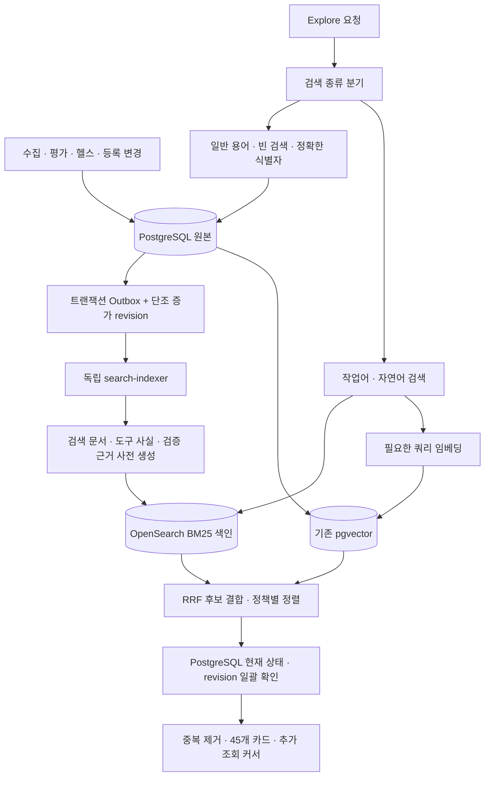

# Explore 로컬 OpenSearch 도입 검토·검색 가속 설계

2026-10-30 KST · 상태: 설계 검토 완료. 7절 1~2단계(A1: 엔진 독립 검색 문서·일괄 검증)는 구현 후 운영 적용(10:18~10:23 KST), 검색 문서 초기 적재 진행 중. 적재 속도·정체 보완은 jobs r4·웹 r3로 적용(11:07~11:10, 8.7). 다음 페이지 중복 수정은 웹 r4로 적용(11:16, 8.10). OpenSearch 설치·색인 적재·운영 전환은 미실행. 진행 현황은 8절.

## 1. 결론과 권장 결정

**설계와 로컬 설치 모두 가능하다. 우선 검증할 도입안은 OpenSearch BM25 + 기존 pgvector + 사전 생성 검색 문서다. PostgreSQL은 원본·상태·권한의 기준으로 유지한다.** 다만 현재보다 가장 빠른 조합이라는 결론은 같은 데이터·품질 기준의 비교 시험 후에 내린다. 이번에는 논문·공식 문서·SNS와 실제 소스 및 기존 운영 측정을 검토했으며 OpenSearch 성능 시험은 하지 않았다.

단순히 기존 SQL을 OpenSearch 요청으로 바꾸는 것은 권장하지 않는다. 현재 병목에는 임베딩 대기와 다수 후보의 계약 파싱·검증·카드 생성이 포함된다. 이 작업을 요청 시점에서 색인 갱신 시점으로 옮기는 것이 두 검색엔진 모두에 필요한 선행 작업이다. 전체 벡터 DB를 또 이전하는 일도 첫 단계에서 제외한다.

현재 서비스 Mac은 직접 읽은 하드웨어 정보 기준 **Apple Silicon, RAM 16GiB, 논리 CPU 8개**다. OpenSearch를 기존 PostgreSQL·웹·jobs·임베딩과 같은 장비에서 무제한으로 실행하면 메모리 경합이 생길 수 있다. 사용자가 알려준 별도 Mac mini의 64GB는 이번에 접속·검증하지 않았고, 해당 장비의 LLM 메모리 여유도 확인하지 않았다. 그 장비를 자동으로 검색 서버로 지정하지 않는다.

## 2. 현재 구현에서 확인한 것

- `agent_market/concierge/front.py:2447`: 일반 용어의 명시적 카탈로그 탐색, 선택 필터, 결과 캐시, 캐시 재사용 시 현재 상태 재검사, 최대 300건 창과 `o45` 커서를 구현한다.
- `agent_market/concierge/discovery.py:93`: PostgreSQL GIN 어휘 검색, 쿼리 임베딩, pgvector ANN, 확장 후보를 결합한다. PostgreSQL 경로의 어휘 후보는 최근 확인 시각으로 최대 300건씩 가져와 작업어 포함 정도 등으로 재정렬한다. 응답 필드 이름 `bm25_match`가 있다고 해서 이 PostgreSQL 경로가 Lucene BM25인 것은 아니다.
- `agent_market/concierge/hybrid_explore.py`: 프로토콜별 최대 600개 후보를 요청하고, 전체 계약은 100개 단위로 늦게 읽으며 관련성·안전성·검증·중복을 확인한다. 이미 A2A/MCP의 제한적 병렬 읽기가 있으므로 ‘병렬 처리 도입’만을 새 해결책으로 제시하지 않는다.
- `agent_market/gateway/rag.py:266`: 쿼리 임베딩에 기본 1.5초 예산, 모델에 결합된 60초 성공 캐시, 동일 요청 합치기와 동시 실행 제한이 있다. OpenSearch로 어휘 검색을 옮겨도 이 비용은 사라지지 않는다.
- `agent_market/postgres_ann.py`: 현재 검색 벡터는 768차원 HNSW이며 필터가 있으면 지원 버전에서 iterative scan을 사용한다. 이미 사용 중인 이 기능을 신규 개선으로 중복 계산하지 않는다.
- `agent_market/catalog_index.py`, `catalog_index_outbox.py`: 원본 revision·hash·lease·fence에 결합된 색인 산출물 설계가 있다. 이것을 OpenSearch 전송의 참고 구조로 재사용할 수 있으나 현재 운영의 모든 수집·헬스·평가 변경이 이 경로를 거친다고 확인한 것은 아니다. 기존 lexical artifact는 OpenSearch 어댑터도, 벡터 검색 구현도 아니다.

QA11 배포 후 공개 검색 13회는 중앙값 **424ms**, 첫 `weather forecast seoul` **5,927ms**, 같은 검색 재요청 **388ms**였다. 첫 요청의 Server-Timing은 5,579ms였다. 표본이 작고 캐시 조건이 다르므로 p95나 평시 SLA로 사용하지 않는다. 별도 읽기 전용 실험에서 20개 결과를 얻기 위해 전체 계약 재구성 약 348회가 관측됐다. 각 단계의 독립 기여율은 측정되지 않았다. 근거: [검색 원자료](../../reports/qa11-remediation-2026-10-30/post-deploy-search-timings.json), [계약 재구성 실험](../../reports/qa11-remediation-2026-10-30/negative-prefilter-benchmark.json).

## 3. 논문·SNS에서 얻은 설계 판단

**비싼 후속 단계로 넘어가는 후보 수를 줄인다.** Mackenzie 등의 다단계 검색 연구는 단계별 후보 수·예산을 조절해 품질 손실과 긴 꼬리 지연을 함께 다룬다. 이 서비스에는 ‘600개를 가볍게 검색하고 모두 비싸게 검사’하는 대신, 미리 검증된 검색 문서와 제한된 현재 상태 일괄 조회를 적용한다. 논문의 200ms 결과를 우리 서비스의 보장값으로 옮기지는 않는다. [논문 원문](https://arxiv.org/abs/1704.03970)

**키워드+벡터를 함께 쓰되 결합식을 검증한다.** Bruch 등의 연구에서 RRF는 매개변수 영향을 받고 점수 결합이 더 나은 경우도 있었다. 초기에는 현재와 비교하기 쉬운 RRF를 사용하고, 별도 정답 집합에서 가중 점수 결합을 비교한다. ‘RRF면 항상 최상’이라고 확정하지 않는다. [논문 원문](https://arxiv.org/abs/2210.11934), [OpenSearch RRF 공식 문서](https://docs.opensearch.org/latest/vector-search/ai-search/hybrid-search/rrf/)

SNS도 검색했다. 개발자의 [하이브리드 검색 구현 경험](https://www.reddit.com/r/Rag/comments/1pd7tao/i_rewrote_hybrid_search_four_times_heres_what/)은 식별자와 자연어를 같은 검색 가중치로 처리하는 문제를 제시한다. [125,000개 문서에서 800~2,000ms 지연을 겪은 운영자 글](https://www.reddit.com/r/aws/comments/1h0zkbo)은 ‘OpenSearch로 바꾸면 무조건 빠르다’는 가정에 반례가 된다. 둘 다 개인 경험이며 재현 검증된 비교 성능 근거로 쓰지 않았다. 기술 결정은 위 논문과 공식 문서, 우리 데이터 시험으로 판정한다.

## 4. 권장 아키텍처



OpenSearch는 후보 검색을 빠르게 하는 재생성 가능한 보조 색인이다. 건강 상태·권한·검증 만료·원본 삭제의 최종 기준을 맡기지 않는다. 웹의 A/B 재기동과 무관하게 indexer를 독립 운영하며 수집·평가·헬스 프로세스 자체와도 구분한다.

### 4.1 검색 문서

에이전트당 문서 1개로 시작한다. `resource_id`, `content_revision`, `projection_revision`, `corpus_hash`, 계약 hash, 정책 버전, `protocol`, 카테고리, 정규화 이름, 설명 첫 문장, 본문, 제공자/정규 endpoint 중복 키, 공개 카드 필드, 검증 시각과 만료 시각을 저장한다. 도구는 이름·설명·지원 가능 여부·도구 hash를 같은 nested 객체에 묶어 서로 다른 도구의 단어가 합쳐져 한 기능으로 오인되지 않게 한다.

필드별 BM25와 정확한 이름 일치를 지원하고, 긴 전체 JSON 스키마·비공개 endpoint·키·토큰·방문자 대화·개인정보는 검색 색인에서 제외한다. 자동 매핑은 제한하고 명시적 mapping을 사용한다. 첫 버전은 전체 도구별 문서 증식을 피하며, nested 수·문서 바이트 상한과 실제 평균 도구 수를 적재 전 조사한다. 상한을 넘은 항목을 조용히 자르거나 완전한 검색 범위로 표시하지 않는다. 별도 도구 색인은 그 표본의 재현 필요성이 확인될 때 도입한다.

**사전 계산은 검증 삭제가 아니다.** 스키마 지원·연결 사실·도구 분류·등급 구성 등 순수 사실을 현재 계약 hash/정책 버전에 결합해 만든다. 시간에 따라 변하는 권한·상태·증거 만료는 요청 때 확인한다. hash나 revision이 다르면 최신 PostgreSQL 사실로 제한적으로 보완하거나 제외 후 재색인한다. 오래된 문서를 최신 검증으로 표시하지 않는다. 실행은 지금과 같이 별도 승인·보안 검사를 다시 통과해야 한다.

### 4.2 검색 종류와 순서

1. 빈 검색·`data/api/agent/mcp` 같은 일반 용어는 임베딩 없이 카탈로그 탐색 경로를 사용하고 안내와 필터를 유지한다. 존재하지 않는 작업을 성공 매치로 위장하지 않는다.
2. 정확한 이름·공개 ID·프로토콜·ERC-8004 레지스트리 요청은 전용 필드와 필터로 처리한다. `8004`를 일반 숫자 의미 벡터에만 맡기지 않는다.
3. 구체적 작업과 자연어는 OpenSearch 어휘 검색과 기존 pgvector 검색을 겹쳐 실행한다. 임베딩/모델 장애 시 관련성이 확인된 어휘 결과만 명시적 축소 모드로 제공한다. 실패를 0건 또는 완전한 하이브리드 성공으로 바꾸지 않는다.
4. OpenSearch·pgvector 각각 후보 100개부터 시험하고 최종 현재 상태 검사는 우선 90개, 부족할 때 한 번 보충하는 식으로 상한을 둔다. 이 수치는 튜닝 시작점이며 Recall@45를 확인하기 전 고정하지 않는다. 부적합 결과를 45개 채우려고 섞지 않는다.
5. 사용자 선택 프로토콜은 엄격하게 유지한다. 자동/Any의 x402 제외, 정확한 이름→작업 중심 이름/첫 문장→후반 언급, 전용 서비스→묶음형, 최근 성공 검증·활동·등급 순서를 독립 정책 층으로 적용한다. BM25 boost만으로 이 우선순위가 보장된다고 가정하지 않는다. 날씨·우주 날씨, 번역·금융, GitHub issues 같은 기존 회귀를 고정한다.
6. 한국어 등은 현재 입력 정규화·한정 별칭을 유지하면서 다국어 어휘 재현율을 측정한다. macOS 기본 설치에 ICU/Nori/벡터 플러그인이 있다고 가정하지 않는다. 생성 LLM을 모든 Explore 요청의 필수 단계로 넣지 않는다.

### 4.3 결과·추가 조회·캐시

첫 페이지의 하이브리드 후보를 고정한 짧은 검색 스냅샷에서 `Load More Agents`를 이어 간다. 검색어·모든 필터·정렬 정책·색인 세대에 결합된 불투명 커서를 쓰고, 페이지마다 현재 PostgreSQL 상태를 다시 확인한다. 제공자/endpoint 중복 제거 상태를 유지하며, 만료 시 명확히 다시 검색하도록 안내한다. 현행 `o45` 클라이언트는 전환 기간 호환하고 새 커서의 길이 제한·검증은 별도 계약으로 추가한다.

일반 BM25 깊은 탐색은 PIT+search_after를 검토한다. 하이브리드는 pagination_depth 변경으로 순서가 달라질 수 있어 처음부터 같은 후보 창을 유지한다. 일반 search_after를 RRF 점수에 그대로 붙이면 정렬이 보장된다고 가정하지 않는다. [일반 페이지 방식](https://docs.opensearch.org/latest/search-plugins/searching-data/paginate/), [하이브리드 페이지 주의점](https://docs.opensearch.org/latest/vector-search/ai-search/hybrid-search/pagination/)

전체 카탈로그 수와 관련성·중복·검증 필터를 통과한 검색 결과 수를 구분한다. 후보 창 안의 결과만 확인했으면 전체 정확한 매치 수라고 표시하지 않는다. 공개 카드에 색인 내부 점수·개발 정보·권한을 노출하지 않는다. 하이라이트는 원문을 이스케이프해 렌더링한다.

캐시는 기존 체계를 활용해 검색 후보 ID/정렬 사실과 쿼리 벡터를 분리한다. 초기에는 Redis를 추가하지 않는다. 검색 스냅샷에도 현재 상태 검사를 유지하고 정책·계약·색인 변경으로 무효화한다. 사용자 입력을 검색 로그에 평문으로 축적하지 않고 집계 지표만 보관한다.

### 4.4 변경 반영·안전성

원본 변경과 outbox 등록은 같은 PostgreSQL 트랜잭션에서 처리한다. 전달은 at-least-once, 소비는 revision 비교로 멱등 처리한다. 콘텐츠 변경과 헬스/평가 변경 revision을 나눠 상태 변화마다 임베딩을 재생성하지 않는다. 현재 모든 writer 경로를 목록화하고 누락 검사를 통과시킨다. PostgreSQL과 OpenSearch에 요청 처리 코드가 각각 동기 쓰기하는 방식은 피한다.

재시도·중복·순서 역전과 backfill 중 갱신을 시험한다. 삭제·철회 tombstone을 유지해 오래된 upsert가 항목을 되살리지 못하게 한다. 초기 적재 전 변경 watermark를 잡고, 일관된 스냅샷 적재와 그 이후 변경 추적을 연결해 누락 없이 catch-up한 뒤 alias를 바꾼다. 긴 운영 트랜잭션과 대량 잠금은 피한다.

격리·철회·삭제는 색인 갱신 지연과 관계없이 최종 PostgreSQL 검사에서 즉시 제외한다. 일반 변경의 검색 반영 목표는 p95 5초 이내다. outbox 누락·지연·재시도·DLQ·현재 원본과 불일치 수를 어드민에 보여 준다. 회수 불가능한 공개 검색 캐시 TTL도 철회 정책과 함께 검토한다.

## 5. 설치·운영 현실성

2026-10-30 조회 기준 Homebrew stable은 **OpenSearch 3.9.0**이며 Apple Silicon 패키지와 직접 실행 방식이 있다. 다만 formula 소스를 보면 core 배포를 만들고 플러그인 디렉터리는 따로 준비한다. **`brew install opensearch`만으로 k-NN·neural-search·보안 플러그인이 모두 준비된다고 보면 안 된다.** 이 때문에 첫 로컬 검증은 기본 어휘 검색 + 기존 pgvector가 안전한 범위다. [Homebrew 공식 페이지](https://formulae.brew.sh/formula/opensearch), [formula 소스](https://raw.githubusercontent.com/Homebrew/homebrew-core/HEAD/Formula/o/opensearch.rb)

공식 호환성 표의 3.9 시험 대상에는 macOS가 없다. macOS에서 실행할 수 있다는 안내와 공식 운영 시험 대상이라는 뜻을 구분한다. 로컬 PoC는 macOS 네이티브로 하고, 지속 운영을 위한 검색 노드는 가능하면 별도 Linux ARM64 장비/VM에서 동일 버전·플러그인을 검증한다. Docker/Kubernetes는 필수 조건이 아니다. [OS 호환성](https://docs.opensearch.org/latest/install-and-configure/os-comp/), [tar 설치 안내](https://docs.opensearch.org/latest/install-and-configure/install-opensearch/tar/)

같은 16GiB Mac에서의 시험 시작안은 단일 노드·primary shard 1개·replica 0개·JVM heap 1GiB·별도 데이터 디렉터리다. 이는 시험 설정이지 가용성 있는 운영 클러스터가 아니다. heap 상한은 프로세스 RSS나 OS 파일 캐시 상한이 아니며, 전체 추가 메모리 3~4GiB를 시험 중단 가이드로 감시한다. 웹/DB의 p95 악화 또는 메모리 압력/지속 swap 증가 시 같은 장비 배치를 탈락시킨다. 정확한 디스크/RAM 용량은 실제 검색 문서의 평균 크기와 도구 수로 측정한다.

벡터까지 복제할 경우 768차원 float 벡터 20만 개는 원시 값만 약 0.572GiB, 100만 개는 약 2.861GiB다. 공식 native HNSW 추정식 `1.1*(4*d+8*m)*N`에 d=768,m=16을 넣으면 각각 약 0.656GiB/3.278GiB다. 이것은 JVM·문서·페이지 캐시·세그먼트 병합·다른 엔진의 오버헤드를 제외한 특정 추정식이다. **20만/100만은 용량 계획 시나리오이며 현재 적재 개수로 주장하지 않는다.** [추정식](https://docs.opensearch.org/latest/mappings/supported-field-types/knn-methods-engines/)

전체 OpenSearch 하이브리드는 독립 자원이 확보되고 플러그인/네이티브 라이브러리 검증을 통과한 후의 선택지다. 사용할 경우 필터를 ANN 내부에 적용하는 지원 엔진을 비교한다. 사후 필터만 적용하면 결과가 부족해질 수 있다. [공식 k-NN 필터 설명](https://docs.opensearch.org/latest/vector-search/filter-search-knn/index/)

설치 시 검색 포트는 loopback 또는 제한된 내부망에만 연다. 브라우저에서 직접 OpenSearch를 호출하지 않는다. 읽기 서비스와 indexer의 권한을 구분하고, 공식 bundle이나 검증된 보안 경계에서 TLS/인증/필드 제한을 적용한다. 로컬 개발용 core 패키지를 그대로 외부에 노출하지 않는다. 운영 `agentcon`의 프론트엔드/어드민 재시작이 색인 서버를 재시작하지 않도록 서비스 수명주기도 분리한다.

## 6. 비교 시험과 채택 기준

동일한 사전 생성 문서·원본 revision·임베딩 모델·정답 집합에서 다음을 비교한다. **A0 현재 QA11**, **A1 PostgreSQL 검색 문서/일괄 검증 최적화**, **B OpenSearch BM25+pgvector**. 별도 자원이 있으면 **C OpenSearch BM25+벡터**를 추가한다. A0만 예전 후처리를 유지한 채 B의 새 후처리와 비교해 개선 전체를 OpenSearch 효과로 계산하지 않는다.

- 정답이 검토된 공개 작업 200개 이상: 정확한 이름, 일반 용어, 오타, 영어/한국어/일본어/스페인어, 날씨, 번역, GitHub issues, `8004`, 무의미 문자열, 복합 요청, 선택 프로토콜, 검증·보고서·인증 필터를 포함한다.
- 로컬 API와 공개 HTTPS를 따로 측정한다. 검색엔진 `took`와 전체 API 지연을 나누고, 임베딩·어휘·ANN·후처리·현재 상태 조회·직렬화·대기열 시간을 측정한다. 첫 결과와 추가 조회도 구분한다.
- 동시성 1/4/8/16, 결과 캐시 적중/미스, 임베딩 캐시 적중/미스, 재시작 직후, 정상 인덱싱 병행, 색인 장애/지연/재시도를 시험한다. 요청량과 대기 시간을 함께 기록해 포화 시 클라이언트 측 대기 누락을 피한다. 생성 LLM의 16슬롯을 검색 16동시 처리 보장으로 해석하지 않는다.
- 각 중요 조건은 최소 1,000요청으로 p50/p95/p99·실패·타임아웃을 기록하고 시간 창을 분리한다. 실제 운영 전체에 16동시 부하를 임의로 주지 않고 우선 격리 복제본에서 실행한다.
- **아래는 측정 결과가 아닌 1차 합격 목표다.** 캐시 미스 로컬 API p95: 카탈로그/정확 이름 200ms 이하, 키워드 작업 300ms 이하, 임베딩 포함 자연어 800ms 이하. 자연어 p99는 1.5초 이하를 목표로 한다. 공개 경로의 추가 지연은 별도로 측정해 목표를 보정한다. 임베딩 단독 p95가 800ms를 넘으면 모델/호스트 분리 없이 자연어 목표를 달성했다고 볼 수 없다.
- 품질: 기존 통과 회귀 전부 유지, 엄격 프로토콜 위반/철회 노출/페이지 중복 0, NDCG@10과 Recall@45 비열등(초기 허용 하락 1%p 이내, 정답 표본과 신뢰구간 함께 보고), 관련 없는 결과로 45개 채우기 금지. 다국어와 어려운 요청은 평균에 묻지 않고 별도 판정한다.
- **B 채택:** A1 대비 캐시 미스 p95 30% 이상 개선, 품질·안전성 기준 충족, 16동시와 인덱싱 병행 시 웹/DB 영향 허용 범위 충족, outbox 정상 반영·장애 복구 검증. A1이 목표를 충족하고 B 이득이 작으면 A1 유지가 권장 결정이다. 단일 노드라는 장애 범위는 남는다.

## 7. 실행 권장 순서

1. 검색 단계별 시간과 계약/카드 생성 비용을 분리 계측하고 고정 정답 집합을 만든다.
2. 엔진과 독립적인 검색 문서·revision·검증 사실·현재 상태 일괄 조회를 구현한다. A1 기준선을 측정한다.
3. 별도 디렉터리와 자원 예산으로 로컬 OpenSearch 어휘 전용 PoC를 준비하고 기본 필드/한국어 재현을 확인한다.
4. 모든 writer 변경 경로와 outbox를 연결하고 초기 적재·순서 역전·삭제·catch-up을 검증한다.
5. OpenSearch+pgvector 어댑터를 shadow 모드로 연결한다. 사용자는 계속 기존 결과를 받으며 비교 트래픽은 샘플링해 부하를 제한한다.
6. 고정 회귀·보안·16동시 부하·추가 조회·실패 복구를 비교하고 A1/B를 결정한다.
7. 통과한 경우 5%→25%→100%로 Explore만 전환하고 이전 PostgreSQL 경로를 즉시 복구 가능한 상태로 보존한다. 초기에는 Chat·결제·실행·워크스페이스를 같은 변경에 묶지 않는다.
8. 실제 수치가 전체 OpenSearch 벡터 검색의 추가 이점을 요구할 때만 Linux/독립 노드에서 C를 검증한다.

지금 권장하는 다음 개발 범위는 **2~6의 공통 검색 문서 + A1/B 비교 가능한 PoC**다. 이 검토 과정에서는 패키지 설치, 서버 시작·재시작, DB 변경, 데이터 복제, 운영 검색 전환을 수행하지 않았다.

## 8. 진행 현황과 다음 판단 (2026-10-30 10:50 KST 갱신)

7절 1~2단계를 PostgreSQL A1으로 구현해 운영에 적용했다. 3단계 이후(OpenSearch PoC, writer/outbox 연결, shadow 비교, 전환)는 시작하지 않았다. 세부 근거는 [A1 결과 보고서](../../reports/explore-postgres-a1-2026-10-30/REPORT.ko.md)와 [적용 절차](../../reports/explore-postgres-a1-2026-10-30/OPERATIONS.ko.md)에 있다.

| 7절 단계 | 상태 | 남은 것 |
|---|---|---|
| 1. 단계별 계측·정답 집합 | 계측 5종 추가. 정답 집합은 독립 의도 10종 × 표현 20개 = 200개. 독립 작업 201개 초안 작성(8.13) | 초안의 기대값을 사람이 검토해야 6절 기준 충족 |
| 2. 검색 문서·일괄 검증 (A1) | 운영 적용, 초기 적재 진행 중 | 적재 완료 후 운영 재측정 |
| 3~8. OpenSearch PoC 이후 | 미착수 | A1 운영 측정 후 착수 여부 판단 |

### 8.1 A1 후처리 비교 (적용 전, 격리 환경)

폐기용 PostgreSQL 18에 실제 후보 1,834개를 복제하고 A0/A1을 교차 실행해 18회 비교했다. 결과 ID와 순서는 전부 같았다. 중앙값은 지역 날씨 4,314.74 → 2,920.82ms(−32.3%), 번역 1,687.31 → 1,033.87ms(−38.7%), GitHub 이슈 2,542.74 → 1,725.52ms(−32.1%)다. 임베딩·ANN·HTTP를 뺀 후처리 구간만 잰 값이므로 전체 응답 시간이나 p95 개선율로 쓰지 않는다.

### 8.2 운영 적용

- 10:17 직전 상태 기록: frontend/admin `qa11-remediation-*-r1`(슬롯 a), jobs `experience-jobs-20261029-r4`.
- 10:18 jobs `explore-a1-jobs-20261030-r2`, 10:22 frontend/admin `explore-a1-*-20261030-r2` 슬롯 b 활성. 둘 다 준비 완료.
- execution `experience-execution-20261029-r4`와 프록시(PID 79397)는 그대로다. 직전 QA11 r1은 슬롯 a에 남아 있어 웹은 즉시 되돌릴 수 있다.

### 8.3 적용 직후 공개 검색 (10:23, 조건별 1회)

| 검색 | 첫 요청 | 재요청 | 비교: QA11 공개 측정 |
|---|---|---|---|
| `weather forecast seoul` | 8,286ms (서버 7,985) | 466ms | 첫 요청 5,927ms, 재요청 388ms |
| `translate` | 2,817ms | 426ms | — |
| `github issues` | 6,523ms | 329ms | — |
| 일반 용어 `data/api/agent/a/*` | 307~925ms | — | 중앙값 424ms(13회) |
| `weather` + `has_report` | 9,098ms | — | — |

**이 수치로는 A1이 빨라졌는지 느려졌는지 판정할 수 없다.** 측정 시점의 검색 문서는 2,117건이고 전부 x402였다. A2A/MCP 문서는 0건이었으므로 작업어 검색은 모두 기존 전체 계약 경로로 처리됐다. 또한 웹과 jobs를 재시작한 직후라 결과·계약·임베딩 캐시가 비어 있었고, 같은 DB에서 초기 적재가 동시에 돌고 있었다. 표본은 조건별 1회다. QA11 첫 요청보다 느린 원인이 캐시 상태인지, 적재 부하인지, 표본 변동인지는 분리하지 못했다.

기능 확인은 25개 항목 중 24개를 통과했다. 일반 용어, 작업어 3종, 프로토콜·인증·검증·보고서 필터, 무의미 문자열 0건, MCP 주석, 문맥 없는 추천(한국어 번역 포함), 어드민 경계가 포함된다. 실패한 1건은 `data` 다음 페이지 중복이다. 첫 페이지 마지막 항목(232426)이 둘째 페이지에 다시 나왔다. **직전 QA11 슬롯에서도 같은 ID로 재현되므로 A1 이전부터 있던 문제다.** 오프셋 커서(`o45`)를 쓰는데 정렬 기준값이 페이지 사이에 갱신되는 것으로 추정한다. 4.3절의 고정 스냅샷 커서가 해결 방향이며, 별도 수정 과제로 둔다.

### 8.4 초기 적재 전망과 정체 위험

- 10:25 기준 문서 2,117건, 대기열 219,183건(모두 시도 0회)이다. install이 Explore 노출 대상(88,761)만이 아니라 비활성을 포함한 전체 리소스를 대기열에 넣었다. 첫 6분 동안의 속도(약 260건/분)가 유지되면 완료까지 약 14시간이 걸린다. maintenance 슬롯을 retention·availability와 같이 쓰므로 더 길어질 수 있다. **6분 표본에서 나온 추정치이며 측정된 완료 시간이 아니다.**
- **코드 검토에서 정체 위험을 확인했다.** `Refresher.run()`은 `resources(..., "active IN (0,1)", allow_partial=True)`가 돌려주지 않은 대기 항목을 지우지 않는다. 미루거나 `attempts`를 올리지도 않는다. 이런 항목은 계약 한 건이 `MAX_BYTES`를 넘거나 조건에 맞지 않는 경우다. 대기열은 `(queued_at, resource_id)` 순서로 읽으므로 이 항목들은 매 회차 맨 앞에 다시 뽑혀 배치 자리를 계속 차지한다. 25건이 쌓이면 적재가 `checked=0`으로 오류 로그 없이 멈춘다. 이런 항목이 실제 대기열 앞쪽에 있는지는 확인하지 못했다. jobs 로그에는 10:18 이후 refresh 실패 기록이 없다. 다만 성공한 회차도 로그로 남기지 않아서 진행 여부는 DB 상태로만 알 수 있다.
- 정확성에는 영향이 없다. 문서가 없는 항목은 기존 전체 계약 경로로 검색된다. 영향은 A1 속도 개선의 지연 또는 미적용에 그친다.
- 수정안(jobs r3 후보, 적용 전 승인 필요):
  1. 돌려받지 못한 대기 항목은 `attempts+1`과 지수 지연을 적용하고, 상한을 넘으면 별도 상태로 분리한다.
  2. 활성(`active=1`) 항목을 먼저 적재한다.
  3. 회차별 `checked/written/skipped` 집계를 로그와 어드민 지표로 남긴다.

### 8.5 다음 확인과 판단

1. 맥 터미널에서 아래 읽기 전용 명령을 10분 간격으로 두 번 실행한다. `documents`가 늘면 진행 중이다. `queued>0`인데 그대로면 8.4의 정체다.

   ```sh
   cd /Users/kingstonelee/workspace/A2A_Discovery/gateway-data/services/releases/explore-a1-jobs-20261030-r2
   ./.venv/bin/python -B -m scripts.explore_search_documents status --root /Users/kingstonelee/workspace/A2A_Discovery
   ```

2. 정체이거나 진행이 너무 느리면 8.4 수정안으로 jobs r3를 만든다(웹 교체는 필요 없음).
3. 활성 A2A/MCP 문서가 대부분 채워진 뒤 8.3과 같은 검색을 캐시 미스/적중으로 나눠 재측정한다. 그 다음 6절 기준(조건별 1,000요청, 격리 복제본)의 A1 기준선을 만든다.
4. **OpenSearch(B) 착수 여부는 3의 A1 운영 수치를 본 뒤 결정한다.** A1만으로 6절 1차 목표에 가까우면 B의 우선순위를 낮춘다. 정답 집합을 독립 과업 200개 이상으로 늘리는 작업은 B 비교 전에 해야 한다.

### 8.6 적재 진행 확인과 jobs r3 보완 (11:00 KST)
- **진행 확인(읽기 전용):**
  - 10:57 기준 문서 11,250건(10:25 2,117건), 대기열 210,083건이다. 정체는 아니고 진행 중이다.
  - 대기열 194,485건이 활성 상태다. 지금까지 처리 시도에서 실패한 항목(`attempts>0`)은 0건이다.
- **속도 제한의 실제 원인:**
  - 회차당 25건, 5초 간격이라 최대 분당 300건이다. 관측값(약 285건/분)과 맞는다.
  - 문서 생성은 건당 약 0.1ms, 200건 읽기는 0.02초였다(운영 DB 읽기 전용 측정). 계산 비용이 아니라 회차 크기가 한도다.
  - 이대로면 남은 21만 건에 약 12시간이 더 걸린다.
- **r3 수정(`agent_market/explore_documents.py`):**
  1. 회차당 최대 200건, 회차 시간 예산 4초. 예산을 넘으면 남은 항목은 다음 회차로 넘긴다.
  2. Explore에 노출되는 항목(활성·연결 가능·격리 아님)을 먼저 처리하고, 남는 자리에 나머지를 채운다. 우선 조회는 운영 측정 2ms다.
  3. 일괄 읽기가 돌려주지 않은 항목은 `attempts+1`과 지수 지연(60초×2^n, 최대 6시간)을 적용한다. 6회 실패하면 7일 보류한다. 8.4의 대기열 앞자리 정체를 막는다.
  4. 회차별 `checked/written/deferred`를 jobs 로그에 남긴다.
- **시험:**
  - `tests/test_explore_documents*.py` 216건 통과.
  - 실제 PostgreSQL에서 노출 항목 우선 처리를 확인했다. 늦게 대기열에 들어간 항목이 먼저 기록된다.
  - 읽히지 않는 항목은 1회 지연되고, 나머지는 같은 회차에 기록된다.
- **예상 효과(추정):** 회차당 200건이면 분당 최대 약 2,400건이다. 노출 대상 약 8.9만 건은 1시간 안쪽, 전체 대기열은 약 1.5시간으로 추정한다. 실제 속도는 배포 후 로그로 확인한다.
- **적용 패키지:** `explore-a1-jobs-20261030-r4`
  - 운영 중인 r2에 수정 파일 하나(`explore_documents.py`)만 얹었다.
  - 작업 트리 전체로 만든 r3는 다른 작업자의 미배포 변경(분류 규칙, Web Bot Auth 등)이 섞여 있어 쓰지 않는다.
  - r2 기반 복사본에서 시험 215건이 통과했다.
  - 실패 1건(`test_explore_api_current_documents_cursor_scope_and_escaping`)은 r2 원본에서도 똑같이 실패한다. 응답 `status` 필드를 기대하는 최신 시험과 r2 코드가 맞지 않는 것으로, 이번 수정과 무관하다.
- **적용:** jobs만 교체한다(웹 교체 불필요). 배포 승인 후 진행한다.

### 8.7 적용과 확인 (11:07~11:15 KST)
- **배포:**
  - jobs `explore-a1-jobs-20261030-r4`(11:07)
  - frontend/admin `explore-a1-*-20261030-r3`(11:10)
  - 모두 직전 운영 릴리스에 `explore_documents.py` 하나만 얹었다. execution은 그대로다.
- **버전 표시 엇갈림과 해결:**
  - `policy_hash`는 `explore_documents.py` 자체를 포함한다. 그래서 적재 방식만 바꿔도 값이 바뀐다.
  - jobs만 바꾼 3분 동안은 웹(r2)이 새 문서를 쓰지 못했다(결과는 같고 속도 이점만 줄어듦).
  - 웹을 같은 파일로 맞춘 r3 배포 후 세 역할의 값이 `c6963b2d…`로 같다.
  - **교훈:** `policy_hash`에 포함된 파일을 바꾸면 jobs·frontend·admin을 함께 배포해야 한다.
- **적재 속도:**
  - 현재 정책 문서가 11:10:29에 2,192건, 11:12:56에 6,702건으로 늘었다. 분당 약 1,840건으로, 이전 약 285건의 약 6.5배다.
  - 회차별 로그가 남고, 미룬 항목은 0건이다.
  - 기존 1.4만 건은 새 정책으로 다시 만든다(대기열에 다시 추가되며 예상된 동작이다).
- **적용 직후 공개 검색(조건별 1회, 웹 재시작 직후라 캐시가 비고 문서가 2천여 건뿐인 상태):**
  - `weather forecast seoul` 9.5초(서버 8.3초)
  - `translate` 1.9초
  - `github issues` 5.1초
  - 일반 용어 `data` 0.96초
  - 이 수치는 판정에 쓰지 않는다. 적재가 끝난 뒤 다시 잰다.

### 8.8 다음 페이지 중복 수정(8.3의 별도 과제)
- **원인:**
  - 페이지마다 계산 창이 다르다(1쪽 46, 2쪽 91). A2A·MCP 결과를 단계별로 합쳐 정렬하므로, 창이 커지면 새 항목이 앞쪽에 끼어든다.
  - 읽기 전용 재현에서 `data`는 46창과 91창의 순서가 44번째부터 달랐다. 운영에서는 1쪽 마지막 232440이 2쪽에 다시 나왔다.
  - 1쪽이 다음 커서를 줬는데 2쪽이 비는 경우(`weather`)도 같은 계열이다. 요청 사이에 결과 수가 바뀌어 생긴다.
- **수정(`front.py`):**
  - 첫 페이지에서 보여 준 순서를 10분간 기억한다.
  - 다음 페이지는 그 순서는 그대로 두고, 아직 보여 주지 않은 항목으로 이어 간다. 4.3절 "고정 스냅샷"의 최소 구현이다.
  - 시험: 새 항목이 앞에 끼는 경우에도 2쪽에 1쪽 항목이 다시 나오지 않는다. Explore 시험 40건 통과.
- **패키지:** `explore-a1-frontend/admin-20261030-r4`. 운영 r3에 `front.py`만 얹었고, r3와 비교해 다른 부분은 이번 변경뿐이다. `policy_hash`에 영향이 없다. **배포 승인 대기.**

### 8.9 함께 확인한 것
- **"Hawaii Conditions"(서핑·날씨·등산로)의 금융 분류:**
  - 현재 분류 규칙으로 다시 계산해도 `network_ops`가 나온다(도구 이름 `get_balance`, `register_agent` 등 영향).
  - `classify.py` 주석대로 규칙 개선과 저장된 분류의 일괄 갱신(VERSION 9)은 별도 승인이 필요하다.
- **"Agent Weather":** 날씨를 비유로 쓴 AI 에이전트 관찰 서비스다. 현재 규칙으로도 금융 분류이고, "weather" 검색 상위에 오른다. 의미 판정이 필요한 과제로 남긴다.

### 8.10 다음 페이지 중복 수정 적용 (11:16 KST)
- frontend/admin `explore-a1-*-20261030-r4` 배포. jobs r4·execution은 그대로다. `policy_hash`는 그대로 `c6963b2d…`다.
- **운영 확인:**
  - `data`·`api`: 1~3쪽(각 45건) 사이 중복 0이다.
  - `weather`: 2쪽이 빈 페이지 대신 남은 2건을 보여 준다.
  - `translate`: 2쪽 8건, 중복 0이다.
- **적재:** Explore 노출 대상 중 아직 대기 중인 항목은 11:17 기준 175,002건이다(8.6의 8.9만 건 추정보다 많음). 분당 약 1,800건이면 약 1시간 40분이 걸린다. 완료되면 8.3 조건으로 다시 잰다.

### 8.11 적재 속도 재하락과 r5 보완 (11:40 KST)
- **현상:** 11:21 이후 분당 기록 수가 약 1,800건에서 300~450건으로 떨어졌다. 회차 수(분당 11~12회)는 같고, 회차당 기록이 150건 안팎에서 20~40건으로 줄었다.
- **원인(운영 DB 읽기 전용 측정):**
  - 지금 대기열 앞쪽 항목은 계약이 크다. 문서 생성이 중앙값 7.1ms, p90 9.9ms, 최대 94ms다(초기 항목은 0.1ms).
  - 기록을 항목마다 별도 트랜잭션으로 원본 확인·저장·커밋하면서 항목당 약 100ms가 들었다.
- **r5 수정:**
  1. 한 회차에 만든 문서를 **한 트랜잭션으로 일괄 기록**한다. 원본 digest 일괄 잠금·비교, 바뀐 항목 제외는 그대로다.
  2. 적재 코드를 `agent_market/explore_document_refresher.py`로 분리했다. `policy_hash()`는 `explore_documents.py`만 포함하므로, 앞으로 적재 방식만 바꿀 때는 이미 만든 문서가 무효가 되지 않는다. 이번에는 파일이 바뀌어 정책 값이 `008d6c3a…`로 한 번 더 바뀐다. 기존 문서는 다시 만든다.
  - 시험: `tests/test_explore_documents*.py` 216건 통과. 생성과 기록 사이 원본 변경 시 기록하지 않는 시험도 통과했다.
- **패키지:**
  - `explore-a1-{jobs,frontend,admin}-20261030-r5`. 각 r4에 두 파일만 얹었다.
  - 세 역할의 정책 값이 같으므로 **반드시 함께 배포**한다.
- **적용(11:47):**
  - jobs·frontend·admin r5를 함께 배포했다. 세 역할의 정책 값이 `008d6c3a…`로 같다.
  - 첫 1분: 매 회차 `checked=200 written=200 deferred=0`, 7회 1,400건, 오류 0. 회차당 상한을 꽉 채운다(최대 약 2,400건/분).
  - 공개 검색 정상 응답. 정책 변경으로 기존 문서를 다시 만드는 중이라 첫 요청은 아직 느리다(weather 8.8초, translate 2.4초, data 0.65초).
  - 노출 대상 대기 160,787건(11:48).

### 8.12 분류 규칙 개선(저장 분류 일괄 갱신은 미실행)
- **원인:** "Hawaii Conditions"는 여행·날씨 1점("weather")과 네트워크 1점("ping" 상태 확인 도구)이 동점이다. 우선순위 때문에 네트워크로 분류됐다.
  - "ping" 도구는 많은 MCP 서버에 기본으로 있어 같은 오분류가 흔할 것으로 본다.
- **수정(`classify.py`, VERSION은 8 유지):**
  - 네트워크: 단독 "ping" 대신 "icmp", "ping test", "ping latency"
  - 여행·날씨: surf conditions, surf report, ocean safety, volcano, tide times/table(s)/predictions, sunrise and sunset, sunrise sunset, trail conditions, hiking, snow report
  - 일반어 "trail"은 "audit trail" 오분류를 막으려고 넣지 않았다.
- 분류 시험 4건 통과. 기존 저장 분류는 바꾸지 않았다. 새로 수집·갱신되는 항목에만 적용된다.
- **dry-run(읽기 전용, 배포된 규칙 대비 내 수정만):**
  - 1차: 활성 205,416건 중 130건이 바뀐다. 단독 sunset·sunrise·tides·trail status·moon phase가 오분류를 만들었다.
    - 예: 세법 "sunset provisions", 감사 기록 "audit trail status", 점성술
  - 2차: 단어를 구로 좁힌 뒤 활성 205,400건 중 **65건**이 바뀐다.
    - 날씨로 37건: Hawaii Conditions, Find My Tide, NOAA tide predictions, PeakCam Snow, Japan Volcano Alerts, 하이킹 등
    - 단독 ping 도구만으로 network_ops였던 항목 28건이 원래 분야로 이동했다.
    - 남은 경계 사례는 베다 점성술 2건뿐이다("sunrise and sunset" 포함).
- 시험 `tests/test_classify_weather_terms.py` 3건과 분류 관련 194건이 통과했다.
- VERSION 9 일괄 갱신은 승인 대기다.
  - 작업 트리의 `classify.py`에는 다른 작업자의 단독 "forecast"(날씨)가 함께 있다. 이 단어는 배포되지 않았다.
  - 예측 시장 "forecast"와 겹쳐 오분류를 만든다. 배포할 때는 배포본에 내 수정만 얹는다.
- **승인 시 실행 절차(준비 완료, 미실행):**
  - 운영 PostgreSQL은 VERSION 값만으로는 다시 분류되지 않는다. 시작 시 재분류는 SQLite 저장소에만 있다.
  - 실제 갱신은 `scripts.apply_category_refresh`로 한다.
    1. 배포본 `classify.py`에 위 두 곳 수정과 VERSION 9만 얹은 파일을 준비했다. 다른 작업자의 단독 "forecast"는 넣지 않는다.
    2. 이 파일로 dry-run을 실행해 약 65건인지 다시 확인한다.
    3. `--apply`로 적용한다. 변경 목록(id, 이전, 이후)을 `gateway-data/backups/category-refresh-*.jsonl`에 먼저 쓰고, 읽은 분류가 그대로일 때만 바꾼다. `--revert <백업>`으로 되돌릴 수 있다.
    4. 같은 `classify.py`를 jobs·frontend·admin에 함께 배포한다. 새로 수집되는 항목과 검색어 분야 판정도 같은 규칙을 쓰게 하기 위해서다. 이 파일은 `policy_hash` 대상이 아니므로 검색 문서는 다시 만들지 않는다.

### 8.13 적재 진행 재확인과 독립 정답 집합 초안 (12:10 KST)
- **적재가 멈춘 것처럼 보였던 이유:**
  - r5 배포 직후 노출 대상 대기가 약 20분간 160.8천 건 근처에 머물렀다.
  - 정책 값 변경으로 기존 문서 약 4.4만 건(이전 정책 `c6963b2d…`, `9bad3beb…`)이 다시 대기열에 들어갔다. 이들이 먼저 처리되면서 대기 수가 줄지 않았다.
  - 이후에는 정상 감소:
    - 12:05→12:09에 현재 정책 문서 45,399→54,799건(분당 약 2,350건), 전체 대기 177,435→168,062건
    - 노출 대상 대기 160,809(11:57)→139,733건(12:07)
  - 원본 세대 불일치는 약 780건에 머문다. 수집기 갱신으로 계속 다시 들어오지만 적재 속도보다 훨씬 작다.
  - 지금 속도면 노출 대상은 약 65분, 전체는 약 75분 뒤 끝난다. 끝나면 8.3 조건으로 재측정한다.
- **독립 정답 집합 초안:** `docs/qa/explore-eval-tasks-2026-10-30.json`
  - 작업 201개. 기존 의도 10종×표현 20개와 별개로, 현재 결과를 보지 않고 작성했다.
  - 구성:
    - 기능 116
    - 정확한 이름 10
    - 일반어 15
    - 무의미 문자열 10
    - 다국어(ko/ja/es/fr/de) 15
    - 오타 10
    - 프로토콜 필터 8
    - 검증·인증·보고서 필터 5
    - ERC-8004 2
    - 복합 요청 10
  - 기대값 형식: `relevant`(상위 N에 `required_any` 포함, `forbidden` 없음), `first_name`, `browse`, `empty`, `relevant_or_suggestion`, `protocol_only`, `filter_respected`, `registry`
  - **상태는 초안이다.** 각 작업을 사람이 채택·수정·삭제로 검토한 뒤에만 합격 기준으로 쓴다. 정확한 이름 10개는 운영 목록에 있는지 먼저 확인해야 한다.

### 8.14 정확한 이름이 작은 결과 수에서 빠지는 문제 (12:45 KST)
- **발견:** 독립 정답 집합의 정확한 이름 10개를 운영에서 확인했다.
  - `Research Papers`·`Faceabot Weather`는 `limit=45`에서 1위다. `limit=5`(일부는 10)에서는 결과에 없다.
- **원인:** 프로토콜별 검색은 하이브리드 순서로 앞에서부터 `limit+1`건만 받는다. 정확한 이름을 맨 앞으로 올리는 정렬은 그 다음에 적용된다. 창이 작으면 정확한 이름 항목이 창에 들어오지 못한다.
- **수정:** `concierge/hybrid_explore.py`에서 순위 계산 직후, 이름이 질의와 정확히 같은 후보를 창을 채우기 전에 앞으로 옮긴다.
  - `policy_hash` 대상 파일이 아니므로 검색 문서는 무효가 되지 않는다.
  - 시험 `test_exact_name_leads_small_windows_too`는 수정 전 실패, 수정 후 통과했다.
  - Explore 관련 시험 실패 6건은 수정 전에도 같은 결과로 실패한다(작업 트리의 다른 변경). 브라우저 2건, 오래된 병합 순서 기대 1건, 기타 3건이다.
- **패키지:** `explore-a1-frontend-20261030-r6`(r5 + 이 파일 1개, 정책 값 `008d6c3a…` 유지)
- **적용(12:46, 슬롯 b):**
  - 정확한 이름 6개(`Research Papers`, `Faceabot Weather`, `Japan Weather API`, `Paper Finder`, `Technology News`, `Country Profile`)가 `limit` 5·10·45 모두에서 1위다.
  - 회귀 확인: 작업어·일반어·무의미 문자열 0건·MCP 필터·보고서 필터 정상, `data` 1~2쪽 중복 0, `/`·`/status.json` 200
  - 시작 후 프런트 로그 오류 0건

### 8.15 "Recorded reports" 필터 시간 초과 (13:05 KST)
- **현상(사용자 보고, 내장 브라우저로 재현):** 탐색에서 Recorded reports 체크 시 "Finding agents…"가 계속 표시되다가 화면 제한 30초에 걸려 중단된다(`ERR_ABORTED`). 캐시가 채워진 뒤에는 1초 안팎이다.
- **원인:** 보고서 필터는 보고서가 있는 후보 약 7,800건을 모두 확인해 정확한 합계를 낸다.
  - 후보마다 `store.resource()`와 보고서 조회를 따로 실행해 약 16,000번 쿼리를 보냈다.
  - 쿼리마다 별도 읽기 트랜잭션과 배포 게이트 검사를 거쳤다. 로컬 측정 48.6초 중 34초가 트랜잭션 준비였다.
- **수정(`concierge/front.py`, `policy_hash` 대상 아님):**
  1. 보고서 필터 전체를 한 번의 읽기 전용 스냅샷 안에서 실행한다. 48.6초에서 14.4초가 됐다.
  2. 후보의 현재 행은 200건씩, 보고서 행은 1,000건씩 일괄로 읽는다. 일괄 읽기에서 빠진 행은 기존 단건 읽기로 보완한다. 종류·주체 확인은 그대로다.
- **동등성 확인(운영 DB 읽기 전용, 수정 전 r6 코드와 비교):**

  | 조건 | 수정 전 | 수정 후 |
  |---|---|---|
  | 전체 | 31.1초 | 4.0초 |
  | MCP | 17.3초 | 1.7초 |
  | weather | 4.7초 | 1.2초 |
  | 검증+보고서 | 2.3초 | 0.7초 |

  - 네 조건 모두 결과 항목·순서·등급·합계·보고서 수·과거 항목 수가 완전히 같다.
- 시험: `tests/test_report_filter_prefetch.py` 2건과 보고서 관련 176건 통과. 실패 2건은 수정 전에도 같은 결과로 실패한다.
- **패키지:** `explore-a1-frontend-20261030-r7`(r6 + `front.py`, 정책 값 `008d6c3a…` 유지)
- **적용(13:06, 슬롯 a):**
  - 공개 API 첫 요청 기준:
    - 보고서 필터 전체 5.8초(이전 16~48초)
    - MCP 2.4초
    - weather 2.1초
    - 실행 확인+보고서 1.7초
    - 재요청 1.3초
  - 내장 브라우저에서 Recorded reports 체크, MCP 선택, weather 검색 조합이 모두 결과를 표시한다. 요청은 모두 200이다.
  - 시작 후 프런트 로그 오류 0건

### 8.16 노출 대상 적재 완료 후 재측정 (13:15 KST, 조건별 1회)
- 13:14에 노출 대상(활성·정상·격리 아님) 대기 0건이 됐다. 비노출 항목은 계속 적재 중이다.
- 공개 HTTPS 측정. 측정 위치에서 왕복 기본 지연은 약 0.65초다(서버 5~20ms인 요청의 전체 시간 기준).
- 8.3은 적재 0% 상태(x402 문서 2,117건뿐)와 재시작 직후 측정이다. 아래 "첫 요청"도 frontend r7 배포 8분 뒤라 결과 캐시는 비어 있었다. 다만 임베딩 등 다른 캐시는 일부 채워졌을 수 있다.

| 검색 | 8.3 첫 요청(서버) | 지금 첫 요청(서버) | 지금 재요청(서버) |
|---|---|---|---|
| `weather forecast seoul` | 8,286ms (7,985) | 4,915ms (3,942) | 914ms (41) |
| `weather forecast busan`(처음 묻는 검색어) | — | 5,206ms (4,312) | 767ms (71) |
| `translate` | 2,817ms | 2,592ms (1,660) | 781ms (127) |
| `translate korean to english` | — | 3,423ms (2,363) | 982ms (54) |
| `github issues` | 6,523ms | 3,156ms (2,541) | 712ms (58) |
| `github pull requests` | — | 2,455ms (1,847) | 642ms (29) |
| `data` / `api` | 307~925ms | 679 / 837ms (18 / 14) | 651 / 652ms |
| `weather` + 보고서 | 9,098ms | 2,589ms (1,952) | 998ms (332) |

- **판단:**
  - 작업어 검색의 서버 시간이 8.3보다 40~80% 줄었다. 보고서 필터는 8.15 수정 효과가 함께 들어 있다.
  - 다만 서버 시간 2~4초는 6절의 1차 목표(키워드 p95 300ms, 자연어 p95 800ms)와 거리가 멀다.
  - 조건별 1회 표본이라 p95를 말할 수 없다.
- **단계별 시간(13:25, 운영 DB 읽기 전용, 프로세스 안 측정, 처음 묻는 검색어):**
  - A2A·MCP 두 스레드의 합이라 벽시계 시간보다 클 수 있다.

| 검색 | 전체 | 검색 문서 읽기 | 관련성 판정 | 카드 | 투영 | ANN | 임베딩 |
|---|---|---|---|---|---|---|---|
| `weather forecast okinawa` 첫 요청 | 3,961ms | 1,324 | 1,795 | 854 | 438 | 269 | 54 |
| 같은 검색 재요청 | 1,660ms | 1,027 | — | 27 | 338 | 130 | 0 |
| `github issue finder` 첫 요청 | 2,048ms | 704 | 683 | 63 | 352 | 430 | 23 |
| `translate french to english` 첫 요청 | 1,765ms | 588 | 534 | 133 | 310 | 235 | 29 |

  - 임베딩은 30~50ms로 병목이 아니다.
  - 가장 큰 고정 비용은 **검색 문서 읽기(0.5~1.3초, 재요청에도 그대로)**다.
    - 읽을 때마다 원본 필드 전체(`usage_full_tools` 포함)의 sha256과 문서 해시를 DB에서 다시 계산해 "현재 원본과 같은지"를 확인한다.
    - 계약이 큰 항목이 많을수록 비싸다.
  - 첫 요청에서는 관련성 판정(admission)이 0.5~1.8초를 더 쓴다.
- **다음:**
  1. 검색 문서 읽기의 원본 대조 비용을 줄이는 방안을 설계한다. 예: 쓰기 시 함께 기록한 `source_generation`(세대 번호)만 비교하고, 해시 재계산은 표본 검사나 jobs 쪽 주기 검사로 옮긴다. 원본 결속 보장 수준이 바뀌므로 적용 전 검토가 필요하다.
  2. 6절 기준(조건별 반복, 격리 복제본)의 A1 기준선을 만든다.
  3. 독립 정답 집합(8.13) 검토가 끝나면 품질 비교에 쓴다.

### 8.17 검색 문서 읽기를 세대 번호로 결속, 첫 요청 병목 분석 (13:50 KST)
- **새 읽기 모듈 `agent_market/explore_document_reader.py`:**
  - 원본 필드 전체의 sha256을 매번 다시 계산하는 대신, 문서를 기록할 때 저장한 세대 번호(`source_generation`)를 현재 세대 번호와 비교한다.
  - 세대 번호 트리거는 검색 문서 원본 필드 7개를 모두 감시한다(확인함). 헬스체크 같은 다른 관측 변경에도 올라가므로, 그 사이에는 기존 전체 계약 경로로 처리되고 jobs가 다시 만든다. 결과는 정확하고 속도만 달라진다.
  - 문서 해시·정책 값·크기 제한·노출 조건 확인은 그대로다.
  - `explore_documents.py`를 고치지 않아 정책 값 `008d6c3a…`가 유지된다. 이미 만든 문서는 그대로 쓴다.
- **동등성(운영 DB 읽기 전용):** 무작위 노출 항목 3,000건에서 반환 항목·행 내용·도구 사실·기능 텍스트가 모두 같다. 읽기 시간 1,154ms → 541ms.
- **검색 단위 효과:** 문서 읽기 단계 `weather forecast` 첫 요청 1,468 → 1,158ms, 재요청 1,017 → 646ms.
- **시험:** PostgreSQL 18 실제 클러스터 시험 추가. 원본 변경·상태 변경·문서 손상·다른 정책·격리 항목은 읽지 않고, 다시 만든 뒤에는 읽는다. 문서 관련 3건 통과.
- **남은 첫 요청 병목(MCP 한 스레드, 프로세스 안 측정):**
  - `task_scope_matches`(작업 범위 판정): 358회 2.05초, 항목당 약 5.7ms. MCP 도구 목록 전체에 정규식 규칙을 반복 적용하기 때문이다.
  - 카드 생성은 실제 약 0.13초다. 측정에 보인 1초는 측정 프로세스의 첫 모듈 로딩이었다.
  - 큰 열(`usage_tools` 10KB, `usage_guide` 8KB, 문서 13KB) 전송은 무거운 묶음 100건에 36~100ms다. 관련성 판정이 이 열들을 쓰는지 하나씩 확인해야 해서 보류한다.
- **판정 개선은 별도 설계 항목:** `task_scope_matches`가 있는 `selection.py`는 `policy_hash` 대상이다. 고치면 문서 약 19만 건을 다시 만들고(약 80분) jobs·frontend·admin을 함께 배포해야 한다. 동작을 그대로 두는 최적화(도구별 소문자 텍스트·정규식 결과 재사용)를 묶어 한 번에 적용하는 것이 좋다.

### 8.18 방문자 체감 속도 조치와 기존 실패 정리 (14:40 KST)
- **frontend r8(13:58):** 검색 문서 읽기를 세대 번호 결속으로 바꿨다(8.17).
- **frontend r9(14:10): 탐색 결과 캐시 30초 → 15분**
  - 재사용할 때도 `revalidated_page()`가 목록마다 현재 상태(격리·정책·비활성)를 다시 읽는다.
  - 등록 처리(`registration_service`)는 캐시를 비우므로, 소유자가 등록한 에이전트는 바로 검색된다.
  - 측정: 처음 묻는 검색어 2.3~4.6초, 40초 뒤 같은 검색 0.68초(서버 42~59ms). 이전에는 30초가 지나면 다시 계산했다.
- **시도 후 되돌린 것:**
  - 관련성 판정 정규식 재사용(`selection.py`):
    - 새 코드로 만든 문서 2,000건은 저장 문서와 동일했다.
    - 60개 검색어에서 속도 차이가 없었다(140초 대 146초).
    - 정책 값만 바뀌므로 적용하지 않았다.
  - Chat 추천 결과 10분 재사용:
    - "새 데이터는 즉시 추천에 반영" 요구(`test_new_data_immediately_changes_selection`)와 충돌해 되돌렸다.
    - 카탈로그 변경 번호는 약 0.5초마다 올라 무효화 키로 쓸 수 없다.
- **Chat 측정(공개):** 6~8초. 같은 질문 반복도 5.7초다. 프로세스 안 추천 검색은 첫 요청 7.5초, 반복 2.5초다. 다음 개선 대상이다.
- **기존 실패 정리(전체 테스트 624개 파일, 파일별 병렬 실행):**
  - 처음 실패 파일은 20개였다. 원인과 처리는 다음과 같다.
  - **실제 결함을 코드에서 고침:**
    - Test 화면 예시가 서버 확인 전부터 "실행 가능"으로 표시되고, 확인에 실패해도 남는 거짓 가용성
      - 미리보기 → 확인 후 실행 버튼, 실패 시 비우고 다시 시도
    - 선택한 워크플로가 공개 목록에서 빠질 때 안내 없이 실행만 막히던 문제 → "현재 사용할 수 없음" 안내
    - Chat 기록 스크롤 영역에 키보드 접근(`tabindex="0"`) 추가
    - 프로토콜 병합 시 같은 등급 안에서 작업을 직접 말하는 항목을 도구 언급 항목보다 앞에 둠
    - `scripts/agent_scenarios.py`가 다른 도구로 덮어쓰여 사라진 탐색 점검 도구를 `scripts/agent_discovery_audit.py`로 복원
      - 기존 모듈에서 다시 내보내고 `--list-scenarios` 추가
      - MCP 후속 질문 점검은 저장되는 `chat` 도구로 함
  - **의도된 변경에 맞춰 테스트를 고침:**
    - MCP `search`·`find_agents`는 읽기 전용이라 방문자를 만들지 않음(문서 511줄)
    - API 오류의 RFC 9457 `problem+json`
    - `skill.md` 지시 주입 절 제거
    - 홈 통계 `<section>`
    - 미로그인 `/customer/workflows` 로그인 이동
    - 복구 API 무인증 401
    - x402 확인 전용 모드의 공급자 주소 명시 필드
    - 공개 OpenAPI 8개 경로
    - 소유 예시 5개
    - 성공 보고서의 실행 기록 요구
    - 차단 응답 오류 코드
    - 작은 서버의 작업 판정
    - SWR 캐시 키 `explore:v4`
    - 인라인 스크립트 순서와 nonce


### 8.19 전체 테스트 마무리와 Chat 지연 분석 (15:40 KST)
- **frontend r10(14:45)·r11(14:51) 배포:** 8.18의 결함 수정을 `qa12-frontend-20261030-r2` 위에 얹었다. r11은 보고서 필터 일괄 읽기를 200건에서 50건으로 줄였다(200건은 문장 제한 5초를 넘겨 500 오류, 50건은 최악 0.38초).
- **전체 테스트 완료(624개 파일):**
  - 앞 403개 파일 중 실패는 `test_admin_management_completion` 1개였다.
    - 원인은 부하다. 병렬 6개로 돌려 기계 부하가 18까지 오른 상태에서 화면 대기가 30초를 넘었다.
    - 부하가 낮을 때 파일 전체가 두 번 연속 6/6 통과했다. 코드 결함이 아니다.
  - 나머지 221개는 병렬 2개로 돌려 모두 통과했다.
  - 실행 전후 서비스 PID 변화는 다른 세션의 frontend 배포(`qa12-cors-frontend-20261030-r1/r2`, 15:08·15:11)뿐이다. 그 릴리스는 r11 위에 만들어져 r10·r11 변경이 유지된다.
- **Chat 지연 분해(공개, 같은 방문자 3회):**
  - 전체 3.6~5.9초, 서버(`Server-Timing`) 2.6~4.9초다. 나머지 약 0.9초는 네트워크·프록시다.
  - 프로세스 안 `FastConcierge.handle`(읽기 전용, 반복 요청)은 1.8~2.4초다.
    - SQL 1.1초(492회)
      - 어휘 검색 4회 307ms
      - 기능 텍스트 순위 2회 305ms
      - 같은 이름 중복 조회 1회 181ms
    - 나머지는 파이썬 처리다. 스키마 검증기 생성 0.59초, 항목별 조회 109회 0.42초.
  - 공개 측정에서 빠진 1~2초는 요청 사이 부하(테스트 병행)와 방문자 기록 쓰기로 보이며, 아직 분리하지 않았다.
- **수정: 추천 회로 차단의 같은 이름 조회(`application_store_consumers.global_failing_resources`)**
  - 기존에는 활성 리소스 약 20만 건을 매 Chat마다 전체 스캔했다. 집계 쿼리 자체는 0.07ms였다.
  - ASCII 이름은 기존 색인 `resources_admin_name`(translate 소문자)을 쓴다. `LOWER()` 조건을 그대로 남겨 결과가 같다.
  - ASCII가 아닌 이름은 기존 `LOWER()` 쿼리를 쓴다. translate가 ASCII만 소문자로 바꾸기 때문이다.
  - 남는 차이: ASCII 이름과 `LOWER()`로만 같아지는 ASCII 아닌 이름(예: 켈빈 기호 K)은 첫 경로에서 찾지 못한다. 이런 등록은 확인된 사례가 없다.
  - **동등성(운영 DB 읽기 전용):** 무작위·중복 이름·비ASCII 표본 23묶음에서 기존 쿼리와 결과가 모두 같았다. 현재 차단 대상(4건)은 115ms → 1ms다.
  - **시험:** 단위 시험 2건(스칼라 인자 계약, ASCII/비ASCII 경로 분리), PostgreSQL 실제 회로 시험 통과. 스테이징 트리에서 관련 65개, Chat 202개 통과.
  - `policy_hash` 대상이 아니라 검색 문서를 다시 만들 필요가 없다.
  - **패키지:** r12(`qa12-cors-r2` 기준)는 다른 세션의 `qa12-rest-r1·r2` 배포로 쓰지 않는다. `explore-a1-frontend-20261030-r13`(활성 `qa12-rest-frontend-20261030-r2` + 이 파일 + 다시 만든 SQL 목록, 스테이징 시험 252개 통과). **배포는 사용자 승인 대기.**
- **남은 Chat 개선 후보(정책 해시 대상이라 묶어서 처리해야 함):**
  - `execution_policy._offline_validator`: `lru_cache(256)`가 작고, 거부된 스키마는 예외라 캐시되지 않아 매번 다시 검사한다.
  - `selection.resource_at`: 항목별 조회 109회를 일괄 조회로 바꾸기
  - 두 파일 모두 `policy_hash` 대상이다. 고치면 문서 약 19만 건 재생성(약 80분)과 jobs·frontend·admin 동시 배포가 필요하다. 8.17의 판정 최적화와 한 번에 묶는다.
- **배포 결과(15:44):** 다른 세션이 `qa12-rest-frontend-20261030-r1~r3`를 잇달아 배포해 r12·r13은 쓰지 않았다.
  - r14(r3 + 이 파일 + **다시 만든** SQL 목록)는 시작에 실패했다. 운영은 r3에 그대로 남았다.
    - 원인: SQL 목록을 다시 만들면 `front.py`의 보고서 쿼리 문장(`front.source.931`)이 빠진다. 시작 점검에서 `unsupported_application_sql`가 났다.
  - r15(r3 + 이 파일 + r3 SQL 목록에서 이 파일 해시만 교체)를 배포했다. 슬롯 a가 활성이고, 시작 후 오류 0건이다.
  - 공개 Chat(같은 방문자 3회): 서버 3.6초(첫 요청) → 1.7초·1.8초(반복). 배포 전 반복 요청은 2.6~3.7초였다(다만 그때는 테스트를 병행해 부하가 높았다).
  - **교훈:** 다른 세션의 릴리스 위에 얹을 때는 SQL 목록을 다시 만들지 않는다. 바꾼 파일의 해시와, 그 파일이 더하는 문장만 반영한다.

### 8.20 r15 이후 Chat 남은 비용 (15:58 KST, 부하 약 5)
- 프로세스 안 반복 요청: 0.77~0.97초. 첫 요청은 1.6~1.8초다.
- 어휘 검색 57~78ms, 기능 텍스트 순위 24~161ms, 리소스 일괄 읽기 약 0.4초다. 일괄 읽기는 계약 캐시와 바이트 상한 처리가 이미 들어가 있어 더 줄일 여지가 작다.
- **가장 큰 남은 비용은 스키마 검증기(`execution_policy._offline_validator`)다.**
  - 4개 검색어를 반복하면 서로 다른 도구 스키마 1,034개를 검사한다. `lru_cache(maxsize=256)`라서 1,301회 중 970회가 캐시를 놓친다. 0.73초(4회 합계)가 든다.
  - 거부된 스키마 83개는 예외를 던져 아예 캐시되지 않는다.
  - 개선안: 캐시 크기를 약 4,096으로 늘리고 거부 결과도 기억한다. 결과는 같고 반복 요청은 거의 0이 된다.
  - 제약: `execution_policy.py`는 `policy_hash` 대상이다. 검색 문서 약 19만 건을 다시 만들고(약 80분), jobs·frontend·admin을 함께 배포해야 한다. `selection.resource_at` 일괄화(0.39초)와 8.17의 판정 최적화를 같은 변경에 묶는 것이 좋다. **사용자 결정 대기.**

### 8.21 검증기 캐시 개선 묶음 배포 (16:10 KST)
- **변경(`execution_policy.py` 한 파일):**
  - 검증기 생성 결과를 `_checked_validator`(`lru_cache(4096)`)에 기억한다. 거부된 스키마도 거부 문구로 기억하고, 같은 문구의 `ExecutionDenied`를 다시 만든다.
  - 검증 규칙 자체는 바꾸지 않았다.
- **묶으려던 `selection.resource_at` 일괄화는 필요 없었다.**
  - 이미 `RESOURCE_BATCH` 단위로 미리 읽고 있었다. 프로파일의 157회는 캐시 조회이고, 실제 읽기는 일괄 2회였다.
  - 0.39초는 일괄 읽기 자체의 비용이다.
- **동등성(운영 DB 읽기 전용):**
  - 새 코드로 다시 만든 문서 3,000건이 저장 문서와 모두 같았다.
  - Chat 32개 질의:
    - 캐시 유무에 따른 차이는 1~2건이었다.
    - 캐시 없이 두 번 돌려도 4건이 달랐다. 모두 3순위 동점 후보의 순서 차이라서 캐시와 무관한 자연 변동이다.
- **효과(프로세스 안):** 32개 질의 59.7초 → 53.1초(반복). 질의당 약 0.2초 줄었다. 32개 질의에서 서로 다른 스키마 3,831~3,990개를 검사한다.
- **메모리:** 검증기 4,096개를 채우면 RSS가 약 18MB 늘었다(평균 스키마 476바이트).
- **시험:**
  - 관련 22개 파일 893개 통과
  - 새 시험 2건(`tests/test_execution_policy_schema_cache.py`): 거부 기억, 형식 오류·정상 결과 유지
- **배포:**
  - jobs `explore-a1-jobs-20261030-r6`, frontend `explore-a1-frontend-20261030-r16`, admin `explore-a1-admin-20261030-r7`를 배포했다. 각각 활성 릴리스에 이 파일만 얹었고, SQL 목록은 다시 만들지 않았다.
  - 정책 값은 세 역할 모두 `57e5ebe0…`다.
- **배포 후:**
  - 세 프로세스 모두 16시 이후 오류 0건이다.
  - 공개 Chat 서버 시간: 첫 요청 2.6초, 반복 1.13~1.47초(r15 반복 1.7~1.8초).
  - 공개 홈·Explore 정상(1.1~1.9초).
- **문서 재생성:** 16:15~16:16에 분당 약 2,321건이었다. 남은 21.7만 건은 약 95분(17:50 전후)으로 추정한다. 노출 대상이 먼저 처리된다. 재생성 중인 항목은 전체 계약 경로로 정확하게 처리된다.
- **재생성 완료 후 재측정(22:19~22:31, frontend r16 활성):**
  - 검색 문서 225,371건이 모두 현재 정책(`57e5ebe0…`)이고 대기 0건이다.
  - 공개 Chat 서버 시간(질의 5종, 각 2~3회):
    - 첫 요청 1.4~3.1초. 유휴 뒤 첫 요청이 가장 느렸다.
    - 반복 요청 0.98~1.58초. r16 배포 직후(1.13~1.47초)와 같은 수준이고, 재생성 완료로 더 빨라지지는 않았다.
  - 공개 Explore API(`/api/explore`, 질의 7종):
    - 첫 요청 0.66~2.05초(가장 느린 것은 "currency exchange").
    - 반복 요청 0.70~0.98초. 결과 수는 두 번 모두 같았다.
  - 공개 홈 0.74초.
  - 17~22시 오류는 frontend 2건(`/api/gateway/x402/<id>` 501, 이번 변경과 무관), admin·jobs 0건이다.

### 8.22 Explore 캐시 미스·더 보기 개선 (2026-10-31 00:10~01:00 KST)
- **측정(운영, 시험 종료 후):**
  - 처음 보는 검색어의 서버 시간은 1.0~2.7초(중앙값 약 1.8초)였다. 같은 검색어를 반복할 때만 0.06~0.2초였다.
  - 공개 경로는 요청마다 약 0.4~1초가 더 든다. Cloudflare가 이 Mac의 요청을 LAX로 보낸다(연결 140ms, TLS 0.4초). 코드 문제가 아니다.
  - "더 보기"(offset 45·90)는 창 크기가 달라 매번 전체를 다시 계산했다. 예: "sentiment analysis"는 결과 29건인데 2쪽 2.5초, 3쪽 1.5초.
- **검색 문서 적용률:** 운영 코드(정책 `57e5ebe0…`) 기준으로 후보의 100%가 미리 만든 문서를 썼다.
  - 작업 트리에서 재면 0%로 나온다. 트리에 다른 작업자의 미배포 정책 파일 수정이 있어 정책 값이 `189af1c9…`로 다르기 때문이다.
  - 성능 측정은 반드시 활성 릴리스 코드로 해야 한다.
- **비용 분해(운영 코드, 검색어 하나, A2A+MCP 합):**
  - 후보 검색 0.5~1.0초
  - 문서 읽기 0.43~0.59초. 행 전체를 옮기는 비용이고, DB 안의 실행 시간은 100건당 33ms다.
  - 작업어 검사 0.63~0.87초(후보 500~800개)
  - 작업어 검사 결과를 기억하는 키(HMAC) 계산은 전체의 약 6%다.
- **변경(정책 값 대상이 아닌 파일만, 검색 문서 재생성 없음):**
  1. `hybrid_explore.py`
     - 이미 채택된 엔드포인트·공급자·호스트(2개 상한), no_auth, verified 조건으로 어차피 제외될 후보는 비싼 작업어 검사 전에 건너뛴다. 이 조건들은 앞서 채택된 항목만 읽으므로 결과가 같다.
     - 후보를 끝까지 보고도 창을 채우지 못한 결과에 `complete`를 붙인다.
  2. `protocols.py`: 모든 프로토콜이 `complete`이고 잘린 항목이 없을 때만 합친 결과도 `complete`다.
  3. `front.py`
     - `complete`인 결과는 같은 검색(검색어·필터·프로토콜 동일)의 더 넓은 창에도 다시 쓴다. 다시 쓸 때도 `revalidated_page`로 현재 상태를 확인한다.
     - 공개 응답에서는 `complete`를 뺀다.
  4. `discovery_contracts.py`: 작업어 검사 결과 키를 한 번에 계산한다. 키 값은 기존과 바이트 단위로 같다(무작위 3,000건 비교, 시험 고정).
- **동등성:**
  - 같은 후보 목록을 기존·변경 코드에 넣어 검색어 47개 × 프로토콜 2개 × 창 2종, 188개 경우의 결과·총계가 모두 같았다.
  - 별도 실행끼리는 기존 코드끼리도 94개 중 28개가 달라 자연 변동이 크다.
- **효과(프로세스 안, 따로 실행):**
  - 첫 페이지: 47개 합계 91.9초 → 78.1초(-15%), p90 3.68초 → 2.71초
  - 더 보기: 47개 중 44개가 첫 계산에서 후보를 다 봤으므로, 2쪽 이후는 재계산 없이 캐시에서 나온다(1.5~2.5초 → 약 0.2초 예상).
- **시험:**
  - 새 시험 `tests/test_explore_complete_reuse.py` 4건
  - 관련 32개 파일 773개 통과
- **패키지:** `explore-a1-frontend-20261031-r17`. 활성 `qa12-frontend-20261030-vary-r1`에 네 파일만 얹었고 검증을 통과했다. 정책 값은 그대로다.
- **배포 (05:37 KST):** r17은 배포하지 않았다.
  - 그 사이 다른 세션이 `qa13-frontend-20261030-r1`(정책 파일 `selection.py` 변경)을 frontend에만 배포했다(05:32). frontend 정책 `189af1c9…`와 문서 227,324건의 `57e5ebe0…`가 어긋나 검색 문서를 하나도 쓰지 못하는 상태였다.
  - frontend `explore-a1-frontend-20261031-r18` = qa13 + 네 파일
  - jobs `explore-a1-jobs-20261031-r7` = jobs r6 + qa13 `selection.py`
  - 두 릴리스 모두 정책 `189af1c9…`. 문서 재생성은 분당 약 2,400건(약 07:12 완료 예상).
- **운영 측정 (05:41, 문서 재생성 2% 시점, 서버 직접):**
  - 더 보기: 결과가 한 쪽에 다 들어간 검색은 0.02~0.04초 (이전 1.5~2.5초). 45건을 넘는 검색은 아직 1.3~1.9초다.
  - 첫 검색: 2.2~7.1초. 문서가 대부분 옛 정책이라 느린 경로로 돈다. 재생성이 끝난 뒤 다시 잰다.
- **다음 쪽 미리 계산 (r19, 미배포):** 결과가 한 쪽을 넘는 검색(위 1.3~1.9초)용이다.
  - 첫 쪽을 보낸 뒤 더 보기 창(offset+2×limit+1)을 백그라운드 작업자 1개가 계산한다.
  - 대기열은 8개이고, 가득 차면 버린다. PostgreSQL에서만 동작한다.
  - 더 보기 요청은 캐시에서 받거나, 진행 중인 계산에 합류한다.
  - 시험: `tests/test_explore_next_page_prefetch.py` 3건, 관련 192건 통과.
  - 패키지: `explore-a1-frontend-20261031-r19` = 다른 세션이 배포한 `qa13-frontend-20261031-r2`(r18 기반) + `front.py`. 정책 `189af1c9…`.
  - 배포(06:2x KST, 사용자 승인). 운영 측정(첫 쪽 뒤 3초 쉬고 더 보기):
    - 대부분 0.15~0.75초
    - 첫 쪽이 8.7초 걸린 검색은 미리 계산이 덜 끝나 3.3초
    - 첫 쪽은 2.4~12.2초. 문서 재생성 중이고 재시작 직후라 캐시가 비어 있다.
  - 주의: 다른 세션의 미배포 `qa14-frontend-20261031-r1`은 `front.py`·`hybrid_explore.py`를 바꾸지만, 이 미리 계산은 들어 있지 않다. qa14를 배포할 때는 r19 변경을 얹어야 한다.
- **독립 정답 집합 검토 (06:00):** `docs/qa/explore-eval-tasks-2026-10-30.json`
  - 승인 140개, 수정 61개(사용자 요청으로 Claude가 대신 검토).
  - 수정한 것은 대부분 `required_any`가 무관한 결과도 통과시키던 넓은 낱말이다. 예: market, address, forecast, task, health, space, `ner`.
  - "search"는 탐색 범위 보기가 아니라 기능 요청으로, "lorem ipsum"은 실제 목록이 있을 수 있어 무의미 입력에서 바꿨다.

### 8.23 분류 VERSION 9 재분석 (2026-10-31, 읽기 전용)
- 비교한 세 가지:
  - 저장된 분류
  - 배포 규칙: frontend r16. 다른 작업자의 단독 "forecast"가 이미 포함돼 있다.
  - 준비해 둔 VERSION 9 파일: 단독 "forecast" 제외, ping·날씨 어휘 수정.
- **저장 vs 배포 규칙: 2,453건 차이.**
  - 가장 큰 것은 finance_crypto → travel_maps_weather 323건이다. 단독 "forecast"가 예측 시장을 날씨로 옮긴다.
  - 그 밖에 여러 분야 → docs_knowledge 이동이 수백 건 있다(그동안 쌓인 규칙 변경).
- **배포 규칙 vs VERSION 9: 471건 차이.**
  - 대부분은 travel → finance 314건으로, 단독 "forecast"를 되돌린 것이다.
  - 하지만 NHC 허리케인·SPC 예보 같은 실제 날씨 항목이 communication_messaging으로 가는 역회귀도 섞여 있다.
- **저장 vs VERSION 9: 2,103건이 바뀐다(활성 2,034건).** 교정과 역회귀가 섞여 있어 일괄 적용하지 않았다.
- 다음 단계:
  - "forecast"는 날씨 문맥 구("weather forecast", "hurricane", "storm outlook" 등)로 좁힌다.
  - 이동 상위 묶음별로 표본을 판정한 뒤 적용한다.

### 8.24 OpenSearch 어휘 PoC와 A1 비교 (2026-10-31 06:45~07:42 KST)
7절 3단계(로컬 OpenSearch 어휘 전용 PoC)와 6절 비교의 첫 회차다. 운영 경로는 바꾸지 않았다.

- **설치·실행:**
  - Homebrew `opensearch` 3.9.0(core, 플러그인 없음)을 썼다.
  - `127.0.0.1:9200`에서만 받고, JVM 힙은 1GB, 데이터는 `gateway-data/opensearch`에 둔다.
  - launchd 서비스로 등록하지 않고 직접 실행했다. 운영 `agentcon` 재시작과 수명주기가 분리돼 있다.
- **색인:**
  - 운영 DB를 읽기 전용으로 읽었다. `public.resources_fts`의 name·description과 `resources`의 필터 열(활성·상태·보안·kind·category·last_ok_at)이다.
  - 227,941건을 18.9초에 색인했다(인덱스 316MB).
  - 분석기는 standard + lowercase + asciifolding으로, PostgreSQL의 `simple`+unaccent에 맞췄다.
- **엔진 단독(결과 300개, 1,000요청씩):**

  | 동시 | 처리량 | p50 | p95 | p99 |
  |---|---|---|---|---|
  | 1 | 84/초 | 11ms | 21ms | 51ms |
  | 4 | 301/초 | 14ms | 21ms | 27ms |
  | 8 | 419/초 | 17ms | 42ms | 56ms |
  | 16 | 436/초 | 27ms | 100ms | 142ms |

- **A1 vs B 전체 탐색 비교:**
  - 방법:
    - 운영 `qa15-frontend-20261031-r1` 코드를 그대로 쓰고, `discovery.candidates()`의 어휘 SQL만 가로챘다. B는 같은 낱말·어형(`LEXICAL_FORMS`)·AND/OR 두 단계·필터로 OpenSearch BM25(name^2) 상위 300개를 쓴다.
    - 벡터(ANN)·확장·투영·적합성 검사·카드는 같다.
    - 매 검색 전에 프로세스 캐시를 비웠다. 연결 1개, 프로토콜 순차, 실행 순서는 A·B를 번갈아 했다.
  - 정답 집합: 검토된 201개 중 보고서 필터 1개를 뺀 200개.

  | | A1 (PostgreSQL, 최근 순 300) | B (OpenSearch BM25 순 300) |
  |---|---|---|
  | 전체 p50 | 1.89초 | **1.38초 (-27%)** |
  | 전체 p90 | 3.51초 | **2.43초 (-31%)** |
  | 전체 p95 | 4.41초 | **2.70초 (-39%)** |
  | 200건 합계 | 404초 | 288초 |
  | 어휘 단계 p95 | 0.40초 | 0.20초 |
  | 판정 통과 | 124/180 | 124/180(아래 참고) |
  | 관련 검색 P@10 평균 | 0.540 | 0.545 |
  | 첫 결과 적중 | 112/153 | 113/153 |

  - B가 빠른 검색은 136/200이다. 상위 10개가 완전히 같은 검색은 85/200이다.
  - 엇갈린 판정:
    - A1만 통과: SMS 발송, 음성 합성, LLM 대화, 위키백과 요약, 정확한 이름 "Research Papers".
    - B만 통과: 시간별 기온 예보, 웹 스크래핑, 택배 추적, 탄소 배출 데이터.
    - "Research Papers"는 B가 같은 이름의 "Research papers"(대소문자만 다름)를 먼저 둔 것으로, 판정이 대소문자를 구분한 탓이다. 실제 품질 차이로 보지 않는다.
  - 빨라진 이유:
    - 어휘 단계 자체의 차이는 작다(p95 0.2초).
    - 일치 목록을 관련도 순으로 자르면 관련 후보가 앞에 와서, 적합성 검사가 페이지를 일찍 채운다.
- **A2(PostgreSQL에서 관련도 순으로 자르기)는 불가:**
  - 이름 가중 `ts_rank`로 정렬하면 어휘 단계 하나가 7.7~17.6초 걸렸다.
  - 1건은 문장 시간 한도로 실패했다(일치 목록마다 tsvector 재계산).
  - 관련도 순 자르기는 OpenSearch가 아니면 비용이 맞지 않는다.
- **6절 기준 대비:**
  - 캐시 미스 p95 -39%로 30% 기준을 넘는다(프로세스 내부, 순차 실행 기준). 운영 API(프로토콜 병렬)에서 다시 확인해야 한다.
  - 품질은 비열등이다(통과 같음, P@10 +0.005). NDCG@10·Recall@45와 신뢰구간은 아직 계산하지 않았다.
  - 아직 하지 않은 것: 16동시 + 색인 병행 시 웹/DB 영향, writer·outbox 연결과 순서 역전·삭제·catch-up, 장애·지연 시 PostgreSQL 경로로 되돌리기, shadow 비교.
- **사고 기록:**
  - 07:25에 비교 스크립트가 런타임 읽기 풀을 써서 DB 연결(한도 24, 관리자 예약 3)을 고갈시켰다. 운영 탐색이 500을 냈고, 기록된 것은 측정 요청 3건이다.
  - 스크립트를 멈추자 즉시 복구됐다.
  - 이후에는 연결 1개(`_admin_read_pool=None`)만 쓰고, 앱 연결이 3초 연속 20개 이상이면 스스로 멈추게 했다. 비교 중 운영 5xx는 0건이다.
- **스크립트:** scratchpad의 `os_index.py`(색인), `os_compare.py`(A/B/C 비교), `os_load.py`(동시성), `os_report.py`(집계). 채택하면 저장소로 옮겨 시험을 붙인다.
- **다음(채택 시 7절 4~6단계):**
  1. 목록 변경을 색인에 반영한다(outbox 또는 주기 동기화). 삭제·비활성화는 즉시 반영한다.
  2. frontend에 OpenSearch 어휘 어댑터를 둔다. 시간 한도(예: 300ms) 안에 응답이 없거나 실패하면 지금의 PostgreSQL 경로로 돌아간다.
  3. shadow 비교로 실제 트래픽 일부를 견준 뒤 5%→25%→100%로 전환한다.
  4. OpenSearch를 launchd 서비스로 분리 운영한다(힙 1GB, 127.0.0.1).

### 8.25 OpenSearch 연결: 어댑터·동기화·shadow 준비 (2026-10-31 07:45~07:55 KST)
7절 4~5단계다. 사용자는 계속 PostgreSQL 결과를 받는다.

- **어댑터 `agent_market/concierge/opensearch_lexical.py`:**
  - `discovery.candidates()`의 어휘 SQL 한 곳만 `lexical_ids()`로 감쌌다. 정책 해시 대상 파일이 아니라 검색 문서를 다시 만들지 않는다.
  - 설정은 `gateway-data/explore-opensearch.json`이다.
    - 소유자 전용 0600/0400이어야 한다.
    - 루프백 `http`만 받는다. 시간 한도는 50~2000ms다.
    - 5초마다 다시 읽으므로 재배포 없이 모드를 바꾼다.
    - 파일이 없거나 잘못되면 `off`다.
  - 모드:
    - `off`: PostgreSQL만 쓴다.
    - `shadow`: PostgreSQL이 결과를 낸다. 표본 비율만큼 백그라운드 작업자 1개가 OpenSearch에 같은 질의를 보낸다. 겹침(Jaccard)·건수·지연을 50건마다 로그에 남긴다. 대기열은 32개이고, 가득 차면 버린다.
    - `on`: OpenSearch가 결과를 낸다. 실패·시간 초과·이상 응답이면 PostgreSQL을 쓰고 30초 동안 OpenSearch를 건너뛴다.
  - 안전: 후보 뒤의 `ranking_rows()`가 활성·상태·보안을 PostgreSQL에서 다시 거른다. 색인이 늦어도 철회된 목록은 노출되지 않는다.
- **동기화 `scripts/explore_opensearch_sync.py`:**
  - 앱 DB 계정으로 연결 1개, 읽기 전용, 서버 쪽 커서로 읽는다.
  - 새 인덱스 `agentcon-lexical-<UTC시각>`에 전체를 넣고, 건수를 확인한 뒤 별칭 `agentcon-lexical`을 한 번에 옮긴다. 이전 빌드는 지운다.
  - 새 건수가 0이거나, 보낸 수와 다르거나, 기존의 90% 미만이면 교체하지 않고 새 인덱스를 지운다.
  - 실측: 228,172건을 14.1초·13.2초에 처리했고, 별칭 교체와 옛 인덱스 삭제를 확인했다. 지금 `--loop 600`(10분마다)으로 돌고 있다.
- **시험:**
  - `tests/test_explore_opensearch_lexical.py` 21건: 설정 검증, 권한, 질의 모양, off·on·되돌리기·차단, shadow 기록, 응답 검증, 별칭 교체·짧은 빌드 거부, 비루프백 거부.
  - 탐색·후보 관련 시험 482건 통과.
- **실경로 확인(r20 코드, 운영 DB 읽기 전용, 연결 1개):**
  - `on` + 정상: PostgreSQL 어휘 SQL 0회, 결과 46개.
  - `on` + 엔진 없음: SQL 4회로 되돌렸고, 결과 46개에 차단이 켜졌다.
- **릴리스:**
  - r20(qa16-r1 기반)은 배포하지 않았다.
  - 다른 세션이 `qa16-frontend-20261031-r2`를 배포한 것을 기다린 뒤(07:51), 그 위에 다시 얹은 `explore-os-frontend-20261031-r21`을 사용자 승인으로 배포했다(07:52, 활성 b). 정책 `189af1c9…`.
- **shadow 운영 관찰 (07:52~08:01):**
  - 150건을 비교했다. 실패 0, 버림 0.
  - 평균 지연: OpenSearch 35ms, PostgreSQL 38ms. 평균 후보 수는 둘 다 200개다.
  - 평균 Jaccard 0.53. 같은 일치 목록을 관련도 순과 최근 순으로 300개씩 자르므로 예상한 값이다.
  - shadow on/off를 번갈아 잰 탐색 지연(각 28건):
    - shadow: p50 2.86초, 평균 2.86초
    - off: p50 2.65초, 평균 3.35초
    - 차이는 오차 범위로, shadow의 부담은 측정되지 않았다.
  - 재시작 직후 첫 60건은 p50 3.96초였다(캐시가 빈 상태).
  - 관찰 중 탐색 5xx는 0건이다. 5xx는 이전부터 있던 x402 게이트웨이 501 응답 1건뿐이다. 앱 DB 연결은 17개다.
  - 10분 주기 동기화도 정상이다(07:58, 228,199건, 16.3초).
- **설정:** `gateway-data/explore-opensearch.json`을 `shadow`(표본 20%, 300ms)로 만들어 두었다. 지금 운영 릴리스는 이 파일을 읽지 않는다.
- **남은 것(전환 전):**
  - shadow 로그로 겹침·지연을 확인한다.
  - OpenSearch와 동기화를 launchd 상시 서비스로 등록한다. 지금은 이 작업 세션의 백그라운드 프로세스다.
  - 16동시 + 동기화 병행 시험을 한다.
  - `on` 전환은 사용자 확인 뒤 설정 파일만 바꾼다.

### 8.26 OpenSearch·동기화 상시 서비스 등록과 부하·복구 시험 (2026-10-31 08:02~08:12 KST)
- **launchd 등록** (`~/Library/LaunchAgents`, postgres18과 같은 형식):
  - `biz.agentconcierge.opensearch`
    - `/opt/homebrew/opt/opensearch/bin/opensearch`를 127.0.0.1:9200, 힙 1GB(`OPENSEARCH_JAVA_OPTS`)로 띄운다.
    - 데이터·로그는 `gateway-data/opensearch`에 둔다.
    - `KeepAlive.SuccessfulExit=false`로, 비정상 종료 시 다시 띄운다.
  - `biz.agentconcierge.opensearch-sync`
    - `.venv/bin/python scripts/explore_opensearch_sync.py --loop 600`, `KeepAlive=true`.
    - 로그는 `gateway-data/opensearch/logs/sync.log`다.
  - agentcon 관리 접두어(`498590e0b3`)를 쓰지 않아, agentcon 배포·재시작과 수명주기가 분리된다.
  - 동기화는 작업 트리의 `scripts/`와 `agent_market/application_runtime.py`를 직접 쓴다. 작업 트리가 깨지면 동기화도 멈춘다. 그래도 `on`에서는 PostgreSQL로 돌아간다.
- **자동 복구 시험:**
  - OpenSearch를 `kill -9`로 죽이자 launchd가 10초 만에 다시 띄웠고, 27초 만에 green이 됐다. 228,215건이 그대로였다.
  - 엔진이 내려간 동안 탐색은 200(4.0초)이었다. red 동안의 503도 어댑터가 실패로 처리한다.
- **부하 시험 (엔진만, 2,000요청, 동시 16):**
  - 동기화 없음: 139/초, p95 118ms, p99 185ms.
  - 동기화 병행(3회): 146~166/초, p95 93~104ms, p99 120~137ms. 병행으로 나빠지지 않았다.
  - 동기화 한 번은 부하 중 35.6초, 평소 14~24초다.
  - 처리량이 PoC(436/초)보다 낮은 것은 기기 경쟁 때문이다. 08:10 부하 평균은 12.4(8코어)였고, 다른 세션의 시험 프로세스가 CPU 91%를 쓰고 있었다.
  - 세그먼트를 하나로 합쳐 봤지만 104~110/초, p95 151~178ms로 개선되지 않아 되돌렸다.
  - 경쟁이 가장 심할 때 엔진 p99는 250ms로, 어댑터 시간 한도 300ms에 가깝다. 한도를 넘으면 PostgreSQL로 돌아가고 30초 쉰다.
- **운영 방법:**
  - 끄기(즉시, 재배포 없음): `gateway-data/explore-opensearch.json`의 `mode`를 `off`로 바꾼다. 5초 안에 반영된다.
  - 켜기: `mode`를 `on`으로 바꾼다. 실패 시 자동으로 PostgreSQL을 쓴다.
  - 서비스 정지: `launchctl bootout gui/$(id -u)/biz.agentconcierge.opensearch-sync`, 이어서 `…/biz.agentconcierge.opensearch`.
  - 상태 확인: `curl -s 127.0.0.1:9200/_cluster/health`, `tail gateway-data/opensearch/logs/sync.log`, frontend 로그의 `Explore OpenSearch shadow:` 줄.

### 8.27 운영 전환: OpenSearch `on` (2026-10-31 08:27~08:33 KST, 사용자 승인)
- **활성 frontend:** 다른 세션이 r21을 바탕으로 만든 `typed-dispatch-frontend-20261031-r1`이다(고객 워크플로 실행 수정 포함). 어댑터가 들어 있는 것을 확인했다. 대기 슬롯의 `qa17-frontend-20261031-r1`에도 들어 있다.
- **전환:** `gateway-data/explore-opensearch.json`의 `mode`를 `on`으로 바꿨다(시간 한도 300ms). 재배포는 하지 않았다.
- **같은 조건 번갈아 측정** (운영 API 8402, 처음 보는 검색어 각 60건, 6회 교대):

  | | shadow(PostgreSQL 어휘) | on(OpenSearch 어휘) |
  |---|---|---|
  | p50 | 2.01초 | **1.47초 (-27%)** |
  | p90 | 3.63초 | **2.55초 (-30%)** |
  | p95 | 4.03초 | **2.81초 (-30%)** |
  | 평균 | 2.11초 | 1.62초 |

  - 120건 모두 200이고, PostgreSQL로 되돌린 경우는 0건이다.
  - 운영 API(프로토콜 병렬)에서도 6절 기준인 캐시 미스 p95 30% 개선을 충족한다.
- **되돌리기:** `mode`를 `off`(또는 `shadow`)로 바꾸면 5초 안에 PostgreSQL 경로로 돌아간다. 엔진이 실패하면 자동으로 PostgreSQL을 쓴다.

### 8.28 전환 후 실측 정리와 남은 이슈 (2026-10-31 11:05 KST)
- **전환 후 운영 상태 (08:27~11:04):**
  - 활성 frontend는 다른 세션의 `qa17-frontend-20261031-r3`이다. 어댑터와 더 보기 개선이 들어 있고, 정책 `189af1c9…`이다.
  - PostgreSQL 되돌림 0건, 탐색 5xx 0건이다.
  - 엔진 평균은 2.5ms다.
  - 동기화는 10분 주기로 정상이다(10:55, 228,805건, 23.6초).
  - 앱 DB 연결은 17개다.
- **11:04 재측정 (처음 보는 검색어 12개, 순차):**
  - 첫 쪽 1.24~3.89초(중앙값 약 2.0초). 같은 시각에 분류 재분석 스크립트가 돌고 있었다.
  - 더 보기 0.01~0.12초.

### 8.29 PostgreSQL·OpenSearch·Redis 최적화와 AI 안내 (2026-10-31 11:40~12:20 KST)
근거:
- PostgreSQL 공식 자원 설정 문서와 실무 권장: `shared_buffers` 약 25%, OLTP는 `jit=off`, SSD는 `random_page_cost≈1.1`, `effective_io_concurrency` 상향
- OtterTune(SIGMOD'17): 작업 부하별로 영향이 큰 설정부터 조정
- OpenSearch 공식 문서: index sorting, query cache, doc values, 세그먼트, 웜업
- Redis 앞단 캐시 실무 글: 질의 해시 키, TTL, 장애 시 통과

- **PostgreSQL (재시작 없이 `ALTER SYSTEM` + `pg_reload_conf()`, 원래 `postgresql.auto.conf` 백업):**
  - 진단 결과:
    - 캐시 적중률 81.7%(권장 95% 이상)
    - 임시 파일 195,278개, 누적 4.6TB
    - `shared_buffers` 1GB(DB 9.2GB), `jit` on, `random_page_cost` 4
  - 적용 값:
    - `jit=off`
    - `random_page_cost=1.1`
    - `effective_io_concurrency=200`
    - `effective_cache_size=6GB`
    - `log_temp_files=16MB`
    - `work_mem` 16MB→48MB
  - 임시 파일은 jobs 연결의 8초 주기 질의(`explore_document_queue` 적재 INSERT의 22.8만 행 LEFT JOIN, 벡터 작업 제외 CTE)가 20~30MB씩 넘친 것이었다. `work_mem` 48MB 적용 전후 2분에 35건→0건이 됐다.
  - 남은 것(재시작 필요, 승인 대기):
    - `shared_buffers` 1→2GB(여유 메모리 54%, 스왑 2GB 사용 중)
    - 질의 통계용 `pg_stat_statements`
- **OpenSearch:**
  - 힙 1GB→768MB. 사용률은 평소 38%, 재색인 직후 72%다.
  - `_source` 저장 끔(어댑터는 ID만 씀). 필터 전용 필드의 doc_values 끔.
  - `index.store.preload`를 켜고, 별칭 교체 전에 대표 질의 96회로 데운다.
  - 결과:
    - 인덱스 168MB→138MB(-18%).
    - 엔진 속도는 같다: 동시 1에서 p95 16~17ms, 동시 16에서 124~152ms.
    - 필터 캐시 적중은 0이다. 단순 term 필터는 캐시 대상이 아닌 것으로 본다.
  - 시험 22건 통과.
- **Redis 공유 탐색 캐시 (`front._shared_explore`):**
  - 운영 경로의 프로세스 캐시 아래에 Redis 2단 캐시를 둔다.
  - 키: 검색 조건(프로세스 ID 제외)의 해시. 후보를 다 본 결과는 창 크기를 뺀 키로도 저장한다. TTL은 10분이다.
  - Redis에서 온 결과도 `revalidated_page`로 목록 상태를 다시 읽는다.
  - JSON으로 바꿀 수 없거나 2MB를 넘는 값은 저장하지 않는다(Redis 장애로 오인되지 않게). Redis가 없으면 통과한다.
  - 실데이터 6건에서 JSON 왕복 뒤 응답이 원본과 같았다(6/6, 17~47KB).
  - 시험 4건. 관련 시험 2,473건 통과.
  - Redis `maxmemory`(현재 무제한·noeviction) 설정은 분류기 차단으로 승인 대기다. 권장은 256MB·volatile-lru다.
- **채팅 RAG:** 채팅도 같은 `candidates()`를 거친다. 채팅 1회에 OpenSearch 질의 5건이 들어오는 것을 확인했다(OpenSearch 어휘 + pgvector 벡터 + 확장).
- **AI 안내 문구 (영어, 공개 화면):**
  - 채팅 안내: "replies can take a little longer. AI can make mistakes; verify important details before you act."
  - 워크스페이스 Create with AI: "AI suggestions can take a few seconds and can be wrong, so review each step before you save."
  - `front.py` HTML, `extracted_html.txt`, `new/en/*.html` 9개, `workspace-studio.js`를 고쳤다.
- **릴리스:**
  - `explore-redis-frontend-20261031-r22` = 활성 `qa17-frontend-20261031-r4`에 이번 변경만 문자열 단위로 적용(작업 트리의 다른 작업자 변경 제외). 검증을 통과했고 정책 `189af1c9…`다.
  - 배포는 분류기 차단으로 승인 대기다. 미배포 `qa18-frontend-20261031-r1`에는 이 변경이 없다.
- **분류 v9d** (부분 집합 8.6만 건, 배포 규칙 대비 505건 변경):
  - 단독 forecast 제거, 날씨 전용 낱말 추가, "meteo" 제외.
  - 데이터 유틸리티 → 날씨 오분류(v9b의 77건)가 없어졌다.
  - 적용하면 운영 약 2,100건이 다시 분류되므로, 승인 전에는 트리에 넣지 않았다(`classify_v9d.py`는 scratchpad).

### 8.30 frontend r22 배포와 Redis 접두어 문제 (2026-10-31 12:30 KST)
- **배포:** r22를 사용자 승인으로 배포했다(활성 b, qa17-r4 기반).
- **확인:**
  - 채팅 화면에 새 AI 안내 문구가 나온다.
  - 탐색 5xx 0건.
  - 처음 보는 검색어 8개의 첫 쪽이 0.82~1.10초, 더 보기가 0.01~0.04초다. 11:04의 1.24~3.89초보다 빠르다. PostgreSQL 조정 효과로 보이며, 측정 수가 적어 추가 확인이 필요하다.
- **문제:**
  - Redis 키 접두어가 `a2a:test:<id(store)>:`였다. `_redis_cache_prefix()`가 PostgreSQL 저장소의 경로를 찾지 못해 시험용 접두어를 붙이기 때문이다.
  - 그래서 슬롯 간 공유와 재시작 후 재사용이 되지 않았다. 기존 overview·insights Redis 캐시도 같은 이유로 프로세스별이다.
- **수정 (r23):**
  - 운영 서비스(`AGENTCON_PROJECT_ROOT` 있음)의 PostgreSQL 저장소는 `a2a:shared:<프로젝트 경로 해시>:` 접두어를 쓴다.
  - 시험용 PostgreSQL(같은 Redis, 환경 변수 없음)과는 섞이지 않는다. 시험 5건.
  - `explore-redis-frontend-20261031-r23` = r22 + 접두어 수정. 검증을 통과했고 정책은 같다.
  - 배포는 분류기 차단으로 승인 대기다.

### 8.31 승인 항목 처리 (2026-10-31 12:40~12:55 KST, 사용자 전체 승인)
- **frontend r23 배포 (활성 a):**
  - Redis 공유 키 `a2a:shared:<프로젝트 해시>:cache:explore-result:v1:*`가 생겼다(TTL 600초).
  - 다른 프로세스(같은 릴리스 코드)가 계산 없이 Redis에서 결과를 받는 것을 확인했다.
  - 첫 쪽 0.98~1.07초, 탐색 5xx 0건.
- **Redis:** `maxmemory 256mb`, `maxmemory-policy volatile-lru`. `/opt/homebrew/etc/redis.conf`에 반영했다(백업은 scratchpad).
- **분류 v9:**
  - 트리 `agent_market/gateway/classify.py`를 VERSION 9로 올렸다. 단독 forecast 제거, 날씨 전용 낱말 추가, meteo 제외.
  - 회귀 시험 `tests/test_classify_forecast.py` 5건. 분류 시험 44건과 forecast 관련 시험 1,689건이 통과했다.
  - jobs `classify-v9-jobs-20261031-r8` = r7 + `classify.py`를 배포했다(정책 해시 동일). 새로 수집되는 목록은 v9 규칙으로 분류된다.
  - 기존 목록 일괄 갱신(`scripts/apply_category_refresh.py`)은 dry run조차 분류기가 막아 실행하지 못했다. 사용자가 직접 실행해야 한다.
- **PostgreSQL:**
  - `ALTER SYSTEM`으로 `shared_buffers=2GB`, `shared_preload_libraries=pg_stat_statements`를 넣었다(재시작 대기, `pending_restart=t`).
  - 재시작은 분류기가 막아 실행하지 못했다. 실행 전에 막혀 운영 변화는 없다.
  - 재시작 스크립트: `gateway-data/maintenance/pg-restart-shared-buffers-20261031.sh`. 앱 중지→DB 재시작→앱 시작 순서이고, DB가 60초 안에 뜨지 않으면 두 설정을 되돌린다. 예상 중단은 80~100초다.
  - 다른 이유로 DB가 재시작돼도 새 설정이 적용된다.

### 8.32 분류 v10: 공통 도구 묶음 오분류 수정 (2026-10-31 오후)
- **v9 드라이런:** 사용자가 실행했고, 변경 2,110건이 나왔다. 표본을 읽기 전용으로 보니 `→ docs_knowledge` 이동이 대량으로 잘못돼 있어 적용하지 않았다.
  - 예: Twilio(SMS), 전화번호 검증, 암호화폐 공포·탐욕 지수, OpenFIGI, PACER, GovInfo가 모두 `docs_knowledge`로 갔다.
  - 원인: 한 게시자의 MCP 묶음(이름이 `Twilio`, `Pacer` 같은 짧은 것들, id 약 50k~52k)에 공통 도구 설명이 약 1만 4천 자씩 붙어 있다. 그 안의 research·citation·papers 등이 한 줄 설명의 단서를 압도했다.
- **v10 (`classify.py` VERSION 10):**
  - `classify_listing(text, tool_text)`를 새로 만들었다. 도구 설명이 8,000자(`BUNDLE_TOOL_CHARS`)를 넘으면 이름·설명이 판단하고, 도구 설명은 동점을 가를 때만 쓴다. 설명에 단서가 없으면 예전처럼 합쳐서 판단한다. 그 밖의 목록은 v9와 똑같다.
  - 호출부 3곳을 바꿨다: `store.py`의 일괄 갱신과 사용 안내 갱신, `scripts/apply_category_refresh.py`.
  - 보안 권고 어휘(`osv`, `security advisory`)를 추가했다. PyPI `tornado` 권고가 날씨로 가지 않는다.
  - 시험 `tests/test_classify_listing.py`를 추가했다. 분류 시험 48건과 관련 묶음 229건이 통과했다.
- **채택하지 않은 안 (모두 20% 표본 45,892건, v9 변경은 439건):**

  | 안 | 표본 변경 | 결과 |
  |---|---|---|
  | 모든 목록에서 설명 우선 | 1,854 | 한 낱말 설명이 도구 근거를 이김(`US state AL → dev_tools`) |
  | 설명에 가중치 2배·3배 | 1,339 / 1,399 | 판정 데이터 없이 수천 건이 흔들림 |
  | 식별자 안 낱말(`list_places`) 제외 | 1,394 | 설명 속 정당한 단서까지 지워짐(datapackvibe 목록이 `finance_crypto`로 대량 이동) |
  | 둘 다 | 2,707 | — |

- **v10 전체 측정 (229,540건):** 변경 2,030건(v9는 2,215건). `public_legal`·`health_science`·`web_search`·`database_analytics` 등에서 `docs_knowledge`로 가던 묶음 이동이 모두 사라졌다.
  - 남은 상위 이동 중 맞는 것: `public_legal → security` 80건(OSV 권고), 날씨로 가는 이동 약 150건(NWS·NOAA).
  - 남은 상위 이동 중 섞인 것: `finance_crypto → commerce_marketing`·`dev_tools` 등. 이건 v9에도 있던, 예전 규칙으로 저장된 차이다. 예를 들어 `agent_infra → finance_crypto` 29건은 도구 설명의 결제 낱말 때문이다(v9도 같음).
- **함정:** 마침표 없는 수만 자 문자열에서는 `_BILLING` 정규식이 2제곱 역추적에 빠진다(시험용 문자열에서 재현됨). 실제 묶음은 문장으로 끊겨 있어 문제가 없었다.
- **남은 일:**
  - 적용할지는 사용자가 정한다(`scripts/apply_category_refresh.py --apply`, 백업·`--revert` 있음).
  - jobs 배포가 필요하다(지금 운영 jobs r8은 v9).
- **적용 (2026-10-31 16:02, 사용자 실행):**
  - `--apply` 결과: 변경 대상 2,017건 중 1,966건 갱신. 51건은 그사이 카테고리가 바뀌어, 비교 후 갱신 규칙에 따라 건너뛰었다.
  - 백업: `gateway-data/backups/category-refresh-20261031-160200.jsonl` (2,017줄). `--revert`로 되돌릴 수 있다.
  - 탐색 문서: 10분 사이 2,732건이 다시 만들어졌고, 대기열에 173건이 남아 있었다.
  - 탐색 응답: 모두 200. 처음 묻는 검색은 그동안 1.5~4.6초로 느렸고, 같은 검색을 다시 하면 0.1초였다.
  - jobs `classify-v10-jobs-20261031-r9` = r8 + `classify.py`. 검증을 통과했고 정책 해시는 같다(`189af1c9`). 17:25에 배포했다. 프론트 `qa19-frontend-20261031-r3` 배포가 잠금을 쥐고 있어 그것이 끝난 뒤 진행했다. 배포 뒤 jobs 프로세스는 정상이고 탐색 문서 갱신도 계속 돈다. PostgreSQL 잠금 시간 초과는 배포 전과 같은 빈도(몇 분에 한두 번)다.
- **PostgreSQL 재시작 전 기준치(2026-10-31 19:50 KST, 탐색 문서 대기열 빈 뒤):**
  - 설정: `shared_buffers` 1GB, `shared_preload_libraries` 비어 있음. DB 접속 18개. 통계 초기화 뒤 누적 캐시 적중률 82.08%.
  - Explore(`/api/explore`, 포트 8401, 질의 8종, `prodmeasure.py`): 첫 검색 1.20~3.00초(중앙값 약 1.8초), 더 보기 0.02~1.72초, 반복 0.02~0.30초.
- **커밋·푸시:** 분류 v10을 `classify.py`·스크립트·테스트·문서만 골라 커밋했다(`store.py` 호출부는 다른 작업과 섞여 미커밋). 원격에 맥 커밋 34개가 있어 임시 worktree에서 그 위에 로컬 커밋 3개를 다시 얹고 푸시했다(`59a1a795`, WORKLOG는 양쪽 항목을 모두 남김). 이 작업 폴더의 로컬 브랜치는 아직 원격과 갈라진 상태다.
- **전체 테스트:** 10,192개 중 10,160 통과, 5 실패(1시간 25분). 따로 돌리면 3개는 통과(부하 탓). 남은 2개(`test_agent_http_interoperability_browser`의 세션 헤더 출처 검사, `test_log_retention_policy`의 200/304 숨김)는 아직 git에 없는 다른 작업의 새 테스트이고 분류와 무관하다.
- **PostgreSQL 재시작(2026-10-31 20:20~20:22 KST, 사용자 실행):** 중단 113초. `shared_buffers` 2GB, `shared_preload_libraries=pg_stat_statements`, 확장 생성. 서비스 전부 재기동, 앱 접속 9개 재연결. jobs는 그사이 다른 작업자가 배포한 `docs-jobs-20261031-r1`(분류 `classify.py`는 r9와 같음, v10 유지).
  - 직후(캐시 빈 상태) Explore 첫 검색 1.63~3.35초(중앙값 약 2.2초).
  - 30분 뒤(20:23~20:53): 구간 캐시 적중률 **99.1%**(hit 8.35억, read 760만. 재시작 전 누적값 82%는 구간값이 아니라 직접 비교는 어렵다). Explore 첫 검색 0.91~2.25초(중앙값 약 **1.36초**, 재시작 전 약 1.8초), 반복 0.02~0.12초.
  - `pg_stat_statements` 30분 상위: `legacy_vector_jobs` 대기열 UPDATE·SELECT·DELETE가 각 4,055회·평균 51~60ms(합계 약 11분), capability 검색 SELECT 783회·평균 193ms, 제외 목록 CTE 118회·평균 724ms. 다음 최적화 후보는 벡터 작업 대기열 쿼리다.

### 8.33 벡터 작업 대기열 쿼리 최적화 (2026-10-31 밤)
- **진단:** `claim_batch`가 30분에 4,055회(초당 약 2회) 불리고, 매번 대기열 쿼리 4개를 실행했다. 합계 약 16분/30분.
  - `legacy_vector_jobs` 214만 건이 모두 끝난 작업(indexed 106만, superseded 108만)이다. 찾는 대상인 pending·claimed는 0~400여 건이다.
  - 대기·처리 중 작업을 찾는 쿼리 3개: 상태 전용 인덱스가 없어 `(resource_id,status)` 인덱스를 수백 번 건너뛰며 훑었다(30~66ms). `legacy_vector_heads`(22.8만)는 `job_id` 인덱스가 없어 매번 통째로 읽었다. SQLite 정의의 `legacy_vector_heads_job`이 운영 PostgreSQL에는 없었다.
  - 7일 지난 작업 삭제: 지울 행이 0건이어도 오래된 후보 3.6만~4.6만 건마다 heads·provenance를 확인했다(79ms).
- **변경:**
  - `admin_query_indexes.QUEUE_INDEXES`: `legacy_vector_jobs_open (created, job_id) WHERE status IN ('pending','claimed')`, `legacy_vector_heads_job (job_id, resource_id)`. 운영 DB에는 `scripts.search_indexes --apply`가 `CONCURRENTLY`로 만든다. 새 DB는 설치할 때 함께 만든다. SQL 문장은 바꾸지 않아 등록 SQL 목록은 그대로다.
  - `claim_batch` 삭제: 한 번에 500건을 채워 지웠을 때만 다음 호출에서도 이어서 지운다. 덜 지웠으면 `RETENTION_PAUSE`(60초) 동안 쉰다.
- **운영 사본 측정(폐기용 PG18, 214만 건 복사, PREPARE 후 일반 계획 확인):**

  | 쿼리 | 전 | 후 |
  |---|---|---|
  | 작업 가져오기 SELECT | 50~66ms | 3.6~4.1ms |
  | 오래된 대기 작업 정리 UPDATE | 62~66ms | 0.4ms |
  | 시도 3회 넘은 작업 실패 처리 | 30ms | 0.06ms |
  | 오래된 작업 삭제 | 59~79ms(매 호출) | 113~138ms(평소 1분에 1회. heads 인덱스로 계획이 중첩 반복으로 바뀜) |

  - 예상: 30분 약 16분 → 30초 안쪽. 인덱스 크기는 48kB와 15MB다. provenance `job_id` 인덱스는 삭제를 242ms로 늦춰서 넣지 않았다.
- **패키징:** jobs `vector-queue-jobs-20261031-r1` = 활성 `docs-jobs-20261031-r1` + `legacy_vector_index.py`. 검증을 통과했다. 운영 인덱스 확인 전용 결과: 새 인덱스 2개 missing, `resources_search_lookup` valid. 사용자가 인덱스 생성과 배포를 모두 승인했다.
- **운영 적용(2026-10-31 22:35~22:43 KST):**
  - 22:35 `scripts.search_indexes --apply`: `legacy_vector_jobs_open` 1.24초, `legacy_vector_heads_job` 0.18초, 이어서 `resources` 일반 VACUUM 3.15초. 세 인덱스 모두 valid.
  - 그사이 다른 작업자가 `docs-jobs-20261031-r2`(r1 + `model_contract_reverify.py`)를 만들었다. 5분 지켜봐도 배포되지 않아, 22:42에 승인받은 `vector-queue-jobs-20261031-r1`을 배포했다. r2를 배포하면 이 변경이 빠지므로, 대신 쓸 `vector-queue-jobs-20261031-r2`(r2 + `legacy_vector_index.py`, 검증 통과)를 만들어 두었다.
- **배포 10분 측정(`pg_stat_statements` 초기화 뒤):**
  - 대기열 쿼리 평균: 작업 가져오기 SELECT 0.22ms, 오래된 대기 작업 정리 UPDATE 0.38ms, 시도 3회 넘은 작업 실패 처리 0.05ms. 각 1,699회(처리량이 늘어 10분에 1,625건 색인).
  - 삭제는 10회(1분에 1회), 한 번에 평균 415ms. 사본 측정(113~138ms)보다 느리지만 10분 합계 4.1초다.
  - 대기열 쿼리 합계: 10분에 약 15초. 배포 전 추정치는 약 5분 25초(30분에 약 16분)다.
  - jobs 오류는 배포 뒤 0건이다.
  - 다음 후보: 백필 후보를 고르는 `WITH exclusions AS MATERIALIZED` 쿼리(98회, 평균 615ms, 10분 60초)와 provenance SELECT(232회, 평균 40ms, 9.4초).
