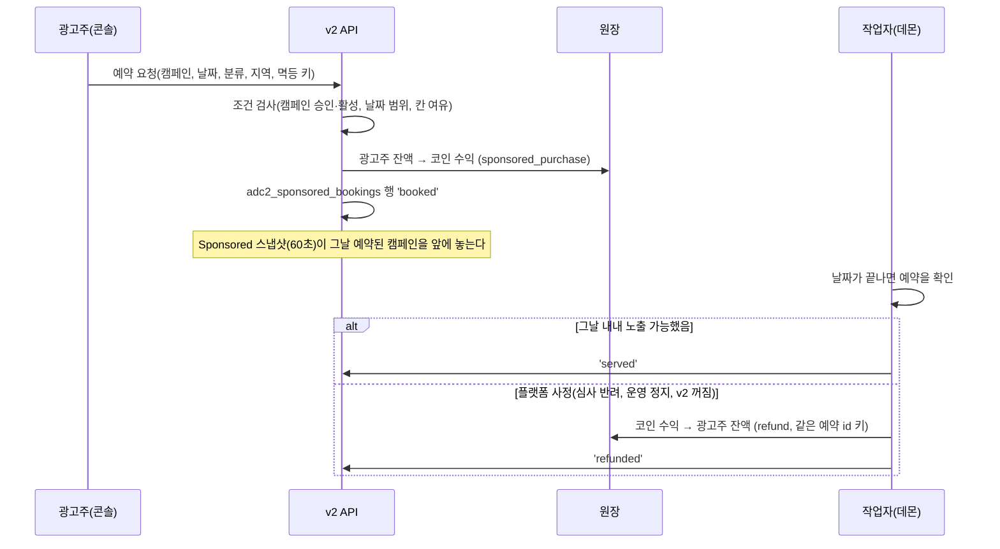

# AI AD Coin 코인 경제 3단계: Sponsored 하루 예약과 코인 결제 (설계 초안)

- **작성:** 2026-11-10, AI AD Coin 팀. **설계 초안이며 코드는 아직 만들지 않았다**(PM 11-10 지시).
- **바탕:** `docs/AD_COIN_COIN_ECONOMY.md` 2절·7절 3단계, `docs/AD_COIN_SPONSORED_SLOT.md`, 사용자 결정 11-10(수익·지출은 코인으로만, 지출 0)
- **결정 요청:** 끝의 6절. PM 검토 뒤 사용자에게 올린다.

## 1. 한 줄 요약

광고주가 **자기 코인 잔액**으로 Sponsored 영역의 하루 노출을 (작업 분류, 넓은 지역) 단위로 예약한다. 대금은 광고주 잔액에서 **플랫폼 코인 수익**으로 옮긴다. 플랫폼 사정으로 노출하지 못한 날은 같은 원장에서 되돌린다. 돈(법정화폐·USDC)은 어느 단계에도 들어오거나 나가지 않는다.

## 2. 헌장 1절 경계 확인 (법정화폐와 코인을 바꾸는 경로가 없음)

| 확인 항목 | 이 설계 | 근거 |
|---|---|---|
| 광고주가 코인을 **돈으로 사는** 경로 | 없음. 광고주 코인은 환영 지급, 제공자 보상, 운영자 지급(성장 예산)으로만 생긴다 | `economy.py`, 원장 `issuance`는 발행→성장 예산만 허용 |
| 코인을 **돈으로 바꾸는** 경로 | 없음. 예약 대금은 플랫폼 코인 수익 계정으로만 가고, 그 계정은 성장 지출로만 나간다 | 원장 계정 용도 고정 |
| 사람 → 광고주 이동 | 없음. 사람은 Sponsored를 살 수 없다 | 원장 규칙(사람·광고주 계정이 한 기록에 있으면 거부) |
| 실가치 스위치 | 계속 꺼 둔다(`AD_COIN_REAL_VALUE_ENABLED`). 이 기능은 스위치와 무관하게 동작한다 | `real_value.py` 미마운트 |
| 결제 대행사·체인 호출 | 없음 | 새 외부 호출 0 |
| 화면 문구 | 광고주 화면에 "coins have no cash value and cannot be bought or sold"를 둔다. "투자·수익·가치 상승" 표현 금지 | 경제 문서 6절 |

## 3. 흐름

### 3-1. 예약 (API 한 개)

- `POST /api/ad-coin/v2/advertisers/{id}/sponsored-bookings`
  - 필요: 광고주 관리 권한, CSRF, `Idempotency-Key`
  - 본문: `campaign_id`, `day`(UTC 날짜), `task_category`, `region`
- 검사(한 트랜잭션, 잠금 키 `sponsored:<날짜>:<분류>:<지역>`)
  1. 캠페인이 이 광고주 것이고 `approved`·`active`이다
  2. 날짜는 내일부터 30일 안이다. 오늘은 예약할 수 없다(당일 정산을 피하려고).
  3. 같은 (날짜, 분류, 지역)에 'booked'·'served' 예약이 `MAX_CARDS`(지금 2)보다 적다
  4. 같은 (캠페인, 날짜, 분류, 지역)은 표의 UNIQUE가 한 번만 허용한다
- 기록
  - 원장 `sponsored_purchase`: 광고주 `advertiser_available` −가격, `REVENUE_ACCOUNT` +가격. 멱등 키는 `sponsored_booking:<예약 id>`
  - 잔액이 모자라면 원장이 음수를 거부한다(`insufficient_balance`)
  - 감사 로그 `SPONSORED_BOOKED`(가격, 날짜, 분류·지역. 개인정보 없음)

### 3-2. 노출

- Sponsored 스냅샷(`campaigns_sponsored_snapshot`, 60초)에 "오늘 예약" 조건을 더한다. 예약된 캠페인만 Sponsored 영역에 나온다(6절 결정 2).
- 요청 경로는 지금처럼 메모리 사전 조회다. 실시간 DB 조회를 넣지 않는다(응답 시간 정책).
- 표시 규칙은 그대로다. 라벨은 "Sponsored", 추천 결과와 분리하고, 순위에 영향을 주지 않는다.

### 3-3. 정산과 환불 (작업자)

- 날짜가 끝나면(UTC 다음 날 00:10 이후) 작업자 데몬이 그날 'booked' 예약을 처리한다. 한 주기에 50건씩 한다.
- **served:** 그날 캠페인이 승인·활성 상태로 남아 있었다.
- **refunded(플랫폼 사정):** 운영자가 심사를 반려·정지했거나, v2 또는 Sponsored 영역이 꺼져 있던 시간이 정해진 기준을 넘었다.
  - 원장 `refund`: `REVENUE_ACCOUNT` −가격, 광고주 +가격. 키는 `sponsored_refund:<예약 id>`
  - 같은 키로 한 번만 되돌린다.
- **광고주가 스스로 멈춘 경우:** 환불하지 않는다. 예약 화면에 미리 알린다(6절 결정 3).
- 예약을 하루 전까지 취소하면 전액 되돌린다. 당일 취소는 되돌리지 않는다.

## 4. 운영 DB 변경

- **표:** `adc2_sponsored_bookings`는 이미 스키마 10에 있다(`economy_schema.py`, 승인안 A1에 포함). 11-10 v2 migrate로 `ad_coin_v2` 스키마에 만들어졌을 것이다.
  - **확인할 것:** 운영에서 `scripts.ad_coin_v2_migrate status`(읽기 전용)로 `existing_tables`와 `expected_tables`가 같은지 본다.
- **새 구조 변경: 없음(예상).** 새 SQL 문장(예약 수 세기, 예약 넣기, 상태 바꾸기, 오늘 예약 스냅샷)은 등록 SQL 목록(`sql_registry.json`)에 더하는 **코드 변경**이고, DB 구조는 바뀌지 않는다.
- **구조를 바꿔야 하게 되면**(예: 칸 수를 표로 관리, 인덱스 추가) 기존 절차를 따른다.
  1. `scripts.db_change_rehearsal run --command "python -m scripts.ad_coin_v2_migrate migrate ..."`로 사본에서 운영 버전 앱 연결까지 통과시킨다. public 트리거 5개 불변 검사도 함께 통과해야 한다.
  2. 복구 SQL을 준비한다. 새 인덱스는 `DROP INDEX IF EXISTS ad_coin_v2.<이름>`, 새 표는 비어 있을 때만 `DROP TABLE ad_coin_v2.<이름>`(데이터가 있으면 별도 승인).
  3. PM을 거쳐 사용자 승인을 받는다.
  4. 실행 직전 `check`가 0이 아니면 멈춘다.
- 모든 객체는 `ad_coin_v2` 스키마에만 만든다. public에는 아무것도 만들지 않는다(11-10 05:38 장애).

## 5. 시험 계획

- 원장
  - 예약하면 광고주 잔액이 줄고 코인 수익이 는다.
  - 잔액이 모자라면 거부한다.
  - 같은 멱등 키로 두 번 요청해도 한 번만 처리된다.
- 칸 한도: 같은 (날짜, 분류, 지역)에 3번째 예약은 거부된다. 동시 요청 두 개가 마지막 칸을 다투면 하나만 성공한다(실제 PG 클러스터).
- 경계
  - 사람 계정으로 예약하면 403이다.
  - 다른 광고주의 캠페인을 예약하면 403이다.
  - 실가치 스위치를 켜도 동작이 그대로이고, 법정화폐 경로는 404이다.
- 정산: served, refunded(반려·정지), 광고주 정지(환불 없음), 하루 전 취소(전액).
- 스냅샷: 예약이 없는 캠페인은 Sponsored에 나오지 않는다. 조회 시간은 지금 수준(마이크로초)을 유지한다.
- 대사: 예약 대금의 합과 환불의 합이 `REVENUE_ACCOUNT` 변화와 맞는다. `/ad-coin/v2/admin`에 "Sponsored 수익"을 추가한다.

## 6. 결정 요청 (PM → 사용자)

1. **가격:** (분류, 지역) 하루 1칸에 **50코인**(초안).
   - 참고: 환영 지급은 100코인이고, 제공자 보상은 월 1,000코인까지다. 이 가격이면 새 광고주가 이틀, 검증된 제공자가 한 달에 20일을 쓸 수 있다.
2. **노출 대상:** 예약한 캠페인만 Sponsored에 보인다(초안).
   - 지금은 예산이 있는 활성 캠페인이면 모두 보인다. 바꾸면 무료로 보이던 시험 캠페인이 예약 없이는 사라진다.
3. **환불 기준:**
   - 플랫폼 사정이면 전액 환불한다. 기준은 반려, 정지, 또는 v2·Sponsored가 하루에 1시간 넘게 꺼진 경우다.
   - 광고주가 스스로 멈추면 환불하지 않는다.
   - 하루 전까지 취소하면 전액 환불한다.
4. **칸 수:** (분류, 지역)마다 하루 2칸으로, 지금 표시 카드 수와 같다(초안).
5. **새 광고주 지원:** 경제 문서 3절의 "노출 지원"(성장 예산으로 첫 예약 하루를 대신 결제)을 이번에 함께 넣을지, 다음으로 미룰지 정한다.
6. **약관·화면 문구:** 광고주 약관에 예약·환불 조항을 더한다. 약관 변경은 매번 사용자 승인 사항이다.

## 7. 순서 (승인 뒤)

1. SQL 등록과 예약 API(원장, 칸 한도, 감사), 시험
2. 작업자 정산과 환불, 시험
3. 스냅샷 조건 변경(결정 2), 시험과 속도 측정
4. 광고주 콘솔의 예약 화면(영어, 디자인 체계)과 운영 화면의 Sponsored 수익(한국어)
5. 운영에서 `migrate status`로 표를 확인하고, 활성 버전 위에 겹쳐 게이트를 통과한 뒤 배포한다.
