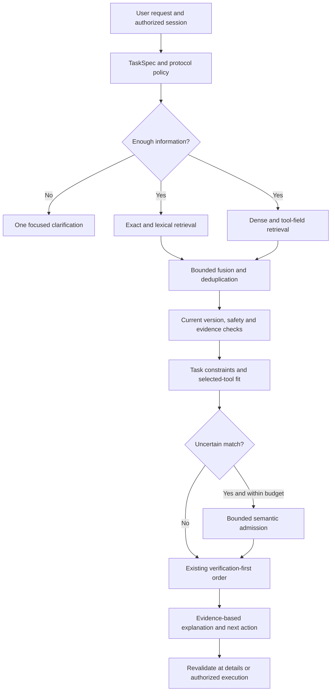

# 채팅 자연어 에이전트 추천 품질 개선 설계 1.0

작성·조사일: 2026-10-26 KST. 대상: 공개 프론트엔드 Chat의 자연어 요청, 후속 질문, 에이전트 추천·상세·연결 안내. **설계 완료 단계이며 운영 구현·배포나 신규 모델 성능 검증 완료를 뜻하지 않는다.** 기존 통합 설계 `reports/discovery-chat-workspace-upgrade-design-2026-10-25/DESIGN.ko.md`를 대체하지 않고 Chat의 요청 이해·추천 근거·평가 계약을 구체화한다.

## 1. 권고 결정

현재 PostgreSQL 18 + pgvector와 검증 기록 기반 추천을 유지한다. 우선 투자할 부분은 **조건을 빠뜨리지 않는 요청 이해, Tool 단위 기능·입출력 검색, 추천한 기능 자체의 검증 근거, 실패 원인을 구분하는 평가**다. 모델·벡터 DB 전면 교체는 이 평가에서 기존 방식보다 좋아진 경우에만 선택한다.

사용자가 얻어야 할 결과는 “비슷한 소개문을 가진 서비스”가 아니라 **내 작업과 조건에 맞는 에이전트, 맞는 이유, 확인된 범위, 다음 행동**이다. 추천 화면에 HTTP 200이나 일반 헬스 체크를 업무 성공으로 표현하지 않는다.

## 2. 현재 소스에서 확인한 사실

검토 파일의 SHA-256은 `source-snapshot.json`, 오프라인 재현은 `offline-query-probes.json`에 보관했다. 이번 조사에서 운영 사용자 메시지·개인정보를 추가 수집하지 않았으며 운영 DB를 수정하지 않았다.

### 이미 구현되어 있어 유지할 부분

- `concierge/front.py`는 `QualityRecommender`와 `FastConcierge`를 연결한다. 기본 채팅은 질문마다 생성 모델을 호출하지 않는다. “채팅이니 이미 생성형 RAG 답변을 한다”는 전제로 설계하면 실제 경로와 다르다.
- `concierge/discovery.py`는 PostgreSQL 전문 검색 후보와 pgvector ANN 후보를 RRF로 합친다. 벡터 원본·모델 일치 검사와 정확한 이름 검색 경로도 있다. 현재 전문 검색을 BM25라고 단정하지 않는다. 반환 필드명 `bm25_match`와 PostgreSQL의 실제 검색 알고리즘은 구분한다.
- `selection.py`에는 안전한 엔드포인트, 현재 상태, 실패 이력, 기능 범위, 인증 조건, 지원 스키마, 보고서·연결 버전 검사가 있다. 최종 순서는 최근 성공 검증 → 최근 활동 → 등급·품질을 우선한다.
- `report_evidence.py`는 보고서의 대상·버전·실제 실행 시각·최신 실행 근거를 확인한다. 보고서 게시 시각만으로 추천하지 않는다.
- `gateway/rag.py`에는 쿼리 임베딩 1.5초 예산, 동시성 4, 동일 요청 중복 억제, 모델·엔드포인트에 묶인 캐시가 있다. 생성 모델과 임베딩은 별도 기능이다.
- `postgres_ann.py`에는 설치 버전 확인 후 제한된 iterative scan을 적용하는 코드가 이미 있다. 새 기능처럼 다시 개발할 대상은 아니다.

### 직접 재현한 개선 대상

**F1 — 한국어 표현 범위:** `계약서에서 불리한 조항을 찾아주는 에이전트 추천해줘`는 `search_terms()`가 빈 배열을 반환했다. 같은 목적의 영어 문장은 `identify, unfavorable, clauses, contract`를 추출했다. 현재 `FastConcierge`는 검색어가 없으면 명확화 응답으로 종료한다. 모든 한국어가 실패한다는 뜻은 아니며, 현재 별칭 사전에 없는 이 표현에서 확인된 문제다.

**F2 — 긴 요청의 검색 조건 손실:** 663자 합성 요청을 `interpret()`에 넣자 내부 원문이 500자로 줄었다. 뒤쪽 `Seoul`과 API 키 제외 조건은 해석 결과에 없었다. `FastConcierge`는 2,000자까지 받으므로 단계별 길이 계약이 다르다. 인증 검사 일부는 별도 원문을 사용하므로 이것만으로 실제 인증 조건 위반을 확정하지 않는다. 다만 뒤쪽 검색 대상·조건을 후보 검색에 반영하지 못하는 경로는 재현됐다.

### 소스 구조상 확인한 위험과 추가 측정 필요 부분

**F3 — 검색 전에 후보가 누락될 가능성:** 전문 검색은 이름·설명에서 ID를 먼저 찾고 최근 활동 기준으로 제한한 뒤 재정렬한다. 상세 도구에만 적힌 기능이나 초기에 잘린 후보는 뒤의 RRF·검증으로 되살릴 수 없다. 실제 누락률은 동일 스냅샷 평가가 필요하다.

**F4 — 의미 유사도가 최종 추천을 보장하지 않음:** Dense 후보라도 최종 기능 단어 수·규칙·관련성 임계값을 통과해야 한다. 안전성에 유익하지만 표현만 다른 정답을 탈락시킬 수 있다. 반대로 최근에 검증된 약한 관련 후보가 관련성 문턱을 통과하면 먼저 나온다. 검증 우선 정책은 유지하고 관련성 통과 판정의 정확도를 높인다.

**F5 — 에이전트 검증과 선택한 도구 검증의 차이:** 현재 보고서 검증은 리소스·연결 버전 중심이며, 화면에 선택한 도구는 요청 관련 단어 등을 기준으로 별도 고른다. 여러 도구 중 하나의 성공을 모든 도구의 업무 성공으로 설명하지 않도록 `selected_tool`에 연결된 근거 범위를 명시해야 한다. 기존 버전 검증이 없다는 의미는 아니다.

**F6 — 후속 조건 변경:** 현재 후속 요청에는 문장 접두어·검색어 유무를 보고 이전 작업을 이어 붙이는 분기가 있다. “그중 PDF 표를 보존하는 것”, “같은 조건에서 일본어도”, “이제 다른 작업”을 구분하는 구조적 상태가 필요하다. 모든 후속 질문이 실패한다고 확정하지 않는다.

**F7 — 결과 없음의 원인 혼합:** 현재 “활성·관련 에이전트 없음”에는 카탈로그 부재, 조건 불명, 표현 해석 실패, 검증 탈락이 함께 들어갈 수 있다. 임베딩 장애나 DB 제한까지 진짜 카탈로그 부재로 기록하지 않아야 품질 개선 지점을 찾을 수 있다.

현재 계약 회귀는 `test_retention_quality_admission.py`, `test_search_quality_phase2.py`, `test_discovery_three_policy.py` **54건 통과**했다. Starlette의 테스트 클라이언트 사용 중단 예정 경고 1건이 있다. 이 결과는 추천 정확도·운영 p95·외부 실행 성공률 측정이 아니다. 이번 범위는 소스 점검·격리 테스트·문헌 조사이며 운영 로그인·외부 실행은 하지 않았다.

## 3. 추천 정책을 먼저 고정한다

제공된 사용자 지침과 저장소 파일·현행 코드 사이에 정책 차이가 있다. 사용자 지침은 추천 1개, 기본 A2A, 명시적 Any는 세 프로토콜 검색이다. 현재 파일·코드는 최대 3개, 자동/Any에서 A2A 우선 후 MCP 보충, x402는 명시 선택이다. 이 차이를 “정확도 개선” 속에 숨기지 않는다.

이 설계의 출시 계약은 **사용자가 제공한 지침을 우선하여 기본 추천 1개·기본 A2A·명시적 Any는 A2A/MCP/x402**로 명세한다. 명시적 선택자는 문장보다 우선하며 후속 요청은 선택 범위를 유지한다. 기존 3개·자동 보충 동작은 현행 대조군으로 기록하고 정책 전환 회귀를 별도로 만든다. `protocol_policy_version`, `presentation_policy_version`, `ranking_policy_version`을 독립적으로 기록한다. 정책 변경과 의미 검색 개선의 효과도 따로 비교한다.

품질 모델은 동일 프로토콜 범위 내에서 **후보 검색과 작업 적합성 판정**을 돕는다. 최종 추천의 최근 성공 검증 → 최근 활동 → 등급 순서는 보존한다. 관련성을 최종 정렬의 첫 항목으로 바꾸는 안은 별도 정책 변경 전까지 출시하지 않는다. 고객 등급·광고·금액으로 순서를 바꾸지 않는다.

## 4. 논문·공식 문서·SNS 조사와 채택 판단

아래 적용안은 연구를 우리 서비스에 맞게 해석한 설계 제안이다. 논문 벤치마크의 성능을 이 서비스에서 달성한 것으로 사용하지 않는다.

- **ToolRet, ACL 2025:** 일반 IR에서 강한 모델도 도구 검색에 약할 수 있음을 다룬다. 따라서 이름·소개문 검색뿐 아니라 실제 도구와 입력 가능성, 실행 가능한 정답 집합으로 평가한다. [원 논문](https://arxiv.org/abs/2503.01763)
- **Multi-Field Tool Retrieval, 2026-02:** 기능·입력 조건·출력 형식처럼 서로 다른 측면을 구분해 검색하는 접근이다. `action`, `subject`, `input`, `output`, `constraints`별 검색·판정으로 구체화한다. [원 논문](https://arxiv.org/abs/2602.05366)
- **Tool-DE, 2025-10:** 불완전한 도구 문서의 구조화·확장을 다룬다. 수집 문서를 표준화하되 생성된 설명은 검색 보조로만 사용하고 실행·인증·언어 지원의 사실 증명으로 쓰지 않는다. [원 논문](https://arxiv.org/abs/2510.22670)
- **Query Rewriting, EMNLP 2023:** 요청과 검색문 표현 차이를 줄이는 근거다. 원문을 바꾸는 대신 구조화한 조건을 보존한 검색문을 최대 2개 추가한다. 논문에서 사용하는 학습·강화학습까지 초기 구현에 도입하지 않는다. [원 논문](https://arxiv.org/abs/2305.14283)
- **BRIGHT, ICLR 2025:** 단순 표현 일치로 해결되지 않는 검색을 평가한다. 복합 요청에서 목적·대상·입출력을 추출하는 평가군을 추가한다. 복잡한 요청마다 긴 추론을 실행하라는 근거로 사용하지 않는다. [원 논문](https://arxiv.org/abs/2407.12883)
- **RRF, SIGIR 2009:** 서로 다른 검색기의 순위를 결합하는 단순 기준선이다. 현재 RRF를 유지하고, 다중 검색문이 같은 에이전트에 중복 표를 주지 않도록 검색 계열별 가중치를 고정한다. [원 논문](https://cormack.uwaterloo.ca/cormacksigir09-rrf.pdf)
- **Qwen3 Embedding, 2025-06:** 다국어 임베딩·재정렬 모델의 비교 후보다. 현재 임베딩과 소형 모델을 동일 질의·스냅샷에서 비교한다. 범용 벤치마크 순위만으로 교체하지 않는다. [원 논문](https://arxiv.org/abs/2506.05176)
- **MCPTox, 2025, 개정 2026-09:** 도구 메타데이터 자체에 악성 지시를 넣는 위험을 다룬다. 설명을 모델의 지시문으로 승격하지 않고, 추천 모델에 실행 권한·비밀·임의 URL 조회 도구를 주지 않는다. [원 논문](https://arxiv.org/abs/2508.14925)
- **pgvector 공식 문서:** ANN에 필터를 결합할 때 반환 개수·재현율을 별도로 확인해야 한다. 기존 iterative scan을 유지하면서 선택도별 exact 검색 기준값과 비교한다. [공식 문서](https://github.com/pgvector/pgvector#filtering)
- **Anthropic 공식 엔지니어링 자료, 2025-11:** 필요한 도구 정의만 단계적으로 불러오는 접근을 설명한다. 전체 카탈로그를 모델에 넣지 않고 현재 작업의 작은 후보와 근거만 전달한다. 특정 공급자 SDK 추가는 필요 없다. [공식 자료](https://www.anthropic.com/research/advanced-tool-use)

SNS는 공개 Reddit 원문을 조사했다. 다음은 독립 검증된 연구 결과가 아닌 작성자·댓글의 경험 보고다. 상대 날짜와 검색 결과의 캐시 날짜가 달라질 수 있어 조사일과 링크만 고정하며, 인기도를 기술 선택 근거로 쓰지 않는다.

- Hybrid·재정렬 추가 후 오히려 결과가 나빠졌다는 사례는 **후보 Recall과 최종 순위 품질을 분리하고, 복수 정답을 인정하며, threshold부터 평가**할 필요를 보여주는 반례다. 게시자의 수치를 우리 개선 예상치로 인용하지 않는다. [r/Rag 사례](https://www.reddit.com/r/Rag/comments/1v7g3oe/hybrid_search_and_reranking_made_my_rag_worse/)
- 자유문장 카탈로그 매칭 토론에서는 필수 조건을 유사도 모델에 맡기지 말고 구조화한 필터로 검사하고, 추천 이유가 필드 근거와 일치하는지 확인하자는 의견이 나온다. 이를 한 조건만 위반하는 함정 후보 평가로 구체화한다. [r/LocalLLaMA 토론](https://www.reddit.com/r/LocalLLaMA/comments/1wzndla/local_embeddings_and_rerankers_vs_a_hosted_llm/)

## 5. 목표 처리 흐름



### 5.1 TaskSpec: 요청과 조건을 분리한다

내부 계약 예시:

```json
{
  "schema_version": 1,
  "action": "extract",
  "subject": "invoice line items",
  "input": {"media_type": "application/pdf", "scanned": true},
  "output": {"format": "json", "preserve_tables": true},
  "must": ["ocr", "table_structure"],
  "must_not": ["account_signup"],
  "entities": [],
  "protocol": "mcp",
  "protocol_source": "selector",
  "operation": "refine",
  "unresolved": []
}
```

원문은 서버 입력 상한까지 검사하고, 검색용 압축문과 필수 조건을 따로 둔다. 500자 뒤 조건을 조용히 버리지 않는다. 너무 긴 요청은 명확한 제한 안내를 하며 무단으로 뒷부분을 삭제하지 않는다. 부정, 기간, 지역, 언어, 형식, 고유명사, 순서에 원문 위치 근거를 연결한다.

공통 표현·정확한 이름은 로컬 규칙으로 빠르게 처리한다. 미등록 언어 표현·복합 조건·후속 변경이 있는 경우에만 제한된 모델 호출을 사용한다. 모델 출력은 JSON Schema, 열거형, 크기 제한, 원문 조건 보존 검사를 통과해야 한다. 금지 조건을 긍정 검색어로 넣지 않는다. 모델이 추출하지 못한 중요 조건은 `unresolved`로 남겨 질문한다.

후속 요청은 `new / refine / alternative / details / outcome`으로 구분한다. 원문 이어 붙이기 대신 확인된 TaskSpec을 수정하고, 프로토콜 변경과 작업 변경을 분리한다. 이전 작업의 일시적인 실패나 불필요한 지역 조건을 새 작업에 넘기지 않는다. 공개 제품 답변은 영어를 유지하되 다양한 언어의 입력은 지원한다.

### 5.2 Tool 단위 프로파일

제안 테이블 `agentcon_search.tool_profiles`에 `resource_id`, `tool_key`, `connection_version_id`, `schema_hash`, `source_hash`, `normalizer_version`, `action`, `subjects`, `input_fields`, `output_facts`, `limits`, `auth_requirements`, `observed_at`, `provenance`를 보관한다. 출력 형식이나 언어 지원이 문서에 없으면 `unknown`이다. JSON 응답이 가능하다는 이유로 PDF 변환·표 보존 능력을 추정하지 않는다.

각 사실은 `declared / verified / inferred`로 구분한다. `inferred`는 검색 표현 보조에만 사용하며 필수 조건 충족 증거가 될 수 없다. 하나의 Tool이 조건을 만족하는지 확인한다. 한 서버의 도구 A의 OCR과 도구 B의 JSON을 합쳐 존재하지 않는 단일 기능을 만들지 않는다. 여러 단계가 필요하면 Chat에서 임의 연결·실행하지 않고 Workspace 검토로 안내한다.

기존 수집·헬스·평가 작업은 유지한다. 프로파일 작성은 독립된 jobs 증분 작업으로 수행하고 이름·문서·스키마 해시가 바뀐 항목만 재처리한다. 기존 원본·보고서·벡터를 삭제하거나 덮어쓰지 않는다. 리소스 활성 세대·연결 버전이 달라지면 검색에서 즉시 제외한다. 프로파일 누락 시 기존 경로를 사용한다.

### 5.3 후보 검색과 누락 방지

원문 검색을 항상 유지하고 검증된 재작성문은 최대 2개까지 허용한다. 초기 실험 후보 수는 원문 lexical 100, 원문 dense 100, Tool 필드 100이며 확장 검색을 포함해 **현재의 부모 리소스 최대 600**을 넘지 않는다. 각 원문 검색 계열의 후보 몫을 예약해 확장문이 원래 후보를 밀어내지 않게 한다. 같은 계열의 여러 검색문은 계열 내에서 먼저 합쳐, 검색문 개수가 RRF 가중치를 부풀리지 않도록 한다.

자원 제한 전후의 정답 보존율을 따로 측정한다. Tool 문서에서 찾은 결과를 부모 리소스로 묶되 `matched_tool_key`를 잃지 않는다. 동일 기능의 거울 배포는 중복을 줄이되 서로 다른 계약·인증·범위까지 같다고 추정해 합치지 않는다.

pgvector에서는 모델별 dimension·토크나이저·정규화·쿼리 prefix를 descriptor에 포함한다. 비교 모델은 별도 테이블/인덱스로 적재하고 기존 768차원 컬럼에 다른 차원 벡터를 섞지 않는다. 전량 재임베딩은 비교 실험 통과 전 하지 않는다. 조건으로 남는 후보가 적으면 정확 검색을 사용할 임계값을 측정하고, 선택도별 ANN Recall을 exact top-K와 비교한다.

### 5.4 적합성 검사와 근거 단위

안전성·현재 버전·지원 프로토콜·실패·연결 거부는 코드가 강제한다. 인증 불필요 같은 명시적 요구는 충족/위반/불명 3상태로 판정한다. **불명을 충족으로 처리하지 않는다.** 조건이 불명인 결과는 주 추천 대신 조건 확인 대상으로 분리한다.

초기 후보에서 코드 판정이 어려운 최대 24개의 도구 요약만 소형 의미 판정기로 검사한다. 반환은 `match / mismatch / unknown`과 근거 필드 ID다. 확률처럼 보이는 임의 LLM 숫자를 “정확도”로 표시하지 않는다. 필수 조건 위반을 모델 점수로 상쇄할 수 없으며 후보 목록 밖 ID·URL은 거부한다. 시간 초과·구조 오류면 기존 결정적 판정으로 돌아간다.

새 근거 인덱스는 `(resource_id, connection_version_id, tool_key, schema_hash, task_class, finished_at, expires_at)`를 사용한다. 기존 에이전트 단위 성공 기록을 특정 Tool 성공으로 승격하지 않는다. Tool 기록이 없으면 “Connection verified”와 “Task not yet verified”를 구분하고 엄격한 업무 성공 추천에는 넣지 않는다. 최근 동일 범위 실패는 오래된 성공을 덮는다. 이 엄격화로 후보 수가 줄 수 있으므로, 운영자 테스트 보강을 함께 진행하되 실패를 감추려고 문턱을 낮추지 않는다.

## 6. 사용자가 체감할 답변과 화면

기본 답변은 한 개의 주 추천과 다음 행동에 집중한다. 기술 세부는 Details에서 펼친다. 예시 문구는 실제 데이터가 있을 때만 생성한다.

- 요청 요약: `You need an agent that extracts scanned invoice tables into JSON.`
- 추천 이유: `Matches your PDF input and structured-output requirements.`
- 근거: `This tool passed the matching task check on <verified date>.` 날짜·범위가 없으면 이 문구를 사용하지 않는다.
- 제약: `Requires your provider connection.` 또는 `Table preservation has not been verified.` 후자의 경우 필수 조건으로 요청했다면 주 추천으로 확정하지 않는다.
- 행동: `View details`, `Review in Workspace`, `Show another match`. 연결 안내와 실제 실행 승인은 구분한다.

요청 요약, 이유, 근거는 TaskSpec·원본 필드·검증 ID에 연결한다. 이름·주소·기능·검증일은 DB 값만 사용한다. 초기 구현은 템플릿 방식으로 설명하며 추가 문장 생성은 이후 선택 실험이다. 생성 문장을 쓰더라도 사실 필드와 불일치하면 템플릿으로 대체한다.

결과 없음은 다음 네 가지를 구분한다.

1. `needs_clarification`: 빠진 조건 한 가지만 질문한다. 예: `Do you need a public web search agent or a search tool for your own documents?`
2. `no_eligible_match`: 현재 확인된 후보가 조건을 만족하지 않는다. 어떤 조건 때문인지 설명하고 변경은 사용자가 선택하게 한다.
3. `verification_unavailable`: 기능은 일치하나 검증 근거가 부족하다. “업무 실행 확인”으로 표시하지 않는다.
4. `temporarily_unavailable`: 시간 초과·용량 제한·의존 서비스 장애. “그런 에이전트가 없다”로 응답하지 않는다.

사용자 전송 직후 해당 답변 영역에 로딩 상태를 표시하고 완료·오류·취소·예산 종료 모두 해제한다. 배경 재검증은 전체 화면 로딩을 켜지 않는다. 전송 중 중복 제출은 idempotency key로 막고 입력 초안은 유지한다. 새 답변 우선, 키보드 조작·스크린리더 상태 안내·모바일 줄바꿈을 검증한다. Chat·상세·답변에는 가격·결제·지갑·등급별 상향 판매 정보와 방문자 토큰·원시 JSON·내부 설정을 표시하지 않는다.

## 7. 성능·동시성·캐시 설계

아래 수치는 **초기 설계 목표와 예산**이며 실측 달성값이 아니다.

- 일반 경로: 모델 호출 0회, 사용자 응답 p95 1.8초 목표.
- 복합 경로: 해석 1회, 필요한 경우 의미 판정 1회 이내. p95 3.5초 목표, 전체 deadline 5초. 큐 대기도 전체 deadline에 포함한다.
- 예산 초안: 요청 구조화 0.8초, 병렬 검색 1.6초, 의미 판정 0.5초, 현재성 확인·응답 0.2초. 연결 획득·스케줄링 여유는 별도 계측한다. 이 예산을 초과하면 재시도 사슬을 늘리지 않고 단계적으로 축소한다.
- 현행 임베딩 1.5초 제한은 유지한다. 재작성 검색이 3개가 되어도 임베딩 대기·작업을 무제한 늘리지 않는다. 동시 요청 합치기와 계열별 1회 임베딩을 우선한다.
- 모델 서버의 16 슬롯은 최대 수용량 참고값이다. 긴 요청·컨텍스트 크기·발열·Workspace와 jobs 경합을 고려해야 하므로 동시 사용자 16명 모두에게 같은 응답 시간을 보장하는 수치로 해석하지 않는다.

전역 admission의 초기 분배안은 온라인 최대 12(채팅 최대 4, Workspace 최대 8), 배치 최대 2, 여유 2다. 채팅은 우선 2로 시작해 실측 후 4로 확장한다. 여러 서비스 프로세스에서 공유할 수 있는 Redis lease와 상한 제한을 사용한다. 원격 요청이 실제로 끝나기 전에는 사용자 HTTP 시간 초과만으로 슬롯을 반납하지 않는다. 로컬 semaphore 16개를 프로세스마다 따로 만들어 총량을 초과하지 않는다. 임베딩 서버의 용량은 생성 모델 슬롯과 별도 관리한다.

후보 ID 캐시는 질의 해시·구조화 조건·프로토콜 정책·카탈로그 세대·프로파일 버전·임베딩 descriptor를 키로 한다. 캐시는 실행 권한·최종 검증 판정을 저장하지 않는다. 반환 직전 최신 상태를 다시 확인하고 Workspace 연결 정보는 사용자 간 공유하지 않는다. 개인정보·비밀이 섞인 요청은 공유 캐시 대상에서 제외한다. 부정 결과는 짧게 보관하되 장애 응답은 “정답 없음” 캐시에 넣지 않는다.

## 8. 평가 데이터와 출시 기준

우선 **600개 독립 작업군**을 구성한다. 쉬운 도메인 100, 동의어·다국어 100, 긴 요청·부정·복합 조건 100, 입력·출력·스키마 함정 100, 정답 없음·모호함 100, 다중 턴·프로토콜 전환 100이다. 이는 제안 수량이며 현재 라벨링 완료 수량이 아니다. 현재 만든 seed는 전체 정답 데이터가 아니다.

각 작업군의 표현 변형·대화 턴은 같은 분할에 넣고 제공자·스키마 유사군도 누수를 점검한다. 개발 200·보정 100·잠금 평가 300 작업군으로 고정한다. 각 작업에는 복수 정답 Tool·버전, 조건별 근거, 불명 상태, 반드시 탈락해야 하는 유사 후보를 기록한다. 2인 독립 판정 후 불일치를 조정하고 모델 단독 심판으로 정답을 확정하지 않는다. 실제 로그를 추가하려면 기존 보관 목적·권한·마스킹 정책 안에서 별도 처리한다.

분리해서 측정할 지표:

- **후보 Recall@100 / Tool Recall@100:** 적격 정답이 후보에 들어오는가. 단계별 제한 전후를 따로 측정한다. 카탈로그에 적격 정답이 있는 작업만 분모에 둔다.
- **조건 위반률:** 출력 추천 중 필수 조건을 위반한 비율. 불명 조건을 확인 완료로 표시한 것도 위반이다.
- **Top-1 Task Fit / nDCG@3:** 기본 추천 품질과 요청한 대안 품질을 각각 평가한다. 등급 라벨은 불가 0·일부 가능 1·조건부 2·모든 필수 조건 충족 3으로 고정한다.
- **No-match Precision / Recall, 답변 커버리지:** 모른다고 해야 할 때 추천하지 않는가, 실제 정답이 있는데 숨기지 않는가를 동시에 본다. 답변을 줄여 정확도만 높이는 개선은 불합격이다.
- **근거 일치율:** 기능·입력·출력·검증 범위·날짜 설명에 추적 가능한 근거가 있는가.
- **업무 결과 성공률:** 명시적으로 승인된 샌드박스 실행에서 요청의 출력 계약을 충족하는가. HTTP 200·도구 목록 반환·ACK는 업무 성공으로 계산하지 않는다.
- **지연·가용성:** p50/p95/p99, 큐 대기, DB 연결 대기, embedding 실패, lexical fallback, 429/503, 실제 모델 inflight와 deadline 이후 잔존 작업을 기록한다.

출시 목표는 후보 Recall@100 95% 이상, 조건 위반·위험 후보 추천 0건, 잠금 평가 Top-1 Fit 현행 대비 8%p 이상 개선, 주요 언어·작업군의 유의한 퇴행 없음이다. 근거 일치율은 검토 표본 100%를 요구한다. 이는 무결함 보장이 아닌 해당 평가셋의 통과 기준이다. 작은 하위군은 점추정만으로 판단하지 않고 신뢰구간과 실패 사례를 함께 검토한다. 통과가 어려우면 기준을 낮추지 말고 원인을 분류해 적용 범위를 좁힌다.

실험군은 A 현행, B 요청 구조화만, C Tool 프로파일 추가, D 조건부 의미 판정 추가, E 임베딩 후보 변경으로 나눈다. 같은 스냅샷·정답·쿼리로 각 단계의 추가 효과를 비교한다. 정책 변경 실험은 별도 축으로 유지한다. 1·4·8·16 동시성에서 콜드/웜, 긴 요청 혼합, Workspace와 동시 사용, 모델·임베딩 장애를 포함한다. 먼저 200회 안정성 예비 실행 후 p95 신뢰도가 부족하면 표본을 늘린다. 16건 한 번 성공은 지속 처리량 검증으로 쓰지 않는다.

재방문은 품질과 관계가 있을 수 있으나 방문 목적·유입·로그인 마찰·동의 여부도 영향을 준다. 재방문 부족을 추천 실패로 단정하지 않는다. 명시적 결과 피드백, 상세 열기, 승인된 실제 실행 성공, 재방문을 별도 집계하고 기존 개인정보 고지 범위를 지킨다. 사용자의 `worked` 보고는 자기 보고로 저장하고 검증된 외부 실행 근거로 승격하지 않는다.

## 9. 구현 순서와 파일별 반영 지점

**1단계 — 기준선과 계약(P0).** 현재 정책 불일치 명세, 평가 작업군·반례, 시점 고정 카탈로그, 단계별 탈락 코드부터 만든다. `fast_chat.py`, `query_intent.py`, `retrieval_metrics.py`에 요청 길이·상태·오류 계약을 설계하고 격리 회귀를 추가한다. 완료 기준: F1·F2 재현 테스트와 정책 회귀가 독립적으로 존재한다.

**2단계 — 요청 구조화(P0).** 새 `chat_task_spec.py`, `chat_query_rewrite.py`를 도입하고 `fast_chat.py`에서 구조적 후속 상태를 사용한다. 500자 단순 절단을 공통 입력 계약으로 교체한다. 완료 기준: 주제·부정·형식·지역·프로토콜을 보존하고 미확인 조건은 질문한다. 기존 명령·토큰·알림 동의 계약을 유지한다.

**3단계 — Tool 색인과 근거(P1).** `capability_retrieval.py`를 재사용해 증분 Tool 프로파일·색인을 만들고 `discovery.py`에 원문 후보 보장형 검색을 추가한다. `report_evidence.py`·registry에는 Tool/업무 범위 근거를 추가하되 원본 보고서는 보존한다. 완료 기준: Tool 설명에만 있는 정답이 후보에 들어오고 다른 도구의 성공을 차용하지 않는다.

**4단계 — 적합성 판정과 답변 UX(P1).** `selection.py`의 최종 검증 우선 정렬은 유지하며 `chat_semantic_admission.py`, `chat_explanation.py`를 분리한다. `front.py`와 `extracted_html.txt`를 동기화하고 기본 답변·명확화·상세·빈 결과·로딩·접근성을 검증한다. 완료 기준: 각 추천 이유의 근거 추적, 입력 유지, 반복 클릭 차단, 안전한 fallback.

**5단계 — 모델·성능 최적화(P2).** 기존 임베딩과 소형 다국어/Tool 특화 모델을 비교한다. 새 모델 도입 시 모델 파일·라이선스·해시·의존성·서빙 기능·메모리를 확인한다. 기존 맥미니 서버에 임의로 모델을 추가 적재하거나 운영 설정을 바꾸지 않는다. 완료 기준: 동일 평가군 품질 개선과 동시성 지연 목표를 함께 만족한다.

**6단계 — 제한 공개와 환류.** `off / shadow / canary / on` 플래그를 요청 구조화·Tool 검색·의미 판정별로 나눈다. Offline 통과 → shadow → 소규모 canary → 확대 순서로 진행하고 신규 경로의 오류·오추천·지연 증가 시 기존 추천으로 복귀한다. Shadow도 후보 데이터·모델 요청 상한을 공유하며 운영 자원을 무제한 소비하지 않는다. 프로파일 스키마는 추가 방식으로 배포하고 롤백 시 데이터 삭제를 요구하지 않는다. 운영 프로세스 교체는 별도 명시적 지시에 따른다.

## 10. 보안·관측·완료 정의

Tool 설명·문서는 신뢰하지 않는 데이터다. 모델 입력은 공개 필드 allowlist와 길이 제한을 거치며 비밀·토큰·사용자 연결 설정을 포함하지 않는다. 모델 출력은 후보 ID·근거 필드만 참조하고 URL 생성·임의 외부 조회·자동 실행을 할 수 없다. SSRF·명령 주입·저장 XSS·공급자 메타데이터 주입·교차 사용자 캐시·실패 후 슬롯 미반납에 대한 격리 회귀를 실행한다. 의미 분류기 자체를 보안 경계로 삼지 않는다.

기존 `observability.py`는 운영 메타데이터용이며 이를 방문자 추적 저장소로 확장하지 않는다. 집계할 최소 이벤트는 단계 지연, 후보 수, 정형 탈락 사유, 사용한 정책·모델·프로파일 버전, 결과 상태다. 원문·자격증명·민감한 고유명사를 집계 로그에 넣지 않는다. 정책 버전별 비교에 필요한 데이터만 제한 보관하고 추적 동의·권한과 분리한다.

구현 완료 판정은 기능 회귀·공개 콘텐츠 검사·격리 브라우저/API 보안 검사, 잠금 품질 평가, 동시성·장애 실험, 승인된 외부 실행의 실제 출력 확인을 모두 포함한다. 회귀 통과만으로 “추천 품질 개선 완료”라고 보고하지 않는다.

이번 설계의 산출물은 설계서, 근거 목록, 소스 해시, 재현 입력, 평가 seed, 기존 계약 회귀 결과다. 애플리케이션 소스·운영 설정·서버·DB·모델은 변경하지 않았다.

## 11. 개발 결과 연결 (2026-10-26)

핵심 요청 보존·조건 판정·선택적 언어 정규화·도구 근거 표시·주 추천/대안 UI가 구현됐다. [개발 결과와 차이점](../chat-recommendation-quality-development-2026-10-26/REPORT.ko.md)을 구현 상태의 기준으로 삼는다. 실제 측정에 따라 선택적 정규화 예산은 초기 제안 0.8초에서 1.8초로 조정됐다. 기존 FTS의 Tool 문서 확장을 재사용했으며, 신규 영속 프로파일 테이블이나 모델 교체는 수행하지 않았다. API 프로토콜 범위는 현행 동작을 유지하고 화면에서는 주 추천 하나를 먼저 표시한다. 대표 품질 평가 목표는 아직 미달성/미측정 상태이며 404개 기능 회귀와 구분한다.
