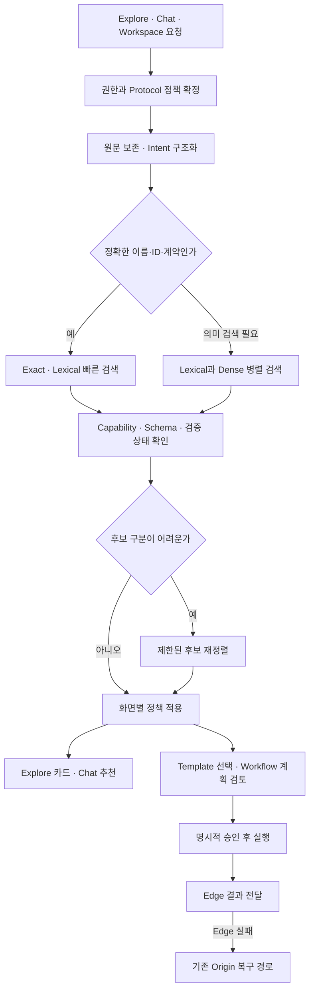

# Agent Concierge 탐색·Chat·Workspace 성능·품질 개선 설계서

작성일: 2026년 10월 25일 · 범위: 공개 탐색, Chat 추천, Workspace 자연어 Workflow 생성 · 상태: 구현 전 설계

## 1. 제안하는 방향

**세 화면이 같은 Capability 정보와 실행 가능성 근거를 사용하도록 통합하고, 간단한 요청은 빠르게 처리하며, 복잡한 Workflow는 검증 가능한 단계로 생성한다.** 더 큰 LLM을 모든 요청에 붙이는 방식보다 먼저 적용할 개선이다.

- **탐색:** 이름과 키워드가 정확한 검색은 즉시 처리한다. 의미 검색은 원문의 대상·버전·제외 조건을 보존하고, 실제 Tool과 입력·출력 계약을 기준으로 후보를 찾는다.
- **Chat:** 대화 맥락과 선택한 Protocol을 유지한다. 추천 이유는 확인된 기능과 검증 기록으로 설명하고, 빠진 필수 조건만 짧게 확인한다.
- **Workspace:** 자연어를 목적·조건·입출력 관계로 구조화한다. 적합한 기존 Template을 우선 제시하고, 새 생성이 필요하면 승인된 Capability로만 Workflow를 구성한다. 생성·검토·실행·다운로드의 완료 상태를 각각 확인한다.
- **공통 운영:** 단계별 지연시간과 실패 원인을 측정한다. 모든 Agent 결과는 크기와 관계없이 Edge 우선으로 전달하고, Edge 실패 시에만 기존 Origin 복구 경로를 사용한다.

최우선 개발 순서는 **측정 기준 확보 → 조건 보존과 검색 일관성 → 선택적 재정렬 → Workflow 의미 검증 확장 → 실제 실행 평가**다. 아래 수치 목표는 앞으로 검증할 설계 목표이며, 현재 달성 성능과 구분한다.

## 2. 조사 방법과 확인 범위

현재 저장소의 관련 함수·고객 UI 연결·기존 검증 결과를 읽고, 논문 11편, 공식 기술 자료 4건, SNS 토론 4건을 대조했다. 기술 구조는 원 논문·공식 자료를 기준으로 정했고, SNS는 현장에서 반복되는 실패와 반례를 찾는 용도로 사용했다. 외부 글의 개선 배수를 Agent Concierge의 예상 개선 배수로 환산하지 않았다.

이번 작업은 설계서 작성이다. 운영 Provider 호출, 실제 고객 Workflow 실행, 모델 부하 시험, DB 변경, 서버 재시작은 수행하지 않았다. 현재 소스 관찰과 과거 보고서의 측정값은 다음처럼 분리한다.

### 확인된 구현 기반

- `agent_market/concierge/discovery.py`: 선택적 Embedding과 Lexical 검색, RRF 결합, 최대 600개 후보, 모델·원본 정보 변경에 대한 Fence가 있다. PostgreSQL 검색에서는 Lexical 후보와 ANN 후보를 결합한다. Embedding이 활성화되면 현재 함수는 Query Embedding을 먼저 구한다.
- `agent_market/concierge/hybrid_explore.py`: PostgreSQL 공개 탐색의 주 경로다. Protocol·Category·검증·입력 요건·공개 실행 적합성을 검사하고 Host 다양성을 제한한다. 최종 카드에는 Registry Projection을 사용한다.
- `agent_market/concierge/front.py`: `/api/explore`에서 PostgreSQL이면 기본적으로 Hybrid 경로로 들어간다. `has_report` 등 일부 조건은 기존 `get_front_explore` 경로를 사용한다. 기존 경로의 메모리·Redis Cache에 프로세스 객체의 `id(store)`가 들어가므로 공유 Cache 효율을 별도로 확인해야 한다. **이 Cache 관찰을 모든 탐색 요청의 확정 병목으로 확대하지 않는다.**
- `agent_market/concierge/selection.py`, `fast_chat.py`: 실행 적합성 검사와 최근 성공 검증·활동·등급 기반 추천을 제공한다. 일반 추천은 기록된 정보를 사용하며, 요청마다 Provider를 시험 호출하는 구조가 아니다.
- `agent_market/concierge/workflow_discovery.py`: Template의 실제 Node 기능으로 목적 포함 여부를 검사하고, 추가 기능·불필요한 Node에 감점을 준다. 과거의 과도한 Template 추천 사례는 이미 이 보완이 들어간 상태를 기준으로 재평가한다.
- 고객 Workspace UI의 AI 생성 버튼은 `customer_typed_authoring_view.py`에서 `/api/customer-organizations/{workspace}/authoring/typed/reviews/model`을 호출한다. `customer_authoring_service.py` → `CustomerAppFactory` → `workspace_app_factory.py`로 연결된다. Admin 전용 Composer와 구분되는 실제 고객 경로다.
- `workspace_app_factory.py`: 공개 목적과 승인된 후보만 모델에 전달하고, 모델 호출 전후 권한·후보·Schema·설정 변경을 다시 검사한다. 생성 결과는 검토 대상이며 실행되지 않는다. 현재 모델 생성 계약은 `news.search.v1`, `docs.search.v1`에 제한된다.
- `workflow_model_proposer.py`, `workflow_goal_policy.py`, `workspace_typed_flows.py`: Schema 지정 출력, 코드에 의한 DAG 구성, 단계 수·주제·버전·순서·결과 수·기간 보존 검사, 타입이 확인된 입력 연결과 조건 분기가 있다. 알려진 순서에서는 모델이 Query를 제안하고 코드가 Graph를 구성하는 경로도 이미 존재한다.
- 모델 제안은 실행 Thread 4개, 수용 Slot 16개, 외부 대기 제한 60초가 있다. 시간 초과 시 실제 원격 작업이 종료됐다고 간주하지 않고 Slot을 완료 시점까지 유지한다. 새 설계는 이 보호를 유지하면서 Queue 가시성과 단계별 Deadline을 추가한다.

### 기존 검증 자료가 알려주는 것

1. `reports/discovery-three-recommendations-2026-10-25/validation-summary.json`: 고유 회귀 테스트 **417개 통과**, 실패 0개. 운영 Provider 업무 호출과 운영 Workflow 실행은 각각 0건으로 기록돼 있다. 검색 정확도 100.0%를 뜻하는 자료로 사용하지 않고, 해당 리비전의 기능 회귀 근거로 사용한다.
2. `reports/workflow-generation-diverse-2026-10-23/final/summary.json`: **52개 시나리오 통과**, 모델 호출 31건, Agent 호출 0건. 모의·격리 생성 검증의 근거다. 실제 Provider 결과까지 완성한 비율은 별도로 측정한다.
3. `reports/workflow-template-discovery-redesign-2026-10-25/live-catalog-timing.json`: Template 25개를 반환한 단일 요청이 **약 2.5초**였다. 단일 관찰이므로 p95나 현재 전체 검색 속도로 일반화하지 않는다.

현재 정확도·p95·동시 사용량별 처리량의 대표 Baseline은 아직 없다. 첫 개발 단계에서 같은 Catalog Snapshot과 같은 평가 요청으로 확보한다.

### 성능 개선과 구분할 정책 정합성

제공된 프로젝트 지침은 Chat 한 개 추천, 기본 A2A, `Any`는 세 Protocol 검색을 규정한다. 현재 소스와 최신 변경 보고서는 **최대 3개 추천, A2A 우선·MCP 보충, x402 명시 선택** 정책을 구현하고 있다.

성능 변경에 이 차이를 숨겨 넣지 않는다. 공통 `protocol_policy_version`과 `presentation_policy_version`을 명시하고, 출시 계약은 프로젝트 지침에 맞추거나 명시적으로 갱신한 뒤 고정한다. 비교 실험에서는 현행 동작을 대조군으로 보존하고 정책 변경군을 별도로 평가한다. 아래 설계의 검색 최적화는 추천 개수나 Protocol 범위를 자동 변경하지 않는다.

## 3. 논문과 SNS에서 얻은 적용 근거

### 검색은 문장 유사도와 Tool 적합성을 함께 평가한다

ToolRet는 일반 정보 검색에서 좋은 모델도 Tool 검색에서는 부족할 수 있음을 보여준다. 따라서 Agent 소개문 유사도에 더해 Tool의 목적·입력·출력·실행 조건을 평가해야 한다. Agent Concierge에는 **Tool 단위 색인과 실행 가능한 정답 집합**을 적용한다. [ToolRet 원 논문](https://arxiv.org/abs/2503.01763)

MCP-Zero는 전체 Tool 정의를 처음부터 모델에 넣기보다 필요한 기능을 요청하고 관련 Server·Tool을 단계적으로 찾는 구조를 제안한다. Workspace의 생성 Context를 목적별 승인 후보로 좁히는 근거로 활용한다. 이 설계에서도 검색이 실행 권한을 부여하지는 않는다. [MCP-Zero 원 논문](https://arxiv.org/abs/2506.01056)

RRF는 서로 다른 검색기의 점수 대신 순위를 결합한다. 이미 있는 RRF를 기본 대조군으로 유지하고, 추가 Reranker는 실제 데이터에서 이득을 확인한 요청군에 적용한다. [RRF 원 논문](https://cormack.uwaterloo.ca/cormacksigir09-rrf.pdf) · [Sentence Transformers 공식 Retrieve & Re-Rank](https://sbert.net/examples/sentence_transformer/applications/retrieve_rerank/README.html)

BGE-M3는 다국어 Dense·Sparse·Multi-vector 검색을 다룬다. 한국어 입력과 영어 Catalog의 연결을 개선할 실험 후보로 삼되, 현재 모델 교체는 도메인 평가·Memory·지연시간 측정 후 결정한다. [M3-Embedding 원 논문](https://arxiv.org/abs/2402.03216)

Query Rewriting 연구는 원문과 검색 표현 사이의 차이를 줄이는 접근이다. QA 연구 결과를 그대로 Tool 추천 성능으로 환산하지 않고, 조건 보존을 통과한 재검색에 한정해 실험한다. [Query Rewriting 원 논문](https://arxiv.org/abs/2305.14283)

### Workflow는 계획을 만들고 코드로 검증한다

LLMCompiler는 계획과 실행을 분리하고 의존성이 없는 Tool을 병렬로 처리한다. ReWOO는 추론과 관찰을 분리해 반복 Context를 줄이는 접근이다. 여기서는 기존 DAG Compiler를 확장하고, 의존성이 없는 읽기 작업에만 제한된 병렬 실행을 적용한다. 논문의 속도 배수는 본 서비스의 목표값으로 사용하지 않는다. [LLMCompiler 원 논문](https://arxiv.org/abs/2312.04511) · [ReWOO 원 논문](https://arxiv.org/abs/2305.18323)

XGrammar는 제약된 구조 출력을 효율적으로 만드는 방법이다. 기존 Schema 지정 출력을 유지하고, 사용 중인 모델 Runtime이 지원하면 대체 Grammar Backend를 비교한다. JSON 형식 성공과 사용자의 목적 달성은 별도 지표로 검증한다. [XGrammar 원 논문](https://arxiv.org/abs/2411.15100)

ToolSandbox는 상태·도구 간 의존성·정보 부족을 포함한 여정을 평가한다. τ-bench는 마지막 업무 상태와 반복 실행 일관성을 평가한다. 생성한 JSON이나 HTTP 200에 그치지 않고 **실제 결과와 상태 변경**으로 성공을 판정하는 근거다. [ToolSandbox 원 논문](https://arxiv.org/abs/2408.04682) · [τ-bench 원 논문](https://arxiv.org/abs/2406.12045)

AgentDojo는 외부 Tool 결과에 숨은 지시가 Agent의 행동을 바꿀 위험을 다룬다. Tool 설명과 Provider 결과를 데이터로 취급하고, 권한은 코드가 검사하는 구조를 유지한다. [AgentDojo 원 논문](https://arxiv.org/abs/2406.13352)

### 공식 자료와 SNS의 실무 반례

- pgvector 공식 문서는 ANN 검색 후 Filter로 인해 결과가 부족해질 수 있고, 지원 버전에서는 제한된 Iterative Scan으로 후보를 추가 탐색할 수 있다고 설명한다. 설치 버전·선택도·실행 계획을 확인한 뒤 작은 조건 집합은 Exact 검색과 비교한다. 출시 관련 SNS에서도 같은 기능이 소개돼 있다. [pgvector 공식 문서](https://github.com/pgvector/pgvector#filtering) · [PostgreSQL 커뮤니티 토론](https://www.reddit.com/r/PostgreSQL/comments/1gl6wgz/pgvector_080_released_blog_post/)
- Anthropic의 Tool Search와 Tool 작성 자료는 필요한 정의만 불러오는 방식, 명확한 설명·입력 예제·복구 가능한 오류의 중요성을 설명한다. 특정 API 도입을 전제로 하지 않고 Catalog 계약과 오류 메시지 설계에 적용한다. [Advanced Tool Use](https://www.anthropic.com/research/advanced-tool-use) · [Writing Tools for Agents](https://www.anthropic.com/engineering/writing-tools-for-agents)
- RAG 제작 사례에서는 후속 질문 재작성, Catalog 버전 Cache, 사용자 간 데이터 충돌, Blocking 호출 지연을 경험으로 보고했다. **서버가 정한 권한 범위**와 Catalog 버전을 Cache에 포함하고, 원문·검색문을 분리하는 설계에 반영했다. 게시자의 구현 경험이며 독립 성능 검증 자료와 구분한다. [SNS 제작 사례](https://www.reddit.com/r/Rag/comments/1wvmja5/i_built_a_document_rag_chatbot_with_hybrid_search/)
- 다른 사례에서는 Hybrid와 Reranker를 추가한 뒤 결과가 나빠졌다고 보고했다. 개선 방향에 대한 반례로 삼아 **후보 Recall 확인 → 조건부 Reranking → 동일 데이터 비교** 순서를 채택한다. 게시자의 수치는 본 서비스 수치로 인용하지 않는다. [SNS 반례](https://www.reddit.com/r/Rag/comments/1v7g3oe/hybrid_search_and_reranking_made_my_rag_worse/)
- XGrammar 소개 토론은 구조 출력 처리량에 대한 수요를 보여준다. 기술적 채택 근거는 위 원 논문과 실제 Runtime 검증에서 확보한다. [XGrammar SNS 토론](https://www.reddit.com/r/LocalLLaMA/comments/1gxfcb7/achieving_efficient_flexible_and_portable/)

SNS의 상대 날짜 표시는 수집 시점에 따라 달라질 수 있어 조사일과 원 링크를 보관한다. 검색 결과의 인기도·찬성 수·판매 문구를 기술 우위의 근거로 사용하지 않는다.

## 4. 공통 구조: 하나의 Capability 기반, 화면별 응답 계약



공유하는 것은 **질의 해석·후보·사실·실행 적합성·버전**이다. 세 화면의 정렬과 권한은 목적에 맞게 구분한다.

- Explore는 검색 관련성과 선택한 Filter를 중심으로 탐색한다.
- Chat은 관련성·안전성 통과 후보 안에서 확정된 Protocol 및 최근 성공 검증·활동·등급 정책을 따른다. Reranker가 이 순서를 임의로 덮어쓰지 않게 한다.
- Workspace는 목적 충족, 입력·출력 호환성, 실제 사용 권한과 최소한의 단계 구성을 우선한다. 공개 추천이 곧 Workspace 실행 권한으로 이어지지 않는다.

## 5. 공통 데이터 설계

### Capability 색인

색인 단위를 Agent 소개문에서 **Agent 안의 개별 Tool·Capability**로 세분화한다. Registry와 승인된 Schema를 원본으로 사용하고 기존 테이블을 대체하는 대규모 이전은 뒤로 둔다. 먼저 새 Projection과 버전 필드를 추가하는 방식으로 구현한다.

필수 정보는 다음과 같다.

- 식별: Resource·Tool·Contract ID, Protocol, 원본 Revision, Schema Hash, Model Descriptor, 색인 Generation.
- 의미: 수행 작업, 대상 도메인, 지원 입력·출력 형식, 언어·지역·시간 범위, 지원하지 않는 범위.
- 조합: Input/Output Schema, 허용 Projection 경로, 결과 개수, 단일·목록 여부, 순서·조건·집계 지원 여부.
- 실행 근거: 최근 성공 검증 시각과 만료, 검증 범위, 현재 Readiness, 승인·인증 요구, Side Effect 종류, Idempotency 지원.
- 평가: 원문 Query 예제와 검증한 성공·실패 예제. 공급자가 쓴 홍보 문구와 실행으로 확인한 사실을 구분한다.

Embedding 문서에는 비밀 주소·Token·개인 목적·실행 결과를 섞지 않는다. 공개 Catalog와 비공개 Workspace 색인은 권한 범위로 분리한다. Provider 설명의 지시문은 실행 지침으로 채택하지 않는다.

### Intent 표현

원문을 보존하고 다음을 별도 필드로 만든다.

```json
{
  "original_query": "Find FastAPI 0.115 documentation and then search the returned title in papers; exclude news",
  "language": "en",
  "intent": "compose_workflow",
  "entities": [{"name": "FastAPI", "version": "0.115"}],
  "required_capabilities": ["documentation_search", "paper_search"],
  "excluded_capabilities": ["news_search"],
  "dependency": "second_query_uses_first_result_title",
  "protocol_source": "explicit_selector",
  "protocol": "mcp",
  "missing_fields": []
}
```

これは **새로 제안하는 내부 형식 예시**다. 실제 Catalog가 두 Capability를 입증하는지는 별도 확인한다. 현재 `docs.search.v1`이 특정 논문 검색까지 보장하는지는 Tool 계약과 증거로 판단한다. 모델이 `paper_search`라고 표현했다는 이유만으로 지원을 선언하지 않는다.

추출은 규칙·사전·기존 Goal Policy부터 사용한다. 애매한 요청만 제한된 모델 해석을 거치며, 버전·수량·지역·부정 조건·입력 형식은 원문과 대조한다. 개인정보가 들어간 원문은 기존 공개 목적 모델 경로에 전달하지 않는다. 공개 UI와 API 계약에는 필요한 안전한 요약만 노출한다.

## 6. Explore 개선 설계

### 원문을 잃지 않는 검색

현재 오디오 관련 `normalize_task`는 일부 문장을 `audio transcription`으로 축약한다. 최종 Gate 일부가 원문을 다시 확인하더라도 후보 검색에서 언어·형식·제외 조건이 약해질 수 있다. 개선 후에는 원문과 정규화 기능명을 함께 색인 질의로 사용한다. 예를 들어 `Korean audio to timed subtitles, no translation`은 한국어·Timestamp·자막·번역 제외를 독립 조건으로 유지한다.

정확한 Agent 이름, Tool 이름, Contract ID는 Exact 경로로 먼저 찾는다. 품질·보안·실행 Gate는 동일하게 적용한다. 확인된 정확한 일치가 충분하면 Embedding과 Reranker를 생략할 수 있다.

### 검색 후보를 넓히되 처리량을 통제

- 1차 실험값: Lexical 80개, Dense 80개, 합친 후보 최대 160개. 기존 최대 600개는 고정 삭제하지 않고 Recall이 낮은 요청의 제한된 확장 경로로 유지한다.
- Lexical·Dense를 가능하면 병렬 수행하되 각각 전용 제한과 Deadline을 적용한다. DB 연결을 쥔 상태에서 원격 Embedding을 기다리지 않는다.
- RRF를 기본으로 사용한다. Dense 점수와 Lexical 점수를 검증 없이 직접 합산하지 않는다.
- 후보에 정답이 없는 요청과 후보 순서가 틀린 요청을 분리한다. Recall 문제가 우세하면 색인·별칭·질의를 고치고, Reranker 투입을 뒤로 미룬다.
- 선택도가 높은 Category·Protocol·권한 Filter는 Exact 검색과 ANN을 비교한다. 설치된 pgvector가 지원할 때만 Iterative Scan을 시험한다. `ef_search`, Scan 상한, Memory 상한은 격리 측정으로 결정한다.
- 현재 Revision·검증 만료·Quarantine·Schema Gate는 후보 결합 후에도 다시 적용한다. 검색 결과가 없다는 이유로 이 Gate를 낮추지 않는다.

### 선택적 Reranking

불확실하거나 유사 설명이 많은 요청에서만 상위 20개를 재정렬하고, 필요 시 40개로 비교한다. 시작부터 대형 Reranker를 필수 인프라로 추가하지 않는다. 후보 20개·40개·재정렬 없음의 정확도와 p95·Memory를 같은 조건에서 비교한다.

Reranker는 계약 일치·입력 호환성·검증 범위를 설명할 근거를 반환한다. 모델 점수를 확률처럼 표시하지 않는다. Explore에서 관련성 순위가 달라져도, Chat의 최종 검증 우선 정책은 별도로 지킨다.

### 화면 응답과 DB 부담

검색 입력은 우선 250ms Debounce를 시험한다. 새 질의에는 이전 요청을 취소하고 Request Sequence로 늦게 도착한 옛 응답을 무시한다. 취소는 서버·Provider 작업 취소와 구분한다.

첫 페이지에는 필요한 카드 Projection만 Bulk로 읽는다. Registry·검증 정보의 건별 조회 여부를 Span과 SQL 수로 측정한 뒤 묶는다. 정확한 전체 `COUNT`가 첫 결과를 늦추면 Cursor·`has_more`로 우선 응답하고 정확한 Count는 별도 계산한다. 추정치와 정확한 Count는 API에서 구분한다.

검색 0건은 원인을 구분해 안내한다. `해당 기능 없음`, `선택한 Protocol 내 없음`, `권한 설정 필요`, `현재 검증 만료`, `필수 조건 불명확`을 한 문구로 합치지 않는다. 다른 Protocol 대안은 사용자에게 선택지를 제시하고, 명시한 Protocol을 자동 변경하지 않는다.

## 7. Chat 개선 설계

### 대화 맥락의 정확성

최근 사용자 목적, 명시한 Protocol, 선택 후보의 Snapshot·버전, 확인된 조건을 구조화해 유지한다. `두 번째 것`, `다른 후보`, `같은 조건으로 MCP` 같은 후속 질문은 직전 응답의 정확한 후보를 참조한다. 요약만 저장해 지시 대상이 바뀌는 문제를 방지한다.

현재 추천 결과 개수와 프로젝트 지침의 차이는 2절의 정책 계약으로 해결한다. 확정한 추천 수와 관계없이 각 후보에는 **지원하는 작업·적합한 이유·다음 행동**만 간단히 제시한다. 가격·등급별 판매 우선순위·결제 유도·Raw JSON·방문자 Token은 Chat 화면에 넣지 않는다.

### 질문을 꼭 필요한 경우에만 확인

- 결과를 바꾸는 필수 정보가 빠졌을 때 우선 한 가지를 확인한다. 예: 실시간 날씨의 도시, 변환 대상 파일 형식, 어느 결과를 다음 단계에 사용할지.
- 지원되는 간단한 요청은 추천부터 제공한다. 불필요한 인터뷰가 추천 시간을 늘리지 않게 한다.
- 안전하게 기본값을 선택할 수 있는 선택 사항은 기본값과 수정 방법을 보여준다. Side Effect·지역·버전처럼 목적을 바꾸는 필드는 추정하지 않는다.
- 후보가 없는 경우 같은 조건으로 제한된 별칭 확장을 한 번 수행할 수 있다. 필요조건을 삭제하거나 지원하지 않는 Agent를 만들어 채우지 않는다.

### 근거 있는 응답과 빠른 경로

기록된 Catalog와 검증 정보로 추천 가능한 경우 기존 결정적 응답 경로를 유지한다. LLM은 어려운 질의 해석·짧은 설명 보조에 제한하고, 도구 호출이나 증거 없는 최신 상태를 만들어내지 못하게 한다.

응답에는 `Catalog 일치`, `현재 연결 가능`, `이 입력 유형으로 검증됨`을 구분한다. UI에는 쉬운 영어 문구로 표시하고, 내부 API에는 근거 ID·Revision·만료를 보존한다. 스트리밍 설명을 먼저 보여도 아직 검증하지 않은 후보를 실행 가능하다고 표시하지 않는다.

선택 후보로 이동할 때 입력 조건을 안전한 구조로 넘기고, 사용 전에 현재 Schema·권한을 다시 확인한다. 추천용 Delivery Protocol과 사용자 선택 검색 Protocol을 분리해 Edge 적용이 추천 범위를 바꾸지 않게 한다.

## 8. Workspace 자연어 생성 개선 설계

### 현재 기능에서 확장할 지점

현재 기반은 제한된 공개 News·Docs 검색 계약, 2~10개 Node, 검토 후 저장·실행이다. 타입이 확인된 연결과 일부 조건 분기를 이미 지원한다. 개선은 이 안전한 기반을 유지하며 **목적 해석의 범위·후보 적합성·설명·검증 결과·복구**를 강화한다.

`뉴스 찾기`를 `뉴스 요약 작성`으로, `상품 자료 검색`을 `상품 구매`로 대체하지 않는다. 독립된 두 검색을 임의의 직렬 연결로 만들거나, 연결이 필요한 두 단계를 독립 검색으로 만들지도 않는다. 자연어 이해가 애매하면 목표를 유지한 질문으로 연결한다.

### Template 우선, 신규 생성은 다음 단계

1. 입력 목적을 Capability·대상·순서·필터로 구조화한다.
2. 게시·검증된 Template을 같은 구조로 검색한다.
3. 필수 기능·출력 형식·조건을 충족하는 Template만 추천한다.
4. 목적이 동등한 Template 사이에서 불필요한 Node·외부 의존성·미검증 범위가 적은 것을 우선한다.
5. Template을 선택해 수정하는 경로와 새 AI 생성 경로를 명확히 구분한다. 무료 사용자의 Template 경험을 AI 생성 권한과 혼합하지 않는다.
6. 적합한 Template이 없고 사용 권한이 있으면 승인된 Capability로 새 계획을 만든다.

현재 Template 감점 규칙은 영어·한국어 별칭과 유한한 기능군 중심이다. 새 설계에서는 각 Template에 입력·출력·필수 기능·Side Effect·검증 범위를 정규화한 Projection을 추가한다. 현재 최소 구성 감점은 유지하고, 시간·지역·부정·순서·형식 조건을 계약 기반으로 확장한다.

### 목적 중간 표현에서 검토 가능한 Graph까지

새 흐름은 다음 상태를 사용한다. 명칭은 개발용 상태값이며 사용자 화면에는 자연스러운 단계 설명으로 표시한다.

`received → intent_checked → candidates_ready → plan_compiled → validated → review_required → saved`

실행은 별도 승인 이후 `prepared → running → completed / failed / outcome_unknown`으로 이어진다. 다운로드는 검토한 버전·Schema·권한·배포 설정을 확인한 뒤 별도 완료 처리한다.

- **Intent 검사:** 목적, 지원할 Capability, 제외 조건, 수량, 시간대·기준 시각, 연결/독립/병렬 여부를 구조화한다.
- **후보 선택:** 각 단계의 승인된 Tool·Contract를 검색한다. 현재처럼 관련된 최소 후보만 모델에 전달한다. 인프라 한도는 유지하고 목적과 관계없는 전체 Catalog 전달을 피한다.
- **계획 생성:** 가능한 곳은 기존 코드 Compiler를 사용한다. 모델은 제한된 선택·질의·연결 제안을 하고, 임의 URL·명령·미등록 Contract를 생성할 권한을 갖지 않는다.
- **정적 검증:** Node ID 유일성, DAG 무순환, 최대 크기, 입력 필수 필드, 출력 Projection 타입, 조건의 Boolean/Enum, 순서, 원문 주제·버전·기간·개수·제외 조건을 검사한다.
- **실행 가능성 검사:** 현재 권한·Schema Revision·Tool 승인·인증 상태·만료·Adapter 지원을 검사한다. 관련 Capability가 있다는 사실과 지금 실행 가능하다는 사실을 분리한다.
- **목적 설명:** 각 요구사항이 어느 Node·입력·검증 근거로 충족되는지 보여준다. 충족되지 않은 요구를 숨기지 않고 수정 가능한 형태로 표시한다.

일반 집계·집합 Join·배열 전체 Map·반복·예약·발송은 새로운 typed 연산과 권한 계약을 마련한 뒤 별도 지원한다. 현재 Primitive Projection을 임의 코드 실행기로 확대하지 않는다.

### 제한된 자동 수정

전체 Workflow를 반복 생성하기보다 실패한 Node와 영향을 받는 하위 경로를 수정한다. 최대 2회 수정은 **초기 실험 상한**이며 전체 Deadline 안에서만 실행한다.

- 형식 오류: JSON·Schema 제약으로 우선 차단하고, 보정 시 허용 필드만 다룬다.
- 계약·타입 오류: 승인 후보와 정확한 Schema를 재제공한다. 존재하지 않는 Tool을 추가하지 않는다.
- 목적 이탈: 원문의 주제·버전·순서·제외 조건을 기준으로 다시 검사한다.
- 정보 부족·지원 범위 밖: 추가 생성 대신 필요한 정보나 지원 가능한 범위를 제시한다.
- 권한 철회·Schema 변경·민감정보 발견: 해당 결과를 폐기하고 최신 권한으로 다시 검토한다. 자동 수정으로 우회하지 않는다.

수정은 새 권한을 만들지 않는다. 기존 제한된 모델 Profile을 확장할 때는 Profile 버전과 평가 결과를 분리한다.

### Dry-run과 실제 실행의 차이

`Dry-run`은 Schema·예제·연결·권한·Mock 결과를 검사하는 단계다. **실제 결과 확인**은 사용자가 승인한 격리 실행에서 Provider 출력과 최종 목적을 확인하는 단계다. UI와 평가 자료에서 두 결과를 구분한다.

예를 들어 `첫 뉴스의 제목으로 Docs를 검색`은 1단계가 반환한 제목이 2단계 입력과 일치해야 성공이다. 두 Node가 HTTP 200을 반환했어도 각자 원래 검색어를 사용했다면 목적 연결은 실패다. 결과가 빈 배열일 때 첫 원소를 참조하는 경우에는 빈 결과 조건을 안내하고 임의 제목을 만들어내지 않는다.

독립 읽기 Node는 동시성 상한 안에서 병렬 처리할 수 있다. `then`이나 입력 Binding이 있는 Node는 의존성을 지킨다. 같은 Provider에 과도한 병렬 요청을 보내지 않도록 기존 Pace·Rate Limit과 연동한다.

### 생성 권한과 Credit 경험

확정된 서비스 방향을 유지한다. 무료 3 Credit 제공, **AI 자동 생성과 유료 Fallback은 유료 구독 권한 확인 후 제공**, 구독별 요금·Credit 지급량은 출시 전 검증 항목으로 둔다.

권한 확인은 버튼 표시뿐 아니라 고객 API·Factory 진입 시 서버가 검사하도록 수용 기준에 넣는다. 현재 관련 라우트의 검토·권한 검사와 별개로 구독 Entitlement가 모든 진입점에서 강제되는지는 구현 단계에서 계약 테스트로 확인한다.

Workflow 한 개를 완성하기 위한 생성·테스트·재생성·수정은 동일 Lifecycle로 묶는다. 기존 저장 시 Credit 처리와 연결하고, 재시도나 자동 수정마다 추가 차감이 생기지 않게 한다. 네트워크 불확실성에는 같은 Idempotency Key로 저장 결과를 조회한다. Workspace에는 필요한 Credit 정보를 명확히 보여주며 Chat에는 노출하지 않는다.

## 9. Cache·동시성·모델 성능 설계

### Cache를 목적과 권한에 맞게 구분

공개 검색 Cache는 정규화 질의, 보존한 조건, Protocol·Filter, Catalog Generation, Schema/검증 Epoch, Model Descriptor, 정책 버전을 포함한다. 기존 프로세스 객체 ID는 공유 Cache의 영구 식별자로 사용하지 않는다. PostgreSQL 주 검색 경로와 기존 경로에 같은 Cache 계약을 적용한다.

개인 Workspace Cache에는 서버 인증에서 도출한 권한 범위·권한 Revision·구독 권한을 추가한다. 클라이언트가 보낸 Workspace ID나 Session ID만으로 접근을 허용하지 않는다. 공개 검색 Cache와 생성 계획·사용자 결과 Cache는 분리한다.

초기 TTL 실험값은 공개 후보 60초, 0건 10초다. 보안·Schema·권한 철회는 TTL을 기다리지 않고 무효화한다. 같은 의미로 보이는 질의라도 대상·날짜·버전·제외 조건이 다르면 Cache를 공유하지 않는다. 실행 전 현재 Gate를 재검사한다.

### 긴 Queue와 실패 확산 제어

Embedding, Reranker, Workflow 생성은 서로 다른 동시성 Budget을 사용한다. 생성 요청이 검색을 밀어내지 않게 한다. 현재 생성 Pool 4개·Slot 16개를 기준으로 Queue 대기와 실제 실행 시간을 분리 측정한 뒤 조정한다.

서버는 남은 Deadline 안에 처리하기 어려운 새 요청에 재시도 가능한 상태를 반환한다. 실행 중 원격 모델 요청이 남았는데 Slot을 조기 반환해 동시 호출이 늘어나는 방식을 피한다. 모델 연결 Primary/Fallback은 현재 설정을 사용하고, Model Descriptor가 바뀌면 Cache와 생성 Snapshot을 분리한다.

같은 공개 검색에는 Singleflight를 적용할 수 있다. 고객 생성은 같은 인증 주체·같은 요청 Key의 중복만 합친다. 사용자가 수정한 목적은 별도 Generation으로 처리한다. Browser 취소와 원격 취소를 구분하고, 취소된 요청의 늦은 결과가 새 Draft를 덮어쓰지 않게 한다.

### 측정 후 선택할 모델 최적화

Embedding·Reranker 후보는 현재 모델과 다국어 모델을 함께 평가한다. 입력 길이·후보 수·Batch·Warm/Cold 상태별 지연과 Memory를 기록한다. XGrammar 같은 Backend는 실제 Runtime·양자화·Schema 조합에서 Format 유효성과 지연을 확인한 뒤 도입한다. 이미 있는 Schema 지정 출력과 코드 Compiler는 기본 대조군이다.

튜닝·Fine-tuning은 승인된 실패 예제와 충분한 정답 데이터가 쌓인 다음 단계다. 첫 개선에 새 학습 인프라·Vector DB 교체·범용 Agent Framework 도입을 필수로 두지 않는다.

## 10. Edge 전달과 결과 복구

모든 Agent 출력은 작은 JSON·일반 Text·SSE·큰 파일을 포함해 **Edge가 기본**이다. Origin은 Edge 실패 복구에 사용한다. 검색·모델 계산 위치와 결과 Delivery를 구분하며, 검색 성능 문제를 이유로 Provider 결과를 Origin 기본 경로로 돌리지 않는다.

실행 오류는 다음처럼 분류한다.

- Provider로 보내기 전 Edge 연결 실패: 기존 정책이 허용하는 Origin 경로로 복구한다.
- Provider가 실행을 접수한 뒤 연결 단절: 실행 Key·Receipt·Provider Idempotency로 상태를 확인한다. 처리 여부를 모르면 `outcome_unknown`으로 남기고 자동 중복 실행을 막는다.
- Stream 중간 단절: 검증 가능한 Resume나 보관 결과 조회가 있으면 이어받는다. 지원 여부와 승인 범위를 확인한 복구만 수행한다.
- Provider 업무 오류·입력 오류: 전송 실패와 구분한다. 같은 잘못된 작업을 Origin에서 다시 실행해 성공으로 포장하지 않는다.

계측에는 `delivery_attempted=edge`, `delivery_completed`, `fallback_reason`, `provider_dispatch_state`, `first_byte_ms`, `stream_complete`를 분리한다. Edge 시도율이 높아도 중간에 끊긴 Stream은 결과 완료율에 성공으로 포함하지 않는다. 전체 동작은 기존 Gateway의 Receipt·정책과 결합하고 별도 우회 구현을 만들지 않는다.

## 11. 평가 데이터와 성공 판정

### 계획한 평가 규모

첫 번째 격리 평가 세트는 **총 300개 과제**로 설계한다. 이는 앞으로 구성할 규모이며 이번 조사에서 실행한 결과가 아니다.

- Explore 120개: 정확한 이름·키워드·의미 검색·한영 교차 입력·Protocol·Filter·0건·갱신 사례.
- Chat 80개 여정: 단일 추천, 대명사 후속 질문, 조건 수정, Protocol 유지, 정보 부족, 지원 범위 밖.
- Workspace 100개 목적: 현재 지원 범위, Template 선택, 단계 수·주제·기간·순서·병렬·Binding·조건, 정보 부족과 신규 기능 요구.

훈련·튜닝용과 최종 평가용은 같은 Provider·Template 가족과 Query 변형이 섞여 누출되지 않도록 분리한다. 정답은 하나의 Resource ID로 제한하지 않고 허용 가능한 후보 집합과 필수 계약으로 표현한다. 지원 범위 밖 요청도 분모에 남겨 전체 사용자 요청 대비 제공 범위를 함께 보고한다.

첫 작업용으로 `evaluation-seed-cases.json`에 **36개 검토용 사례**를 함께 제공한다. 실제 Catalog Snapshot의 정답 ID·Schema·결과 증거를 붙여야 실행 가능한 Benchmark가 된다. 한국어 입력 사례는 내부 평가 데이터에만 저장하고 공개 소스에는 직역 Copy를 추가하지 않는다.

### 화면별 지표

**탐색:** 후보 Recall@50, nDCG@10, MRR, 선택한 조건 위반률, 0건 판단의 정확도, 최신 Catalog 반영 시간, 응답 p50·p95를 측정한다. Recall은 적합한 정답이 Catalog에 있는 과제로 계산하고, 없는 요청의 올바른 안내는 별도 측정한다.

**Chat:** 정책상 허용된 최상위 추천의 적합성, Protocol 유지, 후속 참조 정확성, 확인된 사실에 근거한 설명 비율, 불필요한 추가 질문 수를 측정한다. 후보를 많이 보여 생긴 Hit 상승과 대표 추천의 정확도를 구분한다.

**Workspace:** 목적 충족, Schema 유효성, Graph 타입 검증, 첫 생성의 검토 가능 비율, 수정 후 검토 가능 비율, 승인된 실행의 실제 최종 성공, 불필요한 추가 단계, 수동 수정량, 다운로드 버전 일치를 측정한다. JSON 성공률·Static 성공률·실행 성공률의 분모를 따로 기록한다.

반복 일관성은 선택한 30개 핵심 과제를 각 5회 실행해 **5회 모두 성공한 과제의 비율**도 보고한다. 한 번이라도 성공한 pass@5와 구분한다. 자동 평가는 결정적 Schema·상태·결과 비교를 우선하고, 설명·주제 충실성에는 사람의 판정을 붙인다. LLM Judge만으로 합격을 확정하지 않는다.

### 속도·정확도 목표: 초기 검증용

다음은 현재 성능 실적이 아닌 후보 SLO다. 실제 장비·모델·Catalog·동시성 조건을 고정해 Baseline을 얻은 뒤 확정한다.

- Explore 첫 유효 카드: Warm Cache p95 **0.8초**, 일반 Cold 검색 p95 **1.5초**.
- Chat 기록 기반 추천 완료: p95 **1.5초**. 의미 해석이 필요한 경로는 별도 분리해 p95 **3.0초**를 실험한다.
- Workflow 첫 구조화 초안: p95 **8.0초**, 정적·권한·목적 검증을 통과한 검토안: p95 **20.0초**. Provider 실행 시간은 별도 기록한다. 모델 Queue 포함값과 실행 중 값도 함께 보고한다.
- 검색 Recall@50 초기 목표 **95.0%**, Chat 적합한 대표 추천 목표 **90.0%**, 지원 범위 내 첫 생성 검토 가능 목표 **85.0%**, 제한 수정 후 **95.0%**. 첫 실행 최종 성공 목표 **90.0%**는 Mock과 승인된 실제 Provider 평가를 구분해 적용한다.
- 권한 위반·미등록 Tool 실행·사용자 간 결과 혼합·불확실한 실행의 자동 중복: 격리 회귀 세트에서 **0건**을 출시 조건으로 둔다. 유한한 시험으로 무결점 운영을 보장한다고 표현하지 않는다.

p95는 각 경로에서 최소 1,000개 요청을 수집하는 계획으로 시작한다. Cache Warm/Cold, Query 종류, 동시성 1·4·8, Queue·Model Time·DB Time을 분리하고 개수·오류·타임아웃을 함께 보고한다. 대표 트래픽 비율이 정해지기 전에는 혼합한 단일 p95로 성능을 주장하지 않는다.

절대 목표가 현재 장비에서 어렵다면 정확도를 희생해 숫자를 맞추지 않는다. 우선 Baseline 대비 p95 **30.0% 감소**와 품질 비열화 확인을 1차 개선 기준으로 삼되, 이 역시 달성 여부를 측정한다.

## 12. 계측과 품질 운영 화면

각 요청에 서버가 발급한 Trace ID를 붙이고 다음 Span을 구분한다.

`queue → intent → cache → lexical / embedding / ann → admission → rerank → response`

Workspace에는 `template_match → plan → compile → validate → repair → review → authorized_run → delivery → download`를 추가한다.

Admin에서는 화면별 요청 수·p95·실패율, 0건의 이유, Candidate Recall 표본, 모델 Queue, Cache 적중과 오래된 결과 차단, Workflow 목적 누락·수정 횟수·실제 실행 성공, Edge 완료·Origin 복구·결과 불명 상태를 확인한다.

원문을 기본 로그로 전량 적재하지 않는다. Trace에는 버전·길이·언어·결과 분류·비식별 집계·권한 범위의 서버 생성 참조만 남긴다. 실패 Query의 표본 보관은 별도 동의·정제·접근 권한·보관 기간을 적용한다. 실제 미충족 수요와 단순 HTTP·분석 호출은 구분해 품질 통계에서 정당한 실패가 사라지지 않게 한다.

## 13. 파일별 구현 계획

### 기존 모듈에서 확장

- `concierge/discovery.py`: 원문·기능명 분리, Lexical/Embedding 동시 처리 예산, 단계별 지연 기록, 동적 후보 상한.
- `concierge/hybrid_explore.py`, `concierge/front.py`: 같은 질의 계약 사용, PostgreSQL/기존 경로 Cache 일관성, Bulk Projection, Cursor·Count 의미 구분.
- `concierge/selection.py`, `fast_chat.py`, `protocols.py`: Protocol·추천 정책 버전, 후속 참조 Snapshot, 정책과 재정렬의 책임 분리.
- `concierge/workflow_discovery.py`: 현재 최소 단계 감점 유지, Template 계약 Projection·목적 조건 검증 확장.
- `workflow_goal_policy.py`, `workspace_goal_coverage.py`: 다국어 Intent와 원문 제약 보존, 지원 범위 설명, 순서·독립·결과 연결 검증의 공통화.
- `workflow_model_proposer.py`, `workspace_app_factory.py`: 현재 Schema 출력·Compiler·Authority Fence를 유지하며 단계별 Deadline, 제한된 Node 수정, 수정 전후 근거 제공.
- `workspace_typed_flows.py`: 승인된 실행의 결과 검증, 영향 경로·결과 불명·재개 계약 연동. 기존 Pace·실행 Slot 유지.
- `customer_authoring_service.py`, `customer_authoring.py`: 서버 측 Entitlement·Idempotency·Credit Lifecycle·권한 변경 계약 테스트.
- `customer_typed_authoring_view.py`, `new/live-assets/workspace-studio.js`: 목적→검토→시험→다운로드 진행 상태, 누락 정보·Node별 결과·재개 안내. 제품 Copy는 영어로 작성한다.

### 새로 제안하는 모듈

- 공통 Intent 구조와 검증: `agent_market/concierge/query_intent.py`.
- Capability 검색 Projection: `agent_market/concierge/capability_retrieval.py`.
- 선택적 재정렬·실험 라우팅: `agent_market/concierge/retrieval_policy.py`.
- Workflow 목적별 검증 결과: `agent_market/workflow_goal_evaluation.py`.
- 격리 평가 Runner와 데이터: `tools/evaluate_discovery_workflow.py`, `tests/fixtures/discovery_workflow_quality/`.

위 새 파일은 **설계상 제안 경로**이며 이번 작업에서 제품 코드로 생성하지 않았다. 기존 함수 재사용이 가능한 부분은 먼저 통합해 불필요한 Framework를 늘리지 않는다.

## 14. 단계별 실행 계획과 완료 기준

단일 개발자 전담 기준의 초기 산정은 **핵심 개선 10~15 작업일, 전체 검증 포함 6~8주**다. Catalog 정답 라벨링과 Provider 검증 허가·가용성, 다른 병행 개발은 별도 변수다. 아래 기간은 일정 계획이며 납기 보장값이 아니다.

### 먼저: 정책과 Baseline, 2~3 작업일

정책 차이·현행 Source Hash·모델·Catalog Snapshot을 고정한다. 36개 Seed를 검토하고 우선 핵심 60개 평가 과제로 확장한다. Trace와 지연·정확도 Baseline을 확보한다. 합격 조건은 같은 Snapshot에서 기존·새 경로를 재현하고, 실패 원인을 후보 누락·순서·권한·목적 이탈로 분류할 수 있는 것이다.

### 다음: 검색·Chat 핵심, 5~7 작업일

원문 조건 보존, 공통 후보·Cache 버전, Exact 빠른 경로, 선택적 재정렬 실험, 후속 참조·Protocol 회귀를 적용한다. 합격 조건은 중요 조건·보안 Gate·프로토콜 정책 회귀 0건, 고정 과제의 정확도와 p95 개선 증거다. 재정렬이 이득 없는 요청군은 기존 경로를 유지한다.

### 이어서: Workspace 핵심, 3~5 작업일

Template 계약 Projection, 기존 Compiler에 연결할 Intent 표현, 누락 요구 안내, 생성·수정·검토 상태, 서버 권한·Credit 중복 회귀를 적용한다. 합격 조건은 지원 목적을 유지한 검토안과 의도적 거절의 구분, 미지원 작업의 자동 대체 0건이다.

### 확장 검증: 전체 6~8주 안에서 단계적 적용

100개 Workflow 목적과 실제 결과 검증, 제한 수정·실행 재개, Model Runtime 후보, 300개 평가 세트와 동시성 측정을 완성한다. 읽기 전용 Shadow 비교 후 내부 사용자, 제한된 트래픽, 확대 적용으로 진행한다. 사용자 트래픽이 적으면 기간만 채워 A/B 승자를 정하지 않고 표본·효과 크기·신뢰구간을 확보한다.

배포 비율은 5.0% → 20.0% → 전체의 계획값으로 시작할 수 있다. 각 단계는 권한·중복 실행·목적 보존·정확도·p95·실패율을 확인한 뒤 확대한다. 설계 비교를 위한 Shadow가 실제 Provider 실행을 두 번 발생시키지 않게 한다.

## 15. 필수 회귀와 복구 기준

출시 전에 다음을 격리 데이터로 검증한다.

1. **검색 조건:** 한영 동의어·부정·버전·날짜·지역·Schema 형식, 오래된 검증, Filter 후 ANN 부족, 같은 Host 다수 후보, 정상 0건.
2. **Chat:** 정책상 추천 수, Protocol 선택 우선순위·후속 유지, 후보 변경과 대명사, 가격·민감정보·Raw JSON 비노출, 공급자 설명의 악성 지시.
3. **Workflow:** 모호한 목적, 미지원 발송·요약·집계, 단계 수, 순서·병렬·결과 Binding, 빈 결과, Schema 변경·권한 철회, 모델 Timeout·늦은 응답, 수정 상한.
4. **Credit·보안:** 동일 저장 재시도, 수정 반복의 중복 차감, 무료 Credit과 AI 권한 구분, CSRF·IDOR·XSS·SSRF·Prompt Injection·Cache 범위 혼합.
5. **Edge:** 모든 출력 형식 Edge 시도, 초기 연결 실패, Dispatch 후 불확실성, Stream 중단, 업무 오류, Origin 복구 및 중복 실행 방지.
6. **공개 화면:** 영어 Copy·메타데이터 검사, `front.py`의 HTML과 `extracted_html.txt` 동기화, CSP·출력 escaping·키보드·다크/라이트·Reduced Motion·모바일 회귀.

권한 위반·사용자 간 결과 혼합·자동 중복 실행이 1건이라도 나오면 새 경로 확대를 중단한다. 검색·생성은 버전별 Feature Flag로 직전 검증 경로를 복원할 수 있게 한다. 이 복구가 Agent 출력의 Edge 우선 정책을 해제하는 일로 이어지지 않게 한다.

## 16. 완료 상태의 정의

개선 완료는 빠르게 응답하는 화면과 유효한 JSON만으로 판단하지 않는다. **적합한 Agent를 찾고, 사용자의 조건을 유지하며, 승인된 Workflow가 실제 목적을 수행하고, 확인된 결과와 다운로드 버전을 사용자에게 전달했는지**로 판단한다.

이번 설계에서 가장 먼저 얻을 효과는 중복 검색·불필요한 모델 호출 감소, 조건 누락 감소, 추천과 실행 가능성의 일치, Workflow의 불필요한 단계와 반복 생성 감소다. 개선 폭은 제안한 평가 절차로 측정해 확정한다.
