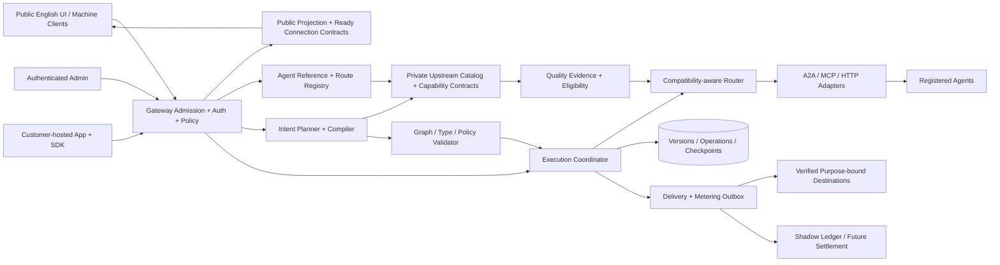

# Agent Concierge — Platform Advancement Design

사업투자제안서 고도화 개발 설계 · v1.1 · 2026-10-17 · 내부 개발·투자 검토용

### v1.1 변경 요지 — 전면 게이트웨이화 반영

공개 에이전트 연결 정보의 기본값을 **원본 제공자 주소가 아닌 검증된 Agent Concierge 게이트웨이 계약**으로 변경한다. Explore·Chat·Testbench·보고서·로그 다운로드·머신 탐색 응답까지 같은 공개 projection을 적용한다. 실제로 호출 가능한 경로만 연결 정보로 제공하고, 단순 주소 치환과 프로토콜 프록시 구현을 구분한다. 이를 AI 합성·폴백의 선행 P0 작업과 G0 출시 Gate로 추가했다.

이 변경은 사용자가 진행 중인 프론트엔드 게이트웨이화 작업의 설계 기준이다. 해당 작업 소스는 이번 문서 수정에서 변경하지 않는다. 공개 **워크플로우 웹앱 다운로드** 호환성은 유지하지만, 에이전트 API의 원본 연결 URL 노출까지 유지한다는 뜻은 아니다. 전체 서비스의 외부 직접 호출·스크래핑을 기술적으로 완전히 차단했다는 주장도 하지 않는다.

## 1. 목표와 설계 결론

**검증 데이터를 공통 실행 계약으로 연결하고, 안전한 읽기 전용 폴백을 먼저 입증한 뒤 AI 합성·상용 정산·개발지원으로 확장한다.** 서비스의 기술적 차별화는 에이전트 수 자체보다 “어떤 업무에서, 언제, 어떤 버전으로 성공했는지”를 실행과 대체 연결에 재사용하는 데 둔다.

기존 투자 제안서 05·06·08·10·11장의 고도화 항목을 개발 가능한 단위로 구체화했다. 12개월 일정, 디자인 파트너 10개 팀, 상용 파일럿 3개 팀은 계속 **제안 목표**이며 확보된 고객·매출·성능 실적이 아니다. T0는 착수 시점이다. 본 문서는 설계 산출물이며 제품 기능을 새로 구현하거나 운영 서버에 적용한 결과가 아니다.

권장 개발 순서는 다음과 같다.

1. P0: 전면 게이트웨이 공개 projection·실제 호출 계약·권한/정책 진입점을 우선 통일.
2. P0: 실행 계약·품질 증거·권한 경계·측정 기준 통일.
3. P0: 영속 실행·체크포인트·중복 방지·복구와 관측 체계.
4. P1: 읽기 전용 호환 폴백을 shadow → opt-in canary로 검증.
5. P1: 검증기를 통과하는 목적 기반 AI 워크플로우 합성.
6. P2: 소유권·조직 인증·서버용 배포와 모의 원장, 이후 제한적 상용 파일럿.
7. P3: 7:3 정산 확대·개발지원센터·자체 에이전트와 공급자 생태계.

현재 공개 프론트엔드 워크플로우 다운로드와 SDK v1.0은 유지한다. 최근 개선한 어드민 SDK v1.1 배포도 호환성을 유지하며, 조직 인증·비공개 정의·장기 실행은 별도 v2 계약에서 도입한다. 공개 키나 Origin 검사로 회원 인증·유료 접근 통제를 대신하지 않는다.

## 2. 현재 구현과 추가 개발의 경계

아래 기준은 현재 작업 소스와 프로젝트 개발 기록이다. 운영 서버에 최신 코드가 로드되어 있는지는 별도 배포 확인 대상이다.

- **평가·추천 기반:** `collector/evaluation.py`, `collector/health.py`, `concierge/selection.py`에 수집 평가, 상태 확인, 최근 검증 중심 추천이 있다. 현재 등급을 모든 업무의 정답률이나 SLA로 해석하지 않는다. 추가할 것은 업무별 데이터셋, 버전·표본·실행 시각이 명확한 품질 증거다.
- **실행 기반:** `workflows.py`에 DAG 검증, 실제 프로토콜 호출, 불변 스냅샷, 실행 이력, 예약·검증된 결과 전달이 있다. 현재 외부 호출 예산 25초, 로컬 실행 스레드 4개, 대기열 12개인 제한된 실행기다. 분산 실행·장기 A2A task 추적·상태 이전형 폴백은 추가 개발이다.
- **합성 기반:** `gateway/dashboard.py`의 목적 입력은 등록 카탈로그 매칭 기반 초안이다. 실제 모델 기반 합성, 의미적 호환성 검증, 자동 수정 루프는 추가 개발이다.
- **배포 기반:** `workflow_webapp.py`와 `concierge/workflow_app.js`는 공개 v1.0, `admin_workflow_webapp.py`, `workflow_apps.py`, `gateway/webapp/`는 어드민 v1.1이다. v1.1에는 입력 바인딩·공개 배포 키·출처·호출 한도·철회·상태 재시도·취소 잠금이 있다. 자동 에이전트 교체와 사용자 인증은 별도다.
- **연락·관리 기반:** `concierge/task_updates.py`, `gateway/visitor_desk.py` 등에 수신처 검증, 목적별 동의와 관리자 대응 기능이 있다. 신규 추천 발송을 자동 워크플로우 교체 권한이나 광고 동의로 확대하지 않는다.
- **거래 기반:** `payments.py`, `ledger.py`, `concierge/clearinghouse.py`, `gateway/store.py`에 결제 검증·가상 크레딧·예약/정산 요소가 존재한다. 이를 계약된 공급자 지급, 복식 원장, 환불·분쟁·대사까지 갖춘 7:3 마켓플레이스 완료로 간주하지 않는다.
- **게이트웨이화 진행 상태:** 첨부 검토 내용과 이번에 읽은 작업본에는 `get_safe_agent_detail()`의 원본 `agent_url` 조회, Explore/Chat 연결 주소 표시, Testbench의 원본 URL·wire 표시 경로가 남아 있다. 현재 실제 테스트 실행 경로는 `POST /api/test/execute`다. `/api/gateway/agents/...` 같은 첨부 예시는 검증된 구현 경로가 아니다. 기존 `/mcp`도 Concierge 탐색 도구를 제공하는 경로로, 임의 에이전트의 모든 도구 호출을 이미 대리한다고 간주하지 않는다. 읽은 작업본 기준의 부분 확인이며 다른 실행에서 진행 중인 변경이나 운영 배포 완료 상태를 단정하지 않는다.

검토 도중 `front.py`와 `extracted_html.txt`가 다른 실행에서 변경되는 것을 확인했다. 후속 작업본에는 `gateway_agent_url()`/`gatewayAgentEndpoint()`가 생성하는 `/api/gateway/{proto}/{rid}`와 공개 문자열 정리 helper가 추가되어 있었다. 이 경로 형식을 현재 **도입 중인 별칭 후보**로 설계에 반영하며, 주소 생성 코드만으로 호출 handler·프로토콜·권한·보안 테스트가 완료됐다고 판단하지 않는다. 아래 v2 경로는 신규 계약 예시이므로 이 별칭을 즉시 폐기하거나 다시 작성하라는 요구가 아니다. 구현된 경로를 registry에 등록하고 G0로 검증하면 된다.

최근 어드민 웹앱 변경의 127개 회귀 통과 기록은 기존 구현의 검증 근거다. 이 문서에 제안한 고도화의 완료나 보안 검증을 뜻하지 않는다.

## 3. 제품 원칙과 사용자 흐름

### 3.1 기존 공개 서비스

Chat은 가입 없이 이용하고 관련성·안전성 필터 후 최근 성공 검증, 최근 활성 확인, 품질 등급 순서로 한 에이전트를 추천한다. 명시 프로토콜이 없으면 A2A, 선택기가 있으면 선택기 우선이다. 적합한 후보가 없을 때는 관련 없는 에이전트나 가짜 검증 결과를 만들어 한 개를 채우지 않는다.

공개 프론트엔드와 주석·메타데이터는 영어로 작성한다. 모던 레이아웃, 로컬 Lucide 아이콘, 키보드 접근성, 라이트/다크·reduced motion을 유지한다. Chat과 상세 화면에는 금액·결제·과금·지갑·업셀 표현을 노출하지 않는다. 시스템 구성, 모델 실행 정보, 진단, 개인 정보, 원시 토큰도 공개하지 않는다.

공개 `Connection endpoint`와 `Copy connection URL`에는 실제 지원되는 게이트웨이 경로만 제공한다. 공식 서비스 연락처, 뉴스·논문·문서의 출처 링크는 목적에 맞게 유지하되 원본 에이전트의 실행 주소·인증 정보는 반환하지 않는다. 아직 대응 호출 계약이 없는 에이전트는 연결 준비 중으로 표시하고 작동하지 않는 URL을 실행 가능한 것처럼 제공하지 않는다.

### 3.2 신규 워크플로우 빌더

`Describe your task` → `Review workflow` → `Test workflow` → 비교·수정 → `Publish version` → `Download Web App` 순서다. 초안 생성은 외부 업무 실행이나 결제를 동반하지 않는다. 시험 실행은 선택한 입력과 권한 범위 안에서만 한다. 공개 API로 실행 가능한 범위는 기존처럼 공개된 안전한 정의다.

초안·비공개 앱·팀 이력의 영구 저장을 원하는 시점에 별도 workspace 인증을 도입한다. 방문 토큰과 연락처 등록을 계정 인증이나 조직 소유권으로 바꾸지 않는다. 기존 Chat·연락처 등록 흐름에 가입을 강제하지 않는다.

### 3.3 공급자와 관리자

`List Your Agent`는 계정 가입과 구분한다. 공개 에이전트 등록 → 제공자 소유권 확인 → 도구·스키마 수집 → 격리된 검증 → 공개 리포트 → 워크플로우 후보 등록 순서다. 관리자는 증거, 호환성, 실패 사유, 공급자 계약, 배포 상태와 전달 목적을 각각 조회한다. 운영자 자체 에이전트도 동일한 평가·추천 규칙을 적용하고 first-party임을 공개한다.

## 4. 목표 아키텍처

초기에는 **기존 Python/FastAPI의 모듈 경계부터 정리**한다. 여러 서비스를 한꺼번에 분리하지 않는다. 장기 실행과 평가 작업은 HTTP 처리와 분리된 영속 워커가 수행하고, 업무 상태는 DB를 기준으로 판단한다.



### 4.1 공개 주소와 내부 실행 주소의 분리

`resources.url`과 수집·헬스·스키마 피닝에 필요한 원본 주소는 내부 저장소에서 유지한다. 이를 게이트웨이 주소로 덮어쓰면 수집 중복 판별, endpoint hash, 제공자 인증과 실제 호출이 깨지거나 자기 자신을 호출하는 루프가 생길 수 있다. 공개 응답은 별도 DTO로 만든다.

공개 식별자는 안정적인 `agent_ref`, 연결 계약은 `connection_profile`, 내부 바인딩은 `upstream_binding_id`로 구분한다. 논리 매핑은 `agent_ref + capability_version + policy_version → approved upstream binding`이며 공개 ref만으로 실행 권한이 생기지 않는다. 기존 숫자 resource ID의 호환 입력이 필요하면 서버에서 같은 정책으로 변환한다. opaque ID도 권한 검사·호출 한도·목록 수집 방어를 대신하지 않는다.

공개 DTO에는 agent ref, 이름, 관련성·품질 요약, 최근 검증 시각, 공개 리포트 링크, 지원되는 게이트웨이 연결 profile만 둔다. 원본 endpoint, provider credential, 내부 host/path, private Agent Card, raw auth_info, 원본 input/output wire와 관리자 진단은 제외한다. `url` 같은 기존 필드를 유지하더라도 게이트웨이 연결임을 schema version·`connection_mode=gateway`로 명시하고 실사용 가능성을 검증한다.

공개 연결 URL은 신뢰된 서비스 공개 origin과 검증된 route registry에서 생성한다. 요청 Host/Forwarded 값이나 사용자의 임의 base URL로 조립하지 않는다. profile은 실제 method·protocol version·허용 operation·준비 상태를 포함하고, 준비되지 않으면 호출 endpoint 필드를 내보내지 않는다.

### 4.2 공통 적용 표면과 URL 분류

정책 적용 범위는 Explore 목록·상세, Chat 추천·Calling details, Testbench 선택·실행·오류·Telemetry·세션 JSON 다운로드, 테스트 리포트·Markdown·메타데이터, 추천 알림, 워크플로우 공개 정의·export 설정, `/mcp`·`/a2a` 탐색 결과, Agent Card·llms.txt·JSON-LD·SEO·공개 export/cache다. 실제 제공 중인 표면의 목록을 작성하고 동일 projection 회귀에 연결한다. 존재하지 않는 export가 이미 구현돼 있다고 가정하지 않는다.

공개 연결 URI, 사용자 업무 산출물의 출처 링크, 검증된 고객 수신처, 제공자 원본 실행 URI, 인증/결제 URI는 별도로 분류한다. 모든 외부 URL을 무작정 지우거나 `agentconcierge.biz`로 바꾸지 않는다. 예를 들어 뉴스 원문 링크는 실제 출처를 유지하고, 제공자 호출 endpoint는 공개 상세·리포트에서 제거한다. 사용자가 자신의 webhook을 검증하는 화면의 연락처는 해당 소유자/목적의 권한으로 관리한다. 그 주소를 에이전트 게이트웨이 경로로 치환하지 않는다.

중첩 JSON, 자유 텍스트, 제공자 오류, 응답 헤더의 Location/Link/WWW-Authenticate, artifact/resource 링크에서의 재노출도 검사한다. 1차는 허용 필드 projection, 2차는 등록된 민감 endpoint·credential의 검증된 비노출 처리다. 사용자·관리자 토큰을 일반 로그에 남기지 않고, 클라이언트가 보낸 값을 원본 wire인 것처럼 반사하지 않는다. 내부 원문과 공개 정제 보고서는 별도 버전/해시로 추적한다.

게이트웨이 연결 origin 허용 검사는 URL을 파싱하여 scheme·정규화한 hostname·port를 정확히 비교한다. `startsWith("https://agentconcierge.biz")`만으로 같은 origin이라고 판정하지 않는다. 접미사가 붙은 유사 도메인, userinfo·인코딩·비표준 port를 합성 테스트에 포함한다. 일반 출처 링크의 허용 정책은 연결 endpoint의 exact-origin 정책과 별도다.

### 4.3 실행 가능한 연결 계약

프로토콜 중립 JSON wrapper, MCP server endpoint, A2A endpoint/Agent Card는 서로 다른 계약이다. 아래 `/api/v2/agents/{agent_ref}/...`는 **신규 제안**이며 현재 운영 경로가 아니다. 실제 전면 게이트웨이 구현이 다른 경로를 채택하면 route registry와 profile에 그 검증된 경로를 등록한다.

도입 중인 `/api/gateway/{proto}/{rid}`도 같은 registry/admission을 이용할 수 있다. URL의 proto·ID를 신뢰하지 않고 등록된 에이전트의 실제 종류·허용 capability와 대조한다. 프로토콜 정보가 없거나 잘못된 경우 임의로 MCP 주소를 만들어 광고하지 않는다. Chat 질문의 기본 A2A 선택과 연결 profile의 검증은 다른 규칙이다. 음수 preset ID는 별도의 검증된 테스트 레시피로만 해석하며 일반 resource ID/임의 대상처럼 처리하지 않는다.

- JSON wrapper `invoke`: 선택된 capability·선언 입력을 서버 정책기로 전달한다. 임의 URL·Host·인증 헤더·임의 도구·그래프를 받는 범용 프록시가 아니다.
- MCP profile: 지원 버전의 discovery/initialize, 허용된 tools/list·tools/call, session·취소·error semantics를 검증한 경우에만 MCP endpoint로 광고한다. Concierge `search` 도구를 제공하는 `/mcp`에 원본 도구명을 보내면 실행된다고 안내하지 않는다.
- A2A profile: 게이트웨이가 실제 지원하는 Agent Card·인증·메시지/task·artifact·취소/상태 조회만 광고한다. 단순 JSON wrapper를 A2A server로 위장하지 않는다. Agent Card의 서비스 주소·문서·아이콘·security metadata도 공개 projection과 지원 계약을 검토한다. [A2A Agent Discovery](https://a2a-protocol.org/latest/topics/agent-discovery/)
- Resource/artifact: 승인된 참조 ID와 권한으로 게이트웨이를 통해 읽는다. 외부 URI를 인자로 받아 가져오는 open proxy를 만들지 않는다. 공개 출처 링크와 보호된 실행 artifact는 분리한다.

MCP session, A2A task/context, stream cursor는 게이트웨이 소유의 공개 ID와 제공자별 내부 ID를 매핑한다. 공개 ID는 caller/workspace/deployment·계약·TTL에 묶고, 다른 에이전트나 세션으로 바꿔 요청하면 거부한다. 제공자 세션 ID나 credential을 그대로 브라우저로 돌려보내지 않는다. 구현하지 않은 streaming·long-running·인증 기능을 capability에 표시하지 않는다.

### 4.4 단일 정책 진입점과 인증 경계

Testbench, 일반 invoke, workflow, MCP/A2A adapter가 같은 `ExecutionAdmission` 논리 계약을 사용하도록 수렴한다. 등록·활성/격리 상태, endpoint/schema version, 안전한 도구와 입력, 호출 주체·목적·권한, deadline·횟수·플랫폼 예산, egress, 취소·사용량을 실행 전에 검사한다. 실제 서버 중개가 있다는 사실만으로 모든 경로가 같은 schema pinning·위험 도구 방어를 이미 통과한다고 간주하지 않는다. 기존 Testbench의 직접 HTTP 분기는 공통 정책으로 전환하거나 동등성 검증을 갖춰야 한다.

여기서 단일 관문은 외부 클라이언트의 실행 계약과 정책을 뜻한다. 내부 수집·헬스·평가·워커가 매번 자기 공개 HTTP 주소로 다시 접속할 필요는 없다. 서비스 주체의 목적·권한으로 공통 admission/egress 모듈을 사용해 제공자와 통신하고 관측 ID를 이어간다. 공개→내부→자기 게이트웨이의 재귀 호출로 deadline·quota가 중복 적용되거나 권한이 확대되는 경로를 만들지 않는다.

익명 사용자는 제한된 공개 read-only 기능, 조직 사용자는 승인 scope만 이용한다. 게이트웨이용 사용자 token과 upstream credential은 audience·용도·저장소를 분리한다. downstream에 gateway bearer/visitor/admin token을 그대로 전달하거나, caller의 임의 Authorization을 플랫폼 계정 권한으로 승격하지 않는다. OAuth를 제공할 때는 연결별 client 동의·redirect 검증·상태 검증과 자격증명 재사용 경계를 검토한다. 인증에 필요한 합법적인 외부 identity flow는 제공자 실행 endpoint 노출과 구분하고 별도 검토한 profile에서만 지원한다. [MCP Security Best Practices](https://modelcontextprotocol.io/docs/2025-11-25/tutorials/security/security_best_practices), [MCP Authorization](https://modelcontextprotocol.io/specification/2025-06-18/basic/authorization)

브라우저 CORS·CSP는 보조 경계다. API를 직접 호출하는 클라이언트에도 같은 서버 권한·quota·크기/동시성·도구 제한이 적용되어야 한다. 고객 호스팅 웹앱은 지정된 HTTPS 게이트웨이만 호출하고 쿠키/관리자 인증을 싣지 않는다. 관리자 upstream 진단은 별도 권한과 감사 아래 최소한만 조회하며 원문 secret을 다시 표시하지 않는다.

### 4.5 Testbench 관측의 진실성

공개 Wire Inspector는 `inspection_scope=client_to_gateway`인 **실제 브라우저→게이트웨이 요청·응답**을 보여준다. endpoint뿐 아니라 method·body·headers도 그 구간과 일치시킨다. 제공자로 보낸 원본 JSON-RPC body/인증 헤더를 남긴 채 URL만 게이트웨이로 바꿔 실제 패킷처럼 표시하지 않는다. 기존 필드명 `request_wire`를 재사용한다면 의미 변경·schema version을 명시한다.

`Gateway latency`, `Provider execution time`, `Total elapsed`는 실제 측정 가능한 구간만 구분한다. 에러도 브라우저 전송 실패, 게이트웨이 정책 거절, 제공자 실행 실패로 분류한다. 공개 provider 진단은 정제된 요약·correlation ID로 제공하고 raw upstream trace는 관리자 전용이다. 세션 JSON·다운로드 로그도 화면과 동일한 정제 스키마를 쓴다.

### 4.6 우회·스크래핑·가용성에 대한 사업적 해석

원본 URL 비노출은 **이 서비스가 통제하는 공개 표면에서 연결 주소의 노출을 줄이는 정책**이다. 다른 사이트에 공개된 제공자 주소, 이미 내려받은 과거 자료, 클라이언트 코드 변조, 공개 카탈로그의 재수집을 완전히 막지 못한다. 서버 인증·rate limit·허용된 기능·목록/검색 한도는 별도로 필요하다. 비공개 제공자와 실제 경유 강제가 필요한 계약은 제공자 측 gateway credential·mTLS/접속 제어 등까지 합의해야 하며 모든 공개 제공자에게 일괄 적용됐다고 주장하지 않는다.

게이트웨이 장애는 전 제공자 실행에 영향을 줄 수 있으므로 provider fallback과 gateway 자체 가용성을 분리한다. 원본 주소로 redirect하는 장애 우회는 허용하지 않는다. 게이트웨이 오류는 정확한 unavailable/Retry-After로 처리하고, 향후 gateway replica·DB/queue·capacity·복구 시험을 별도로 갖춘다. 유지율은 주소 은닉 자체보다 검증·호환 연결·운영 이력의 가치와 실제 재사용으로 평가한다.

### 4.7 호환성·기존 데이터 전환

내부 원본 카탈로그와 증거는 유지하고 공개 API/보고서 직렬화만 새 projection으로 전환한다. 과거 공개 리포트·세션 예제·검색 캐시·서비스워커·CDN이 존재하면 버전 갱신/무효화를 검토한다. 이미 외부로 복사된 주소를 회수했다고 주장하지 않는다. 오래된 링크를 유지하려고 원본 endpoint를 복원하지 않는다.

캐시는 projection/profile version과 공개/조직 권한 범위를 구분한다. 개인 실행·인증된 진단·token이 포함된 응답을 공개 캐시와 공유하지 않는다. 브라우저 실행의 connect-src/요청 관측도 게이트웨이 allowlist로 검증하되 기존의 정당한 알림·인증 흐름과 충돌하는지 별도 확인하고 CSP를 느슨하게 풀어 해결하지 않는다.

기존 공개 workflow ZIP/SDK v1.0과 어드민 v1.1의 실행·입력·취소 계약은 그대로 회귀한다. agent detail/discovery API의 원본 URL 필드는 보안 정책에 맞춰 제거/게이트웨이화할 수 있으며, 이 의미 변경은 별도 스키마와 이전 안내로 관리한다. 게이트웨이 profile이 준비되지 않았다면 호출 기능을 비활성화하거나 제한 사실을 응답하고 가짜 endpoint를 제공하지 않는다. 새 기능의 롤백도 URL 재노출·제공자 direct call 복원 없이 기능만 중단하는 방식이어야 한다.

권장 논리 모듈은 `public_projection`, `connection_registry`, `admission`, `contracts`, `evidence`, `planner`, `execution`, `routing`, `deployments`, `delivery`, `commerce`, `support`다. 기존 파일은 호환 façade로 유지하고 단계적으로 내부 구현을 추출한다. 이 명칭은 신규 제안이며 기존 모듈이 이미 있다는 뜻은 아니다.

SQLite는 단일 운영자 검증과 로컬 개발에서 유지한다. 다중 워커·다중 조직·상용 원장의 기준 저장소는 PostgreSQL로 전환하는 안을 채택한다. 변경 전 저장소 인터페이스와 트랜잭션 회귀를 만든다. 큐는 작업 깨우기 용도이고, 예약·상태 전이는 DB 트랜잭션과 outbox로 확정한다. 처음부터 Redis·Kubernetes·외부 워크플로우 엔진을 모두 도입하는 것은 선행 조건으로 삼지 않는다.

## 5. 공통 에이전트 실행 계약

### 5.1 프로토콜과 결제 능력 분리

A2A는 에이전트 협업·task, MCP는 도구·리소스 연결 역할이다. 이름이나 입출력 JSON이 비슷해도 서로 교환 가능한 에이전트라는 뜻은 아니다. [A2A 공식 비교](https://a2a-protocol.org/latest/topics/a2a-and-mcp/)

x402는 HTTP 결제 표준이다. 기존 UI의 A2A/MCP/x402 선택과 카탈로그 `kind` 호환은 유지하되 내부 계약에는 `transport_protocol`과 `payment_protocol`을 분리한다. x402 후보라고 자동 결제를 허용하지 않는다. 지원 버전·네트워크·자산·제공자별 결제 흐름을 명시적으로 협상한다. [x402 공식 v2 사양](https://github.com/x402-foundation/x402/blob/main/specs/x402-specification-v2.md)

### 5.2 CapabilityContract

버전이 있는 계약 한 개는 논리 업무 한 개를 나타낸다. 예: `news.search.v1`, `docs.search.v1`, `products.compare.v1`.

- 식별: `agent_ref`, `capability_id`, `contract_version`, `agent_version_id`, `adapter_version`, `schema_hash`, `gateway_profile_version`. 원본 URL과 upstream binding은 내부 전용이다.
- 형식: 제한된 JSON Schema의 `input_schema`, `output_schema`, 필수 필드, 단위, 시간대, 언어, 빈 결과 의미.
- 업무 의미: 원천 데이터 종류, 최신성 한도, 정렬·중복 제거 기준, 출처 링크 요건, 결과 부족·권한 부족의 의미.
- 보안: 허용 도구·호스트, 데이터 분류, 데이터 전달 허용 범위, 자격증명 참조, 인증 scope.
- 실행: `side_effect_class` = `read_only | idempotent_write | non_idempotent_write | unknown`, deadline, 취소·상태 조회 가능 여부.
- 복구: 공급자 중복 방지 지원 근거, 조회 가능한 외부 operation/task ID, 체크포인트 변환기.
- 증거: 호환성 인증 ID, 적용 데이터셋 버전, 최근 성공·실패와 만료 시각.

MCP의 input/output schema를 검증에 활용하되 공급자 `readOnlyHint`, `idempotentHint`는 증명으로 신뢰하지 않는다. 플랫폼의 도구 검토·테스트·계약 정책으로 승인한다. [MCP 공식 Tools 사양](https://modelcontextprotocol.io/specification/2025-06-18/server/tools)

### 5.3 예: News Search 계약

입력은 `query`, `from_utc`, `language=en`, `limit<=10`. 출력은 `items[].title`, `url`, `source`, `published_at`, `retrieved_at`, `summary`와 `partial`을 갖는다. 최신순·출처 존재·중복 URL 제거를 검사한다. 게시일을 확인할 수 없는 항목에 현재 시각을 게시일로 넣지 않는다. 가격 분석·투자 권유 같은 다른 업무를 이 계약으로 대체하지 않는다.

단순 JSON Schema 통과 외에 동일 질의·기간·단위·권한으로 동일 업무를 수행하는지 검증해야 폴백 후보가 된다. 승인된 deterministic adapter만 형식을 변환하며, 모델이 임의로 필수 값을 생성해 호환된 것처럼 만들 수 없다.

## 6. 품질 증거와 빠른 추천

### 6.1 증거 데이터

기존 리포트를 유지하면서 `evidence_id`, 실행 시작·종료 시각, 보고서 생성 시각, 에이전트·스키마 버전, 테스트 유형, 데이터셋·검증기 버전, 사례 수, 성공/실패 수, 지연 분포, 판정 사유와 산출물 해시를 추가한다. 과거 실행을 새로 문서화했다고 최신 실행으로 승격하지 않는다. 스키마·주소 변경 시 이전 버전의 성공을 새 버전에 승계하지 않는다.

평가는 네 축을 별도 표시한다: 연결 가능성, 프로토콜·스키마 준수, 업무 결과 품질, 운영 보안. HTTP 200·initialize 성공·402 응답은 각각의 연결 증거일 뿐 업무 성공이나 정산 완료가 아니다. 등급은 테스트 범위와 표본 수를 함께 보여주며 낮은 표본의 결과에 과도한 확신을 부여하지 않는다.

### 6.2 스케줄과 예산

사용자가 설명한 2시간 상태 확인, 선정된 활성·고품질 후보의 10분 검증은 운영 목표로 유지한다. 모든 에이전트를 10분마다 호출한다는 뜻으로 확대하지 않는다. `next_due_at`, 실행 지연, 누락, per-host concurrency, 공급자별 허용 한도, 일일 플랫폼 시험 예산을 관리한다. 신규 버전·실패 급증은 우선 검증하고, 반복 실패는 circuit breaker와 backoff를 적용한다. 실결제·외부 변경이 필요한 테스트는 일반 수집 작업에서 실행하지 않는다.

### 6.3 평가 벤치마크

초기 세 분야를 리서치/뉴스, 개발문서, 제품 비교로 제한한다. 각 분야 최소 30개 검토 사례와 경계·실패 사례 10개를 출발점으로 제안한다. 이는 통계적 품질 보증 수치가 아니다. 정답이 고정된 검사는 deterministic validator, 요약 충실도는 출처 근거 검사와 표본 이중 검토를 사용한다. 평가용 정답·프롬프트가 제공자에게 유출되거나 학습 데이터처럼 재사용되지 않도록 holdout을 분리한다.

### 6.4 추천 경로

요청 시 전체 보고서를 재실행하지 않는다. 검증 결과로 갱신하는 eligibility projection에서 관련성·프로토콜·검증 최신성·최근 활성·등급을 조회한다. 기존 Chat의 최신 검증 우선 정책을 보존하고 회원 등급·자체 공급자 여부로 순서를 바꾸지 않는다. 캐시는 질의·프로토콜·정책 버전으로 구분하며 실패·격리·스키마 변경은 즉시 무효화한다. 캐시가 오래되면 오래된 성공 배지를 붙여 반환하지 않는다.

## 7. 목적 기반 AI 워크플로우 합성

### 7.1 컴파일 파이프라인

1. **IntentSpec:** 목적, 입력/출력, 필요한 최신성, 언어, 실행 방식, 데이터 분류를 구조화한다. 미기재 값은 제한된 기본값을 사용하고 필수 값만 사용자에게 요청한다.
2. **Retrieve:** 승인된 카탈로그·계약·증거에서 후보를 찾는다. 모델에는 `agent_ref`·capability·정제된 schema만 주고 원본 endpoint·credential을 주지 않는다. 모델이 URL·도구명·resource ID를 새로 만들어 넣지 못한다.
3. **Plan:** 승인된 capability ID, 노드·간선·바인딩만 포함하는 제한된 JSON 초안을 생성한다. 첫 버전은 최대 6개 실행 노드·12개 간선·모델 수정 1회로 제안한다.
4. **Compile:** 그래프 무순환, 참조된 상위 노드, 입력 필수값, 출력 매핑, 형식·단위·업무 의미·권한·deadline을 검증한다. 비공개 데이터가 외부 제공자로 흘러가는 경로를 검사한다.
5. **Dry run:** 네트워크 없는 fixture로 타입·분기·오류를 확인한다. 이를 실제 에이전트 성공으로 표시하지 않는다.
6. **Live test:** 사용자가 선택한 시험 입력으로 승인된 읽기 전용 작업만 실행하고 실제 결과·외부 호출 수·지연·판정 근거를 기록한다.
7. **Review/Publish:** 차이와 실패 사유를 보여주고 불변 버전을 게시한다. 모델이 테스트 실패를 숨기거나 스스로 운영 배포하지 못한다. 실행 가능한 게이트웨이 profile을 가진 후보만 게시/다운로드의 연결 대상이 되며, 예제 코드도 공통 SDK/검증된 경로만 사용한다.

카탈로그 설명, 에이전트 응답, 외부 문서는 비신뢰 데이터다. 모델 지시·운영 정책과 분리하고 비밀키·개인 원문·관리자 이력을 프롬프트에 넣지 않는다. 실행 권한은 LLM이 아니라 서버 정책기가 결정한다. 승인되지 않은 스키마 기능, `$ref`, 복잡한 정규식과 무제한 재귀는 초기 검증기에서 거부한다.

### 7.2 교체·비교

`Compare agents`는 같은 계약·입력·버전·평가기준으로 A/B 결과를 비교한다. 병렬 시험도 제공자 허용량과 플랫폼 예산 안에서 수행한다. 기존 실행 중 그래프를 수정하지 않고 새 workflow version을 만든다. 다음 실행부터 새 버전을 적용하며 실행 중 교체는 아래 폴백 정책을 따른다.

## 8. 호환 폴백과 상태 보존

### 8.1 진입 조건

후보는 동일 capability·스키마/의미·언어/단위·데이터 권한을 만족하고, 유효한 호환성 인증과 최근 성공 증거가 있어야 한다. 최신 실패·격리·인증 만료·변경된 schema hash가 있으면 제외한다. 첫 버전은 승인된 read-only 작업, 순차 폴백 1회, 고객 opt-in으로 제한한다. 쓰기·결제·전송·삭제는 초기 자동 폴백 대상이 아니다.

폴백은 게이트웨이 내부에서 후보를 선택하고 바인딩한다. 클라이언트에 후보 원본 URL 목록을 내려보내 직접 재호출하게 하지 않는다. 공개 operation ID·연결 주소는 유지하되 선택된 실제 에이전트 ref, 대체 여부와 검증 결과는 사실대로 표시한다. 계약/스키마를 바꾸는 대체는 기존 연결 뒤에 숨기지 않고 새 버전/명시적 검토로 처리한다. 게이트웨이 장애와 제공자 장애를 구분하고 gateway 자체 장애를 provider 교체 성공으로 집계하지 않는다.

읽기 전용 요청의 연결 실패·허용된 502/503/504·deadline 초과 등은 후보 전환을 검토한다. 입력 오류, 고객 권한 부족, 취소, 정책 위반은 전환하지 않는다. 429는 Retry-After와 총 예산을 먼저 검사한다. 품질 미달 출력은 계약의 필수 검사를 통과하지 못한 경우에만 처리하며, 모델의 주관적 평가만으로 무제한 재호출하지 않는다. 402는 장애로 간주해 자동 지불하지 않는다.

### 8.2 상태 모델과 불변식

워크플로우와 노드의 진행 상태, 외부 요청의 확실성을 별도 저장한다.

```text
Operation: queued → running → waiting_external → validating → succeeded
                       ↘ cancelled / failed / needs_reconciliation
Attempt: prepared → dispatched → completed | failed | unknown
```

- `logical_operation_id`는 한 업무, `attempt_id`는 특정 공급자에게 보낸 한 시도다. 재전달·폴백이 새로운 고객 업무로 계산되지 않는다.
- 전송 전 `prepared`와 입력 해시·정책·버전을 DB에 기록한다. 완료 결과는 현재 fencing token을 가진 워커만 원자적으로 확정한다.
- 공급자가 요청을 수락했는지 모르는 타임아웃은 `unknown`이다. 쓰기 작업은 자동 재실행·교체하지 않고 상태 조회·대사·사람의 판단으로 넘긴다.
- 로컬 unique key만으로 외부 부작용의 exactly-once를 보장하지 않는다. 공급자의 검증된 중복 방지·상태 조회가 없으면 재개를 차단한다. 서로 다른 제공자에게 같은 idempotency key를 보내도 중복 부작용 방지 계약이 생기지 않는다.
- read-only 교체가 동시에 끝나더라도 한 시도의 결과만 commit하고 다른 산출물은 사용하지 않은 시도로 기록한다. 외부 호출 수와 제공자 원가는 각각 남긴다.
- 총 deadline·호출 횟수·권한·허용 지출 범위는 최초 승인에서 확정한다. 폴백이 이를 늘리지 못한다.

### 8.3 체크포인트와 A2A

완료된 노드의 검증 산출물, 입력/출력 해시, 계약/스키마 버전과 artifact 참조를 체크포인트로 저장한다. 복구 시 완료 노드는 반복하지 않고 미완료 노드만 검토한다. 공급자별 내부 대화·세션·숨겨진 상태를 다른 에이전트가 그대로 복원한다고 가정하지 않는다.

A2A의 `taskId`·`contextId`는 해당 제공자에 묶어 저장한다. 다른 제공자에 이식하지 않고, 승인된 최소 문맥으로 새 task를 시작할 수 있는 계약만 폴백한다. `input-required`, `auth-required`는 사용자 입력·권한 대기이며 성공이 아니다. terminal task를 다시 실행 중으로 바꾸지 않는다. [A2A 공식 task lifecycle](https://a2a-protocol.org/latest/topics/life-of-a-task/)

MCP 세션도 제공자 간 복사하지 않는다. 스트리밍은 attempt별 partial 결과를 분리하고 검증 완료한 최종 산출물만 downstream에 전달한다. 사용자는 `Recovering connection`, `Alternative agent used`, `Action required` 같은 실제 상태만 본다. 서버 이벤트가 확인된 경우에만 기존 SDK onFallback을 활성화한다.

### 8.4 실행 예산과 장애 실험

기존 v1 실행 25초 제한을 유지한 상태에서 폴백 예산도 그 안에 배분한다. 예를 들어 주 요청 12초·대체 8초·검증 3초는 제안 정책이며 남은 실제 시간에 맞춰 감소시킨다. 장기 task는 별도 v2 async profile에서 최대 10분을 초기 상한으로 검토하며 기존 API timeout을 단순 연장하지 않는다. 사용자 취소는 진행 중인 모든 시도에 전달하고 확인 전에는 완료 취소라고 표시하지 않는다.

장애 주입에는 전송 전 단절, 제공자 수락 후 응답 유실, 워커 종료, lease 만료, 늦은 중복 응답, 취소와 폴백 경합, 스키마 변경, 후보 없음, 양쪽 제공자 장애, 실제 결제 결과 불확실을 포함한다. shadow는 실제 업무를 두 공급자에 중복 전송하는 방식이 아니라 기록·fixture·허가된 시험 요청으로 정책 결정을 비교한다.

## 9. 배포·조직 인증·버전 정책

공개 workflow SDK v1.0과 어드민 v1.1은 기존 다운로드·실행 계약을 유지한다. agent detail·탐색·테스트 리포트의 원본 주소 응답은 4절의 게이트웨이 정책에 따라 바뀔 수 있으며 이를 workflow ZIP 호환성과 혼동하지 않는다. 추가적인 조직 보안과 비공개 정의는 SDK v2 opt-in profile로 분리한다. 비공개·상용 workflow를 기존 공개 템플릿 API에 노출해 우회 실행 가능하게 만들지 않는다.

v2에는 `workspace_id`, `deployment_id`, 불변 `workflow_version_id`, `contract_version`, `input_schema`, 배포 정책 버전, 지원 SDK 범위를 둔다. 현재 v1.1은 그래프 변경 시 재발급이 필요하지만 v2는 명시적으로 게시된 불변 버전을 pin한다. 정책·보안 사고에 따른 별도 철회는 버전 고정과 무관하게 즉시 적용한다.

고객 정적 웹앱에 secret을 내장하지 않는다. 익명 공개 실행은 제한된 공개 기능만 제공한다. 조직·비공개·상용 실행은 고객 서버/BFF 또는 사용자 인증을 거친 platform token broker에서 짧은 수명·audience·scope·operation 한도의 토큰을 발급받는다. 신규 인증은 표준 OIDC 연동을 우선 검토하며 ID 검증·소유권·조직 권한 검사를 서버에서 수행한다. 공급자 credentials는 vault reference만 사용한다.

공급자 소유권은 지정 HTTPS 위치의 challenge와 endpoint 안전성 검증 등으로 확인하고, 소유권 이전·도메인 만료·키 회전은 재검증한다. 소유권 확인은 에이전트 출력의 정확성·보안 인증과 구분한다.

## 10. 신규 추천·결과 전달과 관리자 연동

`interest → eligible evidence change → recommendation event → outbox → consent recheck → verified destination` 경로를 사용한다. 추천 순위가 일시적으로 흔들리는 현상은 변경 안정화 구간과 event deduplication으로 줄인다. 추천을 받았다고 기존 워크플로우가 자동 교체되지는 않는다. `Review replacement`에서 diff·시험 결과·적용 버전을 확인한다.

알림 이벤트에는 schema version, event ID, 생성/만료 시각, 추천 사유 코드, 공개 검증 링크와 선택적 회신 경로만 포함한다. webhook은 목적별 키로 서명하고 수신자가 event ID로 중복을 제거한다. 전달은 at-least-once 전제로 설계하며 `accepted`는 사람이 읽었다는 의미가 아니다. A2A는 지원 Agent Card·버전에 맞는 메시지/아티팩트로 감싼다. 별도 독점 inbox 프로토콜이 국제 표준이라고 주장하지 않는다.

추천의 호출 연결 정보는 준비된 gateway profile과 공개 agent ref만 담는다. 고객이 등록한 수신 webhook/A2A inbox는 배송 목적지이며 에이전트 제공자의 호출 endpoint와 별개다. 수신처 원본을 게이트웨이 URI로 덮어쓰거나 추천 발송을 계기로 제공자 credential을 수신자에게 전달하지 않는다.

전달 직전 수신처 인증·요청 목적·동의 철회·TTL을 재검사한다. 연락처 인증, 관심 알림, workflow result, 광고 동의를 서로 재사용하지 않는다. 광고 발송은 기존 비활성 정책을 유지하며 별도 출시 판단 대상이다. 방문 에이전트 메뉴는 문의·관심·추천·수신처 검증·동의 변경·전달 이력을 목적별로 조회하고 토큰·서명키는 노출하지 않는다.

**P0 전달 권한 재설계:** 현재 실행 종료 로직은 `source != public` 조건으로 workflow 저장 목적지 전달을 분기한다. 신규 어드민 앱은 `source=webapp`을 사용한다. 따라서 배포별 결과 전달 권한을 출처 문자열로 추정하지 말고 `delivery_grant_id`와 수신 목적·소유자를 실행 snapshot에 명시해야 한다. 일반 다운로드 앱은 관리자 저장 inbox를 자동 상속하지 않는 것을 신규 수용 기준으로 둔다. 이는 소스에서 확인한 검토 항목이며 이번 설계 작업에서 운영 발송을 재현하거나 변경하지 않았다.

## 11. 7:3 거래·정산의 단계적 개발

### 11.1 지금과 상용화 분리

현 운영 정책은 유지하고 먼저 shadow metering·모의 원장으로 검증한다. 고객에게 실제 금액을 청구하거나 자동 x402 결제를 시작하지 않는다. 향후 상용 실험은 별도 인증된 workspace와 명시적 계약에서만 opt-in한다. Chat의 공개 답변·상세 화면에는 상업 조건을 끼워 넣지 않는다.

게이트웨이 경유와 원본 URL 비노출은 과금 동의나 수익 발생의 근거가 아니다. 과금은 서버가 승인한 논리 업무/계약과 실제 사용량 이벤트에 연결하고, 테스트·상태 poll·재전달을 별도 고객 작업으로 중복 청구하지 않는다. x402 등 표준 머신 결제 필드를 UI 주소처럼 임의 치환하지 않는다. upstream 결제 요건은 서버에서 평가하고, 향후 실제 판매 주체·승인된 결제 계약에 맞는 gateway challenge를 제공할 수 있을 때만 지원한다. 금액·수취인·자산·네트워크를 허위로 바꾼 challenge를 내보내거나 upstream 지갑/credential을 무심코 반사하지 않는다. 지원하지 않는 결제 계약은 실행 불가/추가 승인 필요로 처리한다.

### 11.2 업무·사용량·결제·지급 분리

- 업무: 검증된 논리 작업의 완료/부분 완료/실패/불확실 상태.
- 사용량: 어떤 에이전트 버전과 시도가 실제 외부 자원을 사용했는지 기록.
- 결제: 견적 버전, 승인 한도, 결제 의도, 제출·확인·실패·불확실 상태와 제공자 증빙.
- 정산: 계약 버전, 배분 기준액, 원장 전표, 공급자 채권, 보류·환불·지급·대사.

성공 HTTP 응답이나 `sla_verified` 같은 기존 필드만으로 최종 지급을 확정하지 않는다. 결제 불확실은 실패로 바꾸어 무조건 재결제하지 않고 대사한다. 공급자 비용이 발생해도 사용자에게 자동 이중 청구하지 않는다. 읽기 전용 폴백이라도 첫 결제의 확인이 불확실하면 승인 예산과 대사 정책을 따른다.

### 11.3 원장과 배분 정책

금액은 통화/자산별 정수 최소 단위로 기록한다. 하나의 `billable_operation_id`에는 하나의 확정 고객 청구만 허용한다. ledger transaction별 차변·대변 합계가 동일해야 하며 통화·체인·자산이 다르면 별도 원장이다. 전표는 삭제·수정 대신 역분개한다. PSP·온체인 이벤트는 검증된 서명, 재전송 방지, 외부 ID unique 제약을 통과해야 한다.

7:3은 계약 버전이 있는 제안 기본값이다. 세금·환불·결제 수수료·원가의 부담 주체와 배분 기준액을 계약으로 확정한 후 적용한다. `developer_share = floor(distributable_base × 7000 / 10000)`, `platform_share = distributable_base - developer_share`로 반올림 잔액까지 일치시킨다. 다른 비율·지역·계약 변경은 과거 실행에 소급 적용하지 않는다.

환불·분쟁은 공급자 지급 보류·역분개·마이너스 이월로 추적하고 지급 파일/외부 영수증과 일일 대사한다. 공급자 계약, 정산 상대·신원, 처리 지역·세금 방식, 환불 정책과 결제 사업자 연동 검토가 완료되어야 실거래를 연다. 자체 에이전트 수입도 모델·인프라·데이터·지원 원가를 차감하기 전 수익이며 100% 이익으로 표시하지 않는다.

## 12. AI 개발지원센터와 자체 에이전트

개발지원센터는 승인된 workflow schema·계약·문서·샘플 실행을 검색하고 구성 설명, 실패 원인, 호환 교체안, 배포 가이드를 제공한다. 첫 버전은 설명과 JSON patch 제안이다. 비밀키 입력, 임의 터미널 명령, 고객 서버 접근, 자동 운영 배포·결제·메시지 발송 권한을 갖지 않는다. 변경 diff → 검증 → 명시적 시험 → 승인된 게시 순서로 진행한다.

고객에게 생성하는 호출 예제·README·도움말·코드는 게이트웨이 profile/SDK를 사용한다. 내부 문서의 원본 endpoint·개인 이력·debug wire를 RAG로 다시 공개하지 않도록 검색 corpus를 공개/관리자 용도로 분리하고 생성 결과도 같은 공개 projection 기준으로 검사한다.

자체 에이전트는 초기 핵심 분야의 데이터 공백을 메우는 뉴스 출처 정규화, 문서 근거 추출, 구조화 비교부터 검토한다. 외부 데이터 사용 권한·원천 표기·갱신 주기·독립 테스트를 갖춘다. 같은 운영 인프라에 있는 자체 에이전트 둘을 독립 장애 도메인의 폴백으로 계산하지 않는다. 서로 다른 모델·호스트만으로도 데이터 원천·인증·공통 게이트웨이 장애가 분리되었다고 단정하지 않는다.

## 13. 데이터·API·이벤트 설계

### 13.1 저장 모델

기존 `resources`, `agent_test_reports`, `agent_workflows`, `workflow_versions`, `workflow_runs`, `workflow_node_runs`, `workflow_apps`, `workflow_app_runs`, `workflow_destinations`, `workflow_deliveries`를 읽기 호환한다. 명칭과 책임은 다음 신규 논리 엔터티로 분리한다. 실제 migration은 각 단계 시작 시 작성한다.

- `agent_versions`, `capability_contracts`, `compatibility_certifications`: endpoint/schema/adapter hash, 승인 상태·유효 기간. 버전·정책 조합 unique.
- `agent_gateway_bindings`, `gateway_connection_profiles`, `gateway_session_maps`: 공개 agent ref·지원/준비 상태·gateway 경로/버전과 내부 upstream binding·MCP session/A2A task 매핑을 분리한다. 공개 DTO는 내부 매핑을 읽어 반환하지 않는다. session/task는 소유 scope·만료를 가진다.
- `eval_suites`, `eval_cases`, `eval_executions`, `quality_evidence`: 테스트·입력/산출물 참조·판정·최신성. 생성 시각과 실제 실행 시각 분리.
- `workflow_specs`, `workflow_releases`, `workflow_input_bindings`: 초안·불변 게시 버전·선언 입력. 조직/릴리스 ID로 소유권 제한.
- `operations`, `attempts`, `checkpoints`, `run_events`: 논리 작업, 외부 시도, 복구 상태, 순서 있는 사건. `(workspace_id,idempotency_key)` unique, 다른 payload hash면 409.
- `fallback_policies`, `routing_decisions`: 후보·탈락 사유·선택된 증거/정책 버전·deadline. 운영자 판단을 재현할 수 있게 저장.
- `workspaces`, `memberships`, `provider_claims`, `deployment_versions`, `delivery_grants`: 사용자·조직·공급자·배포·수신 목적 권한. 전역 카탈로그와 개인 데이터를 분리.
- `outbox_events`, `delivery_attempts`, `consent_events`: 사건 ID unique, dequeue 시 동의 재검사, 재전달·중단 사유 추적.
- `usage_events`, `commercial_contract_versions`, `payment_intents`, `ledger_transactions`, `ledger_entries`, `payouts`, `reconciliation_cases`: 불변 거래 근거와 대사. 자산별 균형·외부 이벤트 중복·한 논리 청구의 유일성 제약.

### 13.2 제안 v2 API

다음은 신규 계약안이다. 기존 경로를 교체하거나 이미 제공되는 API라고 표기하지 않는다.

```text
GET  /api/v2/agents/{agent_ref}/connection     # 준비된 공개 gateway profile
POST /api/v2/agents/{agent_ref}/invoke         # 정책 검증된 JSON wrapper; MCP/A2A와 구분
POST /api/v2/agents/{agent_ref}/mcp            # 지원 검증 후에만 제공하는 MCP profile
POST /api/v2/agents/{agent_ref}/a2a            # 지원 검증 후에만 제공하는 A2A profile
POST /api/v2/workflow-drafts                  # IntentSpec → 검증 가능한 초안
POST /api/v2/workflow-drafts/{id}/validate     # 네트워크 없는 검증
POST /api/v2/workflow-drafts/{id}/test         # 명시적 제한 시험
POST /api/v2/workflow-drafts/{id}/publish      # 조직 권한 + 불변 릴리스
POST /api/v2/deployments/{id}/operations       # 선언 입력 + Idempotency-Key
GET  /api/v2/operations/{id}                   # 조직/배포 scope 검증
POST /api/v2/operations/{id}/cancel            # 취소 요청; 상태 별도 확인
GET  /api/v2/operations/{id}/events            # cursor 기반 재연결; SSE 선택 지원
GET  /api/v2/agents/{id}/evidence              # 안전한 공개 증거 projection
POST /admin/api/v2/routing/simulations        # fixture/기록 기반 장애 시뮬레이션
POST /admin/api/v2/settlements/reconcile      # 인증된 대사 작업
```

모든 객체 조회·목록·artifact·이벤트 cursor에 조직/배포 권한 검사를 적용한다. 요청의 workspace ID만 믿지 않고 서버 인증 주체에서 scope를 결정한다. URL에 bearer/run capability를 넣지 않는다. SSE가 필요하면 fetch 기반 header 인증을 쓰고 연결 수·TTL·cursor 권한을 제한한다. 초기 SDK는 polling을 유지하고 SSE는 지원이 검증된 새 버전에서만 제공한다.

`OperationEnvelope`는 `operation_id`, `workflow_release_id`, `status`, `result_ref`, 정제된 `error_code`, `event_cursor`, `fallback_summary`를 반환한다. provider URL, 입력 원문, 토큰, stack trace와 내부 과금 원장은 공개 응답에서 제외한다. actor·원장·진단 정보는 인증된 관리자 projection으로만 제공한다.

### 13.3 이벤트 계약

`quality.evidence.published`, `workflow.release.published`, `operation.started`, `attempt.unknown`, `operation.fallback.selected`, `operation.completed`, `delivery.accepted`, `usage.recorded`, `settlement.reconciled`에 schema version과 event ID를 둔다. DB 상태 전이와 outbox 삽입을 한 트랜잭션에서 처리한다. 소비자는 event ID로 중복을 제거하고 이벤트 유실·역순·재전달을 재현한다. 원시 입력·비밀값을 이벤트 버스·분석 로그에 복사하지 않는다.

`gateway.profile.ready`, `gateway.binding.revoked`를 추가하고 projection/profile/binding 버전을 연계한다. 공개 telemetry는 gateway route·agent ref·정제된 상태만, 내부 운영 trace는 제한된 upstream binding과 실제 attempt를 갖는다. 공개 응답이나 correlation ID 조회로 내부 trace를 역조회할 수 없도록 권한을 분리한다.

## 14. 보안·운영·성능 수용 기준

### 14.1 보안 검증

위협 모델의 경계는 익명 방문자, 조직 사용자, 관리자, 공급자, 모델, 작업 워커, 결제/알림 시스템이다. SSRF/DNS rebinding·리다이렉트·내부 메타데이터 접근, 객체 권한 우회, prompt injection, schema drift, resource exhaustion, XSS/CSP, 토큰 탈취, 결제·webhook replay와 작업 중복을 검사한다. URL 문자열 검사만으로 SSRF를 해결했다고 보지 않고 DNS·연결 시점 검증과 egress 정책을 유지한다. [OWASP SSRF 가이드](https://cheatsheetseries.owasp.org/cheatsheets/Server_Side_Request_Forgery_Prevention_Cheat_Sheet.html)

각 단계는 secret/dependency scan, 서버 입력 검증·출력 마스킹 리뷰, 격리된 API·브라우저 동적 검사, 부작용·결제 경합 시험을 통과해야 한다. 공급자 원문을 HTML·명령·모델 상위 지시로 실행하지 않는다. 사용자 입력과 실행 산출물은 암호화·접근 통제·삭제 정책을 적용하고 일반 관측에는 해시·길이·집계만 남긴다. 증거의 무결성 해시는 정확성이나 독립 감사 인증을 대신하지 않는다.

게이트웨이화의 필수 보안 사례는 공개 JSON/HTML/Markdown/헤더/세션 다운로드의 원본 endpoint·credential 재노출, 브라우저의 제공자 직접 호출, `url/host` override와 upstream→gateway 루프, 다른 agent/session/task/cursor 권한 우회, 사용자 token passthrough, 공통 admission을 거치지 않는 테스트·프로토콜 분기, 공개 검색의 과도한 목록 수집이다. 고정된 합성 provider 도메인·token을 여러 중첩/오류/출력 필드에 주입하고 표면별로 거부/정제됨을 확인한다. 동시에 뉴스·문서 출처 URL과 정상 입력·실제 반환 내용의 유용성이 유지되는 양성 대조군도 검증한다. 내부 네트워크 검증 없이 운영 제공자나 수신자에게 시험 요청을 보내지 않는다.

### 14.2 초기 측정 목표안

다음은 개발 수용 기준의 초안이며 현 측정치나 고객 SLA가 아니다. 기준 환경과 실제 baseline을 W1에 확정하고 불가능한 값은 근거를 남겨 조정한다.

- Chat 추천 서버 응답 p95 ≤ 500ms: 카탈로그 1만 건, 동시 사용자 20명, 5 req/s, 30분, 단일 측정 지역. 캐시 hit/miss와 gateway/network 지연을 따로 기록. 외부 에이전트의 실제 업무 완료 시간은 이 지표에 포함하지 않는다.
- 워크플로우 초안 p95 ≤ 15초: 최대 6개 노드·수정 1회·검증을 포함하는 고정 평가셋. 외부 모델 제한·실패를 별도 기록하고 초과 시 초안 실패로 정직하게 표시한다.
- 폴백 후보 결정 p95 ≤ 100ms: 이미 생성된 eligible projection 기준. 제공자 작업 완료 시간과 전체 복구 지연은 별도 측정한다.
- 안전성: 고정 장애 매트릭스에서 권한 없는 실행/전달, 중복 확정 청구, 검증되지 않은 쓰기 재시도는 0건이어야 출시한다. 테스트 0건이 운영상 영구 0건을 보장하지 않는다.
- 복구: 자동 전환 허용 조건을 만족한 장애 중 계약을 충족하며 deadline 내 완료한 비율과 표본 수를 공개 가능한 수준으로 집계한다. 대체 후보 없음도 해당 정책의 실패로 기록하고 분모에서 숨기지 않는다.

실제 가용성은 업무 성공·허용된 요청 접수·증거 최신성을 분리해 측정한다. 용량 부족으로 거절된 정상 요청을 고객 quota 초과처럼 제외하지 않는다. 2시간 probe 비율을 연중무중단 SLA로 바꾸지 않는다. 충분한 운영 데이터·지원체계·계약 없이 99.9%나 무중단을 보장하지 않는다.

### 14.3 보존·복구 초안

원시 입력/출력 기본 보존 7일, 정제된 실행 메타데이터 90일을 검토 시작값으로 두고 사용자 선택·처리 목적·계약에 맞춰 확정한다. 원장·계약 기록의 보존은 별도 사업/지역 요건으로 결정한다. 삭제 시 artifact·로그·분석·수신처와 백업 잔존 기간을 함께 처리하며 집계 지표에 개인 원문을 남기지 않는다.

SQLite는 지원되는 온라인 backup 방식으로 일관된 사본을 만들고 WAL 포함 복구 절차를 시험한다. 실행 중 DB 원본 파일을 단순 복사하거나 자동 복구·덮어쓰지 않는다. 암호화 키도 분리된 접근 통제로 복구 가능하게 보관한다. 초기 제안 RPO 24시간·RTO 4시간은 복구 훈련으로 검증할 목표이며 운영 보장이 아니다. 상용 원장은 이 값으로 충분한지 별도 결정하고 지급 전 최신 대사·증빙을 복구한다. 복원 후 `unknown` 작업을 자동 반복하지 않는다.

## 15. 개발 단계와 출시 Gate

### G0 · Gateway Public Surface & Connection Readiness — 전면 게이트웨이 공개 전

기간상 W1–2의 우선 작업이며 G1의 선행 조건이다. 게이트웨이화 구현 담당 작업과 같은 수용 기준으로 검증한다.

1. 실제 공개 표면 목록과 새 projection/profile version이 확정되고, 중첩 값·리포트·오류·로그 다운로드·머신 탐색·관련 캐시에 원본 실행 endpoint/credential이 남지 않음.
2. 광고하는 연결 경로마다 실제 GET/POST/JSON-RPC 등 **해당 profile의** 지원 동작과 미지원 응답을 검증. 이름만 gateway인 URL이나 Concierge 탐색 경로를 제공자 도구 프록시로 오인시키지 않음.
3. 브라우저/SDK 실행은 정해진 gateway 경로를 사용하고 임의 upstream URL·Host·인증 헤더를 주입할 수 없음. 뉴스/문서 출처·수신처 인증 같은 별도 목적의 링크/통신은 분리 검증.
4. Testbench·workflow·직접 invoke·지원되는 MCP/A2A 분기가 같은 안전성/권한/예산/egress admission을 통과하며 gateway token이 upstream으로 전달되지 않음.
5. Wire/Telemetry·오류·다운로드 기록이 실제 관측 구간을 설명하고, 내부 진단은 관리자 권한 없이 조회할 수 없음. 기본 수신 목적·광고 동의 정책도 유지.
6. 공개 workflow v1.0 ZIP/SDK와 어드민 v1.1 실행 회귀 통과, 영어·Lucide·접근성·메타데이터 일치, 기능 중단 시 원본 주소를 다시 공개하지 않는 롤백 검증.

G0는 이번 설계에서 **추가된 출시 조건**이며 통과 완료라고 기록하지 않는다. 원본 주소 비노출의 실증 범위는 통제 가능한 표면의 고정 테스트다. 전 세계의 제공자 주소 비공개·우회 불가능·스크래핑 불가능을 증명하는 조건이 아니다.

### M0–M3 · Foundation & Design Partners

전면 게이트웨이 공개/호출 계약과 G0를 먼저 정리한 후 계약·증거·전달 권한, 영속 작업·관측·안전한 읽기 폴백과 6노드 AI 초안을 제한 공개한다. 리서치/콘텐츠/개발도구 분야 디자인 파트너 10개 팀을 모집 목표로 둔다. 참여·테스트 성공·반복 사용은 각각 기록한다. 기존 6주 작업에 게이트웨이 표면/프로토콜 구현이 추가되므로 인력·진행 중 작업의 검증 결과에 따라 세부 일정을 재산정한다.

**G1:** G0 통과, 고정 계약·데이터셋·격리 테스트, 출처별 전달 권한, 중복/권한/장애 매트릭스, 기존 공개 다운로드 호환성, 실제 첫 실행 증거를 갖춘다. 이 조건을 통과하기 전 자동 폴백을 전체에 켜지 않는다.

### M4–M6 · Controlled Commercial Pilot

조직 인증·공급자 소유권·불변 v2 배포·shadow 원장을 개발한다. 결제/정산 gate를 통과한 경우에만 별도 opt-in 상용 파일럿 3개 팀을 목표로 전환한다. 상용 조건이 늦어지면 모의 정산 검증을 계속하고 일정 때문에 실거래를 열지 않는다. 기본 공개 Chat 정책은 유지한다.

**G2:** 조직 경계·호출 예산·실행 권한 검증, 환불/불확실 결제/중복 webhook/원장 균형/지급 대사, 공급자 계약, 실제 운영 지표와 지원 절차가 준비되어야 한다.

### M7–M12 · Marketplace & Developer Support

호환성 데이터 확장, 인증된 장기 A2A task, 제한된 상태 복구, 검증된 공급자 지급과 개발지원센터를 확대한다. 실제로 필요한 자체 에이전트를 추가한다. 전면 쓰기 폴백은 공급자 멱등성·상태 조회를 개별 입증한 계약만 후보로 검토하며 일반 제공을 일정의 필수 조건으로 삼지 않는다.

**G3:** 4주 재사용·업무 성공·복구 표본·정산 대사·공급자 대응·운영 비용이 검토 가능해야 한다. 확대는 결함·오류 예산·고객 피드백을 기준으로 결정하며 매출 목표나 SLA를 임의 확정하지 않는다.

### 첫 6주 실행 백로그

- **W1 / AC-00:** 전면 게이트웨이 공개 DTO·표면 목록·이전 계약. 완료: Explore/Chat/Testbench/리포트/로그/머신 응답의 원본 주소·비밀값 비노출, 출처 링크 보존, 현재 구현과 제안 경로 구분.
- **W1 / AC-01:** baseline·측정 이벤트·공통 trace/operation ID 정의. 완료: 추천/실행/전달의 분모와 수집 목적을 문서화하고 합성 이벤트로 검산.
- **W1 / AC-02:** 세 분야 계약 및 schema/version registry. 완료: 계약 샘플 3개, 허용/거부 fixture와 drift 시나리오.
- **W1–2 / AC-13:** 실제 gateway connection profile·agent/session/task 매핑·공통 admission. 완료: 지원 프로토콜/작업만 광고, 실제 호출·임의 대상 거부·token audience·Testbench 동등성 및 G0 검증. AC-00·AC-02를 선행하며 기존 전면 게이트웨이화 구현과 중복 작성하지 않고 연결/검증한다.
- **W1–2 / AC-03:** 실행/배포별 delivery grant. 완료: 일반 webapp·public 실행이 관리자 inbox를 상속하지 않는 API 테스트, 철회·조직 경계 검증.
- **W2 / AC-04:** 증거 모델·실행시각·정책 버전·eligibility projection. 완료: 오래된 성공, 최신 실패, schema drift, 평가 생성/실행 시각 혼동을 거부.
- **W3–4 / AC-05:** 저장소 경계·영속 워커·lease/fencing·outbox·checkpoint. 완료: 워커 강제 종료·늦은 응답·복원 후 중복 확정 방지. PostgreSQL 전환 리허설과 백업 복구.
- **W4–5 / AC-06:** read-only fallback router와 장애 시뮬레이터. 완료: 호환·비호환·남은 예산·unknown·취소·후보 없음 매트릭스. 실사용 shadow는 중복 업무 발송을 하지 않음.
- **W5–6 / AC-07:** 작은 범위 opt-in canary·운영 화면·kill switch. 완료: 원인/선택 증거/시도/최종 결과 조회, 즉시 전환 중단, 기존 공개 ZIP 회귀와 콘텐츠 검사.

총 14개 작업으로 기존 AC-01–12 식별자는 유지하고 AC-00·AC-13을 추가했다. 이후 AC-08 AI 합성 검증기, AC-09 소유권·조직 인증·v2 배포, AC-10 shadow metering·복식 원장, AC-11 상용 대사·지급, AC-12 개발지원센터·자체 에이전트 순으로 진행한다. 병렬화는 담당·의존성·공유 DB 경계를 정한 뒤 시행한다.

## 16. 인력·투자 검증과 구현 경계

위 일정은 기술 리드/백엔드, 실행·데이터 백엔드, 풀스택 각 1명과 평가·QA/보안의 부분 투입을 갖춘 약 3–4명 기술 인력을 가정한다. 채용 확정이나 견적이 아니다. 창업자 단독이면 선행 순서를 유지하되 한 번에 한 모듈씩 완료하고 달력 일정을 재산정한다. 원장·공급자 계약·실지급에는 별도 사업 운영 검토가 필요하다.

투자 검토 자료는 실제 데이터로 다음을 갱신한다.

- 주간 활성 개발팀: 인증된 팀 중 한 주에 정상 업무를 1회 이상 실행한 팀. 방문자 수와 섞지 않는다.
- 추천→실행 전환율: 유효한 추천을 받은 세션 중 측정 기간에 실제 실행한 세션의 비율. 필요한 측정 동의·집계만 사용한다.
- 4주 재사용률: 첫 실행 주의 팀 cohort 중 네 번째 주에 다시 정상 실행한 팀의 비율과 팀 수.
- 성공 실행당 원가: 관측된 제공자·모델·인프라·실패 시도 원가 합계를 성공한 논리 업무 수로 나눈 값. 미측정 원가는 별도 표시한다.
- 폴백 개선: 동일 계약·고정 장애 집합에서 폴백 전/후의 업무 성공·지연·추가 시도·원가를 함께 비교한다. 성공률 하나로 원가·품질 악화를 숨기지 않는다.

신규 실행 기능의 기본 flag는 off다. `gateway_agent_invoke`, `advanced_evidence`, `durable_execution_v2`, `readonly_fallback`, `ai_composer_v2`, `workspace_auth_v2`, `commerce_shadow`, `commerce_live`, `support_assistant`를 분리한다. 공개 projection은 배포 후 반드시 유지하는 보안 정책/버전으로 관리하고 flag rollback으로 원본 주소를 복원하지 않는다. `gateway_agent_invoke`가 off거나 준비되지 않았으면 실행만 제한한다. 계약/입력 snapshot을 보존하고 canary 대상만 확대한다. commerce_live는 shadow 통과만으로 자동 활성화하지 않는다.

이번 작업은 설계서·구조화 백로그·Canvas 작성 범위다. 실제 제품 소스·공개 프론트엔드·서버 프로세스·운영 데이터·상업 동의는 변경하지 않는다. 개발 시 단계별 승인된 범위에서 구현하고 시큐어코딩·동적 API/브라우저 보안 검증을 각 Gate의 필수 산출물로 남긴다.

## 17. 근거와 관련 자료

내부 근거:

- `output/investor-proposal-2026-10-17/README.md`, `prompts.json`, `images/11-roadmap.png`: 고도화 범위, 목표와 가정.
- `docs/WORKFLOW_IMPLEMENTATION.md`: 기존 실행·예약·배포·자격증명 구조. 어드민 배포의 최신 변경은 아래 문서를 우선한다.
- `docs/ADMIN_WORKFLOW_WEBAPP.md`, `reports/admin-webapp-upgrade-2026-10-17/verification.json`: 현재 어드민 SDK v1.1와 검증 범위.
- 위에 기재한 현재 소스 모듈. 과거 분석 Canvas의 수정 전 finding을 현재 미구현 사실로 재사용하지 않았다.
- 사용자 첨부 `1c33edb0-31f3-44d3-a33a-68ed6bc88f08/붙여넣은 텍스트.txt`: Explore/Chat/Testbench의 연결 정보·wire·telemetry·로그 노출 검토와 전면 게이트웨이화 방향. 첨부의 경유 강제·스크래핑 완전 방지·일괄 보안성 주장은 4절처럼 실제 통제 범위로 한정했다.

외부 기술 문서는 2026-10-17 확인했다. `latest` 문서와 기존 배포 버전이 일치한다고 가정하지 않고 실제 구현에서는 버전·capability를 고정/협상한다. 본 문서의 아키텍처·일정·성능 목표·스키마·API는 당사 개발 제안이며 표준에서 요구하는 제품 설계라고 주장하지 않는다.

- [A2A and MCP](https://a2a-protocol.org/latest/topics/a2a-and-mcp/): 두 프로토콜의 역할 구분.
- [A2A Life of a Task](https://a2a-protocol.org/latest/topics/life-of-a-task/): task/context와 lifecycle.
- [MCP Tools, 2025-06-18](https://modelcontextprotocol.io/specification/2025-06-18/server/tools): 도구 스키마·출력 검증·비신뢰 annotation. 버전 지정 참고 자료다.
- [x402 v2 specification](https://github.com/x402-foundation/x402/blob/main/specs/x402-specification-v2.md): HTTP 결제 역할. 실제 어댑터의 v2 지원 완료를 뜻하지 않는다.
- [OWASP SSRF Prevention](https://cheatsheetseries.owasp.org/cheatsheets/Server_Side_Request_Forgery_Prevention_Cheat_Sheet.html): URL/DNS/연결 경계 검토.
- [MCP Security Best Practices](https://modelcontextprotocol.io/docs/2025-11-25/tutorials/security/security_best_practices): 프록시의 token passthrough·confused deputy·session 경계 검토. 확인 시 이 버전 문서로 연결되었으며 지원 완료를 뜻하지 않는다.
- [MCP Authorization, 2025-06-18](https://modelcontextprotocol.io/specification/2025-06-18/basic/authorization): resource/audience·인증 경계의 버전 지정 참고.
- [A2A Agent Discovery](https://a2a-protocol.org/latest/topics/agent-discovery/): 실제 제공 profile과 일치하는 Agent Card 설계 참고.
- [OWASP REST Security](https://cheatsheetseries.owasp.org/cheatsheets/REST_Security_Cheat_Sheet.html): API 접근 통제·입력·상태·응답 정책 검토.
