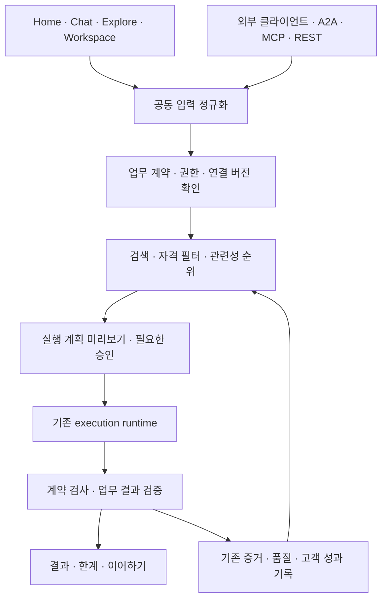
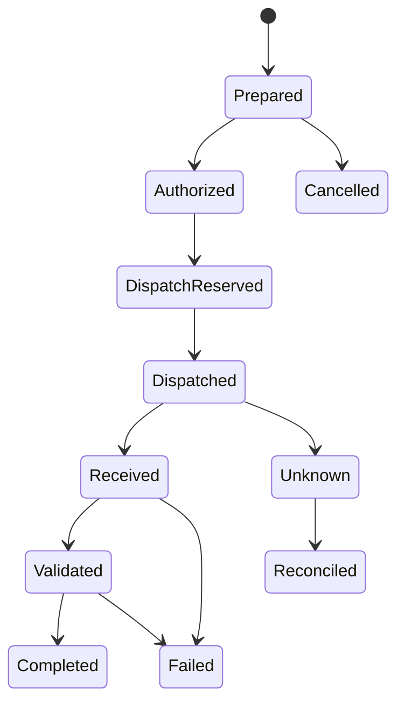

# 에이전트 컨시어지 사업·제품 개선 설계서

**기준일:** 2026-10-25 · **버전:** 2.0 · **상태:** 소스·연구 대조를 반영한 개선 설계 / 구현·운영 활성화 승인 아님

**분석 입력:** 사용자 첨부 「자율형 AI 에이전트 생태계의 진화와 에이전트 컨시어지 플랫폼의 시장성 및 사업 전략 분석」, 현재 저장소의 관련 소스·설계·최근 운영 검증 기록, 공식 표준·제품 발표·연구 논문. 첨부의 사실 주장과 이번 설계의 제안·가정은 구분한다.

**v2 업그레이드:** 관련 소스 21개, 논문 9편, 공식 기술 문서 1개, 공개 SNS 논의 4건을 대조해 위험 항목 14개와 실험 8개를 추가했다. 논문은 공개 초록·요약을 중심으로 검토했으며 전 논문 본문의 재현 실험을 수행한 것은 아니다. SNS는 문제 발견에 사용하고 기술 판단은 소스·공식 문서·연구와 대조했다. 핵심 변경은 아래와 같다.

- 실제 공개 Chat 진입점과 일반 RAG 생성 함수의 차이를 구분한다.
- 필터된 ANN 검색과 사전 후보 절단의 recall을 exact 기준으로 측정한다.
- 응답 유효성·schema 통과와 업무 성공을 분리한다.
- 제공자 연결 저장과 인증된 workflow 실행을 분리하고, OAuth 만료를 반복 실행의 설계 조건으로 둔다.
- 이미 존재하는 typed compiler·출력 검토·권한/증거 gate·Ed25519 receipt를 재사용한다.
- 모델 16슬롯을 서비스 전체 동시성으로 해석하지 않고, 품질 목표에 표본·신뢰구간·실행 경로를 붙인다.

새 기술 검토는 **19~27장**에 있다. 1~18장은 사업·제품 기준 설계이며, 충돌하는 세부 수용 조건은 v2의 명시적 보완을 따른다. 기존 `IMP-01~08`과 승인·보류는 유지한다.

## 1. 결론과 사업 방향

첨부의 핵심인 **“목록 수보다 작업 성공과 책임 범위를 증명하는 능력이 중요하다”**는 방향을 채택한다. 다만 초기부터 금융 클리어링하우스·에스크로 사업자가 되는 전략은 사업 검증 전에 규제·분쟁·자금 관리 부담을 크게 만든다. 또한 사람용 화면을 기계용 API로 대체하면 현재 투자자와 고객이 제품 가치를 이해하고 통제할 접점을 잃는다.

권장 포지션은 **“사람과 자율형 에이전트가 허용된 외부 작업을 요청하고, 적합한 제공자를 연결하며, 결과와 실행 근거를 확인하는 검증·실행 플랫폼”**이다. 진주 목걸이의 각 진주는 에이전트 목록 항목이 아니라 **검증된 입력·출력과 연결 조건을 가진 작업 단계**를 나타낸다.

사업의 순서는 다음과 같다.

1. 연구·개발·공개 데이터 업무에서 반복해서 쓸 수 있는 작업 성공을 입증한다.
2. 사람용 화면과 기계용 접점을 동일한 작업 계약·권한·결과 검증으로 묶는다.
3. 고객이 직접 제공자 자격증명을 연결하는 BYOK 방식으로 먼저 운영한다.
4. 실행 통제·품질 이력·감사 내보내기의 조직용 구독 가치를 검증한다.
5. 실제 결제·정산은 계약과 사업 자격을 갖춘 파트너를 통해 별도로 검증한다.

**당장 경쟁력으로 내세울 것:** 특정 작업과 연결 버전에 대한 최근 검증, 입력 전달의 정확성, 실패·불확실 상태의 정직한 표시, 사용자 승인 범위 준수, 다시 실행·이어하기의 편리함.

**투자 제안서에서 피할 것:** 모든 에이전트의 품질 보증, 프로토콜 세 종류 지원만으로 독점적 해자 주장, 모든 작업 500ms 보장, 일률적인 15~35% 수수료의 업계 표준화, 자동 환불·법적 면책·금융 등급 인증의 확정 표현.

## 2. 조사 범위와 근거의 등급

이번 작업은 설계다. 운영 DB 변경, 외부 에이전트 실행, 결제, 로그인, 배포를 수행하지 않았다. 소스가 존재한다는 사실과 해당 기능이 현재 운영에서 활성화·수용되었다는 사실은 다르다. 운영 관련 평가는 아래 기존 기록의 관측 범위에 한정한다.

- [2026-10-25 r2 운영 점검](../reports/frontend-retention-quality-2026-10-25/post-deploy-r2/REPORT.md): REST/A2A/MCP 검색 6개 사례, 상세 연결 4개, 뉴스 실행·입력 전달, 데스크톱·모바일 동선을 확인한 제한 표본이다. 모든 제공자 품질이나 재방문 개선의 증거는 아니다.
- [고객 범위 결정과 기존 보류](DEVELOPMENT_REMAINING_AFTER_RESTART.md): 가상 고객 검증을 실제 고객 수용으로 승격하지 않는다. 결제·외부 계정·hosted CI 등의 과거 보류는 이번 설계 작성으로 해제하지 않는다.
- [기존 마감 계획](DEVELOPMENT_COMPLETION_PLAN.md): 기존 요구 추적을 유지한다. 이 문서의 `IMP-01~08`은 **개선 검토 묶음**이며 별도의 자동 실행 대기열이 아니다. 후속 개발 시 현재 승인 범위와 대조하여 필요한 변경만 기존 마감표에 편입한다.

근거는 `공식 확인`, `언론의 측정치 인용`, `전망`, `공급자 자체 주장`, `미확인`, `이번 설계의 가설`로 나눈다. 다운로드·방문·활성 사용자·작업 성공·재방문을 같은 지표로 합산하지 않는다.

사실 확인은 사업 결정에 영향을 주는 핵심 주장 중심이다. 첨부에 등장하는 모든 제품 사양·기기 무게·앱 개수·보급률을 전수 확인한 것은 아니다. 별도 근거를 확보하지 않은 세부 수치는 투자 제안서의 확정 사실로 재인용하지 않는다.

## 3. 첨부에서 유지·수정할 주장

### 3.1 상시 작동 에이전트의 확산은 확인하되 시장 지배를 단정하지 않는다

Meta의 Muse와 OpenAI의 Dots는 공식 발표가 확인된다. 출시 자체는 시장 방향의 근거지만, 우리 플랫폼과의 제휴·연동이나 고객 수요의 증거가 되지 않는다. Claude Duet도 조사 시점의 지원 대상·연구 프리뷰 조건을 구분해야 한다. [Meta 발표](https://about.fb.com/news/2026/09/introducing-muse-personal-ai-agent/), [OpenAI 발표](https://openai.com/index/introducing-dots/), [Claude 지원 안내](https://support.claude.com/en/articles/17631495-get-started-with-claude-duet)

Muse의 다운로드·D7/D14 수치는 EMARKETER가 Sensor Tower 측정치로 보도한 자료다. 원시 데이터·동일 코호트의 비교 조건을 독립 확인한 것은 아니다. 소비자 앱의 이 수치를 B2B 워크스페이스 유지율 목표로 그대로 옮기지 않는다. “ChatGPT의 일간 활성 사용자를 두 배 추월” 등 추가 주장은 별도 근거 없이는 제안서에서 제외한다. [보도 자료](https://www.emarketer.com/content/meta-muse-draws-millions-of-users-become-daily-ai-destination)

브라우저 차단·오작동은 전용 API의 가치를 높이는 요인이다. 그러나 모든 웹 자동화가 지속 불가능하다거나 에이전트 간 위임이 반드시 승리한다는 결론은 전략 가설이다. 공식 API, 허용된 브라우저 실행, 사람의 확인을 업무별로 선택한다.

### 3.2 시장 규모를 중복 합산하지 않는다

McKinsey의 연간 2.6~4.4조 달러는 **2023년 생성형 AI 63개 활용 사례의 잠재 경제 가치 추정**이다. 2026년 에이전트 시장 매출이나 우리 서비스의 직접 공략 시장이 아니다. Gartner의 “2026년 말 기업 앱 40%”도 2025년에 발표된 전망이다. [McKinsey 원문](https://www.mckinsey.com/capabilities/tech-and-ai/our-insights/the-economic-potential-of-generative-ai-the-next-productivity-frontier), [Gartner 발표](https://www.gartner.com/en/newsroom/press-releases/2025-08-26-gartner-predicts-40-percent-of-enterprise-apps-will-feature-task-specific-ai-agents-by-2026-up-from-less-than-5-percent-in-2025)

사업 계획에는 상향식 계산을 쓴다. `접촉 가능한 대상 조직 수 × 적격 조직 비율 × 유료 전환율 × 검증된 연간 계약액`으로 매출 시나리오를 구성하고, 각 항목의 실제 CRM 근거·표본·기간을 적는다. 아직 확보하지 않은 시장 조사 회사의 CAGR이나 서로 겹치는 분류를 더해 시장을 부풀리지 않는다.

### 3.3 프로토콜은 연결 규약이며 신뢰 보증 자체가 아니다

- A2A는 에이전트 협업·작업 통신, MCP는 도구·리소스 접근, x402는 HTTP 기반 결제 협상의 역할을 맡는다. 프로토콜 준수와 업무 결과의 유용성은 별도 검증한다.
- `/.well-known/agents.json`을 보편 표준으로 제시하지 않는다. A2A Agent Card와 각 클라이언트의 지원 버전을 명시한다. `/mcp`는 우리 서비스의 접점이며 모든 MCP 서버에 강제되는 경로가 아니다.
- AAIF에 A2A가 포함된 현재 공식 자료는 확인된다. 다만 재단 참여는 우리 제품의 상호운용성 인증을 뜻하지 않는다. [A2A 사양](https://github.com/a2aproject/A2A/blob/main/docs/specification.md), [AAIF 프로젝트](https://aaif.io/projects/agent2agent)
- x402는 선택한 scheme·확장에 따라 에스크로·일괄 정산을 지원할 수 있다. 모든 x402 호출에 조건부 정산·환불이 자동 제공되는 것은 아니다. 현재 플랫폼의 no-spend 검사는 결제 실행이나 상품 품질 보증이 아니다. [x402 공식 저장소](https://github.com/x402-foundation/x402)

### 3.4 신원·위임·법적 책임을 분리한다

로그인 신원, 제공자 도메인 통제 증명, API 사용 권한, 특정 업무의 대리 권한, 사업자 실명 확인은 서로 다른 증거다. API 키를 입력했다는 이유만으로 임의의 구매·계약·개인정보 전송을 허용하지 않는다.

UNCITRAL의 2024 자동 계약 모델법은 국가별 채택을 위한 모델이다. 미국 E-SIGN도 전자 에이전트라는 이유만으로 계약 효력을 부인하지 않는 원칙과 귀속 조건을 다룬다. 모든 관할의 책임을 일괄 확정하는 근거로 쓰지 않는다. 출시 지역·판매 주체·계약 유형을 정하고 전문가 검토 항목을 구체화한다. [UNCITRAL](https://uncitral.un.org/en/mlac), [15 USC 7001](https://uscode.house.gov/view.xhtml?edition=prelim&num=0&req=granuleid%3AUSC-prelim-title15-section7001)

RFC 8785는 JSON 정규화이고 JWS는 서명 방식이다. 암호화와 동일하지 않으며 내용의 사실성·법적 면책·절대적 변조 불가능성을 보장하지 않는다. 명칭은 **“변경 탐지 가능한 서명 실행 증적”**으로 한다. [RFC 8785](https://www.rfc-editor.org/info/rfc8785/)

### 3.5 수수료와 결제 공급자 비교는 실증 대상이다

15~35%는 우리 서비스에 확정 적용할 업계 표준이 아니다. 고객의 지불 의사와 제공자의 원가·유통 계약으로 검증한다. Nevermined의 단축 사례는 공급자 자체 사례이며 우리의 구축 기간 약속으로 전환하지 않는다. Crossmint·Skyfire·Nevermined의 기능 유무를 단정하는 표 대신 실제 지원 지역·상품·정산·환불·키 관리·책임 분담을 같은 PoC로 비교한다. [Nevermined 자체 설명](https://nevermined.ai/blog/x402-integration-guide)

## 4. 현재 자산과 추가 개선의 경계

### 재사용할 구현

1. **기계용 발견과 재방문:** [agent_entry.py](../agent_market/concierge/agent_entry.py)의 entry document·quick actions·skill 안내·resume/report 접점. 기계용 진입 API를 처음부터 새로 만드는 계획은 제외한다.
2. **연결 버전별 증거:** [연결 증거 설계](CONNECTION_EVIDENCE.md)의 `connection_agents`, 연결 버전, `capability_evidence`, 자격 projection. endpoint·auth·schema 변경 시 과거 증거를 무조건 재사용하지 않는다.
3. **작업 계약·출력 검사:** [capability_contracts.py](../agent_market/capability_contracts.py), [result_quality.py](../agent_market/concierge/result_quality.py). 기존 계약의 범위와 휴리스틱을 먼저 측정하고 부족한 업무별 판정만 보완한다.
4. **제공자 연결과 소유권:** [workspace_provider_connections.py](../agent_market/workspace_provider_connections.py), [provider_claims.py](../agent_market/provider_claims.py). OAuth/API 키 vault와 endpoint 통제 증명을 재사용한다. 도메인 통제 증명을 품질 인증으로 바꾸지 않는다.
5. **권한과 장기 실행:** [execution_authority.py](../agent_market/execution_authority.py), [실행 권한 설계](EXECUTION_AUTHORITY.md), [지속 실행 설계](DURABLE_WORKFLOWS.md). 기존 grant·취소·checkpoint·lease·fencing·outbox를 연결한다.
6. **독립 품질·고객 성과:** [workflow_quality_review.py](../agent_market/workflow_quality_review.py), [customer_task_outcomes.py](../agent_market/customer_task_outcomes.py), [workspace_support_outcomes.py](../agent_market/workspace_support_outcomes.py). 실행 성공, 고객의 유용성 응답, 지원 담당자의 기록을 이미 구분한다. 새 평행 평가 저장소를 만들지 않는다.
7. **운영자 워크플로우:** [WORKFLOW_PRODUCTS.md](WORKFLOW_PRODUCTS.md)의 공개 자격과 실제 제공자 장애 시나리오. 현재 템플릿·실행·다운로드 경로를 유지한다.
8. **가입 크레딧:** [customer_credits.py](../agent_market/customer_credits.py)는 신규 100개 지급과 현금 가치 없는 크레딧 약관을 담는다. 기존 가입자 추가 지급·자동 유료 전환·지갑으로 바꾸지 않는다.

### 현재의 핵심 빈틈

- 기능·프로토콜별 성공 기록을 사용자의 **하나의 작업 완료 기준**으로 묶는 추적성이 부족한지 확인해야 한다.
- HTTP 성공·응답 텍스트·건강 상태와 과업 충족을 혼동할 여지가 있다.
- 사람의 입력과 외부 클라이언트의 입력이 같은 실행으로 전달되는지 사례별 비교가 필요하다.
- 실패 후 수정·재개, 결과 검토, 제공자 연결 안내를 반복 사용 흐름으로 묶어야 한다.
- 평가·고객 성과 기능은 소스 존재와 운영 연결·독립 실증의 상태를 구별해야 한다.
- 과거 설계 문서에는 SQLite·가입 3크레딧·Workspace 비공개 등 이후 변경과 충돌하는 설명이 있다. 날짜가 오래된 문서를 현재 사실로 재공표하지 말고 지원 범위 명세와 운영 release 증거를 연결한다.

이번 분석은 전체 코드 감사가 아니다. 위 빈틈은 후속 개발 시 해당 경로를 확인할 설계 과제이며, 모두 재현된 결함이라고 주장하지 않는다.

## 5. 먼저 해결할 고객과 업무

### 초기 고객

- 여러 모델·도구를 사용하는 소규모 개발·리서치 조직.
- 반복적인 기술 조사·문서 확인·공개 데이터 요약이 필요한 운영 조직.
- 자신의 에이전트에서 공식 API를 통해 검증된 외부 작업을 찾으려는 개발자.

개인에게 모든 일을 대신하는 범용 비서와 정면 경쟁하지 않는다. 금융 주문·의료 판단·법률 자문처럼 결과 오류의 책임이 큰 영역은 초기 대표 상품에서 제외하고, 향후 전문 제공자·허가·검수 체계가 준비된 경우에만 별도 profile로 연다.

### 첫 세 가지 대표 업무

1. **기술 동향 브리프:** 주제·기간·언어를 입력하면 실제 출처와 게시일을 가진 뉴스/논문 묶음과 요약을 제공한다. 검색 결과 없음과 수집 실패를 구분한다.
2. **개발 의사결정 자료:** 공식 문서·패키지 정보의 버전과 조회 시점을 표시하고 지원 여부를 정리한다. 설치·외부 변경은 별도 승인 없이는 하지 않는다.
3. **공개 데이터 브리프:** 국가·지표·기간을 명시하고 원본 출처와 단위가 있는 비교 결과를 만든다. 오래된 자료를 최신 값으로 단정하지 않는다.

각 업무는 현재 제공자가 실제 지원하는 입력·지역·기간에 한정한다. 지원되지 않는 업무를 “AI가 알아서 처리”한다고 노출하지 않는다. 하나의 완성된 업무를 홈에서 보고, 시험하고, 저장하고, 다음 방문에서 다시 실행할 수 있게 한다.

## 6. 공통 작업 계약과 실행 구조

### 6.1 두 접점, 하나의 판정

새 마이크로서비스 여러 개를 추가하기보다 기존 frontend/admin/jobs/execution 역할 안에 논리 경계를 둔다. 제공자 호출과 장기 작업은 execution, 수집·평가·색인 갱신은 jobs가 맡는다. frontend의 페이지 응답이 수집 완료를 기다리지 않게 한다.

### 6.2 TaskContract v1 제안

아래는 **기존 계약 위의 내부 정규화 envelope 제안**이다. 현재 capability 계약·typed workflow·권한 ticket을 새 저장소나 실행 엔진으로 대체하지 않는다. 기존 프로토콜의 외부 schema를 일괄 교체하거나 임의의 필드를 표준이라고 주장하지 않는다. 실제 지원되는 언어·시간 조건·operation만 노출하며, 미지원 필드를 자동 무시하지 않는다.

- 식별: `task_id`, workspace/tenant 참조, principal 참조, contract version, canonical request hash.
- 업무: goal, capability profile, 입력 schema, 기대 출력 schema, 언어·지역·시간 범위·기준 시각.
- 연결: 선택 protocol, 고정 connection version, tool schema digest, provider connection revision.
- 권한: grant 참조, 허용 action/data/destination, 만료, 부수 효과 등급, 승인 필요 조건.
- 제약: deadline, 허용 시도 횟수, 내부 실행 한도, idempotency key, 재개 정책.
- 판정: 필수 필드·출처·최신성·허용된 “결과 없음” 조건, 검증 profile version.
- 반환: 결과 schema, status 참조, 승인된 callback/resume 경로, 공개 가능한 receipt 범위.

자격증명·세션 토큰·민감한 원문을 계약이나 LLM 프롬프트에 넣지 않는다. 고객 과금 정보는 필요한 비공개 정책 경로에서만 다루며 Chat UI에 노출하지 않는다.

### 6.3 검색·추천 정책

**지침 차이:** 이번 대화에서 제공된 지침은 Chat의 기본 추천 1개, protocol 미지정 시 A2A, 명시적 Any는 세 protocol 검색이다. 현재 저장소 `AGENTS.md`와 entry 안내에는 최대 3개·자동/Any A2A 우선 후 MCP·x402 명시 선택 정책이 기록되어 있어 서로 다르다. 아래 개선 목표는 이번 사용자 제공 지침을 따른다. 소스의 현재 동작을 설명하는 기록과 목표 정책을 섞지 않으며, 후속 구현에서 UI·API·문서·회귀 기준을 함께 맞춘다. 이번 설계 작성으로 운영 정책을 바꾸지는 않는다.

1. 어휘 검색과 pgvector 검색으로 후보를 얻는다.
2. 권한·연결 버전·금지 대상·최신 자격·schema·제공자 연결 준비 상태를 hard filter로 확인한다.
3. 업무 관련성을 충족한 후보 안에서 최근 성공 검증, 최근 활동, 품질 등급을 적용한다.
4. 명시 protocol 선택을 질문 속 조건보다 우선한다. protocol 미지정 새 요청은 A2A, 명시적 Any는 A2A/MCP/x402 전체를 검색한다. 후속 상세·대안 요청에는 선택 범위를 유지한다. 후보 검색에 x402가 포함되어도 결제나 실행 권한이 자동 발생하지 않는다.
5. Chat은 기본적으로 가장 관련 있는 후보 1개와 첫 행동을 제시한다. 대안은 사용자의 명시 요청으로 제공하고, 일반 Explore 탐색 목록의 페이지 크기와 추천 개수는 분리한다.

“A등급이니 모든 질문에 정확함”으로 해석되지 않도록 등급 옆에 **어떤 작업을 언제 어떤 표본으로 확인했는지** 보여준다. 사용자 질문과 다른 주제의 최근 성공을 무조건 우선하지 않는다.

### 6.4 기계용 배포와 재방문

기존 Agent Card·entry document·skill 안내·MCP/A2A/REST 접점을 재사용한다. 클라이언트별로 발견→schema 해석→입력 전달→권한 확인→실행→결과→resume의 호환 표본을 기록한다. 공식 발표에 있는 앱 수만으로 연동 완료 배지를 붙이지 않는다.

resume의 ETag/304는 변경 없는 응답 body 전송을 줄이는 기능이다. 전체 LLM 비용을 특정 비율 절감했다고 단정하지 않는다. 명시적인 재방문·상태 확인을 지원하되 자동 외부 실행이나 알림 수신 동의를 추정하지 않는다.

## 7. 품질 판정: 연결 성공에서 업무 성공까지

### 7.1 상태를 구분해서 기록한다

`발견됨 → 접속 확인 → 프로토콜/schema 확인 → 실행 응답 확인 → 업무 계약 충족 → 고객의 유용성 확인`을 구분한다. 앞 단계만 통과한 제공자를 마지막 단계까지 검증했다고 표시하지 않는다. 고객이 유용하다고 응답해도 기술적 실패 기록을 덮어쓰지 않는다.

증거는 `연결 버전 + 계약 버전 + 검증 데이터셋 버전 + 실제 실행 + 검사 시각`에 묶는다. 연결·권한·schema가 바뀌면 관련 자격을 무효화한다. TTL은 업무 위험과 데이터 변동성에 맞춘 profile로 관리하고 기존 24시간 증거 정책과의 호환성을 유지한다. 위험한 업무의 자격을 캐시 연장으로 살리지 않는다.

### 7.2 판정 순서

1. 결정적 검사: schema, 필수 값, 날짜·단위·중복·출처 형식, 입력 조건 준수.
2. 실제 근거 확인: 허용된 출처에서 데이터와 시점을 비교한다. URL이 있다는 이유만으로 내용이 사실이라고 인정하지 않는다.
3. 제한된 의미 검사: 질문 관련성·요약 충실성·명시적 불확실성. LLM 평가는 보조 신호로 사용한다.
4. 고위험·모호한 결과: 자동 성공 승격을 멈추고 검토하거나 지원 불가로 반환한다.
5. 고객 피드백: 기존 목적별 동의·철회 기능으로 유용성과 수정 횟수를 수집한다. 지원 담당자가 고객을 대신해 성공 응답을 작성하지 않는다.

HTTP 200, `pong`, 입력 반복, 고정된 완료 문구는 업무 성공이 아니다. “결과 없음”은 요청 계약이 빈 결과를 허용할 때 정상 검색 결과일 수 있지만, 자료를 찾아달라는 고객 목표까지 달성했다고 세지 않는다.

### 7.3 평가 데이터와 공개 조건

τ-bench의 결과 상태 기반 평가·반복 성공률 접근을 참고한다. AgentDojo처럼 외부 도구 결과를 통한 prompt injection과 정상 업무 수행을 함께 시험한다. 논문의 기존 모델 점수를 우리 품질 실적으로 사용하지 않는다. [τ-bench](https://arxiv.org/abs/2406.12045), [AgentDojo](https://arxiv.org/abs/2406.13352)

후속 개발의 **제안 수용 기준**:

- 대표 capability별 held-out 사례 100개 이상. 주제·언어·기간·지역·입력 길이·빈 결과·잘못된 출처·timeout·schema 변경을 포함한다.
- 반복 3회 결과를 별도로 기록한다. 단회 성공률과 세 번 모두 성공한 비율을 함께 제시한다.
- 업무 성공률 90% 이상은 초기 후보 기준이다. 공개 품질 판정은 22장의 제안 gate처럼 표본·95% 신뢰구간·실패 유형을 별도로 확인한다. 결과를 본 뒤 기준을 낮추거나 실패 표본을 제거하지 않는다.
- 성공률 90%는 검증 단계 진입 목표이며 고위험 거래를 허용하는 충분조건이 아니다. 같은 목표의 반복 실행을 서로 독립적인 목표 3개로 계산하지 않는다.
- 가격·권한·결제 판단에 LLM 단독 점수를 사용하지 않는다. 임의 전송·권한 초과·중복 실행 관련 지정 보안 사례는 전부 통과해야 한다.
- 코드에 있는 검사, 격리 fixture 통과, 승인된 실제 제공자 검증, 운영 적용을 각각 표시한다.

## 8. 위임·제공자 연결·안전한 실행

### 8.1 연결 안내 UX

워크플로우 미리보기에서 각 진주에 `Ready`, `Connect required`, `Permission needed`, `Unavailable` 상태를 표시한다. 선택한 단계의 설명에는 필요한 제공자·전송 정보 종류·허용 작업을 보여준다. Google/GitHub 로그인과 외부 제공자 OAuth 연결이 다르다는 점을 명확히 한다.

- API 키: 지원하는 header 방식만 안내하고 마스킹·저장 후 원문 비표시·회전·철회를 제공한다. URL query 키와 제공자 비밀번호 수집은 지원 대상으로 확대하지 않는다.
- OAuth: 해당 제공자의 공식 metadata와 client 등록 요건을 확인한다. 모든 수집 에이전트에 OAuth를 공통 자동 적용할 수 있다고 약속하지 않는다.
- 인증 정보 불명: 추정한 입력 폼을 만들지 말고 “연결 방식 확인 필요”로 표시한다.
- 검증: 비변경 최소 호출이 공식 지원되는 경우에 한해 권한과 연결을 확인한다. 검증 버튼이 유료 호출·전송·구매를 숨겨 실행하지 않게 한다.

HTTP MCP 인증은 선택한 사양 버전의 resource/audience, PKCE, state, metadata 검증을 따른다. 2026 사양의 Client ID Metadata Document와 기존 DCR 호환 조건을 구분한다. token passthrough, OAuth redirect 조작, SSRF, 다른 tenant 자격증명 재사용을 차단한다. [MCP 인증](https://modelcontextprotocol.io/specification/2026-07-28/basic/authorization), [MCP 보안 지침](https://modelcontextprotocol.io/docs/2026-07-28/tutorials/security/security_best_practices), [RFC 8707](https://www.rfc-editor.org/rfc/rfc8707.html)

### 8.2 실행·재시도·대체 제공자

이는 기존 runtime 상태와 매핑할 **업무 관점 모델**이다. 새 실행 엔진을 만드는 사양이 아니다. provider 호출 후 timeout이면 실제 작업이 수행되었을 수 있으므로 `Unknown`으로 둔다. 확인 없이 재실행·다른 제공자 실행·중복 청구를 시도하지 않는다. 취소 요청 접수와 외부 작업의 실제 취소 완료도 구분한다.

대체 실행은 사전 승인된 후보·데이터 수신자·권한 범위 안에서만 허용한다. 외부 부수 효과가 없는 사전 실패 또는 제공자가 검증된 멱등 실행·상태 조회를 제공하는 경우에 한정한다. 새로운 제공자나 민감 정보 전송이 생기면 새 승인을 받는다. 내부 원장 중복 방지와 외부 시스템의 exactly-once 실행은 같은 보장이 아니다.

## 9. 화면·메뉴별 개선 설계

공통 원칙은 **요청→현재 진행→결과→다음 행동**이 한 화면에서 이해되는 것이다. 공개 제품 문구는 영어로 작성하고 진주 테마·Lucide·키보드 포커스·반응형·reduced motion을 유지한다.

### Home / Agent Status

홈은 전체 수집 규모, 최근 상태 확인 수, 특정 업무 실행 가능 수를 서로 다른 정의와 갱신 시각으로 보여준다. 대표 작업 3개에는 실제 샘플 입력과 기대 결과를 연결한다. 수치를 부풀리기 위해 보고서 수를 고유 에이전트 수로 표시하지 않는다. 현황의 주기 갱신은 가능하나 중앙 로딩을 사용하지 않고 방문자의 입력을 초기화하지 않는다.

### Explore

업무 검색과 전체 목록 탐색을 구분한다. 추천은 짧게, 목록은 실제 page size에 맞는 조밀한 grid/list로 제공한다. 리스트 전환·필터·Load More·상세·브라우저 뒤로 가기에서 긴 URL/텍스트가 컨테이너를 넘지 않아야 한다. 선택 조건·스크롤·페이지 위치를 유지한다. 테스트 리포트 수는 “고유 에이전트 중 현재 자격 증거가 있는 수” 등 정확한 집계 정의를 표시한다.

### Test

Chat/Explore에서 넘긴 요청·선택 protocol·agent·입력 값이 그대로 보여야 한다. 샘플은 입력을 채우는 행동이며 즉시 외부 실행하지 않는다. 사전 확인·실행 중·결과 검증·완료/부분 결과/실패를 구분하고, 완료 후 오래된 preflight 안내가 남지 않게 한다. 실패 시 수정할 입력을 보존하고 재시도의 외부 부수 효과를 설명한다.

### Workflows / Template Hub

템플릿 수가 1,000개가 되어도 거대한 select나 전개 목록을 기본 화면에 두지 않는다. 검색·카테고리·업무·연결 준비 상태 필터, 서버 페이지 조회, 자세히 보기로 구성한다. 기본 화면은 선택한 작업과 편집·실행이 중심이다. 공개와 Workspace는 같은 템플릿 원본·revision·자격 상태를 사용한다.

진주 수는 실제 에이전트 단계 수와 일치시킨다. 입력·분기·검수 노드는 에이전트로 잘못 세지 않는다. 진주 연결은 실행 순서·분기를 표현하고 키보드/스크린리더용 목록을 함께 제공한다. 제공자 장애 시 불가한 연결을 예쁘게 표시만 하고 실행 가능한 것처럼 남겨두지 않는다.

### Chat

자연어 요청에서 목적·기간·언어 등 필요한 정보만 질문한다. 기본 추천 1개에 선정 이유와 다음 행동을 명시하고 Test/Workflow로 전달한 입력을 보존한다. 최신 답변을 먼저 표시한다. 결제·가격·비용·플랜·지갑·방문자 토큰·내부 JSON은 현재 제품 정책에 따라 표시하지 않는다. 필요한 제공자 연결은 Workspace로 안내한다.

### Workspace

첫 화면에 진행 중·입력 필요·검토 필요·완료된 작업과 다시 실행 동선을 둔다. 세션 확인 전 보호 화면이 순간 노출되지 않게 한다. 로그인 완료 후 권한 확인과 최초 화면 필수 데이터가 준비될 때까지 진행 상태를 유지한다.

제공자 연결, 저장한 워크플로우, 실행 기록, 예약·일시 중지, 결과 내보내기를 같은 업무 맥락에서 연결한다. 자동 실행과 알림은 목적별 명시 동의를 요구한다. 세션 만료 후 원래 작업의 안전한 경로로 돌아오며, URL의 return 값으로 임의 origin에 이동하지 않는다.

### Register Agent / Provider

endpoint 통제 증명, 연결 schema 검사, capability 실행 검증, 사업자 확인을 단계별로 구분한다. “도메인 소유 확인”을 “공인 품질 보증” 배지로 바꾸지 않는다. 변경된 연결의 재검증 대상을 명확히 알려준다.

### Admin

관리자의 오늘 업무를 `연결 문제`, `검증 만료`, `업무 결과 실패`, `결과 미확정`, `개인정보 요청`, 향후의 `정산 예외` 작업함으로 묶는다. 새 메뉴 수를 늘리는 방식보다 관련 목록에서 원인·영향·다음 행동을 보게 한다.

보고서 이력은 삭제로 숫자를 맞추지 않는다. 같은 실행의 중복 작성은 operation key로 차단하되 **서로 다른 버전·계약·검증 데이터셋·재검증 실행의 정당한 이력**을 보존한다. 기본 목록은 최신 유효 증거를 projection으로 표시하고 과거 기록은 상세에서 본다. 활성·수집·검증·준비·실행 성공의 집계를 구분한다.

### Footer / Developer / Privacy

공식 지원 protocol·기계 진입 문서·제약·서비스 상태·개인정보 권리·접근성 안내를 연결한다. 방문만으로 마케팅·callback·Push 동의를 추정하지 않는다. 내부 경로·모델·배포 구성·개인정보를 공개 문서에 노출하지 않는다.

### 공통 로딩·오류·복귀

명시적인 사용자 실행은 버튼에 즉시 진행 상태를 주고, 화면 전환이 필요할 때만 중앙 표시를 사용한다. Home 갱신·백그라운드 polling·자동 작업에는 중앙 로딩을 띄우지 않는다. 요청 owner와 lifecycle을 묶어 완료·실패·취소 시 정리한다. 새 요청이 이전 요청의 로딩을 임의 종료하지 않게 한다. 입력과 스크롤은 유지하고 중복 전송을 막는다.

## 10. 데이터·캐시·운영 설계

현재 PostgreSQL 18 + pgvector 운용 방향을 유지한다. 새 DB 전환을 개선 과제로 다시 만들지 않는다. 기존 테이블·원장·자격 projection에 필요한 연결을 추가하고 동일 목적의 병렬 저장소를 만들지 않는다.

- 업무 결과는 기존 run·계약·evidence·customer outcome을 참조한다. 새로운 식별자가 필요하면 기존 key와 일대일/일대다 관계를 명시한다.
- schema 변경은 additive migration→구버전 호환 읽기/쓰기→backfill 검증→새 경로 사용→관측→별도 정리 순서로 한다.
- 자격·권한·철회는 서버의 현재 상태로 판정한다. 캐시/Redis는 응답 가속 수단이며 실행 권한의 원본이 아니다.
- 검색 캐시는 tenant·query·protocol·filter·catalog revision에 묶는다. 권한 철회·schema 변경은 실행 직전에 다시 검사한다.
- 대기열은 기존 SQL outbox/worker를 우선 사용한다. 처리량·지연·장애 격리의 수치가 필요성을 입증하기 전 Kafka·새 벡터 DB·분석 DB를 추가하지 않는다.
- frontend/admin/jobs/execution을 독립 반영하고 release/source/config를 증거와 연결한다. 오래된 대기 프로세스의 DB pool도 연결 예산에 포함한다.
- 현재 단일 호스트의 서비스 전환을 물리 장애에 대한 HA라고 부르지 않는다. 백업·복구·네트워크 장애·호스트 장애는 별도 시험이다.

성능 측정은 cold/warm, 캐시 hit/miss, pgvector 준비 상태, 수집 경합, 외부 제공자 지연을 분리한다. **제안 목표**는 제한한 입력·데이터 규모에서 discovery 서버 응답 p95 3초 이내다. 외부 작업은 업무별 deadline을 두고 일괄 500ms 목표로 묶지 않는다. 동시 16개는 요청 종류·입력 길이·캐시 조건을 고정한 부하 profile로 검증하며, 모델 슬롯 16개가 DB·외부 API의 무제한 동시성을 뜻하지 않는다.

## 11. 서명 증적과 개인정보

기존 서명 모듈을 재사용하여 task/run 참조, principal/grant revision, 계약·연결·입출력 digest, 검증 방법·시각, 결과 상태, key ID를 포함하는 receipt를 제안한다. **이미 내부 HMAC artifact와 별도의 공개 opt-in Ed25519 metadata receipt/JWKS 구현이 있다.** 이를 하나의 새 JWS 시스템으로 대체하지 않는다. 기존 공개 receipt는 제한된 metadata 증명이며 업무 성공·현재 철회를 모두 증명하지 않는다. 공개 receipt는 별도 opt-in과 최소 필드만 허용한다.

클라이언트가 실제로 JCS/JWS를 요구하는 경우에만 새 호환 profile을 추가하고 정규화·키 회전·폐기·검증키 게시·시간 기준을 문서화한다. 현재 `sort_keys` 기반 JSON을 RFC 8785와 동일하다고 부르지 않는다. 변조 탐지 가능성과 서명 검증은 사실성 확인·전자서명 법적 요건·규제 인증과 구별한다. SOC 2·ISO·PCI 준수나 보험 인수는 실제 심사 없이 표시하지 않는다.

원문·자격증명·세션 값은 로그에 남기지 않는다. 낮은 엔트로피 개인정보는 단순 hash로 익명화했다고 주장하지 않고 비밀키 기반 digest나 암호화·토큰화를 검토한다. 데이터 종류별로 payload와 최소 메타데이터의 보존·삭제·법적 보류 정책을 정한다. 고객 피드백 철회 시 기존 aggregate에서 즉시 제외되는 경계를 유지한다.

## 12. 수익화와 결제 단계

### 1단계: 직접 연결 + 운영 가치

고객은 제공자와 직접 계약하고 자격증명을 연결한다. 플랫폼의 유료 가치는 작업 구성·팀 권한·반복 실행 통제·품질 이력·감사 내보내기에서 검증한다. 실제 유료화에는 별도 약관·고지·결제 승인·사업 준비가 필요하다. 현재 무료 100크레딧은 현금·코인·정산 잔액으로 전환하지 않는다.

### 2단계: 비수탁 파트너 결제

선정 PSP/facilitator의 허용 지역과 상품을 대상으로 sandbox를 검증한다. 구매자·판매자·플랫폼의 계약, merchant of record, 환불 책임, 세금·영수증·분쟁·정산 지연·키 관리의 담당자를 확정한다. 플랫폼이 제공자 지갑 private key나 카드 정보를 직접 보관하는 구조를 기본값으로 선택하지 않는다.

### 3단계: 조건부 정산의 제한된 실증

선택한 scheme이 보유·release·refund를 실제 지원하고 사업·법적 요건을 충족할 때만 검토한다. `authorized`, `settlement_pending`, `settled`, `refund_requested`, `refunded`를 실행 상태와 분리한다. x402 결제 확장의 존재만으로 우리 서비스의 구현·계약·지역 자격이 충족되지는 않는다.

업무 결과 검증은 지급 조건의 일부가 될 수 있지만, LLM의 주관 평가만으로 지급·환불을 결정하지 않는다. 이미 확정된 이체를 단순 API 호출로 되돌릴 수 있다고 약속하지 않는다. 미확정 호출은 먼저 제공자·결제사와 대사한다.

### 단위 경제성과 지불 의사

조직당 기여이익은 `플랫폼 매출 − 플랫폼 부담 모델/제공자 호출비 − 검증비 − 인프라 배분 − 지원·분쟁 비용`으로 본다. BYOK로 고객이 직접 내는 비용을 플랫폼 매출이나 원가에 중복 계상하지 않는다. 원가에는 최초 요청뿐 아니라 허용된 재시도·평가 호출도 포함한다.

예시 계산은 **현재 가격·실적이 아닌 가정**이다. 월 매출 149달러, 작업 10,000건, 작업당 시도 1.1회, 플랫폼 부담 호출 단가 0.004달러, 작업별 검증 0.001달러, 인프라·지원 50달러라면 비용 104달러, 기여이익 45달러다. 세금·고객 획득·R&D 등 미포함 비용이 있어 순이익으로 부르지 않는다. 견적 인터뷰·실제 사용량·지원 시간으로 모든 값을 교체해야 한다.

## 13. 지표와 재방문 분석

북극성 지표는 **“일주일에 검증된 업무 결과를 얻은 외부 조직 수”**로 제안한다. 목록 수·페이지뷰만으로 성과를 판정하지 않는다.

- 첫 가치: 방문/연결 시작→첫 유효 결과까지의 시간. 초기 UX 목표 120초는 제안치이며 실제 지원 업무·연결 필요 유무별로 측정한다.
- 품질: 계약 충족률, 출처·최신성 실패율, 반복 성공률, 사용자 수정 횟수, unknown 비율.
- 반복 사용: 가입 주차별 D7/D30, 같은 업무 재실행, 저장 후 다시 실행한 조직 비율. 관측 기간이 끝난 코호트만 비교한다.
- 운영: evidence 만료→재검증 시간, vector backlog의 유입/처리량/최고 대기 시간, p95·오류·DB pool 대기.
- 사업: 유료 파일럿 지불 의사, 활성 조직당 플랫폼 원가, 지원 시간, 계약 갱신 의사.

일반 브라우저·서명된 기계 클라이언트·내부 QA·미분류를 분리한다. User-Agent만으로 인간/자율 에이전트를 확정하지 않는다. IP fingerprint로 개인을 추적하는 기능을 새로 만들지 않는다. 동의된 조직·작업 단위 지표를 우선한다.

재방문이 적다는 사실만으로 불만족이 원인이라고 확정할 수 없다. 일회성 유입·잘못된 대상·측정 누락·가입 장벽·반복 업무 부족도 가설이다. 작업 완료→저장→다시 실행의 이탈 구간과 자발적 피드백을 비교하고, 충분한 표본이 있을 때만 사전에 정의한 실험으로 개선 효과를 판단한다.

## 14. 개선 검토 묶음과 의존관계

아래 우선순위는 이번 제안의 상대 순서다. 기존 승인·보류를 변경하지 않는다. 기능별 현재 구현과 차이를 먼저 대조하고, **필요한 차이만 기존 계획에 편입**한다. owner는 권장 역할이며 실제 담당자 배정이 아니다.

### IMP-01 · P0 · 사실·지원 범위·측정 기준 고정

- 담당 역할: 제품 책임자 + 데이터/QA.
- 산출물: 주장 근거표, release별 지원 profile, 상태/집계 정의, 동의된 코호트 분류.
- 재사용: 기존 운영 보고서·agent entry·고객 성과 모듈.
- 완료 조건: 외부 발표 문구에 출처/날짜/한계가 연결되고, 같은 실행을 여러 성과로 중복 집계하지 않음. 내부 QA가 외부 고객 성공으로 섞이지 않음. 사용자 제공 지침과 저장소 추천 정책의 차이를 일관되게 정렬할 목표 명세 확정.
- 기존 계획 연결: 마감 1단계 범위·완료 판정. 재시작 불필요한 문서 작업부터 가능.

### IMP-02 · P0 · 공통 작업 계약과 입력 전달

- 선행: IMP-01. 담당: backend + frontend.
- 산출물: 현행 계약 대비 delta, REST/MCP/A2A 입력 매핑, schema/version 호환 정책, UI→Test/Workflow→run 추적.
- 완료 조건: 같은 요청의 protocol별 핵심 입력·제약·기대 결과 일치, 알 수 없는 필드·기존 고객 호환 동작 명시. 계약·권한 검사에서 실패한 요청은 외부 실행 0건.
- 기존 계획 연결: 마감 3·5단계의 저장소/서버·A2A/분기 경계.

### IMP-03 · P0 · 업무 품질과 자격 판정

- 선행: IMP-02. 담당: 평가/QA + backend.
- 산출물: 세 대표 업무의 검증 profile·held-out 데이터·독립 검토 절차·현재 자격 연결.
- 완료 조건: 7장의 목표와 부정 사례 통과, 실패 원인이 보이는 보고서. transport 성공을 업무 성공으로 승격하지 않음.
- 기존 계획 연결: 마감 4·7단계 품질/운영 증거·routing. 이미 있는 review와 outcome 모듈에 연결.

### IMP-04 · P1 · 사람·기계의 첫 성공과 재방문

- 선행: IMP-02·03. 담당: UX + frontend + QA.
- 산출물: 9장의 화면별 상태 설계, 실제 데이터 기반 대표 작업, 호환 클라이언트 목록, resume 여정.
- 완료 조건: 홈부터 footer, 로그인·세션 만료·뒤로 가기·템플릿 1,000개·모바일·키보드까지 클릭 전/후/수정 후 증거. 입력 소실·완료 후 무한 로딩·허위 실행 버튼 없음.
- 기존 계획 연결: 마감 6단계 고객·SDK 여정. 유료화 없는 범위에서도 검증 가능.

### IMP-05 · P1 · 제공자 연결과 업무별 위임

- 선행: IMP-02. 담당: 보안/backend + UX.
- 산출물: auth 종류별 연결 안내·지원 범위, grant/연결 revision 결합, 철회·만료·권한 상승 검사.
- 완료 조건: tenant 격리·token passthrough·SSRF·redirect/state·scope·credential 로그 회귀 통과. 연결 불명 제공자에 임의 credential 폼/실행을 노출하지 않음.
- 기존 계획 연결: 마감 2·6단계 외부 사양·인증 여정. 실제 OAuth 등록·계정 사용은 기존 보류와 승인 범위를 확인한 뒤 진행.

### IMP-06 · P1 · 지속 실행과 관리자 작업함

- 선행: IMP-03·05. 담당: execution/jobs + admin + QA.
- 산출물: 기존 상태 매핑, unknown 대사, 사전 승인 대체 조건, 업무 중심 운영 목록, 멱등 보고서 작성.
- 완료 조건: 재시작·lease 상실·부분 장애·timeout·취소·schema drift에서 중복 외부 작업이나 stale 자격 실행을 막음. 관리자에게 원인·영향·다음 행동이 보임.
- 기존 계획 연결: 마감 3·5·7단계. 기존 worker/ledger/복구 경로 재개발 금지.

### IMP-07 · P2 · 감사 내보내기와 조직용 가치 검증

- 선행: IMP-01·04·06. 담당: 제품/보안 + 고객 운영.
- 산출물: 서명 receipt profile, 보존·삭제·내보내기 정책, BYOK 파일럿 제안, 원가·지원 비용 모델.
- 완료 조건: 증적 검증·키 회전·철회·최소 노출, 고객 유용성/지불 의사 확인. 실사용자·계약·동의 없는 가상 시험은 실제 사업 검증과 분리.
- 기존 계획 연결: 마감 6·7·9단계. 고객 접촉·유료 계약은 후속 명시 범위 확정 필요.

### IMP-08 · P3 · 결제 파트너 제한 실증

- 선행: IMP-05·06·07 및 별도 사업 결정. 담당: 사업/재무/법무 + 결제 backend.
- 산출물: 공급자 선정 PoC, merchant/세금/환불 책임, scheme별 상태·대사·회계 매핑, 제한 출시 계획.
- 완료 조건: 사업 자격·지역·약관·계약·sandbox·실거래 한도·환불/분쟁 담당자·대사 증거. 조건 미충족이면 비활성 유지.
- 기존 계획 연결: 마감 8단계의 **기존 보류**. 이번 문서는 보류 해제나 실거래 지시가 아니다.

의존관계: `01 → 02 → 03 → 04`; `02 → 05`; `03 + 05 → 06`; `01 + 04 + 06 → 07`; `05 + 06 + 07 + 사업 승인 → 08`.

## 15. 제안 일정과 단계 중단 기준

**일정 가정:** 제품/UX·frontend·backend·평가/QA를 포함한 4~6명 규모, 승인된 제공자·시험 환경이 준비된 경우의 계획 예시다. 실제 인력·현재 변경량을 확인하지 않았으므로 납기 약속이 아니다.

- 1~2주: IMP-01, IMP-02의 현행 대조·대표 업무 확정·계약 delta.
- 3~4주: IMP-02·03의 입력 parity·품질 baseline. 실패한 대표 업무는 홈 추천에서 제외.
- 5~6주: IMP-04·05의 첫 성공·재방문·연결 안내. 불명확 권한은 실행 차단.
- 7~8주: IMP-06의 장애·unknown·관리자 처리 흐름. 외부 부수 효과는 대사 전 자동 재시도 금지.
- 9~12주: 승인된 범위에서 IMP-07의 조직용 파일럿·지원 비용·반복 사용 평가.
- IMP-08: 12주 안의 출시 약속에서 제외한다. 사업·파트너·규제·기존 보류 해제 후 별도 계획한다.

완료 기준은 코드 작성이 아니라 **동일 후보 버전의 해당 기능·보안·성능 검사와 승인된 실제 범위 증거**다. 기존 자동화·테스트를 재사용하고 영향 없는 전체 회귀를 반복 실행하지 않는다. 소스·DB 변경 후 실제 서버 반영은 운영 지침과 후속 사용자 지시에 따른다.

## 16. 후속 개발의 수용 체크리스트

1. 세 대표 업무가 입력→실행→근거 있는 결과→저장→재실행까지 이어지는가?
2. REST/MCP/A2A와 사람용 화면의 입력·protocol·시간 범위가 일치하는가?
3. 연결/schema/권한/검증 데이터셋의 변경으로 과거 자격이 무효화되는가?
4. 빈 결과·부분 결과·제공자 실패·미확정 실행을 다르게 표시하는가?
5. 같은 실행의 중복 보고서를 막으면서 정당한 재검증 이력을 보존하는가?
6. 만료·철회·다른 tenant·조작된 callback·prompt injection·SSRF를 거부하는가?
7. provider 호출 후 timeout에 안전하지 않은 재시도·대체·청구가 발생하지 않는가?
8. 1,000개 템플릿·긴 텍스트·모바일·뒤로 가기·로그인 만료에서 사용할 수 있는가?
9. 사용자가 누른 동작에만 적절한 로딩이 보이고 완료 시 해제되는가?
10. 공개 콘텐츠 검사, mirror 정합성, 영향받은 보안/브라우저/API 회귀가 통과하는가?
11. 성능 profile의 표본·cold/warm·캐시·동시성·외부 지연이 공개되는가?
12. 유료화·결제·알림·외부 전송은 별도 동의와 사업 조건을 충족하는가?
13. 승인된 후보 release와 관측 결과가 연결되고 롤백·연결 pool·복구 경로가 확인되는가?
14. 실제 고객/독립 평가/실거래와 fixture·합성 검증을 명확히 구분하는가?

## 17. 제안서용 권장 메시지

“Agent Concierge는 사람과 자율형 에이전트가 필요한 외부 기능을 찾고, 허용된 범위에서 실행하며, 결과를 근거와 함께 확인하도록 돕습니다. 연결 버전과 업무 조건에 맞는 최근 검증 이력을 활용하고, 실패하거나 확인되지 않은 작업은 구분해 보여줍니다. 고객은 여러 제공자를 사용하면서도 실행 권한과 결과 이력을 한곳에서 관리할 수 있습니다.”

시장 규모보다 **실제로 완수한 반복 업무, 유효한 최근 증거, 첫 성공까지의 시간, 다시 실행한 조직, 지원 비용**을 투자자 데모의 중심에 둔다. 현재 확인한 표본을 넘어서는 실적·품질 보증·제휴·법적 효력을 암시하지 않는다.

## 18. 산출물과 검증 범위

- 본 설계서: 주장 수정, 제품·기술·UX·사업 설계, 8개 개선 검토 묶음과 수용 조건.
- [구조화 설계·근거](../reports/agent-concierge-strategy-design-2026-10-25/design-data.json): 검토용 Canvas와 동일한 데이터.
- [문서·Canvas 검증 결과](../reports/agent-concierge-strategy-design-2026-10-25/verification.json): 로컬 참조·ID·의존관계·문법 등 산출물 검사. 제품 기능의 신규 보안/성능 수용을 뜻하지 않는다.

**이번 작업의 종료 조건:** 첨부의 과장·오해 소지를 수정하고, 현재 구현을 재사용하는 실행 가능한 개선 설계와 우선순위·검증 기준을 제공한다. 제품 소스·운영·기존 승인/보류 상태는 이번 문서 작성으로 변경하지 않는다.

## 19. v2 소스 검토 결과: 확인한 사실과 잠재 위험

아래 `SR`은 분석 식별자다. 새 개발 큐가 아니라 기존 `IMP`에 연결한 위험 추적표다. **소스에서 구조가 확인됨, 순수 함수의 한계를 확인함, 실제 운영 장애가 재현됨은 서로 다른 상태다.** 이번에는 운영 장애·부하를 재현하지 않았다. 코드 참조의 함수 위치와 SHA-256은 [소스 대조 기록](../reports/agent-concierge-strategy-design-2026-10-25/source-review.json)에 고정했다.

### SR01 · P0 · 필터된 벡터 검색에서 후보가 부족해질 수 있음

현재 [discovery.candidates](../agent_market/concierge/discovery.py:56)는 PostgreSQL ANN 검색에 protocol/category/상태 필터를 JOIN하고 `ef_search=200`, `LIMIT 100`을 사용한다. 별도 [postgres_ann.nearest](../agent_market/postgres_ann.py:46) 경로는 model descriptor로 100개를 찾고 후속 단계가 상태·조건을 확인한다. 같은 “하이브리드 검색”이어도 두 경로의 필터 위치가 다르다.

ANN은 필터 선택도가 낮을 때 충분한 적격 후보를 찾지 못할 수 있다. pgvector 공식 문서는 필터·정확 검색·iterative scan의 선택을 설명한다. 그러나 현재 DB의 extension 버전·실행 계획·선택도별 recall은 이번에 측정하지 않았다. [pgvector 공식 설명](https://github.com/pgvector/pgvector#filtering)

**설계 변경:** 작은 적격 집합의 exact 검색, bounded iterative scan, 후보 보강을 같은 snapshot에서 비교한다. `current_ids()`는 최대 100개 입력이므로 단순히 ANN LIMIT만 늘리는 구현을 금지한다. 필요한 경우 같은 snapshot·deadline 안에서 100개 이하 batch로 검증한다. source/model/generation/hash gate는 유지한다. 정확도 개선을 이유로 만료·격리·권한 필터를 해제하지 않는다.

**연결:** IMP-02 / EX01. 지연·recall이 실제로 개선된 조합만 도입한다.

### SR02 · P0 · 관련성 평가 전에 최신 후보로 절단됨

[discovery.candidates](../agent_market/concierge/discovery.py:56)는 어휘 질의별 `last_ok_at` 순으로 최대 300개를 가져오고, 합친 후보에 coverage와 RRF를 적용한다. 따라서 뒤에서 좋은 관련성 점수를 적용해도 초기 후보 밖의 적격 agent는 되살릴 수 없다. 대량의 포괄적 설명이 있는 카탈로그에서 희귀한 전문 기능이 빠지는 위험이다. 이 위험의 운영 발생률은 미측정이다.

**설계 변경:** exact-name·희귀 capability·계약 일치 후보에 별도 bounded 슬롯을 주고, 충분성 평가가 낮을 때 한 번만 내부 후보를 보강한다. 최종 관련성·안전 gate 안의 freshness 우선 정책을 유지한다. 모든 요청을 무조건 전체 카탈로그 sort나 재검색으로 전환하지 않는다. CRAG의 검색 충분성 점검을 참고하되, 논문에 있는 공개 웹 확장을 서버의 무승인 자동 탐색으로 옮기지 않는다. [CRAG](https://arxiv.org/abs/2401.15884)

**연결:** IMP-02 / EX01·02.

### SR03 · P0 · 일반 RAG 함수 수정만으로 현재 Chat이 개선되지는 않음

[Front 조립](../agent_market/concierge/front.py:122)은 `QualityRecommender`와 `FastConcierge`를 사용한다. [FastConcierge](../agent_market/concierge/fast_chat.py:24)는 질문마다 생성형 모델을 호출하지 않도록 구현됐다. 일반 `Concierge.handle`과 `RagEngine.generate_rag_answer`가 저장소에 존재한다는 이유만으로 현재 공개 Chat이 그 경로를 사용한다고 판단하면 안 된다.

이는 오류 자체가 아니라 속도·안전·안정성을 선택한 구조다. 다만 새로운 표현·복합 조건의 이해를 모두 규칙 추가로 해결하면 사전 유지 비용과 누락 위험이 커진다.

**설계 변경:** 실제 Fast 경로에서 규칙으로 확정되지 않는 요청만 제한된 intent/constraint 추출 후보로 보낸다. 모델에는 허용 schema와 필요한 정보만 주고, protocol·권한·제공자·URL을 임의로 결정하지 못하게 한다. 출력은 서버가 검증한 DTO와 고정 결과 renderer에 합친다. 생성 모델이 실패하거나 지연되면 기존 규칙과 명확한 구체화 질문으로 돌아온다. 별도 생성 경로를 우회 활성화하면 기존 가격·토큰·내부 정보 노출 방어가 달라질 수 있으므로 단순한 engine 교체는 하지 않는다.

**연결:** IMP-02·04 / EX02·08. 최종 문장 품질만 평가하지 말고 요구 제약의 보존과 다음 행동 성공을 평가한다.

### SR04 · P0 · “쓸 수 있는 형식”과 업무 충족은 다름

[result_quality._useful](../agent_market/concierge/result_quality.py:7)은 `pong`, `Completed` 같은 명백한 비응답을 막는다. 그러나 일반 dict나 file URI의 존재는 유효한 응답 구조로 인정한다. [capability_contracts.validate](../agent_market/capability_contracts.py:39)는 schema·URL 형식·시각 등을 검사하지만 외부 출처를 가져와 주제·사실성을 판정하지 않는다. 이것은 각 함수의 역할 한계이며 전체 실행 파이프라인이 모두 우회된다는 취약점 재현이 아니다.

외부 호출 없는 [순수 함수 표본 4건](../reports/agent-concierge-strategy-design-2026-10-25/offline-probes.json)에서 다음을 확인했다.

- 작업과 무관한 `Completed` 문구: 거부됨.
- 일반 상태 객체: helper가 허용함.
- 아직 가져오지 않은 파일 URI: 구조상 허용함.
- Python 문서 요청에 무관한 synthetic excerpt: `docs.search.v1`의 구조·시각 검사를 통과함.

**설계 변경:** `transport_ok`, `response_usable`, `schema_passed`, `goal_passed`, `source_checked`, `customer_useful`을 구분하고 검증 방법·대상을 기록한다. file 참조가 있으면 “파일 생성 완료”로 표시하지 않는다. 다운로드 가능한 산출물 확인이 필요한 계약은 승인된 origin·크기·content type·deadline 안에서 별도 artifact 확인을 한다. URL 임의 fetch 기능을 helper 안에 넣어 SSRF와 비용을 늘리지 않는다.

**연결:** IMP-03 / EX03. 구조 검사 유지 + 업무별 목표 검사가 정답이다.

### SR05 · P1 · OAuth 저장만으로 장기 반복 실행이 유지되지 않음

[ProviderConnections.complete_oauth](../agent_market/workspace_provider_connections.py:420)는 access token과 만료를 저장한다. 이 연결 모듈에서는 refresh token의 회전·재사용 탐지·폐기 수명주기가 확인되지 않았다. 만료된 token을 계속 쓰는 대신 expired로 표현하는 기존 동작은 보존한다. 전체 서비스의 모든 provider 경로에 refresh가 없다고 확대하지 않는다.

**설계 변경:** 기본 지원은 만료 전 안내와 명시 재연결이다. refresh가 필요하고 공식 지원되는 제공자만 별도 profile로 등록한다. 해당 profile은 encrypted refresh credential, issuer/client/resource/scope, token generation, 단일 refresh claim, 회전 token 교체의 원자성, 철회, 미확정 token 교환 시 중지·재연결을 포함한다. 단기 메모리 lock만으로 여러 서버의 동시 refresh를 해결하지 않는다.

**연결:** IMP-05 / EX05. 현재 저장된 연결을 무기한 예약 실행 가능한 것으로 설명하지 않는다.

### SR06 · P0 · 모델 16슬롯은 서비스의 16개 동시 성공을 보장하지 않음

[discovery_embedding](../agent_market/gateway/rag.py:247)의 semaphore 4개, single-flight와 cache는 한 engine/process 범위다. `LocalLLM`의 semaphore, Workspace private 실행 pool과 외부 제공자의 제한은 각각 다르다. frontend/admin/jobs 프로세스 수가 늘면 프로세스별 limit의 합이 실제 자원 한도를 넘을 수 있다. 반대로 모든 semaphore를 16으로 바꾸면 DB와 제공자를 먼저 포화시킬 수 있다.

**설계 변경:** 생성 모델 endpoint/model, embedding endpoint/model, DB pool, provider host, tenant 실행 quota를 다른 자원으로 관리한다. 같은 모델을 쓰는 역할의 총 입장 예산을 정하고 대기열은 유한하게 둔다. 사용자 요청은 짧은 deadline, backfill은 낮은 우선순위와 별도 quota를 사용한다. 새 중앙 admission 서비스가 필요하다고 단정하지 않고 먼저 기존 역할별 고정 예산 배분으로 측정한다.

**연결:** IMP-06 / EX04. 성공 goodput·대기시간·거절률을 함께 봐야 “빠르지만 대부분 실패”인 결과를 피한다.

### SR07 · P0 · 이미 있는 최신성·권한 gate를 최적화 중 잃을 위험

[PostgresVectorIndex.current_ids](../agent_market/application_store_vector.py:93)는 provenance·source·model·generation·vector hash를 검증한다. [WorkspaceExecution](../agent_market/workspace_execution.py:59)은 ticket·현재 연결 binding·dispatch guard·unknown 처리를 가지고 있다. 이를 미구현 항목으로 다시 만들지 않는다.

**설계 변경:** 검색 snapshot과 dispatch 순간의 권한·연결 검사는 별도다. cache key에 revision이 있어도 철회가 즉시 적용된다고 가정하지 않는다. 검색 중 schema 변경, 추천 후 철회, outbox 지연, 오래된 vector projection, 복원된 ticket의 경합을 기존 검사에 연결한다. 변경 관측 event는 성능 최적화이고 최종 권한 판정의 대체재가 아니다.

**연결:** IMP-02·05·06 / EX01·05·08.

### SR08 · P0 · 비신뢰 설명과 결과가 실행 계획을 바꾸면 안 됨

[workflow_model_proposer](../agent_market/workflow_model_proposer.py:46)는 작은 schema와 후보 허용 목록을 사용하고, [compile_proposal](../agent_market/workflow_model_proposer.py:62)이 코드를 통해 DAG를 구성한다. 이 설계를 유지한다. [local_generation.chat_request](../agent_market/local_generation.py:36)는 schema 전달 기능도 이미 제공한다. 다만 실제 서버가 모든 schema keyword를 지원한다는 증거는 별도다.

**설계 변경:** catalog description·tool response·retrieved page는 비신뢰 데이터로 표시한다. 모델이 만들어낸 endpoint, credential 위치, callback, scope, approval, 실행 제한은 수용하지 않는다. 정규식으로 태그를 지우는 것만을 보안 경계로 삼지 않는다. CaMeL의 데이터/제어 흐름 분리 원칙을 기존 권한·compiler에 적용하고 AgentDojo식 부정 사례에서 정상 작업의 성공도 함께 측정한다. [CaMeL](https://arxiv.org/abs/2503.18813), [AgentDojo](https://arxiv.org/abs/2406.13352)

**연결:** IMP-02·05 / EX02·05·06.

### SR09 · P1 · 내부 검토 기록과 독립 운영 증거의 차이

[WorkflowQualityReview.status](../agent_market/workflow_quality_review.py:288)는 qualification source와 source verifier가 없거나 기준에 맞지 않으면 독립 품질·운영 증거를 false로 남긴다. 이 안전한 구분이 이미 있다. 이번 검토로 해당 외부 검증자의 실제 운영 연결까지 확인한 것은 아니다.

**설계 변경:** `configured`, `reviews_complete`, `qualified`, `source_verified`, `current`를 분리해서 보여준다. 모델 judge가 사람 자격·독립성·원본 증거를 대신하지 않는다. 판정 모델/프롬프트를 바꾸면 사람 gold set으로 다시 보정하고 A/B 순서를 교환해 위치·길이 편향을 측정한다. 평가자 모델이 다르다는 이유만으로 완전 독립이라고 표시하지 않는다. [LLM-as-a-Judge 연구](https://arxiv.org/abs/2306.05685)

**연결:** IMP-03·07 / EX03·07.

### SR10 · P1 · 기존 서명을 새로 만들거나 보장 범위를 넓힐 위험

내부 artifact의 [ArtifactSigner](../agent_market/private_artifact_keys.py:103)는 HMAC 기반이다. 별도 [PortableReceiptIssuer](../agent_market/reliability_portable_receipt.py:103)는 Ed25519 metadata receipt를 제공하고, [public receipt](../agent_market/reliability_public_receipt.py)는 opt-in 공개와 JWKS 경로를 구현한다. 따라서 “공개 검증을 위해 signer를 처음부터 만든다”는 계획은 잘못이다.

다만 현재 JSON 정규화와 사용자 정의 서명 framing을 JCS/JWS라고 부를 수는 없다. offline receipt는 현재 철회나 실제 업무 성공을 확정하지 않는다. 기존 receipt의 제한된 contract 목록과 TTL도 유지해야 한다.

**설계 변경:** 기존 형식을 우선 사용하고 verifier 상호운용 요구가 있을 때만 versioned adapter를 검토한다. 기존 내부 MAC·외부 Ed25519의 purpose/key를 분리한다. 공개 claim을 늘리려면 최소 공개 projection·audience·TTL·원본 현재 상태·동의가 충족되어야 한다. 기존 서명 호환성을 깨는 일괄 canonicalization 변경은 하지 않는다.

**연결:** IMP-07 / EX08.

### SR11 · P0 · 표본과 반복의 상관을 무시하면 품질이 과대평가됨

v1의 “100개 이상, 90%”만으로 높은 신뢰의 공개 품질을 주장할 수 없다. 독립 이항 표본을 가정한 계산에서 90/100의 Wilson 95% 신뢰구간 하한은 약 82.6%다. 같은 업무를 세 번 실행한 300회를 독립적인 목표 300개로 계산하면 불확실성을 과소평가한다. [계산 기록](../reports/agent-concierge-strategy-design-2026-10-25/offline-probes.json)

**설계 변경:** unique goal 단위, 업무군·언어·provider strata, 실패·unknown·미응답의 분모를 고정한다. 같은 목표의 반복·동일 provider·같은 시간대는 cluster로 다룬다. 고객 유용성 응답은 기존 동의·철회를 유지하고, 응답자만의 결과임을 표시한다. 미응답을 성공이나 실패로 임의 분류하지 않는다.

**연결:** IMP-01·03 / EX03·07.

### SR12 · P1 · 단계의 성공이 전체 목표 충족은 아님

[compile_proposal](../agent_market/workflow_model_proposer.py:62)의 제한된 순차 계획은 앞 단계 `items[0].title`을 다음 query로 연결할 수 있다. 기존 goal 검사가 있으며 이것이 모든 복합 업무의 의미를 포괄한다는 뜻은 아니다. “뉴스를 찾고 그 근거를 비교”와 “첫 제목으로 다시 검색”은 다른 업무다.

**설계 변경:** `search → independent search`, `search → enrich by item`, `map each item → aggregate`, 조건 분기는 서로 다른 operation profile이다. 요청에 없는 임의 바인딩을 자동으로 만들어 의미를 연결했다고 표시하지 않는다. 새 profile을 만들기 전까지 미지원 조합은 명확히 제한한다. 각 단계의 계약 외에 전체 workflow output과 사용자 목표를 검사한다. agent 수나 병렬도를 늘리는 것만으로 품질 향상을 기대하지 않는다. [MAST](https://arxiv.org/abs/2503.13657), [τ^τ-bench](https://arxiv.org/abs/2609.04611)

**연결:** IMP-02·06 / EX06.

### SR13 · P0 · 연결 저장과 인증된 workflow 실행은 별도 구현 범위

[ProviderConnections.profile](../agent_market/workspace_provider_connections.py:70)은 연결 저장이 paid execution을 활성화하지 않는다고 명시한다. [WorkspaceExecution._resource](../agent_market/workspace_execution.py:136)의 이 private MCP 실행 profile은 read-only/idempotent annotation과 함께 인증 요구가 없는 resource를 요구한다. 제공자 OAuth/API 키 폼이 있다는 사실만으로 모든 인증 에이전트가 모든 실행 경로에서 호출된다고 말할 수 없다. 다른 실행 profile의 범위까지 이 제한을 일반화하지 않는다.

**설계 변경:** 저장/검증/현재 사용 가능/예약 실행 지원을 별도 상태로 표시한다. 인증 provider 실행을 지원하려면 기존 ticket·vault revision·issuer/audience·tool·destination·허용 데이터·credential 수명과 execution profile을 명시적으로 결합한다. credential은 dispatch 직전 승인된 adapter에서 주입하고 LLM·workflow 입력·일반 로그에 넣지 않는다. token 만료·교환 미확정·401 발생 후 무한 재시도도 금지한다. 무인증 admission을 우회하려고 `auth_required`를 지우거나 public proxy에 secret header를 넘기는 구현은 하지 않는다.

**연결:** IMP-05 / EX05. 우선순위가 높은 **기능 범위 연결 과제**이며 단순 UI 폼 보완으로 산정하지 않는다.

### SR14 · P0 · 추천 클래스 경계에서 선택 조건이 전달되지 않음

[QualityRecommender.search](../agent_market/concierge/selection.py:381)의 auto/Any 분기는 `auth_pref`, `hint`, `category`를 `_search_protocol` 호출에 전달하지 않는다. 해당 메서드 구현 내부에서도 이 선택 인자의 적용이 확인되지 않았다. DB/HTTP 없는 method-spy 표본에서 실제 전달 kwargs에 세 인자가 없음을 확인했다. 이것은 클래스 경계의 확인 결과이며 일반 Explore 화면의 필터가 모두 고장 났거나 실행 권한이 우회된다는 운영 재현은 아니다.

**설계 변경:** TaskContract envelope의 명시 조건을 recommendation adapter에서 검색·admission·표시까지 보존한다. 지원되지 않는 조건이면 무시하지 말고 명시적으로 거부하거나 지원 범위를 안내한다. auth preference는 선호/검색 조건이고 실제 credential 사용·실행 권한 판정과 다르다. auto/Any/strict 경로의 동일 조건 parity를 수용 검사에 추가한다.

**연결:** IMP-02 / EX02. 사용자가 지정한 조건이 빠지는 문제는 새 모델보다 먼저 해결할 정확성 과제다.

## 20. 성능·품질을 높이는 권장 구현 구조

### 20.1 요청당 한 번의 해석과 공유 deadline

요청 envelope에서 raw goal·정규화된 capability·명시 조건을 분리한다. 원래 goal은 보존하고 모델·규칙이 만든 검색어를 원문 대신 권한 근거로 사용하지 않는다. 지원하지 않는 언어·지역·기간은 조용히 삭제하지 않는다.

같은 요청의 protocol별 검색이 동일 query embedding을 공유할 수 있도록 요청 내부 memo를 전달한다. 현재 model-bound cache와 single-flight는 유지한다. 매 protocol에 독립적인 전체 timeout을 주어 합계가 사용자 deadline을 넘는 구조를 피한다.

**제안 예산 예시:** 서버 목표 3초 안에서 embedding 최대 0.9초, 후보 조회 합계 1초, 현재 증거 검사 0.4초, DTO 조립 0.2초, 나머지 여유 0.5초. 이것은 자원 deadline 설계 예시이며 측정된 p95의 합이나 현재 달성 수치가 아니다. 실제 비용 분포로 조정한다. provider 실제 실행 시간은 discovery 예산과 별도다.

SQL 실패가 transaction을 중단시킨 경우 같은 transaction에서 “그냥 어휘 검색으로 계속”하지 않는다. rollback·정상 새 snapshot의 허용 여부를 구분한다. embedding 불가, DB 오류, 적격 결과 없음, 검사 시간 초과를 내부 원인 코드로 분리한다.

### 20.2 검색 경로의 공통 책임과 차이

일반 Explore hybrid와 Chat용 discovery는 **공통 candidate DTO·필터 정의·revision 검사·계측 계약**을 공유하되, UI browse와 Chat 추천의 page size·최종 정렬을 하나로 강제하지 않는다. PostgreSQL 어휘 경로는 `ts_rank` 계열을 사용하는데 DTO 이름이 `bm25_match`인 부분이 있다. 호환 API 필드를 임의로 제거하지 말고 내부 설명·실험에서 이를 실제 BM25 점수로 오해하지 않게 한다.

검색 계획은 다음 후보를 실험한다.

1. 저선택도/작은 적격 집합: 필터로 좁힌 뒤 exact cosine 정렬.
2. 큰 집합: 현재 HNSW와 제한된 iterative scan 비교.
3. 후보 부족: 내부 카탈로그에서 정해진 횟수·시간만 보강.
4. 자격 검사: 최대 100개 단위로 현재 증거 확인.
5. 관련성 부족: 지원 불가 또는 구체화. 안전 기준을 낮추지 않음.

iterative scan은 extension 버전·JOIN 계획·`max_scan_tuples`·메모리와 함께 봐야 한다. `SET LOCAL`로 요청/transaction 범위에 적용하고 pool에 전역 설정이 새지 않게 한다. 큰 LIMIT나 `ef_search`를 전역으로 올리는 설정 변경만으로 해결했다고 선언하지 않는다.

### 20.3 reranker는 후속 실험 옵션

우선 어휘·dense·RRF·현재 규칙의 baseline을 고정한다. 필요하면 관련성 **admission** 보조로 제한된 후보만 cross-encoder/경량 semantic scorer와 비교한다. 현재 freshness·활동·등급 정책을 모델 점수가 임의로 뒤집게 하지 않는다. 새로운 모델·서버를 추가하기 전에 p95·CPU/메모리·오탐 감소·효용의 순개선을 확인한다.

관련성을 확인하려고 후보 수백 개의 전체 schema를 생성 모델 context에 넣지 않는다. 선택된 계약·필수 입력·근거의 필요한 부분을 제한된 DTO로 전달하고, 출력 주장의 근거는 별도 source reference에 연결한다. 과거 long-context 연구는 검사 동기를 제공할 뿐 현재 모델의 손실률을 예측하지 않는다. [Lost in the Middle](https://arxiv.org/abs/2307.03172)

### 20.4 불필요한 LLM 호출을 줄인다

정확한 이름·명시 protocol·이미 해석한 후속 요청은 기존 규칙으로 처리한다. 모호한 목적 추출·필요한 요약·엄격한 후보 선택처럼 모델이 도움이 되는 부분만 사용한다. 모델을 권한 판정자·정산 판정자·외부 사실의 단독 보증자로 쓰지 않는다.

같은 model adapter가 schema를 전송할 수 있어도 사용 서버가 이를 강제한다는 보장은 없다. schema keyword별 지원·거부·잘림·추론 채널·모델 ID를 현재 transport 조합으로 검증한다. 지원하지 않는 제약을 제거해 조용히 자유 생성으로 전환하지 않는다. 구조화 출력은 syntax와 semantic correctness를 따로 측정한다. [JSONSchemaBench](https://arxiv.org/abs/2501.10868)

## 21. 구현이 어려운 부분과 범위를 줄이는 결정

### 인증된 제공자의 범용 실행

**어려운 이유:** provider마다 OAuth 등록, scope/resource, token 수명, tool별 권한과 과금/부수 효과가 다르다. 공통 입력 폼은 해결책의 일부다.

**권장 결정:** 지원 profile을 auth 종류만이 아니라 `protocol + credential 전달 방식 + action class + 상태 조회/멱등성 + 동의`의 조합으로 제한한다. 첫 도입은 승인된 하나의 read-only provider profile부터 계약·실행·만료·철회를 왕복 검증한다. 전체 수집 카탈로그를 즉시 “연결 가능”으로 승격하지 않는다. 새로운 제공자 이름을 이번에 임의로 선정하거나 실제 키를 발급하지 않는다.

### 업무 의미의 자동 검증

**어려운 이유:** 정답이 없는 요약·조사에는 schema만으로 해결할 수 없는 사실성·누락·최신성 문제가 있다. 모델 judge 역시 편향이 있다.

**권장 결정:** 세 대표 업무를 각각 결정적 검사·허용 출처·모호함 정책으로 좁힌다. 사실 확인이 되지 않은 부분은 unknown/partial로 반환한다. 외부 source를 확인할 때는 기존 outbound 보안 경계를 사용하고 모든 URL을 무제한 수집하지 않는다. 한 개의 총점으로 admission·품질·사용자 만족을 대체하지 않는다.

### 자유로운 workflow의 의미 연결

**어려운 이유:** 노드 수보다 edge의 데이터 의미, collection 처리, 빈 결과, 분기와 최종 목적이 더 어렵다.

**권장 결정:** 현재 typed compiler·goal validator를 유지한다. 지원 profile 밖의 자유 DAG를 약속하기보다 명시적인 operation profile을 추가하고 각 profile의 한계·예시·산출물을 제공한다. 단순 제목 전달 체인을 보고서 합성·종합 분석이라고 이름 붙이지 않는다.

### 전역 자원 admission

**어려운 이유:** 생성·embedding·DB·외부 API는 병목이 다르고, 재시작으로 프로세스 수가 바뀐다. Redis를 추가해도 권한·장애·복구 문제가 사라지지 않는다.

**권장 결정:** 우선 역할별 정적 예산·bounded queue·tenant fairness를 정하고 관측한다. 다중 호스트의 실제 필요가 확인되면 기존 공유 저장소에서 TTL/fencing 기반 lease를 검토한다. 장시간 DB lock을 잡고 모델/외부 HTTP를 기다리지 않는다.

### 독립 증적과 공개 검증

**어려운 이유:** 암호학적 서명, 데이터 원본 확인, 평가자의 독립성, 현재 철회 상태는 다른 검증이다.

**권장 결정:** 기존 HMAC·Ed25519·공개 opt-in 경로를 각각 유지하고 가장 작은 호환 수정만 한다. 새 JWS 요구가 없다면 형식 교체를 하지 않는다. 실제 qualification/source verifier가 없으면 “내부 검토 기록”으로 표시한다. 감사 구독은 법적 보증 상품이라고 판매하지 않는다.

## 22. v2 평가·수용 기준

모든 수치는 **후속 개발의 제안 gate**이며 현재 실적이 아니다. 새 gate가 과거 사용자 수용·보류를 자동으로 재개하는 요구가 되지 않는다.

### 검색 평가

- 격리한 고정 snapshot에서 같은 eligible 조건의 exact top-k를 기준으로 ANN Recall@k를 측정한다. 이는 semantic relevance 평가와 다른 지표다.
- 적격 후보가 k보다 적으면 분모는 실제 기준 후보 수로 한다. 기준 결과가 0이면 recall을 100%로 부풀리지 말고 해당 없음으로 구분한다.
- 선택도 100%/10%/1%/0.1%, protocol/category 조합, 모델 revision 변경·stale projection을 포함한다.
- 초기 제안: 해당 profile에서 Recall@k 0.95 이상, semantic nDCG@10이 baseline 대비 절대 0.02 초과 하락하지 않음, 지정 안전 사례 통과. 이 threshold는 benchmark를 보고 사후 수정하지 않는다.
- p50/p95/p99, 표본 수, 실행 계획, DB/메모리 비용을 함께 비교한다. 개선 후보가 지연만 낮추고 recall을 악화시키면 채택하지 않는다.

### 업무 성공 평가

- 후보 탐색 단계: 기존 nominal 성공률 90% 이상 + 실패 분류.
- 공개 품질 주장의 추가 제안 gate: held-out 고유 목표 100개 이상에서 Wilson 95% 하한 85% 이상. 예를 들어 93/100이면 약 86.2% 하한이다. 이것은 고위험 실행을 허용하는 일반 인증 기준이 아니다.
- 3회 반복은 별도의 consistency 지표로 기록한다. 동일 목표·provider·시간대의 상관을 반영하는 집계/cluster bootstrap을 사용하고 단순 횟수 증대로 신뢰도를 높이지 않는다.
- task goal·topic/time/language·source correctness·입력 보존·최종 artifact·권한 준수를 분리한다. micro 평균만으로 희귀 업무의 전멸을 감추지 않는다.
- 부분 결과·미확정·명시 실패는 분모에서 삭제하지 않는다. 고객 미응답은 관측 미확정으로 남기고 기술 성공률과 유용성 응답률을 별도로 보고한다.

### 생성 workflow 평가

`JSON 유효 → schema 유효 → compiler 수용 → edge 의미 적합 → 사용자 목적 충족 → 승인된 실행 성공`을 다른 점수로 기록한다. 요구보다 노드가 많다고 더 높은 품질을 주지 않는다. 정상·provider 장애·빈 결과·시간 범위·독립 작업·명시 순차 작업·분기 profile별 결과를 확인한다. 전체 trace를 보지 않은 단일 judge 총점으로 공개 템플릿을 승격하지 않는다. [τ^τ-bench](https://arxiv.org/abs/2609.04611)

### 보안과 성능의 공동 평가

prompt injection을 막았다는 이유로 모든 정상 요청을 거부하는 방어를 채택하지 않는다. 공격 성공·데이터 유출·권한 초과·정상 작업 효용을 함께 측정한다. 목표 수용 조건은 지정 사례에서의 결과이며 모든 공격의 차단 증명으로 표현하지 않는다.

모델 부하는 caller 1/4/8/16/24로 비교한다. 24는 모델 슬롯 확대가 아니라 포화·backpressure 확인이다. 같은 query만 반복하는 cache-hit 부하와 서로 다른 query의 cold 부하를 구분한다. generation·embedding·provider execution의 지표를 섞지 않는다. 요청/완료 건수와 시간으로 계산한 goodput, queue wait, timeout, 거절, 첫 토큰과 전체 완료 시간을 함께 기록한다.

## 23. 실험 8개와 기존 개선 묶음 연결

다음 실험은 개발 후 실행할 명세다. **이번에 8개 실험을 모두 실행했다는 뜻이 아니다.** 이번 실행 증거는 SR04의 순수 함수 표본, SR14의 method-spy 표본, 통계 계산뿐이다. 전체 조건은 [구조화 실험 명세](../reports/agent-concierge-strategy-design-2026-10-25/upgrade-plan.json)에 있다.

1. **EX01 / IMP-02:** exact 기준의 filtered ANN recall, 후보 절단, stale provenance 비교. SR01·02·07.
2. **EX02 / IMP-02·04:** 실제 Fast 진입점의 자연어 제약 추출과 REST/MCP/A2A/UI 입력 parity와 선택 조건 전달. SR03·08·14.
3. **EX03 / IMP-03:** schema-valid 오답·file URI·주제/기간/출처 판정, nominal/CI 분리. SR04·09·11.
4. **EX04 / IMP-06:** 모델·DB·provider를 분리한 혼합 부하와 16슬롯 포화·공정성. SR06.
5. **EX05 / IMP-05:** OAuth 만료·철회·refresh 미확정·tenant 경계·인증된 실행 profile 연결. SR05·07·08·13.
6. **EX06 / IMP-06:** 생성·compile·edge·전체 goal·provider 장애와 실제 출력의 연결. SR08·12.
7. **EX07 / IMP-01·03:** 독립 label·judge 편향·표본·코호트 보정. SR09·11.
8. **EX08 / IMP-07:** 실제 Fast 경로·receipt·공개 정보·권한/서명·release 통합 퇴행. SR03·07·10.

EX01의 초기 검사는 고정 synthetic snapshot으로 시작할 수 있다. 실제 분포 검증은 허용된 비식별/최소 데이터 snapshot을 별도로 정한다. EX03/05/06의 실제 제공자 단계는 승인된 환경·credential·부수 효과 범위 안에서만 수행한다. 현재 운영을 load generator의 기본 대상으로 설정하지 않는다.

## 24. 권장 변경 순서의 정밀화

기존 8개 개선 묶음을 다음과 같이 작게 나눈다. 새 실행 대기열이나 병렬 조직을 추가하지 않는다.

### 먼저: 사실·경로·평가 기준

IMP-01에서 현재 class/route·정책·지원 계약·활성화 조건을 고정한다. 사용자 제공 Chat 정책과 저장소 정책의 차이도 같은 명세에서 정리한다. 미확인 운영 데이터를 가정으로 채우지 않는다. EX01/03/07의 dataset·분모·threshold를 구현 결과를 보기 전에 정한다.

### 다음: 검색의 누락과 의미 검증

IMP-02에서 두 검색 경로의 필터·batch·deadline·계측 계약을 맞추고 exact 비교 도구를 준비한다. 가장 단순한 개선 후보부터 비교한다. IMP-03은 이미 있는 검증기에 goal/source verdict를 연결한다. 새 평가 DB·전체 재색인·새 vector DB를 선행 조건으로 만들지 않는다.

### 그다음: 사용 흐름과 인증된 실행의 실제 범위

IMP-04의 Fast 경로·입력 보존·템플릿 사용성과 IMP-05의 connection/실행 profile 차이를 명확히 한다. 인증 실행은 별도 검토가 필요하므로 폼 개발 일정에 숨기지 않는다. OAuth refresh가 없으면 재연결을 정상 사용자 흐름으로 제공한다.

### 이후: 전체 workflow·공유 부하·업무 중심 운영

IMP-06은 typed compiler·dispatch guard·unknown·기존 outbox를 유지하고 edge semantics와 전체 결과를 검증한다. 모델 16슬롯 활용은 여기에서 부하 실험으로 결정한다. unknown을 해소하지 않은 자동 대체나 결제는 추가하지 않는다.

### 마지막: 증적 가치와 결제 조건

IMP-07은 existing metadata receipt·최소 공개·독립 증거 범위를 정리하고 조직의 실제 업무 가치를 검증한다. IMP-08은 기존 보류와 사업 조건을 유지한다. 조사·검토 자료 작성이 결제 API 연결·실거래 승인으로 해석되지 않게 한다.

v1의 12주 일정은 인력·외부 환경 가정에 따른 예시다. **SR13의 인증 실행, provider별 refresh, 독립 평가 운영, 대규모 부하를 모두 포함하는 확정 납기라고 재사용하지 않는다.** 각 profile의 요구·지원 방식이 정해진 뒤 구현·통합·실제 수용을 별도로 산정한다.

## 25. 논문 근거와 적용 한계

논문은 9편의 공개 초록·요약과 연구 범위를 검토했다. 아래는 핵심 적용 판단이며 논문의 성능 수치를 현재 모델·플랫폼에 그대로 적용하지 않는다. 2026년 preprint도 독립 재현/peer review가 완료된 제품 성능으로 취급하지 않는다.

- **P01 / τ²-bench:** 사용자도 상태를 바꾸는 환경의 의사소통·도구 사용을 함께 평가한다. 로그인·제공자 연결·동의·재개는 화면 클릭과 API 응답만으로 성공 처리하지 않는다. [원문](https://arxiv.org/abs/2506.07982)
- **P02 / JSONSchemaBench:** 구조화 생성의 효율·지원 범위·품질을 분리한다. 현재 transport가 schema를 전달하는 것과 모델 서버가 이를 정확히 강제하는 것을 분리한다. [원문](https://arxiv.org/abs/2501.10868)
- **P03 / LLM-as-a-Judge:** 위치·장황함·자기 선호 편향을 고려한다. 사람 판정 보정과 순서 교환, 개별 rubric과 유보 상태를 둔다. [원문](https://arxiv.org/abs/2306.05685)
- **P04 / CaMeL:** 비신뢰 데이터가 제어 흐름·권한을 직접 바꾸지 않게 한다. 기존 compiler/authority 경계에 원칙을 적용하며 논문의 보장을 모든 adapter로 확대하지 않는다. [원문](https://arxiv.org/abs/2503.18813)
- **P05 / CRAG:** 검색 충분성 평가와 보정을 참고한다. 내부 카탈로그 보강으로 제한하고 공개 웹 검색·추가 tool 권한을 자동 부여하지 않는다. [원문](https://arxiv.org/abs/2401.15884)
- **P06 / MAST:** 시스템 설계·역할 정렬·검증 실패를 나눈다. workflow 실패의 원인을 provider/입력/edge/goal/권한/통신으로 분류하며 agent 수를 늘리는 처방을 기본값으로 하지 않는다. [원문](https://arxiv.org/abs/2503.13657)
- **P07 / Lost in the Middle:** context 위치·길이에 민감할 수 있음을 시험한다. 현재 모델의 손실률로 추정하지 않고 필요한 사실 DTO의 크기를 비교한다. [원문](https://arxiv.org/abs/2307.03172)
- **P08 / AgentDojo:** 공격과 정상 효용을 함께 평가한다. tool 설명·출처·결과 주입이 있는 통합 시나리오를 추가한다. [원문](https://arxiv.org/abs/2406.13352)
- **P09 / τ^τ-bench:** 기존 codebase와 업무 요구에서 완성된 agent를 만드는 end-to-end 조건을 평가한다. 생성된 workflow JSON이 아니라 목표를 수행하는 결과를 수용 대상으로 삼는다. [원문](https://arxiv.org/abs/2609.04611)

실제 filtered ANN 동작은 [D01 / pgvector 공식 문서](https://github.com/pgvector/pgvector#filtering)를 우선한다. 논문 원칙을 따랐다는 이유만으로 이 플랫폼의 성능 향상을 입증했다고 표현하지 않는다.

## 26. SNS에서 찾은 문제와 채택·보류 판단

공개 Reddit 글과 댓글 4건을 읽었다. 이들은 작성자의 사용 경험·의견이고 표본 대표성·모델 설정·운영 규모가 통제되지 않는다. 상대 날짜는 원문 표시이며 확인일은 2026-10-25다. 성공률이나 시장 통계로 사용하지 않았다.

- **S01 / 로컬 tool calling 신뢰성:** 도구를 실행했다고 답하지만 실제 산출물이 없거나 loop가 생긴다는 경험과 정상 작동한다는 반론이 함께 있다. **채택:** 모델의 완료 문장 대신 산출물/실행 상태를 검사. **보류:** 특정 소형 모델 전체가 불가능하다는 일반화. P02·SR04와 대조. [논의](https://www.reddit.com/r/LocalLLaMA/comments/1sp631h/are_you_guys_actually_using_local_tool_calling_or/)
- **S02 / 여러 tool 단계의 orchestration:** 매 단계 모델이 계획을 다시 만들면 토큰·경로 변동·디버깅 부담이 커진다는 논의가 있다. **채택:** 기존 typed compiler와 deterministic runtime 유지, 단계별 trace. **보류:** 자유 agent swarm·무한 recursive retry. P06·SR08·12와 대조. [논의](https://www.reddit.com/r/LocalLLaMA/comments/1qh8xj6/those_of_you_running_agents_in_productionhow_do/)
- **S03 / pgvector iterative scan:** 필터된 검색에서 iterative scan과 비용 추정 개선을 공유한다. **채택:** 공식 문서 기반의 exact/ANN 비교 실험. **보류:** 커뮤니티 체험만으로 DB 교체 또는 성능 보장. D01·SR01과 대조. [논의](https://www.reddit.com/r/PostgreSQL/comments/1gl6wgz/pgvector_080_released_blog_post/)
- **S04 / 정답 없는 운영 평가:** judge의 자기 일치·길이 편향과 사람 gold set·사실성/관련성 구분을 논의한다. **채택:** 블라인드 보정·평가 항목 분리·출처 확인. **보류:** 한 개의 judge 총점으로 고객 만족과 실행 권한까지 확정. P03·SR09·11과 대조. [논의](https://www.reddit.com/r/mlops/comments/1xa88ja/how_do_you_evaluate_llm_output_in_prod_when/)

SNS의 지시·코드·endpoint를 운영에 그대로 실행하거나 외부 작성자에게 메시지를 보내지 않았다. 관련 정보와 반론을 설계 가설로만 반영했다.

## 27. v2 산출물과 검증의 실제 범위

- [연구·SNS 근거 원장](../reports/agent-concierge-strategy-design-2026-10-25/research-ledger.json): 논문 9·공식 문서 1·SNS 4, 적용·한계·확인일.
- [소스 대조 기록](../reports/agent-concierge-strategy-design-2026-10-25/source-review.json): 관련 21개 파일의 선언 위치·내용 hash. 전체 저장소 감사가 아니다.
- [위험·실험 명세](../reports/agent-concierge-strategy-design-2026-10-25/upgrade-plan.json): SR01~14, EX01~08, 기존 IMP 연결.
- [순수 함수 표본과 통계 계산](../reports/agent-concierge-strategy-design-2026-10-25/offline-probes.json): 네 helper 표본·한 method-spy 표본과 Wilson 계산. 전체 파이프라인·실제 제공자 성공률이 아니다.
- [산출물 검증](../reports/agent-concierge-strategy-design-2026-10-25/verification.json): 참조·ID·의존관계·근거 연결·Canvas 일치·문법 검사. 신규 제품 성능·보안 수용은 아니다.

이번 업그레이드에서는 제품 소스 수정, DB 연결·변경, 모델/제공자 호출, 운영 부하, 배포·서버 재시작을 수행하지 않았다. 이미 있는 기능을 다시 만들지 않고, **실제 경로에 필요한 차이와 검증 조건을 좁힌 설계**를 완료했다.
