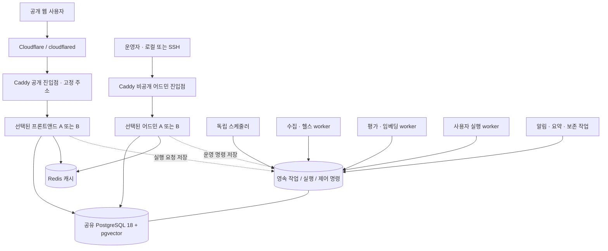

# 웹 무중단 배포와 백그라운드 서비스 독립 운영 설계

검토일: 2026-10-22 · 대상: Agent Concierge · 상태: 설계 제안, 운영 변경 미실시

## 1. 권고 결정

현재의 네이티브 macOS 실행 환경과 PostgreSQL 18 + pgvector를 유지하면서 구현할 수 있다. **고정 진입점 Caddy + 프론트앤드 A/B + 어드민 백앤드 A/B + 독립 작업 서비스**를 권고한다. 프론트앤드와 어드민은 서로 다른 프로세스·기동 명령·배포 상태·롤백 대상으로 관리한다. 수집·평가·헬스체크는 웹 배포와 관계없이 계속 실행한다.

일반 배포는 **기존 A 운영 → 새 B 기동·검증 → B로 전환 → A의 진행 중 요청 완료 → A 대기**로 끝낸다. 다음 배포는 B에서 A로 전환한다. 본 서비스는 고정 포트나 A라는 이름이 아니라 현재 트래픽을 받는 역할이다.

사용자가 제안한 **A → B → A 왕복 전환도 가능**하다. 다만 정상 배포마다 두 번 전환하고 A를 다시 기동할 이유는 적다. 왕복이 필요한 운영 규정이 있을 때만, B에서 검증한 **동일한 배포 산출물**로 A를 기동하고 동일 검증을 거쳐 돌아간다. 이 경우 A의 이전 버전을 덮어쓰기 전에 별도 복귀용 산출물을 반드시 보존한다.

이 권고는 저장소·현재 프로세스 구조·논문·공식 문서·SNS 사례를 종합한 판단이다. 이 서버에서 대안별 부하 비교를 완료하여 수학적 최적성을 입증한 결과는 아니다. 이번 작업에서는 배포, 재시작, DB 변경, Cloudflare 설정 변경을 하지 않았다.

## 2. 현재 확인된 중단 원인과 제약

### 실행 구조

- 확인 시점에 동일 Python PID 31562가 `127.0.0.1:8200`과 `127.0.0.1:8400`을 함께 수신했다. 현재 프론트앤드와 어드민은 포트가 달라도 독립 재기동 단위가 아니다.
- `agentcon`은 하나의 `agent_market.gateway.server`를 기동한다. `restart`는 정지 후 시작하므로 수신 프로세스가 없는 구간이 생긴다. 시작 판정도 프로세스의 LISTEN 소켓 존재를 확인하는 방식으로, 실제 DB·로그인·페이지 준비 완료를 보증하지 않는다.
- `agent_market/gateway/server.py`에서 두 Uvicorn 서버를 함께 만들고 종료 신호를 공유한다. 프론트 초기 캐시 준비는 별도 스레드에서 이루어져 포트가 열려도 화면 데이터 준비가 끝나지 않을 수 있다.
- 같은 lifespan에서 `workspace_platform.start_for(front)`가 실행되며, Scheduler가 수집기와 여러 작업을 시작한다. **scheduler 설정만 끄는 것으로 모든 백그라운드 실행이 중단되는 구조가 아니다.** 현재 실행물을 그대로 두 개 띄우면 작업 중복 위험이 있다.
- `deploy/NATIVE_RUNTIME.ko.md`에는 Cloudflare Tunnel에서 로컬 HTTP 프론트앤드로 연결하는 네이티브 운영 구조가 기록되어 있다. `deploy/Caddyfile`의 `gateway:8200/8400`은 Docker용 예시다. 현재 Cloudflare 원격 대시보드의 설정값은 이번 검토에서 직접 조회하지 않았다.

### 작업 및 DB 경계

- `collector/agent.py`는 수집, 헬스, capabilities/auth/A2A, 레지스트리, 임베딩 등 여러 스레드를 시작한다.
- `workspace_platform.py`는 평가·자동 갱신·early-stop·operations 작업을 시작한다. 방문자 알림, 요약, 보존 정리, 저널 처리도 전체 시작/종료 경로에서 함께 분류해야 한다.
- 독립 실행 가능한 `workflow_worker.py`와 영속 실행 기반이 이미 있다. 그러나 `workspace_typed_flows.py`의 사용자 워크플로우 실행에는 웹 프로세스의 스레드 풀에서 실행하고 결과를 기다리는 경로가 남아 있다. 기존 worker를 켜는 것만으로 모든 실행이 독립되지는 않는다.
- `application_store_postgres.py`는 쓰기 트랜잭션에 공통 PostgreSQL advisory lock을 사용한다. `workspace_access._tx()`는 읽기 용도의 호출도 `BEGIN IMMEDIATE` 경로로 진입한다. 이 장치는 기존 무결성을 보호하지만 프로세스를 늘려도 일부 경로가 공통 잠금에서 대기할 수 있다. 실제 대기 시간은 별도 계측해야 한다.
- 제공자 연결 저장에는 revision 확인과 위 트랜잭션 보호가 존재한다. 단순히 프로세스 내부 lock만 있다고 판단하여 기존 보호를 제거하면 안 된다.
- `observation_guards.py`의 소유자·세대·순서 검증은 오래된 결과를 막는 기반이다. 외부 요청 자체의 중복 실행을 막는 작업 선점 장치와는 구별해야 한다.

## 3. 목표 구조: 서로 독립된 세 가지 배포 영역



### 프론트앤드 서비스

- 공개 홈·탐색·테스트·워크플로우·채팅·회원 로그인·워크스페이스와 이 화면들이 사용하는 API를 담당한다.
- OAuth callback, 쿠키·CSRF, 제공자 연결 API도 공개 서비스의 계약으로 관리한다. 운영자 어드민 서비스로 요청을 우회시키지 않는다.
- 현재 gateway가 제공하는 공개 `/needs`, `/offers/...`, `/agents/register`, `/sns/posts`, `/.well-known/agent.json` 등은 실제 라우트 목록과 소비자를 먼저 확인하여 공개 서비스에 장착할 수 있는 router로 추출한다. **어드민을 정지해도 공개 API가 같이 사라지지 않아야 한다.** 경로 목록은 기존 Caddy 예시만으로 확정하지 않는다.
- 읽기·권한 확인·작업 접수·결과 조회를 수행하며 스케줄러나 장기 작업을 소유하지 않는다.

### 어드민 백앤드 서비스

- 운영자 UI/API, 운영 현황·보고서·작업 제어·감사 기록을 담당한다. 프론트앤드와 다른 PID·포트·배포 명령으로 관리한다.
- 현재 dashboard가 참조하는 collector 등 메모리 객체를 제거하고, worker heartbeat 및 DB 상태를 읽고 영속 제어 명령을 기록한다.
- 수집 시작/정지 같은 명령은 권한 검사 후 명령 ID를 반환한다. worker가 처리 결과를 기록하면 UI에서 확인한다. 어드민 재시작으로 명령이 사라지거나 중복 적용되어서는 안 된다.
- 공개 호스트의 `/admin` 차단을 유지한다. 별도 공개 어드민 호스트를 임의로 만들지 않는다.

### 백그라운드 서비스

- 스케줄러: 실행 시각 계산과 중복 없는 작업 등록만 담당한다. 작업 자체를 긴 시간 실행하지 않는다.
- 수집·헬스: 제공자 수집, 연결 확인, capabilities/auth/protocol 검사. 제공자별 속도 제한과 큐 우선순위를 둔다.
- 평가·임베딩: 평가와 벡터 갱신. CPU·메모리·모델 자원 사용량에 따라 수집과 독립적으로 동시성을 제한한다.
- 사용자 실행: 테스트, 워크플로우, 외부 에이전트 실행. 사용자 작업을 대량 배치 작업보다 우선 처리한다.
- 유지 관리: 알림·요약·보존 정리·저널 등. 데이터 보존과 발송 동의 규칙을 그대로 유지한다.

처음부터 모든 기능을 각각의 마이크로서비스로 만들 필요는 없다. 첫 분리는 **웹 두 서비스 / 기존 작업 묶음 / 사용자 실행 worker**로 하고, 작업 묶음 내부를 공통 영속 큐와 역할별 동시성으로 정리한 후 자원 간섭이 확인되는 평가·임베딩부터 독립 프로세스로 분리한다. 최종 역할 경계와 단계별 실제 프로세스 수를 구분한다.

## 4. 네이티브 운영과 독립 배포 관리

Docker나 Kubernetes 도입 없이 macOS `launchd`로 서비스별 기동·종료·재시도·로그를 관리할 수 있다. 로그인 세션 종료와 무관한 상시 운영은 전용 저권한 계정의 LaunchDaemon 구성을 검토한다. 사용자 LaunchAgent는 로그인 세션에 종속된다. 설치와 실제 권한 변경은 구현 단계에서 별도로 진행한다. [Apple launchd 문서](https://developer.apple.com/library/archive/documentation/MacOSX/Conceptual/BPSystemStartup/Chapters/CreatingLaunchdJobs.html)

제안하는 내부 포트 예시는 다음과 같다. 아직 적용한 값이 아니며 사용 가능 여부를 먼저 검사한다.

- 공개 Caddy: `127.0.0.1:9000`, cloudflared의 고정 origin.
- 비공개 어드민 Caddy: `127.0.0.1:9001`, 로컬/SSH 접근.
- 프론트앤드 A/B: `127.0.0.1:8401 / 8402`.
- 어드민 A/B: `127.0.0.1:8201 / 8202`.
- 작업 서비스: 공개 수신 포트 없음. 내부 상태 조회가 필요하면 권한 제한 소켓을 사용한다.

공개 호스트는 고정하고 배포마다 DNS나 Cloudflare origin을 바꾸지 않는다. Tunnel이 로컬 서비스로 연결되는 공식 지원 방식 위에 고정 프록시를 추가하는 설계다. [Cloudflare published applications](https://developers.cloudflare.com/cloudflare-one/networks/connectors/cloudflare-tunnel/routing-to-tunnel/)

**제안 명령 계약 — 현재 제공되는 명령이 아님:**

```text
agentcon deploy frontend --release <id>
agentcon deploy admin --release <id>
agentcon rollback frontend --release <previous-id>
agentcon rollback admin --release <previous-id>
agentcon worker status
agentcon worker drain <role>
agentcon worker deploy <role> --release <id>
agentcon status --services
```

기존 전체 `restart`와 별도로 구현하며 넓은 프로세스 이름 검색으로 다른 슬롯까지 종료하지 않게 한다. 서비스·슬롯별 launchd label과 실제 PID/프로세스 시작 시각을 확인해야 한다. frontend 배포는 admin·worker를 재시작하지 않고 admin 배포도 frontend·worker를 재시작하지 않는다.

두 독립 배포가 같은 Caddy 설정을 갱신하므로 **공통 프록시 변경 잠금과 설정 revision 검사**가 필요하다. 프론트 배포는 최신 설정의 프론트 라우트만 바꾸고 어드민의 활성 슬롯을 보존한다. 어드민 배포도 대칭적으로 동작한다. 서로 다른 오래된 설정 전체를 덮어쓰는 경쟁을 막는다.

각 프로세스는 `releases/<release-id>/`의 고정된 소스·정적 자산·의존성으로 실행한다. 실행 중인 디렉터리나 공용 가상환경을 덮어쓰지 않는다. worker도 별도의 고정 release를 사용하여 웹 파일 수정이 실행 중인 worker의 동적 import나 템플릿에 영향을 주지 않게 한다. 비밀키·DB·로그·업로드는 release 밖의 권한 제한 저장소에 둔다.

## 5. 무중단 전환 상태와 실패 처리

### 서비스 하나의 정상 배포

1. **PREPARE**: 서비스별 배포 잠금 획득. 현재 슬롯·release·스키마 호환 범위·복귀 대상을 기록한다. 디스크·메모리·DB 연결 여유를 확인한다.
2. **START**: 비활성 슬롯에 새 release를 기동한다. 이 프로세스는 웹 전용이며 작업을 자동 시작하지 않는다. 기존 슬롯은 계속 서비스한다.
3. **VERIFY**: 내부 readiness와 실제 라우트·자산·인증 경계 검사를 통과시킨다. DB 호환성과 캐시 준비를 확인한다. readiness 실패 시 후보만 종료하고 기존 서비스는 유지한다.
4. **SWITCH**: 공통 프록시 변경 잠금 아래 최신 설정을 읽고 해당 서비스 upstream만 교체한다. 전체 후보 설정을 검증한 뒤 Caddy의 단일 원자적 설정 로드로 적용한다. 적용 후 실제 활성 설정과 신규 응답을 대조한다.
5. **OBSERVE / DRAIN**: 신규 요청은 새 슬롯으로 보낸다. 이전 슬롯은 이미 받은 요청과 연결을 마무리한다. 오류율·지연·세션·실행 결과를 관찰한다. 실제 완료 상태와 연결 정책을 보고 종료하며 고정 sleep만으로 판단하지 않는다.
6. **RETAIN**: 이전 release와 복귀 설정을 보존한다. 자원 여유가 있으면 안정화 기간 동안 이전 프로세스를 유지하고, 아니면 drain 완료 후 정지한다. 다음 배포는 반대 슬롯을 사용한다.

Caddy의 단일 설정 로드는 실패 시 이전 설정을 유지하도록 설계되어 있다. 그러나 여러 API 요청 전체가 하나의 트랜잭션은 아니므로 분할 수정 대신 검증된 한 구성과 동시 변경 제어를 사용한다. [Caddy API](https://caddyserver.com/docs/api)

### 오류와 복귀

- 후보가 준비되지 않음: 전환 금지. 기존 서비스 유지.
- 프록시 변경이 실패함: 실제 활성 구성을 읽어 현재 서비스 확인. 불확실한 상태에서 어느 슬롯도 먼저 종료하지 않음.
- 새 버전의 로그인/핵심 API 실패: 이전 버전과 현재 DB가 호환되고 이전 슬롯이 준비되어 있을 때 해당 서비스만 복귀.
- 배포 스크립트가 중간 종료됨: 저장된 배포 단계와 실제 프록시·PID·release 상태를 비교하여 재개. 명령 재입력으로 두 번째 전환을 시작하지 않음.
- 프론트와 어드민이 함께 변경됨: 기본은 독립 배포. 공통 API 변경은 새/구버전 호환을 먼저 확보하고 필요한 경우 명시적인 묶음 배포로 두 후보를 검증한 뒤 전환.
- 외부 실행의 응답을 잃음: 실행 여부를 조회하여 복원. 동일 유료 실행이나 외부 쓰기를 프록시에서 자동 재전송하지 않음.
- DB 스키마가 구버전과 호환되지 않음: 무조건 앱만 되돌리지 않음. 호환 수정으로 전진하거나 별도 복구 절차 적용. 운영 DB를 과거 백업으로 자동 덮어쓰지 않음.

### 요청·스트리밍·사용자 입력 보호

기존 요청은 완료시키고 새 요청만 이동한다. Uvicorn의 정상 종료 대기와 배포 관리자의 종료 기한을 일치시킨다. 긴 사용자 작업은 HTTP 요청 수명에서 분리한다. [Uvicorn server behavior](https://uvicorn.dev/server-behavior/)

Caddy는 기본 설정에서 reload 때 WebSocket을 닫을 수 있다. `stream_close_delay`, 서버 drain, 클라이언트 재접속을 함께 설계한다. SSE는 영속 실행 ID/이벤트 순번으로 이어받고, WebSocket 재접속은 작업 신규 생성과 분리한다. 무한 연결을 영원히 유지하여 이전 버전을 제거할 수 없게 만들지 않는다. [Caddy reverse_proxy](https://caddyserver.com/docs/caddyfile/directives/reverse_proxy)

브라우저를 강제 새로고침하지 않는다. 홈 외 화면의 입력·필터·워크플로우 편집 상태를 유지한다. 세션 검사 완료 전에 보호 화면을 노출하지 않고, 연결 재개 시 같은 실행 ID의 상태만 복구한다. 기존 JS를 가진 탭이 새 API를 호출할 수 있으므로 최소 N/N-1 API 호환성을 유지한다.

## 6. 공유 상태와 보안 경계

- 로그인 세션, OAuth state/PKCE, CSRF, 권한 철회, 제공자 자격 증명, 실행 권한 및 서명 키는 슬롯 간 일관되어야 한다. 프로세스 메모리에만 있는 상태를 찾아 영속 저장 또는 안전한 공유 저장으로 옮긴다.
- A에서 OAuth를 시작하고 B에서 callback을 받아도 성공해야 하며, state 재사용은 계속 차단해야 한다. 슬롯별로 다른 세션 쿠키 이름을 만들지 않는다.
- 현재 persistent workflow key를 포함해 동일 서비스의 암호화·서명 키를 일관되게 로드한다. key rotation은 배포와 분리하여 이전 키 검증 기간을 둔다.
- 고객별 캐시는 workspace/user/권한 revision을 포함하고 다른 사용자에게 공유되지 않게 한다. 공용 통계와 공개 검색 캐시만 공통으로 사용한다. 개인정보 응답에 CDN 공용 캐시를 적용하지 않는다.
- 자산은 내용 hash URL로 제공하고 이전 버전 자산을 호환 기간 동안 유지한다. 프록시 전환 후 기존 HTML이 참조하는 CSS/JS가 404가 되면 안 된다.
- readiness·배포 상태·release ID는 내부 관리용이다. 비밀키, 내부 경로, 상세 예외는 공개 화면이나 응답에 노출하지 않는다.
- Cloudflare → 로컬 HTTP Caddy에서는 Caddy가 보는 scheme이 HTTP일 수 있다. 저장소 Docker 예시의 `X-Forwarded-Proto {scheme}`를 그대로 복사하면 기존 HTTPS·Secure 쿠키 판단을 깨뜨릴 수 있다. **신뢰된 cloudflared 연결과 검증된 전달 헤더만 허용**하거나 전용 터널 listener에서 정해진 외부 HTTPS origin을 사용한다. 임의 클라이언트 전달 헤더는 신뢰하지 않는다.
- Caddy 관리 API는 권한 제한 Unix socket 등으로 보호하고 외부에 공개하지 않는다. 설정 변경 권한과 앱 실행 권한을 구분한다.

## 7. 작업 영속화와 중복 방지

기존 영속 실행 시스템을 우선 재사용한다. 새로운 큐를 추가하기 전에 기존 runs/jobs/관측 기록의 상태·소유권 모델을 대조하여 동일 작업이 두 엔진에서 실행되지 않게 한다.

### 제안 작업 계약

작업에는 `job_id`, `kind`, `target_id`, `payload_version`, `dedupe_key`, `scheduled_at`, `state`, `attempt`, `lease_owner`, `lease_until`, `fencing_token`, `result_ref`를 둔다. 상태는 queued → running → succeeded/failed/cancelled이며 결과를 모르면 reconciliation_required로 분리한다. 실제 테이블 이름과 기존 스키마 통합은 구현 때 확정한다.

- 스케줄러: `(작업 종류, 대상, 입력 revision, 실행 주기)`로 의도한 논리 작업을 유일하게 등록한다. 외부 제공자 수집 커서와 다음 실행 시각도 영속화한다. 누락된 모든 주기를 한꺼번에 재생할지 최신 한 번으로 합칠지는 작업별 정책으로 정한다.
- worker 선점: 짧은 트랜잭션에서 `FOR UPDATE SKIP LOCKED`로 작업을 선택하고 lease·fencing token을 갱신한 뒤 커밋한다. 외부 요청은 트랜잭션 밖에서 수행한다. 이는 일반 조회가 아닌 큐 소비에 적용한다. [PostgreSQL 18 SELECT](https://www.postgresql.org/docs/18/sql-select.html)
- heartbeat: DB 시각 기준으로 lease를 연장한다. 만료된 소유자의 결과는 token 대조로 반영하지 않는다. 단, fencing은 외부 공급자가 이미 처리한 요청 자체를 되돌려주지 않는다.
- 효과 중복 방지: 실행 ID·보고서 유일 제약·공급자 idempotency key를 사용한다. 보고서는 논리 실행 ID와 생성 정책을 구분하여 저장 재시도는 중복 보고서를 만들지 않고, 사용자가 의도적으로 새 테스트를 실행한 이력은 유지한다.
- 보장 수준: 기본은 **적어도 한 번 실행 가능성 + 중복 효과 방지**다. 공급자의 idempotency/조회 기능이 없으면 유료 호출·외부 쓰기를 정확히 한 번 수행한다고 보장할 수 없다. 응답 유실은 자동 재실행 대신 확인 대기로 둔다.
- DB 변경과 후속 이벤트는 같은 트랜잭션에 기록하는 outbox를 사용한다. 알림·캐시 무효화는 outbox consumer가 처리한다.
- `LISTEN/NOTIFY`는 깨어나기 신호만 담당하고 실제 미처리 작업은 DB에서 찾는다. 연결이 끊겼다가 복귀해도 작업이 누락되지 않게 한다. [PostgreSQL LISTEN](https://www.postgresql.org/docs/18/sql-listen.html)
- 재시도는 지수 backoff와 jitter, 제공자별 rate limit, 최대 횟수·격리 큐를 둔다. 헬스 실패 폭증이 수집·사용자 실행을 잠식하지 않게 역할별 동시성 예산을 둔다.

### 사용자 실행 이관

현재 웹 스레드의 typed workflow 실행을 `권한 확인 → 실행 레코드와 작업 저장 → 202 + run_id → 상태 조회/이벤트 구독` 계약으로 바꾼다. 기존 동기 API 소비자가 있다면 호환 adapter를 두되 웹 프로세스가 실행의 유일한 소유자가 되어서는 안 된다. 연결 허용 범위·사용자 승인·크레딧 예약/정산·취소 규칙을 worker에서 재검증한다. 실행 도중 권한이 철회되었을 때도 정책을 일관되게 적용한다.

관리 UI와 웹을 모두 재시작해도 같은 run_id가 계속 진행되어야 한다. worker 자체 배포에서는 새 작업 선점을 중단하고 현재 작업을 마무리하거나 영속 checkpoint를 남긴 후 교체한다.

## 8. PostgreSQL·pgvector와 자원 효율

**현재 PostgreSQL 18 + pgvector를 유지한다.** 이번 요구 때문에 DB를 다시 교체하거나 A/B별 운영 DB를 복제하지 않는다. 두 앱 버전과 작업 서비스가 같은 원본 데이터를 읽고 쓴다. 백업은 복구 수단이지 앱 배포 때의 자동 DB 롤백 수단이 아니다.

현재 호환 어댑터의 공통 writer lock은 무결성 보호를 위해 유지된 장치다. 제거에 앞서 lock wait, 트랜잭션 길이, 스키마 검증 비용과 관련 테스트를 계측한다. 이후 작업 큐 선점은 전용 native PostgreSQL repository·연결 풀로 분리하고, 카탈로그·워크스페이스·연결 자격 증명·보고서 쓰기는 업무별 행 잠금/유일 제약/CAS로 단계적으로 축소한다. SQL 등록 제약이 있는 기존 어댑터에 검증 없이 임의 큐 SQL을 추가하지 않는다. 새 native 경로에도 tenant·권한·감사·무결성 검증을 적용한다.

역할별 DB 풀을 제한한다. **활성 웹 + 준비 중인 후보 + drain 중 이전 슬롯 + 모든 worker + 관리 여유**의 연결 합계로 예산을 계산한다. 기존 프로세스별 reader pool이 A/B에서 배가된다는 점을 반영한다. frontend와 admin 동시 배포는 메모리 예산이 검증되기 전에는 직렬화한다.

Redis는 캐시와 필요한 공유 상태의 보조 수단으로 사용한다. 작업 원장·보고서·실행 결과의 최종 원본은 PostgreSQL이다. 데이터 revision과 캐시 형식 version으로 무효화하며 배포 때 Redis 전체 삭제를 하지 않는다. 홈 통계와 어드민 요약은 사전 집계·짧은 TTL·안전한 stale 응답을 조합하고, 개인정보·권한 캐시는 보수적으로 처리한다.

임베딩은 증분 처리하며 웹 시작 시 전체 재색인하지 않는다. 모델/차원 변경은 새 컬렉션·열·인덱스 버전을 준비하고 검증 후 읽기 경로를 바꾸는 별도 작업이다. 모델 서버는 웹 A/B마다 중복 기동하지 않는다.

DB 변경은 **확장 → 배치 backfill → 신구 병행 검증 → 새 코드 전환 → 복귀 기간 종료 후 축소** 순서로 한다. 논문은 DB 스키마 진화가 앱 프로세스 교체와 별도 문제임을 보여준다. QuantumDB/Tesseract 연구 구현을 PostgreSQL 18에서 바로 사용할 수 있다는 뜻은 아니다. [de Jong 외, ICSE-SEIP 2017](https://doi.org/10.1109/ICSE-SEIP.2017.5), [Hu 외, Online Schema Evolution](https://arxiv.org/abs/2210.03958)

## 9. 구현 순서와 완료 기준

### 단계 1 — 책임 분리와 현재 동작 보존

- `gateway/server.py`의 app 조립과 lifespan을 public/admin/jobs 역할로 분리한다.
- frontend·admin은 각자 별도 진입점·PID·포트·종료 제어를 갖는다. `workspace_platform.start_for`, Scheduler, collector, 알림 등 암묵적 worker 시작을 웹 경로에서 제거한다.
- 공개 API router와 어드민 router를 분리하고 dashboard의 직접 객체 제어를 영속 명령으로 바꾼다.
- 통과 기준: 어드민만 종료해도 공개 핵심 API가 동작하고, 프론트만 종료해도 어드민·수집이 계속 동작한다. 격리 환경에서 검증한다.

### 단계 2 — 실행 지속성과 DB 동시성

- 기존 workflow worker에 typed workflow 실행을 통합한다. lease·fencing·중복 방지·job payload 호환성을 검증한다.
- 작업 큐 전용 DB 경로와 역할별 풀을 정리한다. 기존 전역 보호 제거는 별도 회귀 검증 후 적용한다.
- 통과 기준: 웹 교체 중 실행과 수집이 이어지고, 재시도·응답 유실·lease 만료에서 중복 보고서/외부 효과를 통제한다.

### 단계 3 — A/B 전환과 독립 배포 명령

- immutable releases, frontend/admin 각 A/B, 내부 live/ready, 공통 프록시 설정 잠금, 배포 상태 기록, rollback 명령을 구현한다.
- Caddy 네이티브 설정과 launchd 서비스 파일을 별도로 작성한다. 기존 Docker 설정을 그대로 재사용하지 않는다.
- 통과 기준: 프론트 배포 시 어드민·worker PID/시작 시각이 바뀌지 않고, 어드민 배포 시 프론트·worker가 바뀌지 않는다. 한쪽 배포 실패가 다른 쪽 트래픽 설정을 되돌리지 않는다.

### 단계 4 — 최초 운영 이행

- 기존 단일 프로세스에 작업 lease/정지 제어가 없는 상태에서 새 worker를 겹쳐 실행하지 않는다.
- 가능한 경우 기존 수집 신규 선점만 멈추고 진행 중 작업을 drain한 뒤 독립 worker에 소유권을 넘긴다. 이 동안 기존 웹은 서비스한다.
- 기존 코드에서 온라인 작업 정지가 불가능하면 최초 분리 적용에는 한 번의 계획된 작업 정지 또는 재기동이 필요할 수 있다. 최초 이행부터 무조건 무중단이라고 약속하지 않는다.
- Caddy를 기존 서비스 앞에 설치하는 최초 Tunnel origin 변경도 별도 검증한다. 이후 배포부터 고정 origin을 사용한다.
- 실제 변경·재기동은 검증 결과와 구체적인 전환/복귀 절차가 준비된 뒤 진행한다.

### 단계 5 — 작업 서비스 세분화와 용량 최적화

- 수집/헬스와 평가/임베딩의 자원 간섭을 측정해 프로세스 분리를 확장한다.
- 서비스별 CPU·RSS·DB lock wait·큐 대기·실행 지연·실패율·캐시 적중률을 측정한다. 하드웨어 여유에 맞춰 후보 슬롯 기동을 제한한다.
- 로그는 서비스·release·요청/작업 ID·결과·지연 중심으로 남기고, 반복 성공 로그는 집계한다. 회전·보존 정책을 유지하고 민감정보를 넣지 않는다.

## 10. 배포 승인용 검증 항목

아래는 앞으로 수행할 검증이며 이번 설계 검토에서 통과했다고 주장하는 항목이 아니다.

1. 홈·탐색·테스트·워크플로우·채팅·회원/워크스페이스·푸터·어드민을 지속 요청하면서 frontend A→B, 다음 배포 B→A를 수행한다. 전환으로 인한 연결 실패·5xx·자산 404를 구분 기록한다.
2. admin만 배포하고 프론트 세션·공개 API·사용자 입력·worker PID가 유지되는지 확인한다. frontend만 배포하는 반대 시험도 수행한다.
3. A에서 시작한 Google/GitHub 로그인 callback을 B에서 처리한다. 로그인 유지, 로그아웃·세션 철회, CSRF 거부, OAuth state 일회성을 확인한다.
4. 실행 요청 접수 직후·외부 응답 직후·결과 커밋 직전에 프로세스를 교체한다. 같은 run_id의 결과를 복구하고 외부 실행·크레딧·보고서가 중복 처리되지 않는지 확인한다.
5. worker lease 만료와 이전 worker의 늦은 응답을 재현한다. 오래된 결과를 거부하고 부작용이 불확실한 실행을 확인 대기로 남기는지 검증한다.
6. SSE/WebSocket과 긴 다운로드를 전환 중 유지하거나 안전하게 복구한다. 기존 브라우저 탭의 편집 내용과 구버전 자산을 보존한다.
7. 잘못된 프록시 설정·후보 DB 오류·미준비 캐시·배포 명령 중복·배포 프로세스 중단을 주입한다. 실제 활성 슬롯을 확인하고 이전 서비스를 성급히 종료하지 않는지 검사한다.
8. 실제 peak 동시 접속·검색·실행을 반영한 부하에서 후보 추가 기동 시 RSS·DB 연결·lock wait·p95를 기록한다. 현재 측정값 없이 임의 처리량을 약속하지 않는다.
9. 공개 `/admin` 차단, 전달 헤더 위조, 후보 포트 직접 접근, 워크스페이스 간 캐시 누출, 세션/키 노출에 대한 동적 보안 회귀를 격리 데이터로 수행한다.
10. frontend/admin 양쪽 배포를 동시에 요청해 공통 프록시 변경 충돌과 자원 초과가 방지되는지 확인한다. 원자적 설정 교체와 서비스별 롤백을 검증한다.

내부 `/internal/live`, `/internal/ready`는 새로 설계할 경로다. live는 프로세스의 최소 응답, ready는 DB·스키마·필수 키·핵심 라우트·필요 캐시 준비를 확인한다. 외부 공급자의 일시 장애가 모든 웹 페이지의 readiness 실패로 확대되지 않도록 기능별 degraded 상태를 구분한다. 단순 포트 열림이나 기존 `/health`의 전체 집계를 ready로 사용하지 않는다.

최초 합격 목표는 **전환 때문에 발생한 실패 0건, 인증 경계 오류 0건, 의도하지 않은 중복 외부 실행 0건, 입력 소실 0건**이다. 이는 시험 합격 기준이며 모든 미래 장애에 대한 보장이 아니다. 시간·부하 표본·응답 지연 임계값은 기존 서비스 측정 후 확정한다.

## 11. 논문·공식 문서·SNS 검토의 해석

- **ICSE-SEIP 2017 / de Jong 외**: DB 스키마 변경을 포함한 무중단 배포 연구. 이 설계에는 신구 코드 동시 실행 기간의 데이터 호환성을 독립 배포 조건으로 반영했다. 특정 연구 도구 채택은 제안하지 않는다. [논문](https://research.tudelft.nl/en/publications/zero-downtime-sql-database-schema-evolution-for-continuous-deploy/)
- **OSDI 2016 / Slicer**: 요청 전달과 배치 판단을 분리한 설계. 프록시의 요청 처리 경로에서 배포·수집 판단을 분리하는 원칙의 근거로 참고했다. Google의 규모나 성능 수치를 이 서비스에 적용하지 않는다. [논문](https://www.usenix.org/conference/osdi16/technical-sessions/presentation/adya)
- **Hu 외 / Online Schema Evolution is (Almost) Free for Snapshot Databases**: 온라인 스키마 변경의 연구 사례. PostgreSQL 기본 기능만으로 모든 DDL이 무잠금이라는 주장의 근거로 사용하지 않았다. [논문](https://arxiv.org/abs/2210.03958)
- **Google SRE distributed periodic scheduling**: 주기 작업의 소유권·장애·중복 제어를 별도 문제로 다룬다. 스케줄 등록과 실행 worker를 분리하고 영속 작업 ID를 두는 설계에 참고했다. [운영 지침](https://sre.google/sre-book/distributed-periodic-scheduling/)
- **Reddit r/devops — Kubernetes 없이 무중단 배포**: 프록시 전환·health check·진행 중 요청 완료를 조합한 운영 경험이 논의된다. 현재 단일 호스트에 Kubernetes를 우선 도입할 필요가 낮다는 판단의 보조 자료다. 익명 경험담이며 검증된 성능 자료가 아니다. [SNS 토론](https://www.reddit.com/r/devops/comments/1p8vyxi/zero_downtime_deployments_without_kubernetes/)
- **Reddit r/devops — blue/green DB 동기화**: 앱 배포와 DB 복제/복귀를 혼동하는 운영 어려움이 논의된다. 공유 DB와 호환 스키마를 택하되 근거는 논문·DB 문서로 확인했다. [SNS 토론](https://www.reddit.com/r/devops/comments/1c4g71a/)
- **Caddy 유지관리자 논의**: reload 시 WebSocket 종료가 기본 동작임을 확인하는 자료다. 공식 옵션 설명과 함께 연결 연속성 설계에 반영했다. [개발자 토론](https://github.com/caddyserver/caddy/issues/7222)

현재 선택은 네이티브 A/B 배포다. Uvicorn worker reload만으로는 수집 분리·스키마 호환·프론트/어드민 독립 운영을 해결하지 못한다. 지금 Kubernetes까지 도입하면 제어 계층과 운영 부담이 늘어난다. 여러 호스트·복제본 자동 배치가 필요해질 때 재평가한다. 장기 실행의 재시도·보상·분기 복구 요구가 크게 증가하면 Temporal 같은 외부 워크플로우 엔진도 별도 비용/전환 비교 대상으로 삼되 이번 단계의 필수 의존성으로 추가하지 않는다.

## 12. 보장 범위와 남은 확인

이 구조는 **앱 소스 배포·프로세스 재기동으로 인한 서비스 중단을 줄이는 구조**다. 한 Mac의 전원·절전·네트워크·Caddy·PostgreSQL 장애까지 견디는 고가용성은 아니다. 해당 수준이 필요하면 두 번째 호스트, 프록시/터널 다중화, DB 복제·복구까지 별도 설계해야 한다.

구현 전 남은 확인은 실제 Cloudflare origin/신뢰 헤더 설정, 각 로그인/실행 상태의 영속 위치, 두 슬롯 동시 기동 메모리 예산, DB 잠금 대기, 현재 공개 API 소비자와 스키마 호환 범위다. 운영 설정을 변경하기 전에 이 항목과 격리 회귀 결과를 완료 조건에 포함한다.
